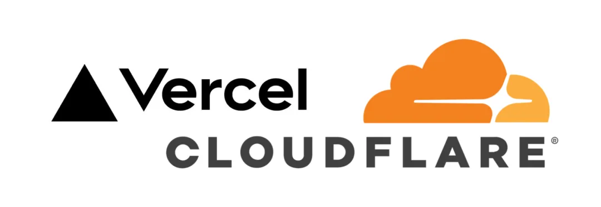
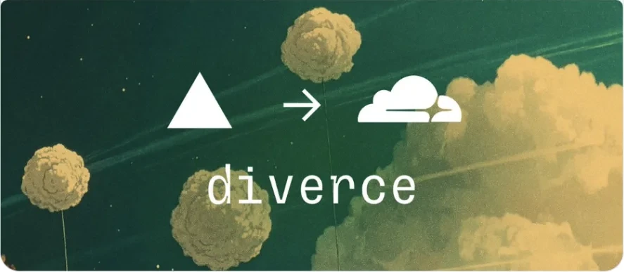
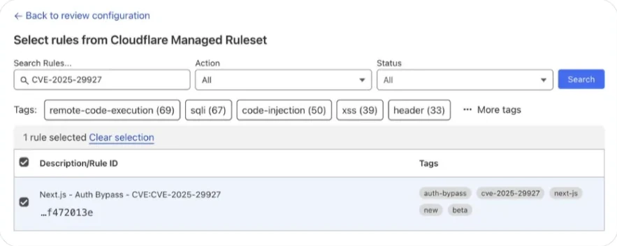
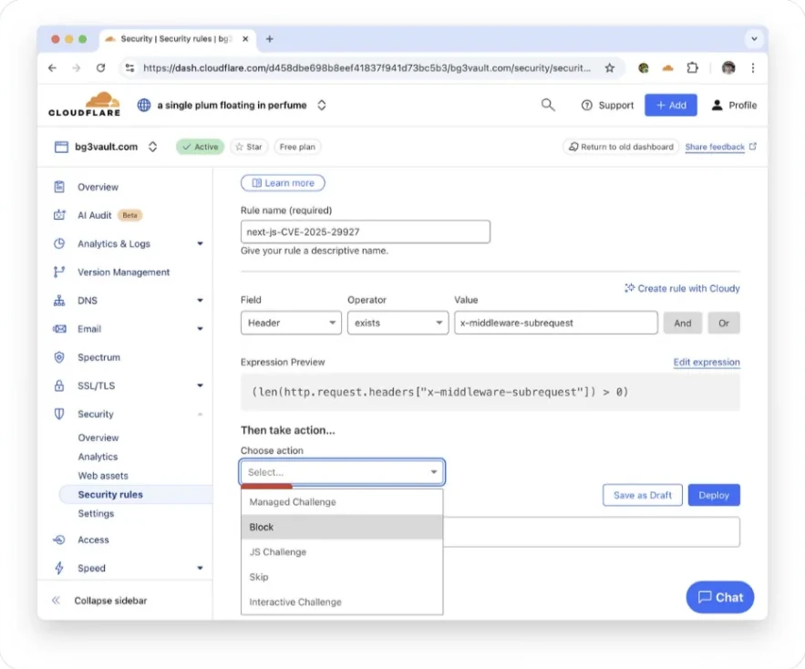

赛博佛祖 Cloudflare CEO 与赛博菩萨 Vercel CEO 在 X 上中门对狙，互相嘲讽甚至还做了梗图，堪称互联网一大奇景。

Cloudflare 是一家著名的 CDN/网络安全/SaaS 云厂商，因为提供慷慨的免费计划而广受开发者好评，承载了几乎 20% 的全球互联网流量，被一些开发者尊称为 “[赛博佛祖](/cloud/cloudflare/)”。Vercel 则是前端界的扛把子，凭借一手 Next.js 绝活，深受开发者青睐，基本成为各类网站的新一代标配，它也有着很慷慨的免费计划，因此被人戏称为 “赛博菩萨”。

这两家都算是全球互联网的关键基础设施了，一个在 CDN 领域呼风唤雨，一个在前端生态风生水起。按理说，这两位也算江湖同道，各忙各的就好，偏偏最近却结下了新“梁子”。Cloudflare 的 的 CEO Matthew Prince 和 Vercel 的 CEO Guillermo Rauch 在推特上毫无形象的大打出手，成为了互联网上一道靓丽的风景线……

> [!SOCIAL] Matthew Prince `@eastdakota`
>
> 省钱、获得更好性能，并与一家真正重视安全的公司合作。#nobrainer
>
> > [!SOCIAL] brandon `@burcs`
> >
> > 现在发布这个工具似乎正是时候……
> >
> > 自动转换你的 @vercel Next.js 项目，并部署到 @CloudflareDev
> >
> > 
> {avatar="avatar-burcs.webp" date="2025-03-23"}
{avatar="avatar-eastdakota.webp" date="2025-03-23" platform="x"}

> [!SOCIAL] Guillermo Rauch `@rauchg`
>
> Cloudflare 造成了互联网历史上最严重的安全灾难之一[1]
>
> 我们曾尝试使用你们的产品，但事故接连不断，最后不得不迁走。
>
> 我们每天都在帮你们缓解转发过来的 DDoS 攻击（你们太慢了）。
>
> 尽管你们不断放冷枪搞卑鄙的攻击，我们仍在与你们的团队沟通，希望未来能更好地协作。我们想要一个安全的 Web。
>
> [1] [en.m.wikipedia.org/wiki/Cloudbleed](https://en.m.wikipedia.org/wiki/Cloudbleed)
{avatar="avatar-rauchg.webp" date="2025-03-23" platform="x"}

> [!SOCIAL] Matthew Prince `@eastdakota`
>
> 
{avatar="avatar-eastdakota.webp" platform="x"}

Cloudflare CEO：（把你的 Vercel 应用一键迁移到 Cloudflare 上！）节省资金、获得更好的性能、并与真正关心安全的公司合作。

Vercel CEO：Cloudflare 造成了互联网历史上最严重的安全灾难之一：我们尝试使用您的产品但不断出现事故，所以不得不放弃。我们每天都要解决您转发给我们的 DDoS 攻击（您太慢了）。尽管你们不断进行卑鄙的攻击，我们仍与你们的团队保持联系，以便将来更好地合作。我们想要一个安全的网络。

Cloudflare CEO：呵呵，锤扁你个三角男（视频）

[嵌入媒体](https://mp.weixin.qq.com/mp/readtemplate?t=pages/video_player_tmpl&action=mpvideo&auto=0&vid=wxv_3912539061054930957)

## 前因后果

故事的起因很简单：Next.js 出了个非常幽默的高危漏洞，一旦被利用，就相当于给小偷留了后门，直接绕过登录做想做的事。

> [!SOCIAL] NadeshikoManju@摇曳露营 S4 制作确定! `@Manjusaka_Lee`
>
> Next.js 极高危(评分: 9.1/10), 利用极为简单的鉴权漏洞, 大家请尽快升级自己已有项目
>
> **[CVE-2025-29927 - GitHub Advisory Database](https://github.com/advisories?query=CVE-2025-29927)**：Authorization Bypass in Next.js Middleware
{avatar="avatar-manjusaka-lee.webp" date="2025-03-22" platform="x"}

> [!SOCIAL] dmesg -w | grep mixdev `@usrbinmix`
>
> 这个洞太幽默了，无论是从问题的产生还是修复的方式……
> 而且这个修复 commit 一眼还有问题，如果同时有两个请求在同一个 globalThis 上这个 subrequest id 绝对会冲突
{avatar="avatar-usrbinmix.webp" date="2025-03-22" platform="x"}

> [!SOCIAL] winter `@winter_cn`
>
> 我是认真建议别让前端写服务端代码……
{avatar="avatar-winter-cn.webp" date="2025-03-22" platform="x"}

> [!SOCIAL] ke su `@kesu1213172`
>
> nextjs做的项目真的很卡，难道只有我一个人卡吗
{avatar="avatar-kesu1213172.webp" platform="x"}

Vercel 作为 Next.js 的金主爸爸，刚被推上“欠解释、缺修复”的风口浪尖，Cloudflare 这边就先拿出补丁，摆出一副“我先替你们收拾烂摊子”的姿态。还在 X 上抛出几句酸溜溜的嘲讽。就像一个隔壁大哥突然跑到你家门口说：“房顶漏了，我给你搭好防水布啦。对了，你们家装修可真够脆弱的嘛。” 这搁谁家听了，不恼也难。

> [!SOCIAL] Brayden Wilmoth `@BraydenWilmoth`
>
> 免费想法：当你自己得知 CVE 漏洞时就立刻告知开发者，而不是 5 天之后。
>
> > [!SOCIAL] Guillermo Rauch `@rauchg`
> >
> > Free ideas 🧵
> {avatar="avatar-rauchg.webp" date="2025-03-23"}
{avatar="avatar-braydenwilmoth.webp" date="2025-03-23" platform="x"}

Cloudflare 自己修了这个问题，然后转了个贴，揶揄 Rauch 爆出这么大漏洞拖延瞒着不告诉开发者，还在搞些扯犊子的 “免费想法”。

> [!SOCIAL] Matt Silverlock `@elithrar`
>
> 规则已全量上线：[New Managed WAF rule for Next.js CVE-2025-29927](https://developers.cloudflare.com/changelog/)
>
> 目前尚未收到误报反馈（如果你受到影响，请随时告知我们）。我们观察到来自 VPS 服务商 ASN 的拦截比例显著偏高，这通常是恶意流量或漏洞扫描的典型特征。
{avatar="avatar-elithrar.webp" date="2025-03-22" platform="x"}

> [!SOCIAL] Matt Silverlock `@elithrar`
>
> 即将完成全量推送：
>
> 
{avatar="avatar-elithrar.webp" date="2025-03-22" platform="x"}

> [!SOCIAL] Matt Silverlock `@elithrar`
>
> 我们（@cloudflare）即将部署一条自动 WAF 规则，拦截可能绕过 Next.js 鉴权中间件的请求，包括尚未打补丁的版本。
>
> 你现在也可以在**任意**套餐下，前往控制台的 `<website> > Security > WAF > Create rule` 手动创建一条 WAF 规则：
>
> 
>
> > [!SOCIAL] Dane Knecht `@dok2001`
> >
> > 如果你在使用 @nextjs，可以在 @Cloudflare 上创建一条简单的防火墙规则来为项目打补丁。我们正在加紧推出内置规则。
> {avatar="avatar-dok2001.webp" date="2025-03-22"}
{avatar="avatar-elithrar.webp" date="2025-03-22" platform="x"}

最后点燃战火的是这条推特：Matthew 转发了这条叫 “Diverce” 的服务，号称能“一键把 Vercel 上托管的 Next.js 应用通通迁移到我家来”。这招就更像当面骑脸了：你这个 Next.js 的爹不行啊，还是来我们这儿吧。不仅管你漏不漏，还干脆要把你客户都抢走。这个 Diverce 的名字也是绝了（离婚 Divorce，以及 di - vercel，干掉/去掉 Vercel）

> [!SOCIAL] Matthew Prince `@eastdakota`
>
> 省钱、获得更好性能，并与一家真正重视安全的公司合作。#nobrainer
>
> > [!SOCIAL] brandon `@burcs`
> >
> > 现在发布这个工具似乎正是时候……
> >
> > 自动转换你的 @vercel Next.js 项目，并部署到 @CloudflareDev
> >
> > 
> {avatar="avatar-burcs.webp" date="2025-03-23"}
{avatar="avatar-eastdakota.webp" date="2025-03-23" platform="x"}

这下 Vercel CEO 给气炸了，直接贴脸开怼，说 Cloudflare DDoS 是垃圾，而且服务天天故障

> [!SOCIAL] Guillermo Rauch `@rauchg`
>
> Cloudflare 造成了互联网历史上最严重的安全灾难之一[1]
>
> 我们曾尝试使用你们的产品，但事故接连不断，最后不得不迁走。
>
> 我们每天都在帮你们缓解转发过来的 DDoS 攻击（你们太慢了）。
>
> 尽管你们不断放冷枪搞卑鄙的攻击，我们仍在与你们的团队沟通，希望未来能更好地协作。我们想要一个安全的 Web。
>
> [1] [en.m.wikipedia.org/wiki/Cloudbleed](https://en.m.wikipedia.org/wiki/Cloudbleed)
{avatar="avatar-rauchg.webp" date="2025-03-23" platform="x"}

> [!SOCIAL] Guillermo Rauch `@rauchg`
>
> 没错，而且他们每天都能把自家一半的区域搞宕机。去看看他们的状态页就知道了
{avatar="avatar-rauchg.webp" date="2025-03-23" platform="x"}

> [!SOCIAL] Karthik Kamalakannan `@imkarthikk`
>
> 这是我见过你和 Vercel 最掉价的一次。你们给客户提供的 DDoS 防护简直既拉胯又猫腻重重。
>
> 十年来 Cloudflare 帮我们省下的时间数都数不清。
>
> 嘴上说得这么好听，你能拍胸脯说你们保护好了客户在……
{avatar="avatar-imkarthikk.webp" platform="x"}

> [!SOCIAL] Guillermo Rauch `@rauchg`
>
> 我们从 Cloudflare IP 段拦截下来的流量多到令人震惊。我们甚至专门写了特殊的代码路径，才不至于把他们整个网络都给封了。
>
> > [!SOCIAL] Guillermo Rauch `@rauchg`
> >
> > 为 @vercel 边缘安全团队感到无比自豪。
> >
> > 下面看到的是我们的 DDoS 防护生效，帮客户挡下了*来自某家知名 CDN 提供商的攻击——而这本来应该是他们自己分内的活儿 😵‍💫*……
> {avatar="avatar-rauchg.webp" date="2025-01-08"}
{avatar="avatar-rauchg.webp" platform="x"}

> [!SOCIAL] Guillermo Rauch `@rauchg`
>
> 自身有过如此严重的前科，却还去踩竞争对手、占领道德高地，这是不可接受的。
{avatar="avatar-rauchg.webp" platform="x"}

各种过去的大面积宕机事件也被翻了个底朝天。—— “忍不了啊，你骑在我头上拉屎，竟然还在站在道德高地？”

> [!SOCIAL] Terry Tai `@poshboytl`
>
> In Chinese community, we call Cloudflare “赛博活佛” which means Cyber Living Buddha...
{avatar="avatar-poshboytl.webp" date="2025-03-23" platform="x"}

Matthew 得意洋洋的转：“我是赛博活佛”

这下 Cloudflare CEO 都懒得回复了，直接贴了个梗视频，又在 X 上贴出了一段老动画视频，一个胖大妈在拳台上锤穿三角形 Logo 的可怜人，配了句“最糟糕的是，我评论区三角男让我脑袋里一直回响着这首蠢歌”。

啧啧，这隔着屏幕都能感觉到嘲讽的火力。黑客与画家，硅谷投资教父 Paul Graham 还跟帖问了句“谁是三角男”，算是给围观群众再加一层调侃滤镜

> [!SOCIAL] Matthew Prince `@eastdakota`
>
> 三角男跑到我评论区里最烦人的地方在于，我脑子里就会一直单曲循环这首蠢歌。
>
> 
{avatar="avatar-eastdakota.webp" date="2025-03-23" platform="x"}

> [!SOCIAL] Paul Graham `@paulg`
>
> Who is Triangle Man?
{avatar="img/social/paulg.webp" date="2025-03-23" platform="x"}

---

老实说，我感觉非常滑稽，我是真没想到这两家能打起来。这两家都称得上是全球互联网关键基础设施了。有人评论到：”我感觉自己就像那个父母现在正在吵着要离婚的孩子，在所有可用平台中，cloudflare 和 vercel 是两个对我来说非常好用的平台。请不要争吵“。

> [!SOCIAL] Average Engineer `@AverageProMax`
>
> 我现在感觉自己就像那个眼看着父母吵着要离婚的孩子。
>
> 在所有可用平台里，Cloudflare 和 Vercel 是两个对我来说都非常好用的平台。求你们别吵了。
{avatar="avatar-averagepromax.webp" platform="x"}

不过在我看来，这次掐架算是 Vercel 有错在先，搞出来这么愚蠢的大漏洞，遮遮掩掩，没看到 CEO Rauch 有多诚恳的道歉，反而首页置顶来一句“Vercel 代表着更好，更安全的网络“ （出了傻 B 故障置顶说我们牛 B，这也太装逼了）

> [!SOCIAL] Guillermo Rauch `@rauchg`
>
> Vercel 代表着更美好、更安全的网络。我们在这次 CVE 的沟通方式上做得不够好，尤其是与行业合作伙伴的沟通。我们会持续改进，协调与漏洞披露流程也会因此得到加强。我由衷感谢社区涌现出的大量反馈。
>
> > [!SOCIAL] Next.js `@nextjs`
> >
> > Next.js 15.2.3 包含一项安全漏洞补丁。
> >
> > 我们建议升级至 15.2.3 或应用向后移植补丁。如果暂时无法升级，我们也提供了保护应用程序的指南……
> {avatar="avatar-nextjs.webp" date="2025-03-23"}
{avatar="avatar-rauchg.webp" platform="x"}

所以我完全能理解 Matthew 作为钢铁技术直男程序员对此的不屑与嘲讽 ——，这个回应也确实是洒脱的直抒胸臆 —— 很符合他一贯的风格 …，虽然斯文扫地，但装逼遭雷劈到故事看着就特别喜感与解气哈哈…

我自己是 Cloudflare 的用户，也是 Vercel 的用户。我的网站是用 Next.js 开发的，首页本来放在 vercel 上，文档/软件仓库则放在 Cloudflare Pages / R2 上，都是免费套餐，用的很不错。所以，我还是希望这两家能在进行良性竞争，不断为用户提供更优质，更慷慨的服务。那么，今天的瓜就到这里，如果有后续我会第一时间跟进；）

[云计算泥石流](/cloud/exit/)点一个关注 ⭐️，精彩不迷路\

---

发布版本：[微信公众号](https://mp.weixin.qq.com/s/1jjBMe525CtDaq1XrDztHQ)
