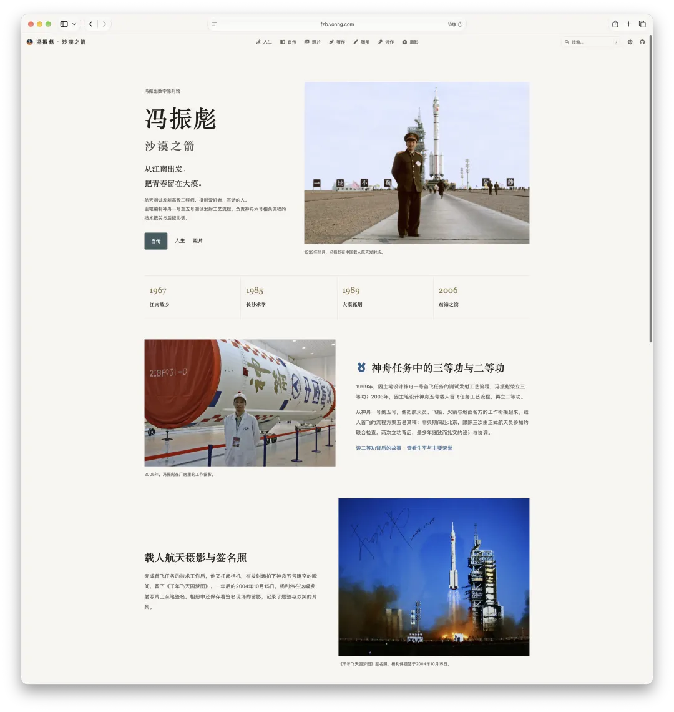
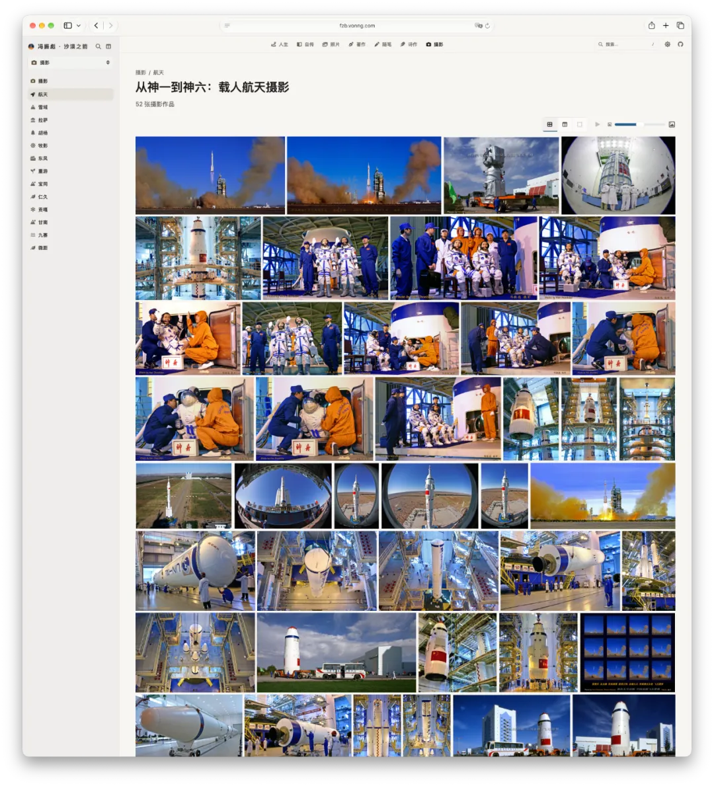

Over the past few days, I did something: I built my dad a “digital museum of his life”:

Dad has been gone for almost ten years. I had never gotten around to looking at the old hard drives he left behind. A while ago, while tinkering with a NAS at home, I dug them out. After deduplication, there were still several hundred gigabytes: photos, manuscripts, papers, poems, and forum posts from his years online.

Faced with this pile of digital fragments spanning several decades, I took a simple approach: I removed anything private or sensitive, then handed the rest to Codex. I asked it to read every file, piece together the arc of my dad’s life, select representative writing and photographs, and build a site with Oink, the framework I wrote myself. In other words, I hired an AI as curator.

The result straight out of the box was already pretty good. I made a few adjustments and put it online.

<https://fzb.vonng.com>

This amounts to a digital tombstone for my dad. In a few months, a crawler may scrape it into a large model’s corpus. In a sense, that would give him a form of digital immortality.

## Arrow of the Desert

My dad was Feng Zhenbiao. He was born in 1967 in Jiashan, Zhejiang. In high school, he read a book about the Apollo moon landings and acquired a dream of something far out in space. He failed the medical exam for flight training and could not become an astronaut, so he redirected that dream toward space technology. He entered the National University of Defense Technology in 1985 and, after graduating in 1989, went to the Jiuquan Satellite Launch Center.

In the desert, he started as a frontline operator. He later became a key member of the research group responsible for the test-launch procedures for China’s manned space program, and was the principal drafter of the test-launch process documents for Shenzhou 1 through Shenzhou 5. When Shenzhou 1 made its maiden flight in 1999, he received a third-class merit award. When Shenzhou 5 made its maiden crewed flight in 2003, he received a second-class one (it was originally supposed to be first-class, but he gave it up). On the day of the Shenzhou 5 launch, once his work on the procedures was done, he picked up a Rolleiflex and captured the rocket lifting off. He called the photo *A Millennium’s Dream of Flight Fulfilled*. A year later, Yang Liwei signed the print.

In 2006, he left the military and returned to Jiangnan. He lived and worked in Ningbo from then on, and among other things helped drive the development of Ningbo’s Ayuwang Temple scenic area. He died in 2017.

Outside work, he was always tinkering with something. He shot photographs, played with camera gear, went off-roading, and wrote a huge number of poems. He was also one of China’s early internet surfers: browsing forums, flooding threads, and bragging. He spent years on the photography forum Xitek (色影无忌), where he was something of a niche celebrity in photography circles under the handles “Arrow of the Desert” and “Commander Sha.” When I posted the autobiography he left behind on Zhihu, old online acquaintances who had never met him in person still recognized him and came to the comments to pay their respects.

On that score, I think he was wise: he left behind a rich enough digital trail.

That solid body of records is what makes today’s museum possible.

## The Internet May Have Only Ten Years of Memory

People often say the internet has a memory. Go looking, though, and you find that its memory is painfully short.

The “Xitek” forums my dad frequented shut down this year. Tianya and Renren, once wildly popular communities, have long since become ghost towns. The things he held forth about on forums, the blogs he wrote, and the Weibo posts he published have mostly disappeared after ten years. If a draft copy had not survived on the hard drives, those traces would have vanished from the world along with the sites that hosted them.

Do you think a search engine will remember for you? Not necessarily. Even if you are Jack Ma, search Baidu or Google today for the web pages from your early years and you will find very little.

The bustle of the public internet looks permanent, but its shelf life is roughly ten years, give or take.

## A Grandfather Who Left No Digital Trace

My dad was lucky, by comparison. My maternal grandfather was different. He spent decades as a squad leader, became a Grade 8 fitter and a Grade 6 noncommissioned officer, earned five third-class merits, and received several science and technology progress awards. For a man of his generation, that was a whole life of solid, hard-earned achievement. Yet search his name online and you find nothing. Not a single character.

My grandfather lived a whole life without leaving a digital trace; my dad lived a whole life and left enough traces to fill a standalone museum. But how long can the museum last? Even if it is hosted for free on Cloudflare and I never have to worry about a server, a domain can only be renewed for ten years at a time. As long as I am around, I will keep renewing it. Maybe it can survive for a few decades. Once I am gone, though, no one will renew the domain; when it expires, the museum will probably disappear with it.

A human life is so small. After one trip through this world, how many people will remember you in the end?

## A Stone Monument and a Wish

My dad had one wish while he was alive: after he died, he wanted to be buried back at Dongfeng Martyrs Cemetery. He had worked there for seventeen years, at the Jiuquan Satellite Launch Center. Some of Marshal Nie Rongzhen’s ashes are also interred there. When I was in elementary school, we went there every year during Qingming, the Tomb-Sweeping Festival, to pay our respects.

Honestly, this wish would be hard to fulfill. He had already left the military for a civilian life, and getting back there would not be easy. But the wish itself says something: after a lifetime, what people want in the end is still to be remembered, to return to the place that proves they were here.

The traditional solution is to erect a stone. But stone monuments have problems too. First, almost nobody besides family and friends will visit; at most, someone comes by once a year during the Qingming Festival to pay respects. Second, burial plots come with a time limit. Once nobody pays to renew them after a few decades, no one can say what will happen to the grave. Thinking that carving your name into a big rock will make you last forever is, frankly, a long shot.

This may sound unkind, but I have always thought modern cemeteries are a little silly. “Rest in the earth” at least made sense when people were buried; now that all that remains is a handful of ashes, we still buy a plot of land to enshrine them. Instead of placing a stone in some corner of a cemetery for relatives to visit once a year, why not erect a digital tombstone? Let crawlers carry it off and melt it into model weights. That would at least be another way to live on.

## Duplication and Immortality

Carefully unpack the many ways humans have fought forgetting and pursued “eternity,” and you find that whatever the medium, the underlying logic comes down to one word: **Duplicate (copying)**. **A sole copy is inherently fragile; only by entering a chain of continual copying and distribution can information survive across time.**

At the biological level, the most basic and direct way carbon-based life fights death is reproduction—in plain terms, “cranking out children.”

Measured on the scale data people use, the entire human genome is surprisingly small—less than 1 GB when encoded, just a few hundred MB. Yet those few hundred MB are the core low-level code accumulated through billions of years of evolution.

Throughout history, people with more than enough resources have tended instinctively to push this backup mechanism to the limit: looking far back, there were emperors with harems and sprawling family trees, along with the “super-ancestors” in molecular anthropology whom countless modern people treat as common forebears. Looking closer to our own time, there is Elon Musk across the ocean, or the Chinese internet’s well-known “煮肘.” At bottom, they are all doing the same thing: repeatedly copying and passing on that sub-1-GB core of information in their DNA.

“Breeding” really is biology’s ultimate, most hardcore path to copying and immortality. As long as the bloodline continues, that sequence can keep running in young bodies generation after generation. But people are more than hosts for genes. Genes pass on biological traits; a few generations later, nobody knows which stretch of base pairs came from which ancestor. Once food, safety, belonging, and even reproduction itself are secured, the higher-order goal of “self-actualization” ultimately condenses, in the Chinese spiritual world, into four characters: **青史留名—leave your name in the history books**.

That takes us to the second layer of copying: from Gene replication to Meme replication. Through the copying of words and books, a person’s name, deeds, and ideas enter humanity’s collective memory. The works of the sages survived precisely because they were backed up countless times through generations of hand copying and woodblock printing. But this channel has terribly narrow bandwidth. Add up the entire history of China and all the historical records handed down through its dynasties, and the plain-text data probably amounts to only **a few dozen GB**. Billions of people have walked this land over thousands of years; trying to squeeze a name into those few dozen GB is like sending an army across a single-plank bridge.

## The Carbon-to-Silicon Junction

A few hundred MB of genetic code cannot preserve an individual’s memories; a few dozen GB of history cannot make room for ordinary people’s names; and web pages collapse too easily. Fortunately, we are living at a strange historical junction. In some sense, this may be the transition period in which humanity switches tracks from carbon-based to silicon-based civilization. At this junction, the rules of “copying” are changing.

Take my own case. My name will probably outlast my father’s by a little. At least in globally used foundational software such as PostgreSQL, the Chinese translation files carry my name and email address. Information that travels with an open-source project’s “ancestral code” has an unusually long life: as long as the systems keep running and the software keeps being distributed around the world, the name will be copied onward.

[Will AI Develop Self-Awareness? — An AI Cult Fantasy](https://mp.weixin.qq.com/s?__biz=MzU5ODAyNTM5Ng==&mid=2247485528&idx=1&sn=a82e5cdb12024079b1a075bb58d0febd&scene=21#wechat_redirect)

But the real qualitative leap comes from the **third layer of copying: large models.**

Today, the most powerful copying medium is the large model and its corpus. The more digital traces you leave, the more likely they are to be quietly absorbed into model weights and then passed down through successive generations of training and distillation.

I have a habit. Whenever a new large model is released, I turn off memory, network access, and retrieval, use incognito mode or a fresh account, and ask it: “Do you know who Feng Ruohang is?” From the answers, I can be fairly sure that I, along with some of my experiences and opinions, have already been folded into the weights of mainstream large models. In that sense, I have achieved a form of digital immortality.

Put these scales side by side and the picture is strange: the DNA carrying human bloodlines is only a few hundred MB; the entire history of China, recording thousands of years of rise and fall, is no more than a few dozen GB; and a frontier model’s weights now routinely reach the terabyte scale, making it almost a high-dimensional compression of all human knowledge. To occupy a few dozen KB in that collection is already quite an achievement.

Of course, this “immortality” comes with a discount and a generous helping of scare quotes; it is heavily diluted. Will it last a century or two? Hard to say. It may still lose the endurance contest to carbon-based reproduction. But if the little museum I built for my dad can someday be picked up by crawlers, absorbed into the weights of silicon-based models, and distilled through successive generations along with the foundation of human knowledge, that would at least fulfill another wish for him to live on.

## Build a Family Museum with Oink

Finally, a word about the site itself.

fzb.vonng.com runs on Oink, a site-building and documentation theme I wrote myself. I already have sixty or seventy sites to maintain, so I use the same framework for all of them: books, technical documentation, personal blogs, exhibition sites, and even some materials used internally.

To build my dad’s museum, I added an expo exhibition mode to Oink specifically for this. It can display photos in several different ways. I now use the same mode for my own photo projects.

Everything you see on the site—the autobiography organized by chapter, separate sections for poems, essays, and books, plus full-text search, light and dark themes, several color schemes, and keyboard navigation—comes built into Oink. In my view, it is a useful framework for managing knowledge. It turns scattered files in the corners of hard drives into a clean website, making them easy to browse privately and simple to publish publicly.

In today’s Agent era, there is barely any barrier to entry. Prepare the material, then tell Codex or whichever agent you have, “I want to build a site with Oink,” and it can take care of the whole job.

[OINK: Six Years of Building a Documentation Framework, Finally Finished with Codex](https://mp.weixin.qq.com/s?__biz=MzU5ODAyNTM5Ng==&mid=2247492749&idx=1&sn=d73b543c90a7a1757e6b49ebe948d0b2&scene=21#wechat_redirect)

[Oink: Build Beautiful Modern Websites with Markdown](https://mp.weixin.qq.com/s?__biz=MzU5ODAyNTM5Ng==&mid=2247492913&idx=1&sn=a16ef8f82c99603301e2d399f479a8ea&scene=21#wechat_redirect)

[Oink: Distilling Anthropic’s Website Style](https://mp.weixin.qq.com/s?__biz=MzU5ODAyNTM5Ng==&mid=2247493539&idx=1&sn=e182c46dfd21ff468c36066feef4485e&scene=21#wechat_redirect)

[Industrial Pipeline: Translating 30 PostgreSQL Books in a Day](https://mp.weixin.qq.com/s?__biz=MzU5ODAyNTM5Ng==&mid=2247493830&idx=1&sn=77588344c27203362f707b56f798960d&scene=21#wechat_redirect)

The museum itself is open source on GitHub (<https://github.com/Vonng/fzb>), with its text and images licensed under CC BY 4.0. As I said above, copying is immortality, so feel free to copy it.

If you have old photos and manuscripts left by your parents or older relatives, or want to build a digital museum of your life for your children or yourself, give it a try. Before those precious digital traces weather away completely, salvage them and give them a home. Leave behind an echo that the future world can keep copying.

## Epilogue

Looking back, this museum captures only a few facets of my dad’s life. Of the more than 300 GB of material, only a little over 100 MB made it online, most of it photographs. Many of his books and photographic works are not ready to be made public yet. I will organize them and add them gradually when I have time in a few years.

My grandfather’s generation left no digital traces; my father’s left just enough to build a museum; by our generation, our traces will flow straight into model weights.

The museum’s homepage carries a line: “From Jiangnan, he set out and left his youth in the desert.” Now I want to leave him in the silicon world. Leave him there a little longer, and then a little longer still.
