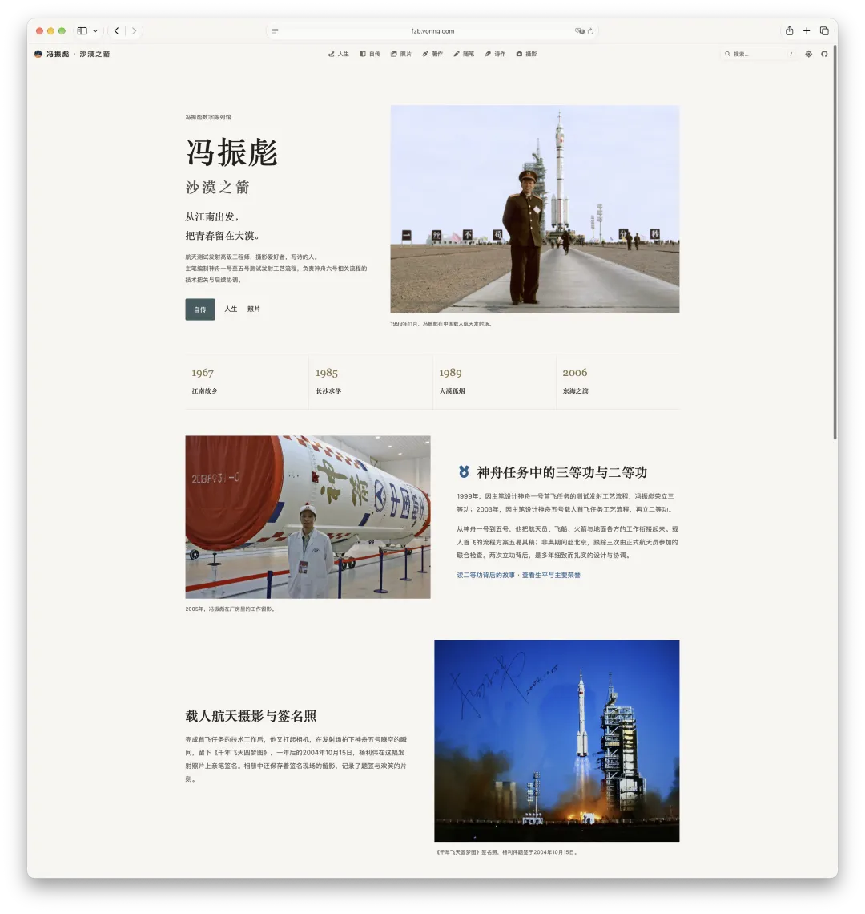
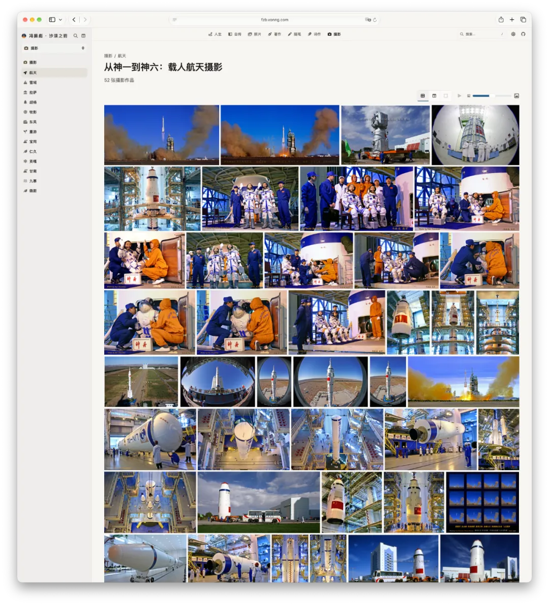

老冯这几天干了一件事：给我爹做了一座“人生数字陈列馆”：

老爹走了快十年，留下的几块旧硬盘我一直没顾上碰。前阵子在家折腾 NAS，把它们翻了出来，数据去重之后还有几百个 G：照片、文稿、论文、诗作，还有当年泡论坛留下的帖子。

面对这堆跨越几十年的数字碎片，我的做法很简单：先把涉及隐私和敏感的资料剔掉，剩下的全交给 Codex——让它通读这些文件，梳理出老爹的人生轨迹，挑出有代表性的文字和照片，再用我自己写的 Oink 框架搭成一个站点。说白了，就是请 AI 来当策展人。

一把出来的效果就相当不错，我稍作调整便上线了。

<https://fzb.vonng.com>

这算是给老爹立了一块数字墓碑。说不定再过几个月，它就会被爬虫收走，进入大模型的语料库。某种意义上，也算是替他实现了一种数字永生。

## 沙漠之箭

我爹叫冯振彪，1967 年生在浙江嘉善。高中时读到一本讲阿波罗登月的书，从此心里有了一个远在天外的梦。招飞体检没过当不成航天员，他就把这个梦转向了航天技术：1985 年考进国防科大，1989 年毕业去了酒泉卫星发射中心。

在大漠里，他从一线操作手干起，后来成了载人航天测试发射工艺流程课题组的主力，主笔编制了神舟一号到神舟五号的测试发射工艺流程。1999 年神舟一号首飞，他立了三等功；2003 年神舟五号载人首飞，又立了二等功（本来是一等功，让了）。神五发射那天，流程上的活儿干完了，他又扛起禄来相机，拍下了火箭腾空的瞬间，取名《千年飞天圆梦图》。一年后，杨利伟在这张照片上签了名。

2006 年，他转业回到江南，此后一直在宁波工作、生活，期间算是推动了宁波阿育王寺景区的建设。2017 年去世。

工作之外，他是个很能折腾的人。玩摄影、折腾器材、开车越野，还写了一大堆诗，他也是最早一批上网冲浪的人：逛论坛、灌水、吹牛，常年混迹于“色影无忌”，在摄影圈里也算是个垂类网红，网名 “沙漠之箭” / “沙司令”。当年我把他留下的自传发到知乎，竟然还有素未谋面的老网友认出他，跑到评论区来悼念。

在这一点上，我觉得他很明智：留下了足够丰沛的数字痕迹。

正是这些实打实的留存，才让今天这座陈列馆成为可能。

## 互联网的记忆，也许只有十年

人们常说，互联网是有记忆的。可真去翻一翻就会发现，这份记忆短得可怜。

老爹当年泡的“色影无忌”，今年关站了。天涯、人人网，这些曾经火得一塌糊涂的社区，也早就人去楼空。他在论坛里挥斥方遒说过的那些话，写过的博客，发过的微博，十年过去，基本都找不到了。要不是硬盘里还存着一份底稿，这些痕迹早就跟着那些网站一起，从世界上消失了。

你以为搜索引擎会替你记着？也不见得。就算是马云，如今去百度或者 Google 搜他最早年的那些网页，能找到的也已经寥寥无几。

公域互联网上的热闹看似永久，保质期大差不差也就十年。

## 没有留下痕迹的外公

老爹其实还算幸运的。我外公就不一样了。外公当了几十年的老班长，八级钳工，六级士官，立过五次三等功，拿过好几次科技进步奖，放在他那一代人里，这是实打实、沉甸甸的一辈子。可你在互联网上搜他的名字，什么也找不到。一个字都没有。

外公活了一辈子，没有留下任何数字痕迹；老爹活了一辈子，留下的痕迹好歹撑起了一座独立陈列馆。可这座馆又能存在多久呢？哪怕网站挂在免费的 Cloudflare 上不操心服务器，域名一次最多也只能续十年。只要我还在，就会一直给域名续费，也许能撑个几十年；等哪天我也走了，没人续费，域名一到期，这座馆大概也就跟着消失了。

人生真的很渺小。来这世上走一遭，最后究竟能被多少人记得呢？

## 石碑与心愿

老爹死前有个心愿：死后想葬回东风烈士陵园。那里是他工作了十七年的地方，就在酒泉卫星发射中心，聂荣臻元帅的一部分骨灰也安放在那里。我上小学那会儿，每年清明都要去那儿扫墓。

老实说，这个心愿很难实现。人都已经转业到了地方，走后再想回去可不容易。但这个心愿本身说明了一件事：人活一辈子，到最后还是想被记住，想回到那个能证明自己来过的地方。

传统的办法是立一块碑。可石头碑也有它的问题：第一，除了亲友，几乎没人会去看，一年到头也就清明时有人来扫一扫；第二，墓地也是有年限的，几十年后没人续费，谁也说不清会被怎么处理。以为刻块大石头就能万古长存，其实也够呛。

说句不太中听的，我一直觉得现代墓地这事儿有点傻。过去讲究入土为安，土葬好歹还有个由头；如今都烧成一捧灰了，还要专门买一块地供起来。与其在墓园某个角落立块石头，等着亲友一年来看一次，不如立一块数字墓碑——被爬虫爬走，熔进大模型的权重里，也算换一种方式活下去。

## 复制与永生

仔细拆解人类对抗遗忘、追求“永恒”的种种努力，就会发现无论用什么载体，最底层的核心逻辑其实只有一个词：**Duplicate（复制）**。**孤本注定脆弱，唯有进入不断拷贝与分发的链条，信息才能跨越时间活下来。**

在生物学层面上，碳基生命对抗死亡最原始、最直接的方式就是繁衍——说白了，就是“哐哐生孩子”。

用我们搞数据的尺度去丈量，人类全套 DNA 序列的信息量其实小得惊人，编码出来满打满算也就 1GB 不到。但这区区几百兆数据，却是生命演化亿万年沉淀下来的核心底层代码。

从古至今，但凡掌握了超额资源的人，往往都会本能地把这套备份机制拉满：分子人类学里那些被无数现代人奉为共同源头的“超级老祖宗”，历代帝王三宫六院、开枝散叶，还有当代马斯克/煮肘，本质上干的都是同一件事 —— 把自己 DNA 里这几个 GB 的核心信息不断拷贝、传递下去。

“下崽”确实是生物界最终极、最硬核的复制与永生逻辑。只要血脉不断，那套序列就能在年轻的躯体里一代代跑下去。但人毕竟不只是基因的宿主。基因传下去的是生物性状，几代人之后，没人知道自己身上的某段碱基序列来自哪位先人。当温饱、安全、归属乃至繁衍这些基本需求都得到满足之后，更高维度的“自我实现”，在中国人的精神世界里最终会收敛成四个字：**青史留名**。

这就进入了第二层复制，从 Gene 复制到 Meme 复制：靠文字与典籍的传抄，把一个人的名字、事迹与思想写进人类的集体记忆。先贤的著作之所以没有湮灭，正是因为在一代代人的手抄与雕版刻印中完成了无数次备份。但这条路的带宽实在太窄了——把整部中国历史、历朝历代所有传世史料全加起来，纯文本数据大概也就**几十个 GB**。几千年来几十亿人走过这片土地，想挤进这几十个 GB 里留下一个名字，无异于千军万马过独木桥。

## 碳硅换轨节点

几个 GB 的基因留不住个体记忆，几十个 GB 的青史容不下普通人的名字，而互联网网页又太容易坍塌。好在，我们正处在一个微妙的历史节点上：某种意义上，这可能是人类从碳基文明向硅基文明换轨的过渡期。在这个节点上，“复制”的规则正在改变。

拿老冯自己来说，我留名的时间大概率会比我爹更长一些。至少在 PostgreSQL 这样全球通用的基础数据库软件里，所有中文翻译语料都写着我的名字和邮箱。这种跟着开源软件“祖传代码”往下走的信息生命力极强：只要系统还在世界各地运行、分发，名字就会被不断复制下去。

[AI 会有自我意识吗 —— AI 神教狂想曲](https://mp.weixin.qq.com/s?__biz=MzU5ODAyNTM5Ng==&mid=2247485528&idx=1&sn=a82e5cdb12024079b1a075bb58d0febd&scene=21#wechat_redirect)

但真正带来质变的，是**第三层复制：大模型。**

在当代，最强有力的复制载体已经变成了大模型和它的语料库。你留下的数字痕迹越多，就越可能被潜移默化地吸收进模型权重，再随着一代代模型的训练和蒸馏传承下去。

老冯有个习惯。每次有新的大模型发布，我都会关掉记忆、联网和检索，开隐身模式或者换个新号，问它一句：“你知道冯若航是谁吗？” 从回答来看，基本可以确认：我和我的一些经历和观点已经融进了主流大模型的权重里。从这个意义上说，老冯已经实现了某种数字永生。

把这几个尺度摆在一起看，其实挺奇妙的：承载血脉的 DNA 只有几个 GB，记录几千年兴衰的整部青史不过几十个 GB，而如今一个前沿大模型的权重动辄就是 TB 级别，几乎是全人类知识的高维压缩。能在这个集合里占上几十 KB 的信息量，已经是很了不起的事了。

当然，这个“永生”得打折，得加引号，水分不小。保质期能撑个一两百年吗？不好说，没准到头来还是拼不过碳基生物传宗接代那么持久。但如果我给老爹搭的这座小小陈列馆，未来也能顺着爬虫融进模型的权重，跟着人类知识的底座一代代蒸馏下去，多少也算圆了另一种长存的心愿。

## 用 Oink，给家人建一座馆

最后说说这个站点本身。

fzb.vonng.com 用的是 Oink，一套我自己做的建站与文档主题。老冯手上要维护的网站已经有六七十个了，索性全用同一个框架来做：出书、技术文档、个人博客、展览型站点，甚至自己内部用的一些资料，统统用它来管理。

为了给老爹做陈列馆，我专门给 Oink 加了一个 expo 展览馆模式，可以把照片按几种不同的方式陈列出来。现在我自己的照片专题，也都用这种方式在管。

你在站上看到的那些呈现：自传按章节组织，诗作、随笔、著作各成栏目，再加上全文搜索、明暗主题、几套配色风格和键盘导航，都是 Oink 自带的。在我看来，它是个很好用的知识管理框架：把散落在硬盘角落里的零碎文件归拢成一个干净的站点，自己查阅方便，公开发布出去也很简单。

在今天的 Agent 时代，用起来也没什么门槛：把资料准备好，直接跟 Codex 或者你手上的 Agent 说一句“我要用 Oink 建个站”，它就能帮你把事情办得妥妥帖帖。

[OINK：文档框架这件事，折腾了六年，终于靠 Codex 毕业了](https://mp.weixin.qq.com/s?__biz=MzU5ODAyNTM5Ng==&mid=2247492749&idx=1&sn=d73b543c90a7a1757e6b49ebe948d0b2&scene=21#wechat_redirect)

[Oink：用 Markdown 快速创建美观的现代网站](https://mp.weixin.qq.com/s?__biz=MzU5ODAyNTM5Ng==&mid=2247492913&idx=1&sn=a16ef8f82c99603301e2d399f479a8ea&scene=21#wechat_redirect)

[Oink：蒸馏 Anthropic 官网风格](https://mp.weixin.qq.com/s?__biz=MzU5ODAyNTM5Ng==&mid=2247493539&idx=1&sn=e182c46dfd21ff468c36066feef4485e&scene=21#wechat_redirect)

[工业流水线：一天翻译完 30 本 PG 书籍](https://mp.weixin.qq.com/s?__biz=MzU5ODAyNTM5Ng==&mid=2247493830&idx=1&sn=77588344c27203362f707b56f798960d&scene=21#wechat_redirect)

这座陈列馆本身也开源在 GitHub 上（<https://github.com/Vonng/fzb>），文字和影像按 CC BY 4.0 授权。前面说了，复制才是永生，所以欢迎复制。

如果你手头也有父母长辈留下的老照片与旧文稿，或者想给孩子、给自己做一个人生数字陈列，不妨也动手试试。趁着那些珍贵的数字痕迹还没有随时间彻底风化，把它们打捞出来、安放好，留一点能被未来世界继续复制下去的回响。

## 尾声

回头看，这座陈列馆收录的其实只是老爹人生里很少的几个切面。三百多 G 的资料，最后上线的只有一百多兆，大部分还是照片。不少专著和摄影作品，现在还不适合公开，等再过些年有空整理，再慢慢补上。

外公那一代人，没有留下任何数字痕迹；老爹那一代人，留下的痕迹刚好够搭起一座陈列馆；到了我们这一代，痕迹会直接流进模型的权重里。

陈列馆的首页上写着一句话：从江南出发，把青春留在大漠。现在，我想把他留在硅基的世界里。留得久一点，再久一点。
