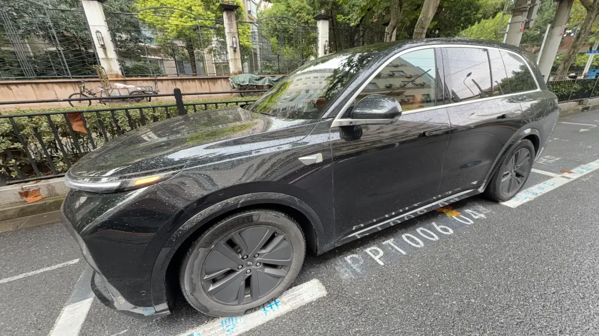
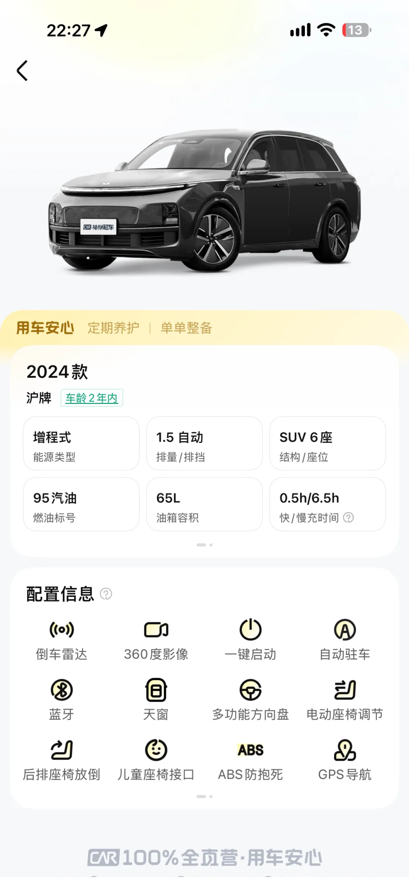
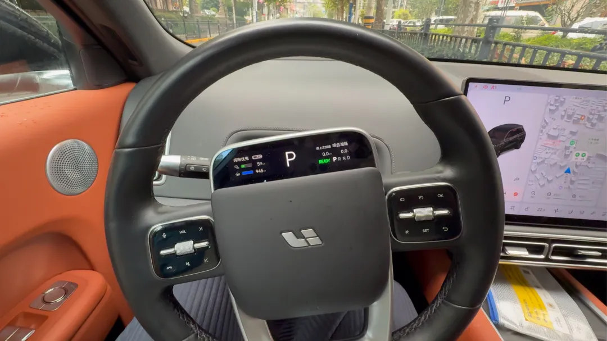

老冯是一个 12 年驾龄的“数据库老司机”，但是在此之前居然从来没开过新能源电车。

倒不是因为我是什么死忠的“内燃机原教旨主义者”，纯粹是因为我没有日常通勤的用车需求。以前上班的时候，我住的地方离公司一般都不超过 300 米，压根没地方能用上车；现在 OPC 居家办公，一个星期都不见得出一趟门，车放在地库纯属落灰。

我唯一开车的场景，就是出门长途自驾游。之前[自驾新疆](https://mp.weixin.qq.com/s?__biz=MzU5ODAyNTM5Ng==&mid=2247484145&idx=1&sn=7e5a47adbe03444458e436cf3f2c2487&scene=21#wechat_redirect)、跑西部玩，一开就是三个多月；在美西和加拿大也都有过一两周的自驾旅途。这种动辄几千上万公里的长途穿越，图的就是一个省事稳妥，所以我每次都会毫不犹豫地选油车，免得半路上折腾。

转折发生在最近。我一哥们儿提了辆电车，我上去试了一把自动驾驶，体验下来确实惊艳。正好前几天带老婆去黄山玩，我就琢磨着：这次干脆租辆电车尝尝鲜。

## 选车排除法：理想 L8？

打开神州租车扫了一眼，周围网点里有的电车，无非就是比亚迪、特斯拉、理想和问界这几家。老冯选车的排除法非常简单粗暴：

- **比亚迪**：坐进去总感觉跟开网约车似的，少点自驾游的兴致，直接跳过。
- **X 界**：看都不看，我可不想给自己惹得一身骚，直接划掉。
- **特斯拉**：车是好车，但国内 FSD 好像还不能完全用起来，这次主要是想体验智驾，先放一边。

最后看了一圈，选了**理想 L8**。

说实话，这车租起来真不便宜。租车行里一辆宝马 3 系也就 100 块钱一天，而租这台理想 L8 光日租就得 450 块，算上服务费和保险，一天落地要六百了。

严格来说，理想 L8 不算纯电车，而是一台**增程式电动车**——本质上是电机驱动，但肚子里装了一块电池加一个油箱，没电了可以烧油给电机发电，号称综合续航能干到 1100 多公里。对于我这种第一次开新能源、心里多少有点里程犯怵的老油车司机来说，算是个极其稳妥的过渡方案。

开了三天下来，我的总体评价就四个字：**确实不错。**

## 最贵的是 Attention：自动驾驶真香

这趟行程从上海出发，先开到杭州，再从杭州一路杀到黄山，单程 400 多公里，涵盖了城市拥堵路段、高架和长途高速。这一路上各种路况，我基本全程都在用它的辅助驾驶。

以前总有人算账，说电车比油车每公里省几毛钱油费。说实话，烧什么能源、省那几块钱油钱，我根本不在乎。**真正让我觉得值回票价的，是自动驾驶省掉了我的注意力（Attention）。**

无论是人类的 Attention，还是 AI Agent 的 Attention，在现在和未来都是最值钱的资源。以前开油车跑长途，你得全神贯注地盯着车道、踩油门、控刹车，高频处理海量的驾驶细节，开几百公里下来人是非常累的；而现在把智驾一开，你只需要在大面上看着路况、做个兜底的监督者就行，精神消耗直接降了一个数量级。

甚至说句“政治不正确”的话：高速上开着自动驾驶，老婆在副驾屏幕上看电视剧，我甚至能分出一点余光瞄着屏幕跟着偷看。当然，这不是什么安全的做法，大家千万别学，但要是开传统油车，你是决然不可能有这种体验的。

另外，对于第一次开电车的新手来说，智能座舱的语音交互也极大降低了上手的门槛。老冯刚上车的时候，很多功能在哪儿根本整不明白。但它有个好处——不懂就直接张嘴问它：“自动驾驶怎么打开？”“按钮都在哪里？”甚至像打开雨刮器、锁车这种操作，直接喊一嗓子就搞定了，完全不用去翻菜单。到了目的地停车，它还有个傻瓜式的一键自动泊车，自己找车位自己停进去，相当省心。

## 补能与座舱：打消焦虑的“冰箱彩电大沙发”

这次跑完高速，我对电车补能和能耗的印象改观很大。我原本以为增程车“用油发电、再用电机驱动”会有不少能量转换的效率折损，结果实际跑下来，这么大一台车，百公里综合油耗也就 6 升左右，相当合算。

更让我意外的是充电体验。它自带的纯电续航大概在两三百公里，去黄山的一路上，几乎每个高速服务区都有充电桩；到了黄山景区附近，吃饭、停车的地儿也随处可见充电车位。

老冯这也是生平第一次摸充电枪，操作比想象中简单得多：微信扫个码，拔枪插上就开始充。去服务区吃个饭，半小时溜达回来，电量就从百分之十几充到了 85%。算下来八九毛钱一度电，花二十多块钱基本就能跑 200 公里。对比油价，这成本几乎可以忽略不计——我现在算是彻底理解为什么满大街跑网约车的全都是电车了。

以前我对电车最大的顾虑，就是怕赶路有急事：油车加油 5 分钟拍屁股就走，电车一充半小时，想想都难受。但只要基础设施跟上了，在休息区吃个饭、上个厕所的工夫顺手把电充了，其实根本不耽误事。

至于车内体验，不得不承认，国产新势力搞的这套“冰箱彩电大沙发”，通风、加热、按摩配齐，坐着确实舒服。看到这儿我也挺心动的，甚至琢磨着我老妈开了十几年的那辆老奥迪，是不是也可以考虑置换一台电车，平时开着能舒服、省心不少。

唯一让我留有一丝戒心的，是不知道这些造车新势力会不会像某些品牌那样，表面上把“冰箱彩电大沙发”做得光鲜亮丽，背地里却在底盘和被动安全配置上缩水。

从工程底子上讲，我心里还是觉得特斯拉做得最扎实；但如果以后老婆要买车，像特斯拉、小米、理想、小鹏、蔚来我大概都会去看看，也不排斥看看其他的。当然，唯一让我感到反胃恶心以至于会直接叉掉的只有带“界”的品牌，你懂的。

## 职业病：聊聊数据隐私与所有权

聊完爽点，最后聊点老冯作为数据行业从业者的“职业病”——**数据隐私与车辆所有权（Ownership）**。

现在的智能电车，本质上就是一台长了四个轮子的智能手机，在后台疯狂收集各种遥测数据。地理位置轨迹自不必说，车内外摄像头、麦克风、驾驶习惯，各种你想得到、想不到的信息可能都在往云端传。

更深一层的问题在于 **Ownership（所有权）**。当车企拥有对车辆的远程监控甚至远程控制权时，这在某种意义上已经削弱了你对这台物理资产的所有权。如果厂家能通过云端随意限制甚至关停你的车，再时不时给你推个强制 OTA 升级、搞点车载开屏广告，这辆车真的还 100% 属于你吗？

当然，在实际体验中——尤其是像我这样出门租车玩几天——这些顾虑倒是无所谓。但如果是自己掏钱买车长期开，这就成了一个必须权衡的问题。

现代社会大家都在用隐私换便利，这个交换本身是可以接受的。我的底线很明确：只要车企别吃相太难看，别搞得像当年的流氓安卓软件、或者干出 zcode 偷传用户代码仓库那种越界的事，正常采集一点脱敏的日常行车数据来换取智驾和智能座舱的便利，我还是能接受的。

## 结语

这次三天四百多公里的黄山自驾，算是把老冯对电车的刻板印象刷新了一遍。

当然，这次没有补能焦虑，很大程度上是因为去的是黄山，属于充电基建极其发达的江南一带。如果让我像以前那样去新疆青海自驾 40 多天，或者去东北，我大概率还是会老老实实选一辆纯油车；但在绝大多数日常和常规旅游场景下，我对电车的接受度已经打开了。

开了好几年电车的老司机们看了别笑话我，老冯以前确实没开过，也懒得折腾。这次折腾了一把，学到了新东西，体验也挺愉快。下次出门租车，我大概还会换个其他品牌的电车试试，看看各家到底还有什么不一样的活儿。

