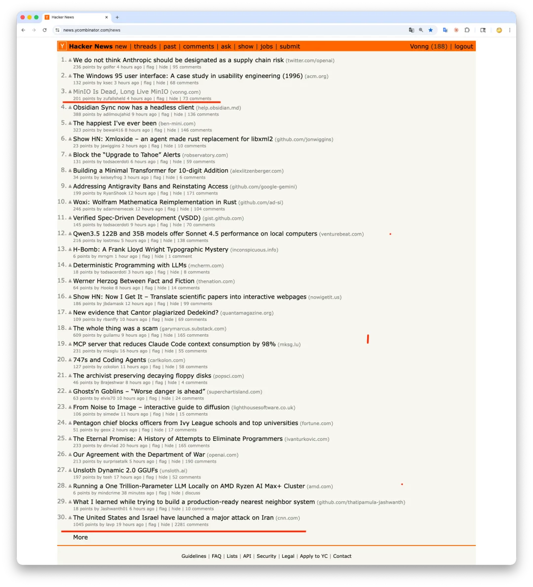
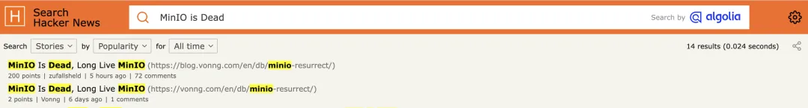
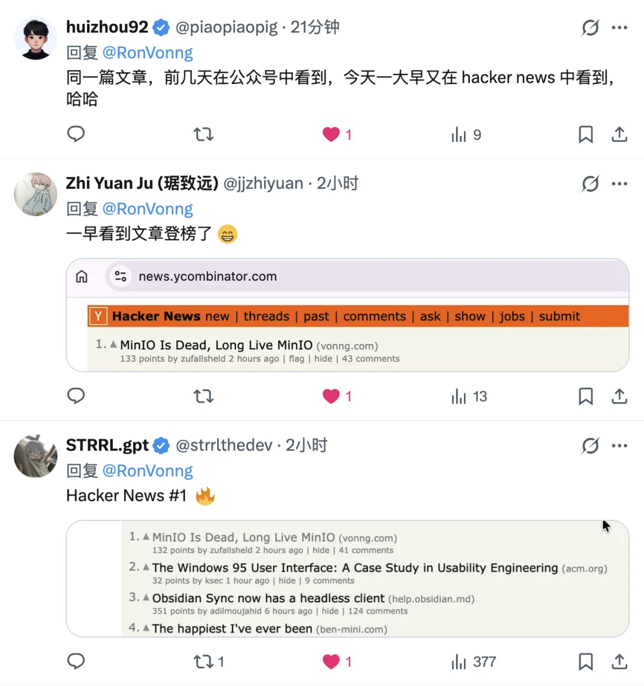
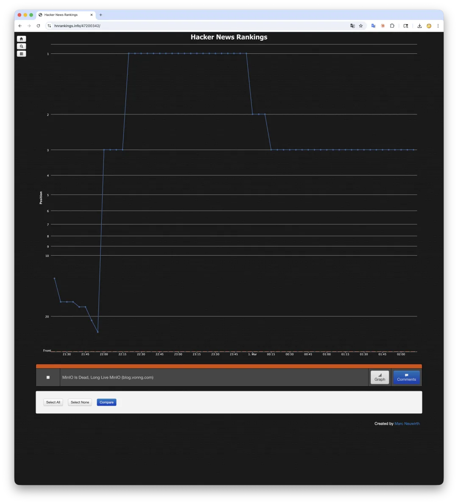
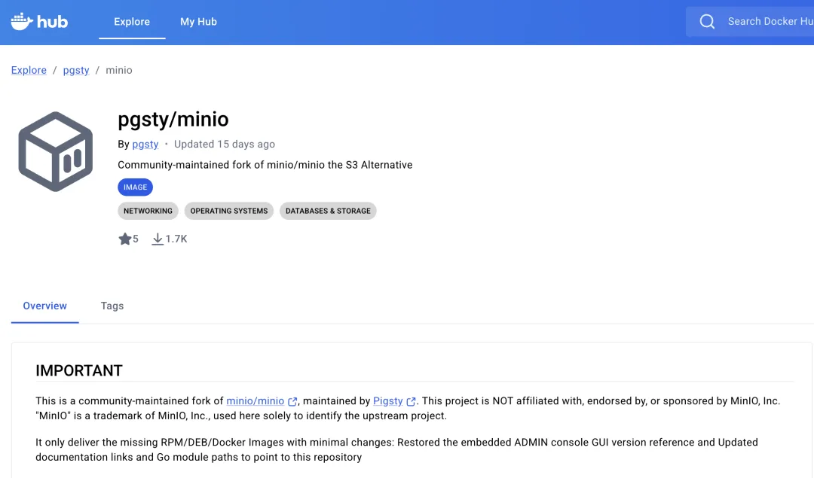
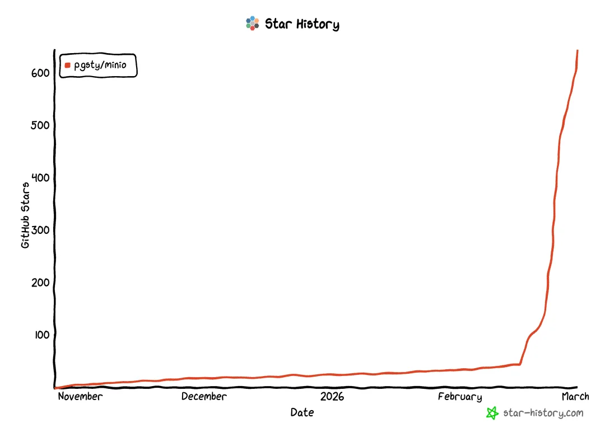

I woke up this morning to check how the war was going, only to find notifications on X telling me I had hit #1 on Hacker News. Sure enough, it was the post I wrote a few days ago about reviving MinIO.

It was my article, though I was not the one who submitted it. The funny part is that I submitted the exact same link myself a few days earlier, and it sank without a trace—2 points, not even a ripple.

This time, someone else submitted it without my knowing. It shot past 200 points, held the #1 spot for two hours, and is still sitting at #3 right now. What catches fire on HN really is a roll of the dice.

Getting to #1 on Hacker News isn't easy. The last time I made it was with *[PostgreSQL Is Eating the Database World](/en/pg/pg-eat-db-world/)*, and I got lucky again this time. By sheer coincidence, it happened right as war broke out between the US and Iran, with the war news sitting at the very bottom of the front page. Grabbing the top spot at a moment like that is a strange bit of luck. The comment thread was entertaining, too. The biggest complaint was that the prose smelled like AI—which was fair enough. I had used Claude to translate and polish the English version, and readers spotted it right away. I owned up to it immediately: English isn't my first language, I used AI to help with the translation, and I'll do better next time. That's how the HN crowd works—if you're upfront, they cut you some slack; if you get defensive, they'll tear you apart. All told, I'm just glad this community fork of MinIO I put together is actually helping people. It's up to 644 GitHub stars and 1.7K pulls on Docker Hub, and other developers have already reached out asking if I need a hand.

Haha—as happy as I am about the traction, part of me still worries that if this ticks MinIO off enough to come after me, it won't be so funny anymore.

---

Original post: [WeChat Official Account](https://mp.weixin.qq.com/s/6Rz3jOFqujXXWQBXv819YA)
