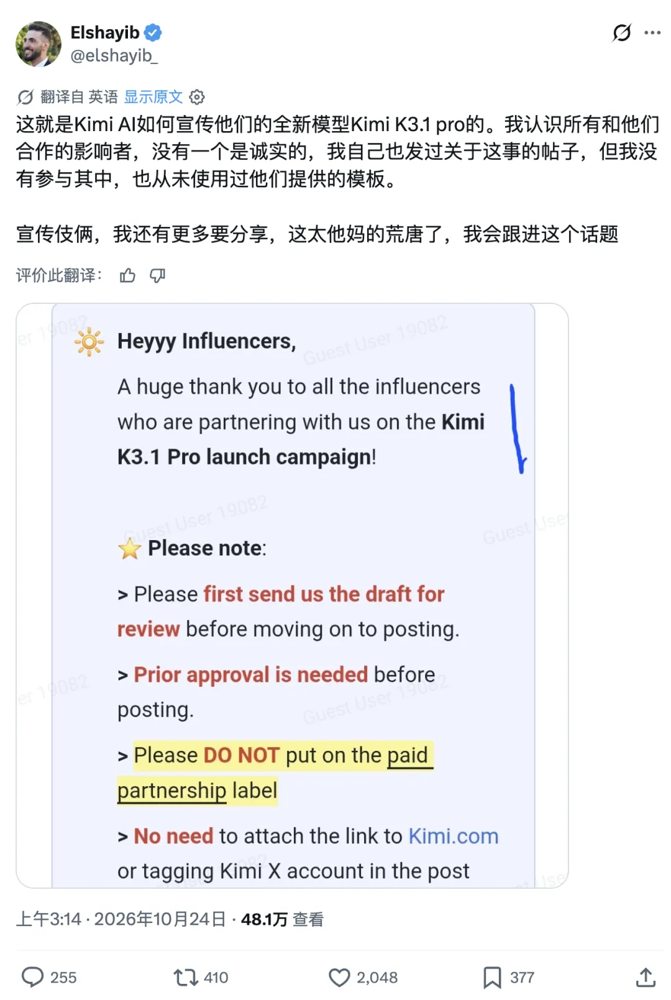
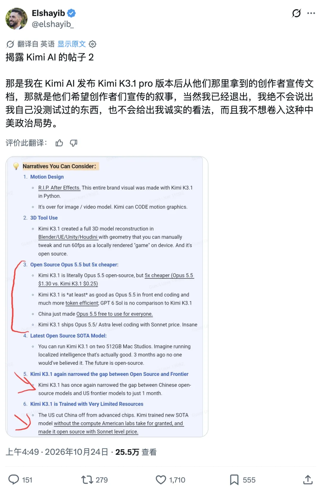
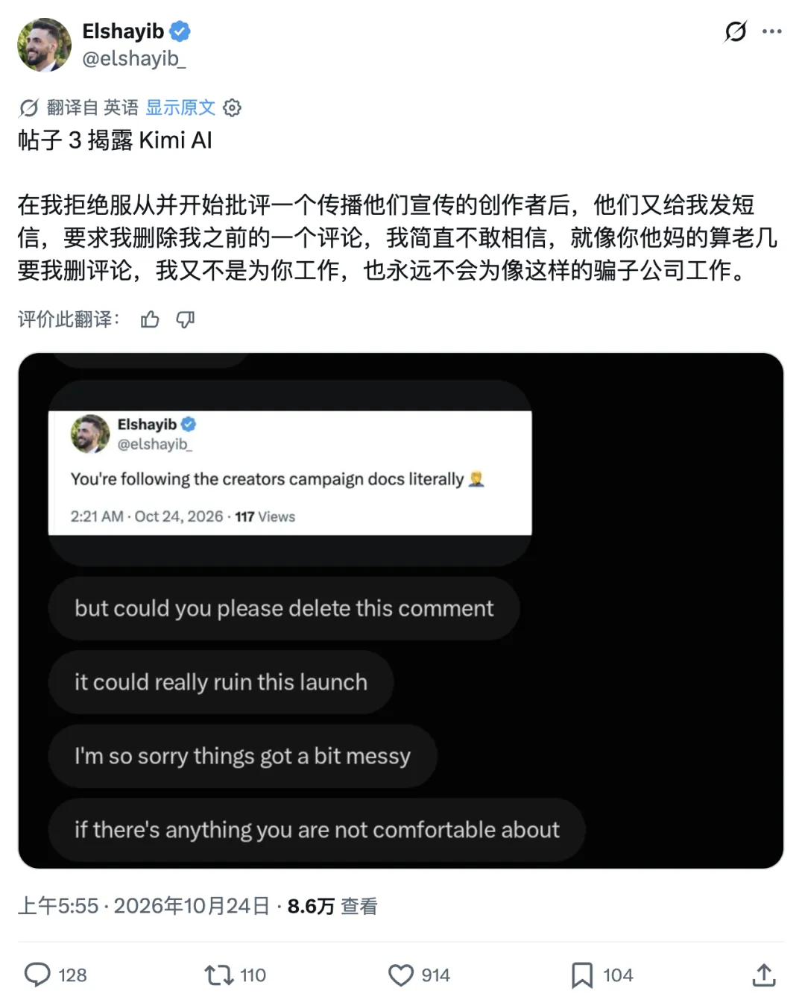
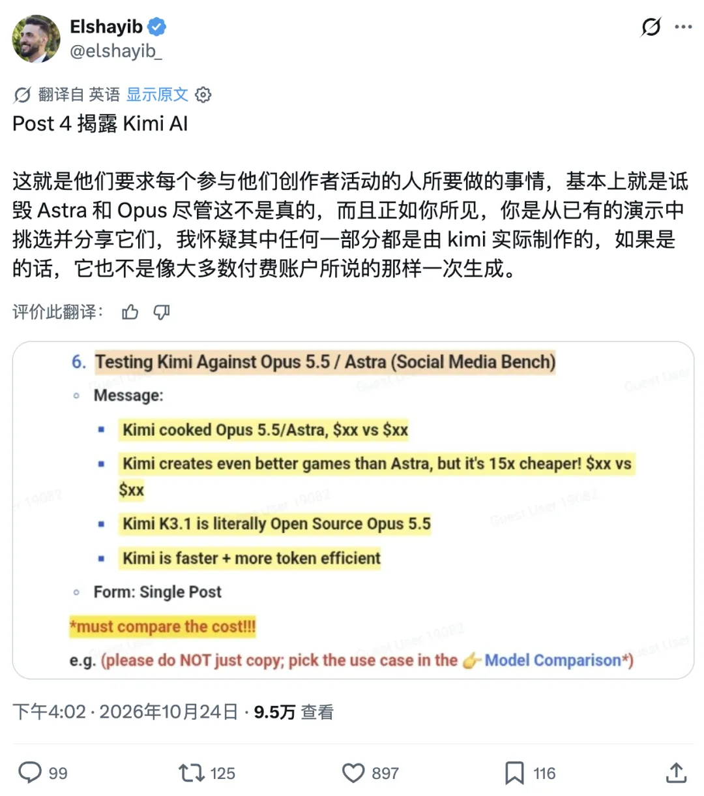
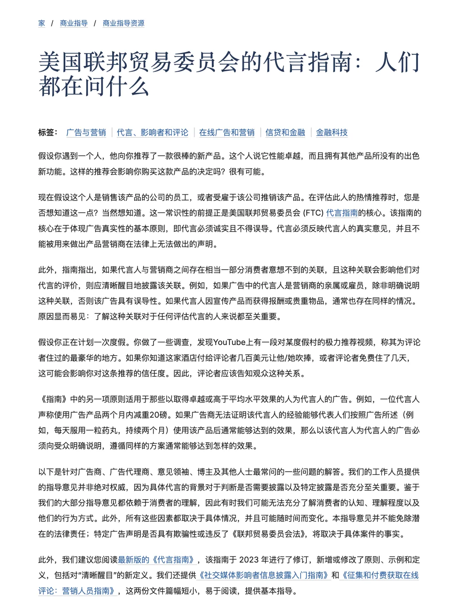

Moonshot AI released its latest model, Kimi K3.1 Pro, a couple of days ago.

On paper, it was a strong release: its Artificial Analysis (AA) Intelligence Index jumped from 44 in the previous generation to 55, right on the heels of first-place Claude Opus 5.5. Yet within hours of launch, the rollout blew up on X (Twitter).

It started when creator [@elshayib_](https://x.com/elshayib_) blew the whistle. In [a series of posts](https://www.techmeme.com/261025/p2), he shared screenshots of what he said was a promotional brief Kimi sent to creators (this is a one-sided account that remains unverified, and Kimi has not responded). According to the screenshots, creators had to submit drafts for approval before publishing, and [the brief supplied ready-made talking points](https://x.com/0xLogicrw/status/2113801452783284724) such as "Kimi is an open-source Opus 5.5 at one-fifth the price" and "China just gave everyone Opus 5.5 for free."

The most damning instruction was [to skip the Paid Partnership label](https://www.implicator.ai/kimi-k3-1-pro-launch-hit-by-unverified-brief-telling-creators-to-skip-ad-labels/), omit links to the official website, and avoid tagging the official account. That way, a paid promotional post would look indistinguishable from an organic recommendation by an ordinary user.

What made the situation darkly funny was that around the time the brief leaked, a wave of blue-check accounts on X had already published [nearly identical "independent hands-on reviews"](https://www.google.com/search?q=https://x.com/search%3Fq%3D%22Chinese%20Opus%22%20Kimi). Some creators didn't even bother rewording the PR copy—they pasted it verbatim, only for users in the replies to call them out one by one with screenshots of the leaked brief: "Did you seriously post the PR prompt without changing a word?"

On the Chinese internet, this kind of astroturfing is practically standard operating procedure. In the Western tech community, though, it hit a brick wall. This episode is a good occasion to talk about LLM marketing, the pollution of information sources, and a few principles of my own.

## 1. Why I Lost Interest in Kimi

My daily workflow runs primarily on Codex, backed up by Claude, with Gemini in a supporting role and GLM handling miscellaneous chores. Locally, I run a few small Qwen models for embeddings and ASR (speech recognition), which work well. I don't use DeepSeek much, and I have never used Kimi.

Why did I pick up GLM over other Chinese models? Simple: several developer friends actually use it in their daily work and told me firsthand that it was solid. That was enough for me to pay for an annual plan—1,700 RMB (roughly 240 USD) for the full year. Compared with major Western AI services that only bill monthly, the annual plan is cheap, and in practice it handles routine tasks well.

As for Kimi, I had seen plenty of praise online, yet oddly few practicing engineers around me actually used it. A few months ago, I genuinely considered signing up to test it—if it really beat GLM as the online buzz claimed, it was worth a look. What killed my interest was seeing aggressive, over-engineered marketing campaigns everywhere, which eroded my baseline trust before I ever tried the product.

The reason is straightforward: my trust in GLM came from firsthand feedback from peers, whereas my curiosity about Kimi came from things I had "heard online." **Once you realize that "online buzz" is laced with undisclosed paid posts, how much of the earlier praise can you still take seriously?**

## 2. "Export-to-Import" Marketing and China's LLM Scene

Many Chinese companies have a chronic marketing habit known locally as "export for domestic sales": pay English-language media outlets or influencers abroad for an endorsement, get a foreign stamp of approval, and bring screenshots back to China as proof of global recognition. It plays on a lingering assumption among domestic audiences that if foreigners are praising a product, the praise must be genuine.

Honestly, it is hard to blame readers for thinking that way. Domestic tech marketing burned through its credibility years ago. Much of the blame goes to players in the EV and smartphone sectors who normalized shameless astroturfing—deploying paid comment farms, coordinated PR copy, and reply-section brigades until product reviews on the Chinese internet lost all credibility.

By comparison, China's LLM community had mostly maintained a civil, engineering-driven culture where models competed on technical merit. Ironically, the sector probably owes a debt of gratitude to the earlier Pangu LLM scandal, when allegations of copied weights sparked a fierce public reckoning. Without that early warning shot, the domestic AI scene might easily have degenerated into the same swamp of hype and rent-seeking that plagues China's state-mandated *Xinchuang* (domestic IT substitution) database industry.

If the leaked brief is authentic, Kimi's misstep is clear: its research team worked flat out to push the model into the global top tier, only for the marketing side to run a domestic consumer-tech playbook of uniform talking points, mass seeding, and undisclosed ads. You have to know who your core audience is. Foundation models live or die by software engineers and technical decision-makers—and **engineers are the last people on earth who fall for this playbook**.

## 3. Undisclosed Marketing Is Poisoning Our Information Sources

Communications theory traditionally divides media into three categories:

- **Paid Media**: Buying ad placement outright.
- **Owned Media**: Publishing through your own website and official channels.
- **Earned Media**: Organic word of mouth earned through product quality.

What went wrong with this campaign is that it tried to **spend Paid Media money to counterfeit Earned Media trust**—demanding total control over the script (mandatory draft approval and forced "open-source Opus" talking points) while claiming the credibility of organic word of mouth (forbidding ad disclosures and posing as regular users).

What makes this so toxic is simple: **stealth marketing is actively poisoning the information sources we rely on.**

I rely on a human filter—essentially user-based collaborative filtering (UserCF)—to get technical information. I curate whom I follow, manage my information intake, and prune nodes with low signal, poor judgment, or compromised credibility, keeping only reliable firsthand sources.

Why go to that trouble? Because official channels lost their credibility long ago. Whether it is vendor-published benchmarks or third-party evaluation leaderboards—not just from Kimi, but across AI labs and cloud providers—I no longer take any of them at face value.

Bluntly put, most leaderboards are bullshit. I remember Dr. Qi making the same point in a talk: you cannot trust the rankings; whether a model actually holds up only becomes clear through real developer word of mouth.

Marketing teams quickly adapted to exploit that shift: if developers ignore benchmarks and only trust peer reviews, then go buy the peer reviews.

Anyone spending time on X lately has noticed the flood of AI-generated reply bots—uncanny, synthetic comments alongside accounts churning out posts with the plastic sheen of assembly-line PR. Incidentally, "marketing" is supposed to be a neutral business term, but on the Chinese internet it has been thoroughly degraded into a pejorative.

I know how this machinery works because a close friend used to run an MCN (multi-channel creator agency). On Chinese platforms like Xiaohongshu (RedNote), influencer marketing has evolved into an industrial assembly line run by coordinated agency matrices. The post you scroll past that looks like an ordinary user sharing a genuine product discovery or a cautionary tale is usually the output of a tightly scripted playbook—right down to the background music cues, the emotional pacing, and the planted shills bantering in the top comments. Once you see the strings behind the curtain, scrolling through those feeds is physically nauseating.

Domestic users have been battered by these tactics for so many cycles that they take sifting through disguised ads for granted. Western developer communities operate on very different norms. When you post a technical take on X, the default assumption is that you are sharing your own firsthand experience and honest engineering judgment. When people discover that creators took money, hid the sponsorship, and copy-pasted identical talking points, it doesn't just torch their reputation—it also runs directly afoul of the [FTC's Endorsement Guides](https://www.ftc.gov/business-guidance/resources/ftcs-endorsement-guides-what-people-are-asking)—triggering an immediate backlash across the developer community.

In a Gresham's-law dynamic, as more people take money to pose as organic fans, bad actors drive out honest voices. Once readers have to wonder whether every technical post is a covert ad, the entire ecosystem rots.

## 4. Why I Never Take Sponsorships

At this point, someone might ask: you write a tech blog yourself—where do you stand on sponsorships and monetizing an audience?

My WeChat blog has nearly 70,000 subscribers and over 100,000 followers across platforms—a sizable readership in a niche like databases and cloud infrastructure. On monetization, though, I follow one simple rule: **no sponsored posts.**

Writing online isn't even a side hustle for me, because I make zero revenue from it. It isn't for lack of offers—my WeChat backend sits at 99+ unread partnership requests from PR agencies and media buyers looking to place sponsored articles.

Over the past year I have been approached to promote Tencent EdgeOne, Qwen, various AI coding tools, and hardware like mini PCs.

I turned them all down. Friends have run the numbers and pointed out that taking those deals full-time could pay more than my actual engineering work. Why pass on it? The best answer is still the line entrepreneur Luo Yonghao delivered to tech reviewer Wang Ziru during their [famous 2014 live debate on Youku](https://www.bilibili.com/video/BV1xW411H7c8/), after exposing that Wang's "independent" review studio was funded by the very phone makers he reviewed:

> **"Once you're a kept man, don't talk to me about editorial independence."**

I started writing to say what I actually think and share firsthand engineering notes. The whole point is not having to walk on eggshells around anyone. If a cloud provider or database vendor ships a broken product or pulls a fast one on developers, I want to be able to call them out by name. As long as my criticism is grounded in facts and reproducible evidence, they can't touch me. That freedom is what makes writing worthwhile. The moment you take a vendor's check, writing turns into PR damage control for someone else, and the joy disappears.

Making money is fine, and running clearly labeled sponsorships is completely fair game. What I despise is disguising paid copy as objective technical evaluation. Good firsthand technical sources are scarce enough already. In my own feed, once I catch a technical blogger running two or three unlabeled advertorials, I assume their future judgment is compromised and block them on the spot.

### Aside: AI Slop vs. the "AI Style Police"

Since I criticized synthetic AI reply bots on X above, it is worth clarifying where I stand on AI-assisted writing.

Many people conflate genuine **AI slop** with **AI-assisted writing**. To me, AI is a **multiplier**: zero times a hundred is still zero. The value of an essay comes from its underlying ideas, thesis, and firsthand experience. If the author has nothing to say—or is spinning up farm accounts to chase ad pennies—multiplying zero produces worthless slop. But if the core argument and structure are your own, using an LLM to tighten phrasing and polish prose is just using a tool, even if a few stylistic tics remain.

I openly use AI to edit and polish my own drafts so I can get ideas across faster and more cleanly.

[Yes, I Use AI to Write Articles. So What?](https://mp.weixin.qq.com/s?__biz=MzU5ODAyNTM5Ng==&mid=2247491818&idx=1&sn=a437b73d9b3ceae1225a7f5457432d42&scene=21#wechat_redirect)

A couple of days ago, Reddit's Open Source community banned all AI-generated content, and DHH quoted it with a single word: *"retard"*. I share the frustration. Whenever someone in the comments ignores the facts and logic of an article just to complain that "this reads like AI," I block them. If you cannot engage with a single substantive point and your entire contribution is LARPing as a human AI-detector, you have nothing useful to add.

And since I don't monetize my readership or owe deference to commenters who act like paying customers, hitting Block costs me zero sleep.

## 5. Speaking Plainly Is a Luxury

To me, the most enviable position in tech looks like [DeepSeek](https://www.deepseek.com/): fund yourselves comfortably through a profitable quantitative trading business, do serious research on your own terms, and open-source model weights and core inference infrastructure without obsessing over short-term monetization. Or like [DHH](https://world.hey.com/dhh): build profitable SaaS businesses like Basecamp and HEY, buy your own independence, and spend your time hacking on an opinionated Linux desktop setup like Omarchy while saying whatever you actually think online.

I try to run my own open-source work the same way. The healthiest way to build open source is to cover your living expenses first so you can write code purely for the craft of building things. A handful of consulting engagements each year keeps me comfortable, and the rest of my time goes into [Pigsty](https://pigsty.io/), my open-source PostgreSQL RDS alternative, and [Silo](https://silo.pgsty.com/), my object storage engine—challenging cloud vendor lock-in and speaking plainly without worrying about who gets offended.

## Conclusion

Coming back to Kimi, this campaign was a classic self-inflicted wound.

The underlying K3.1 Pro model looks genuinely capable. Yet right after paying users on [Reddit](https://www.reddit.com/r/LocalLLaMA/) complained about tightened subscription quotas and steep per-task token burn, the team walked straight into an overseas PR scandal over allegedly paying influencers to fake organic praise.

The era when a slide deck and a coordinated wave of PR posts could sell a model is over. When your target users are skeptical software engineers, you are much better off skipping the consumer-influencer astroturfing and putting that agency budget directly into developers' token quotas.

Look at how OpenAI grew Codex from a few hundred thousand users to 40–50 million in a matter of months: solid base-model capability paired with generous, constantly reset usage quotas. For a developer tool, product quality and free tokens beat clever PR every time.

Trading away the hard-won engineering credibility of your research team for a few cheap influencer impressions is a terrible bargain.

