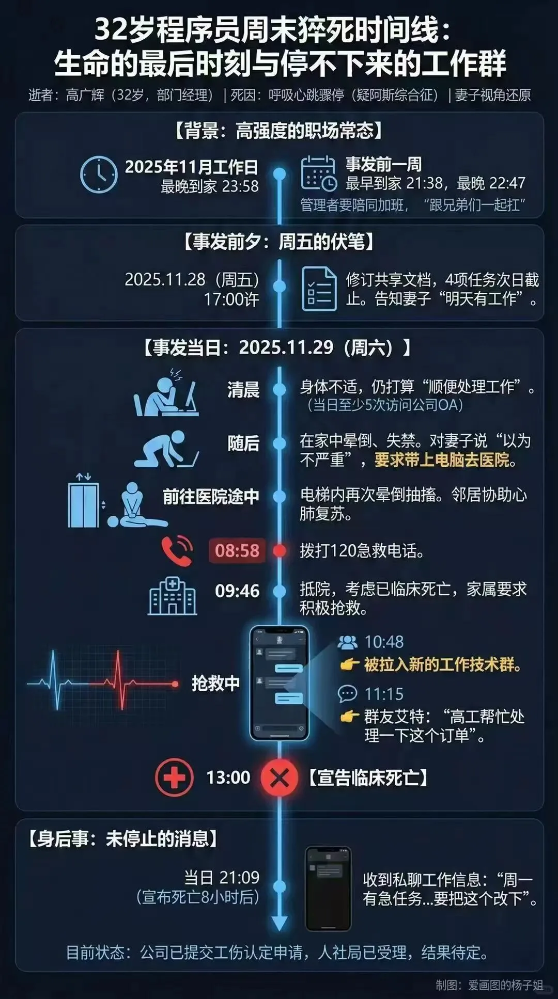
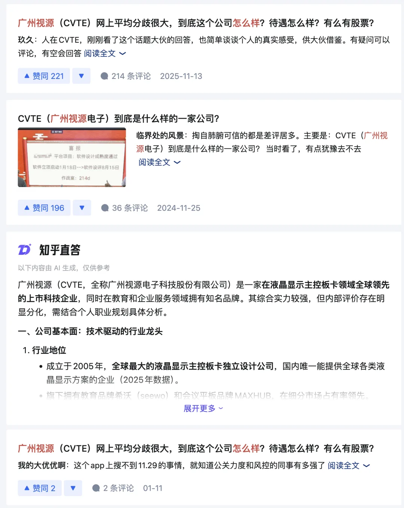

Saturday morning, November 29, 2025. Guangzhou.

At 8:58, emergency services (120) received the call. At 9:14, paramedics arrived on scene. At 9:46, he was transferred to the hospital; the medical chart noted, "Suspected clinical death; family requests full resuscitation." At 13:00, he was pronounced clinically dead.

Publicly circulated timeline of events

He was 32 years old. His ECG from a June 2024 physical exam read "normal."

What truly guts you here is not the sudden death itself. It is that **even dying could not make the work pause for a moment**.

At 10:48, while doctors were still trying to resuscitate him, he was added to a new technical group chat. At 11:15, someone @-mentioned him: "Engineer Gao, please help handle this order." At 21:09, another message arrived: "Urgent task first thing Monday morning... need to get this changed."

The workflow ran like a factory line: one person shut down, and the conveyor belt kept moving.

Under "Medical History" on his chart, the doctors didn't record hypertension or heart disease. They wrote: "Programmer. High work intensity. Frequent late nights."

His wife said she was in the habit of checking his location after 9 PM; if he was still at the office, she would message him on WeChat to "call him home." Later, as he lay in the morgue, she wrote: "No matter how I call for you now, you will never answer me again."

Many people online directed their anger at the coworkers in the chat: "How could you still be pinging him?"

The problem isn't a few heartless individuals. It is the logic of the system: you cannot speed up software development by throwing headcount at it.

*The Mythical Man-Month* explained this forty years ago: critical modules, key accounts, and urgent deliveries always fall on the handful of people who actually understand the system. Pregnancy takes ten lunar months, and you cannot hire ten mothers to deliver in a single month—new hires take time to ramp up, and the communication overhead only slows things down. So the cheapest way for a company to move faster comes down to four words: **squeeze the existing team**.

How far do they squeeze? Until you stop making a sound. He went silent; the group chat kept pinging.

---

This is not an isolated case. It is the standard configuration of a workplace culture that **refuses to treat people like human beings**.

I saw what the grind—what Chinese tech workers call *juan* (involution)—looks like during my time at Alibaba: office towers blazing with light well past midnight. And that still counted as the "decent" version, because at least the pay matched the hours. Small and mid-sized shops are far worse: lower pay, harsher overtime, and none of the compensation that makes it look respectable. Just pure exhaustion.

I also saw what it looks like when a company treats people like human beings, during my time at Apple. Leaving early was normal, and ignoring work messages on weekends was expected. If you stayed at your desk after hours, managers and coworkers didn't praise your dedication—they rolled their eyes: "Why are you still here? Go home and stop trying to start an overtime arms race."

Once you have been treated like a human being, you can never go back.

---

Some ask: what about AI? Won't AI make life easier for programmers?

In theory, it should. Stronger tools mean higher productivity. The reality is colder: the productivity dividend does not belong to the individual.

If you use AI to finish a week's worth of work in a single day, your boss won't say, "Good work, go home and rest." Your boss will say, "Nice—take on three more tomorrow." Today's peak performance becomes tomorrow's baseline requirement. At most companies, "efficiency gains" just mean filling your plate faster.

That is why internal AI rollouts keep stalling. It is an incentive problem, not a technical one: if you use AI to boost productivity, the company pockets the gains; if you look underutilized, you pay the price. Under those rules, what is the rational choice for an employee? Instead of embracing AI, it is **pretending to be busy**. That is not a moral failing; it is survival.

This is the classic pathology of large corporations: everyone sitting on a train, rocking back and forth together to pretend they are moving forward.

---

The most satisfying job of my career was at Tantan, which had a Swedish founding team and a Nordic engineering culture: light on process, serious about life outside work, and committed to treating people like human beings. During my time there, I built Pigsty, an open-source PostgreSQL distribution that automated over 90% of my daily operations work and left me plenty of time every day to drink tea and read the paper. I only dared to do that because I knew my boss wouldn't fire me for looking idle.

Would I have dared to do that at Alibaba? Never. I would never have dug my own grave like that.

Think about it: once you automate your own workload, what is your first instinct? Do you march into your boss's office excited to announce that you just improved your efficiency tenfold? No. Because you know the moment your boss realizes you have free time, they will either pile on more work or decide your role doesn't need as much headcount.

That is why so many companies struggle to push AI adoption—under this payoff structure, employees have zero motivation. If using AI to boost efficiency hands all the upside to the company and leaves all the downside with me, why would I use it?

Unless that distribution structure changes, tragedies like this will only multiply as AI-driven replacement sweeps across the industry.

---

Future technology will extend human lifespans, turning health into a true compounding asset.

The longer you stay alive, the longer you get to live.

But the prerequisite is staying alive in the first place. If you burn through your life at 32, none of it—AI, medical breakthroughs, the longevity dividend—has anything to do with you.

One comment online put it brutally: **"The project launched, the person is gone—who won?"**

Projects will keep launching, products will keep iterating, and group chats will keep pinging people. The world simply lost a 32-year-old man, and his wife will never again see his location pin come home.

If you are reading this while working overtime, put down your phone and go home.

The work will never be done. You only get one life.

---

Published on: [WeChat Official Account](https://mp.weixin.qq.com/s/Q4ukcSaiIzvGLIw1mbz2kg)
