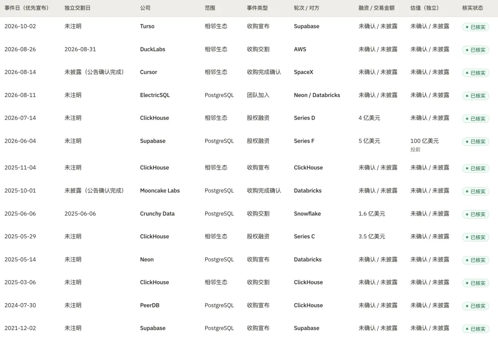
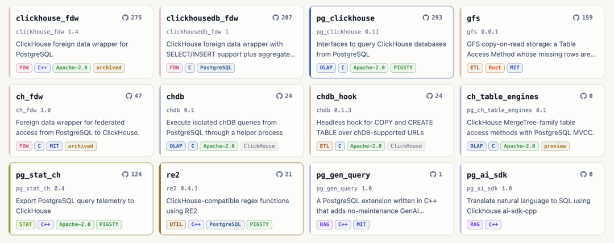
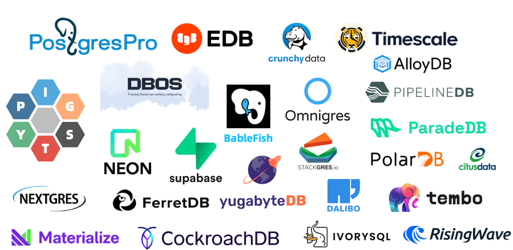
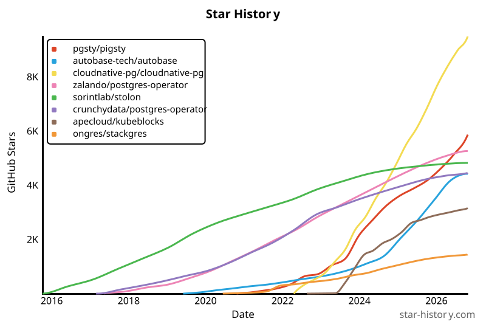
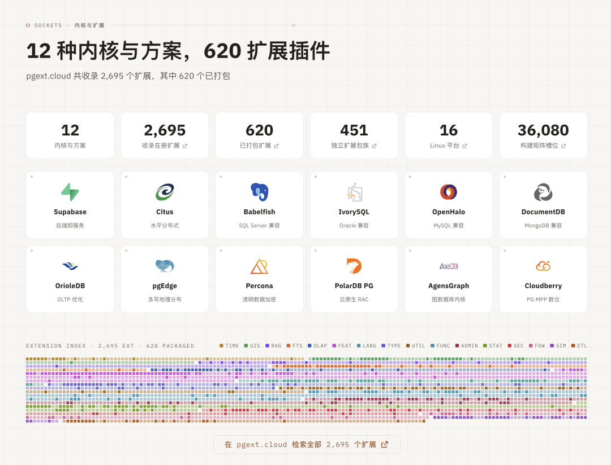

Last night on Twitter, ClickHouse posted a cryptic teaser: *"Something big is coming..."* This morning brought the reveal: ClickHouse has acquired Xata, and its own managed PostgreSQL service is now generally available (GA).

This isn't an isolated deal. It's the latest move in a clear pattern: Postgres ate the database world, and now the industry giants are eating Postgres companies.

## The Buying Spree

Over the past year or so, PostgreSQL startups have become the hottest targets on the market: [Databricks bought Neon for ~$1B](/pg/pg-capital-market/), [Snowflake picked up Crunchy Data for ~$250M](/en/db/db-for-ai/), and now ClickHouse has acquired Xata. All three major analytics platforms have made their move. Not one sat it out.

Smaller extension and tooling teams are finding exits too: [Databricks acquired Mooncake Labs](/pg/databricks-buys-again/), creator of `pg_mooncake` ([which I ended up taking over](/en/pg/fork-pg-mooncake/)), along with Electric, the team behind PGlite; Vercel acquired Gel (formerly EdgeDB), builder of a Postgres DSL; and vector search startup TensorChord sold as well ([leaving `vchord` on my plate too](/en/pg/maintain-vchord/)).

**Capital is voting with its checkbook: Postgres is the highest-conviction bet in the database world right now.**

Andy Pavlo has compared this wave to the late-2000s OLAP acquisition spree: once Aster Data, Greenplum, and DATAllegro were snapped up, Vertica was the only one left waiting at the station.

At the start of the year, his list of independent Postgres DBaaS vendors ran: Supabase, YugabyteDB, TigerData, PlanetScale, Xata, pgEdge, and Nile. Ten months later, Xata has caught its train, and Supabase has blown past a $10B valuation to become an acquirer itself. Not many names are left standing on the platform: TigerData, pgEdge, Nile, ParadeDB...

How frothy has the market gotten? Even my literal one-person PostgreSQL distro shop has fielded ~$17M (RMB 120M) valuation feelers.

## The Dust Has Settled

I've been making this case for a while: [the database order of the AI era is already settled](/en/db/db-for-ai/). PostgreSQL is the Linux of databases, and competing against it head-on with another general-purpose relational kernel is a lost game—you might as well pack it in.

Postgres is the uncontested default today, much as Linux is on servers. Most other databases sit on a steady downward trajectory. The few engines still gaining ground are the ones occupying orthogonal ecological niches: embedded SQLite, and [analytical DuckDB](https://mp.weixin.qq.com/s?__biz=MzU5ODAyNTM5Ng==&mid=2247492999&idx=1&sn=b27149c0f5e676797a94a2572079e78f&scene=21#wechat_redirect).

Being the default means AI agents reach for Postgres right alongside human developers and traditional software. Naturally, everyone sees an opening and wants to own the data entry point for agents. When Neon was acquired, it claimed that over 80% of the databases on its platform were already being spun up by agents; Supabase just bought Turso pitching *"a database for every agent."*

The telling detail is that Turso is an SQLite distribution, which neatly confirms the thesis above. The database winners of the agent era will be PostgreSQL and SQLite (with DuckDB counting as another half). Ephemeral, disposable scratch databases for a single agent will sink down into embedded engines like SQLite and DuckDB, while the enterprise System of Record—where multiple agents share durable state—stays on Postgres. Those cards are already face-up on the table, which is why everyone is scrambling for position.

## ClickHouse's Postgres Playbook

A few years ago in *[PostgreSQL Is Eating the Database World](/en/pg/pg-eat-db-world/)*, I argued that Postgres is far more than a database—it's a framework capable of absorbing the entire data world. What makes that possible is its extension architecture: you can bolt on whole new capabilities without touching the core kernel.

ClickHouse clearly gets this. Over the past two years, it has invested heavily in the Postgres ecosystem, working almost entirely through extensions and external components rather than modifying the kernel:

- Acquired **PeerDB** to stream Postgres data into ClickHouse via CDC;
- Built the **`pg_clickhouse`** extension to query ClickHouse directly from inside Postgres;
- Open-sourced the **`pg_stat_ch`** extension to export per-query Postgres telemetry into ClickHouse;
- Partnered with **Ubicloud**—founded by the original Citus team—to launch its own managed Postgres service built around local NVMe storage and native CDC.

Acquiring Xata is a targeted move for the agent era. ClickHouse's managed Postgres handles high-throughput, long-lived production databases; Xata's copy-on-write storage, branching in seconds, and scale-to-zero architecture are built for massive fleets of short-lived, small-footprint agent databases. One anchors production workloads; the other captures the agent entry point.

## The Next Phase: Distribution War

Once there's no longer any debate over the kernel, competition shifts to two places: talent and distributions. Linux set the precedent decades ago. After the kernel converged, the kernel itself became "boring"—what users actually cared about was whether to run Debian, Ubuntu, RHEL, or SUSE.

[Postgres Dominates the Database World—So Who Will Devour PG?](/en/pg/proprity-pg/)

Postgres is playing out the same way: do you run Pigsty or RDS, EDB or Percona, Supabase, Neon, or Xata? Underneath, they're all PostgreSQL, yet their philosophies and value propositions couldn't be more different.

Thanks to the Postgres community's unique governance structure, this wave of acquisitions won't let any single company "own" Postgres. The core kernel belongs to the community under a permissive license; nobody can buy it out.

While nobody can lock down the kernel or source repository, the managed services, developer entry points, and engineering teams built on top of Postgres are very much up for grabs. The result is a rapid shrinking of independent Postgres vendors, as lock-in moves up the stack from the database layer into catalogs, governance, and billing.

At PGConf.Asia next week, I'm giving a talk mapping out the PostgreSQL distributions and where each one stakes its value proposition. The title gets straight to the point: *Distribution War*.

## My Take

I have both skin in the game and soul in the game here. I'm an active player in this market—I already have a seat at the table, and my footing is solid.

My stance is simple: you fight your war, I'll do my work. While everyone else battles over Postgres distributions, I'm building a [meta-distribution](/en/pigsty/v3.6/)—a distribution of distributions. Concretely, that comes down to two things: extensions and monitoring.

**First, extensions.** Every vendor pitches a different value proposition, yet they all run PostgreSQL—and extensions are the soul of Postgres. The extension repository I maintain (~600 extensions across 16 Linux distributions) is open to the entire Postgres world, ready to use regardless of which distribution you choose.

**Second, the operational control plane.** Running enterprise-grade Postgres requires high availability (HA), point-in-time recovery (PITR), and observability. Most stacks use roughly the same tooling for HA and PITR, whereas Pigsty is the only one that pushes monitoring all the way to the extreme. Whichever Postgres kernel you run, Pigsty gives you that open-source monitoring foundation.

That leaves me in an interesting spot, watching the giants slug it out from the sidelines. Let the heavyweights fight over the market—the world is always going to need an option grounded in open source, software freedom, and local-first infrastructure. I'm happy to hold that line: as long as even one maintainer stands firm on this side, nobody can ever monopolize the PostgreSQL ecosystem.
