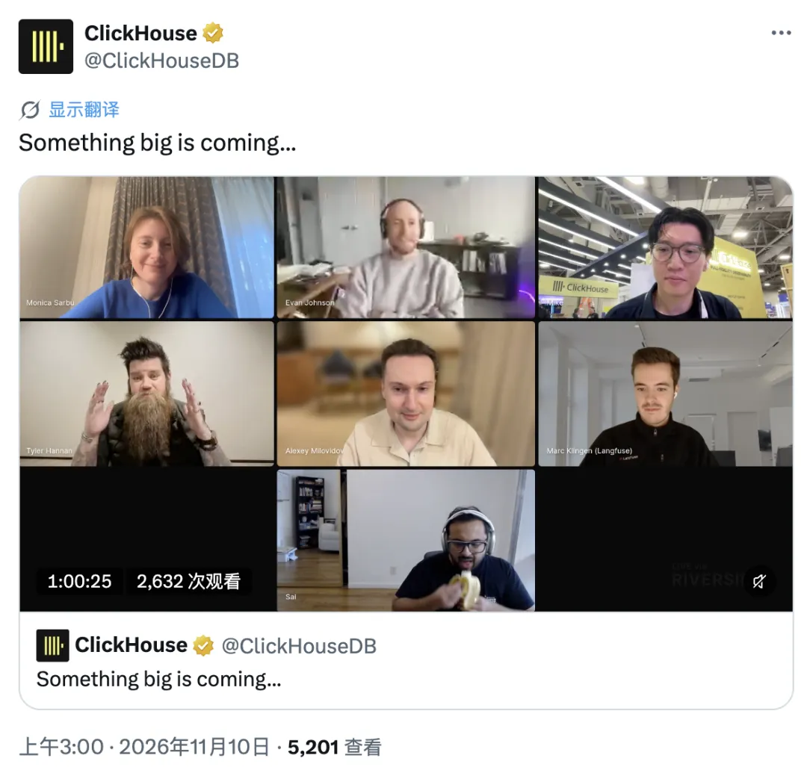
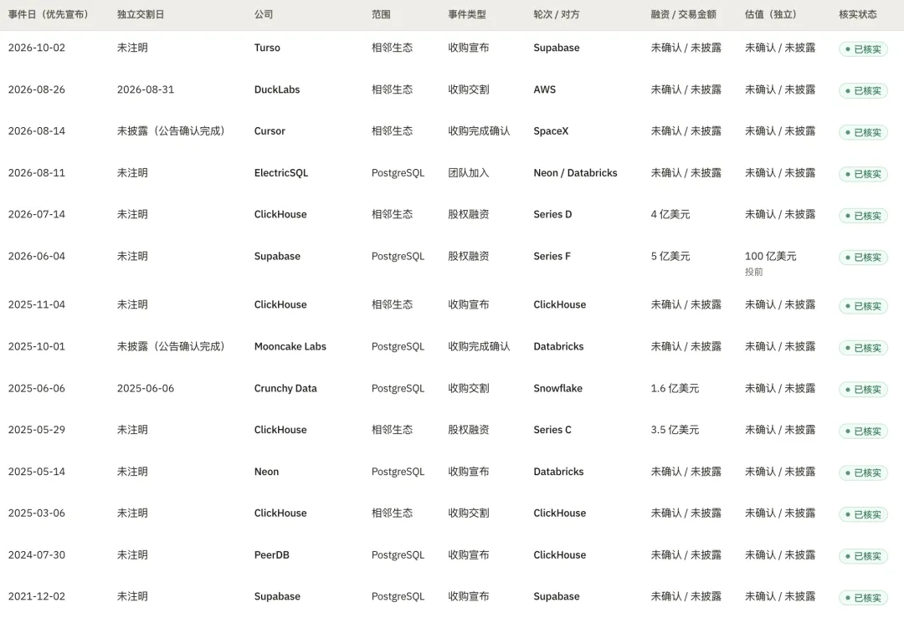
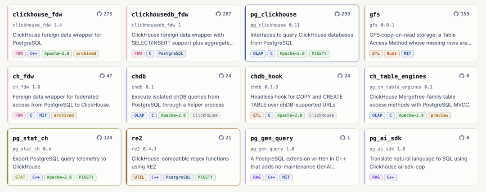
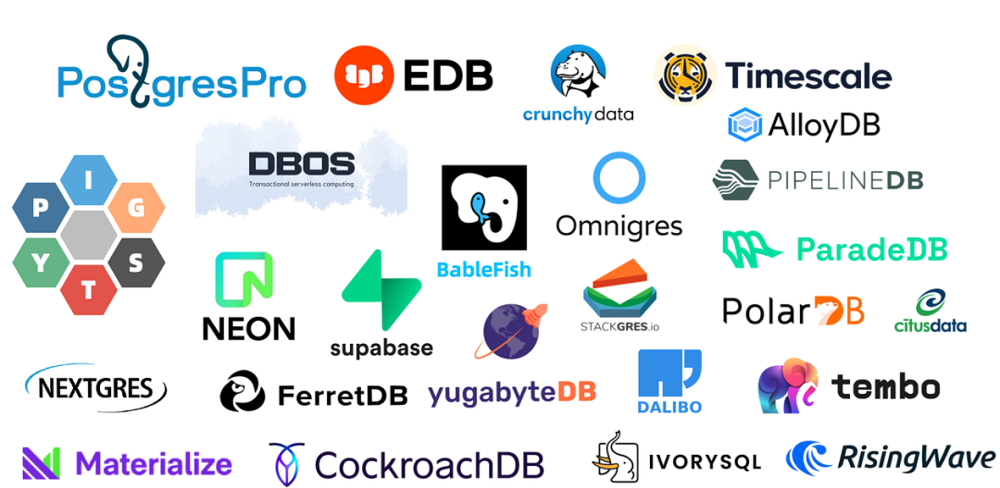
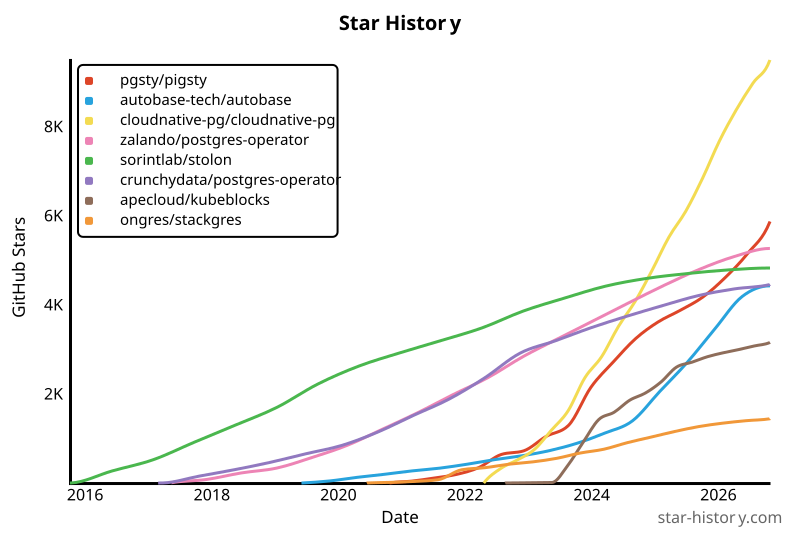
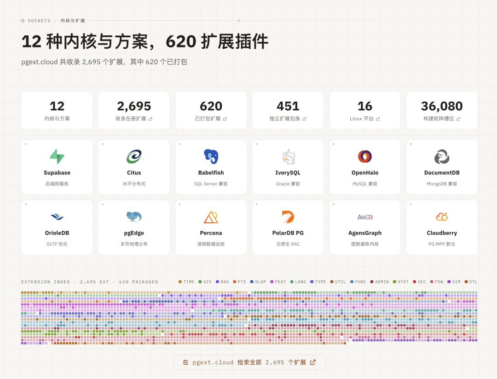

昨晚 ClickHouse 在 Twitter 上神秘兮兮地预告 *“大的要来了”*。今早揭晓：ClickHouse 收购 Xata，同时自家的托管 PostgreSQL 服务正式 GA。

这已经不是一条孤立的新闻，而是一个趋势：PG 吞噬了数据库世界，现在轮到巨头来吞噬 PG 公司了。

## 抢购浪潮

过去一年多，PostgreSQL 成了资本市场的香饽饽：[Databricks 约 10 亿美元买下 Neon](/pg/pg-capital-market/)，[Snowflake 约 2.5 亿美元买下 Crunchy Data](/db/db-for-ai/)，现在 ClickHouse 买下 Xata。三大分析平台，一家不落。

小一点的扩展公司也在上岸：做 pg_mooncake 的 [Mooncake Labs 被 Databricks 收了](/pg/databricks-buys-again/)（[pg_mooncake 由老冯接盘](/pg/fork-pg-mooncake/)）；还买了做 PGlite 的 Electric；Vercel 收了做 PG DSL 的 Gel（原 EdgeDB），做向量检索的 TensorChord 卖了（[vchord 同样由老冯接盘](/pg/maintain-vchord/)）。

**资本在用脚投票：PG 是当下数据库世界里最确定的机会。**

Andy Pavlo 把这一轮比作 2000 年代末的 OLAP 收购潮：Aster Data、Greenplum、DATAllegro 被买走后，只剩 Vertica 在车站等车。

他年初列的独立 PG DBaaS 名单是 Supabase、YugabyteDB、TigerData、PlanetScale、Xata、pgEdge、Nile。十个月后，Xata 上了车，Supabase 估值超过 100 亿美元、自己当起了买家。还在站台上的已经不多：TigerData、pgEdge、Nile、ParadeDB、……

行情火到什么程度？连老冯这个 PG 发行版一人公司，都有 1.2 个的估值。

## 尘埃落定

老冯早就说过：[AI 时代的数据库格局已经尘埃落定](/db/db-for-ai/)，PostgreSQL 就是数据库世界的 Linux，与它直接竞争的数据库内核都可以洗洗睡了。

它是这个时代没有争议的默认选项，就像 Linux 之于服务器操作系统。其他数据库大多在确定的下行通道里，还能往上走的，都是和 PG 错开生态位的：比如嵌入式的 SQLite，[分析型的 DuckDB](https://mp.weixin.qq.com/s?__biz=MzU5ODAyNTM5Ng==&mid=2247492999&idx=1&sn=b27149c0f5e676797a94a2572079e78f&scene=21#wechat_redirect)。

默认选项意味着：不只人类用户和传统软件用 PG，Agent 也用 PG。于是大家觉得这是个风口，要来抢 Agent 的数据入口。Neon 被收购时，号称平台上 80% 以上的库已经是 Agent 建的；Supabase 刚买下 Turso，口号是“让每个 Agent 都有自己的数据库”。

值得玩味的是 Turso 是 SQLite 发行版，这恰好印证了上面的判断：Agent 时代数据库的赢家，会是 PostgreSQL，SQLite（DuckDB 算半个）。单个 Agent 用完即弃的小库，会往 SQLite / DuckDB 这类嵌入式方案下沉；企业级、多个 Agent 共享状态的那个 System of Record，依然是 PG。这已经是明牌，所以大家都在抢。

## ClickHouse 的 PG 布局

老冯几年前在《[PostgreSQL 正在吞噬数据库世界](/pg/pg-eat-db-world/)》里说过：PG 不只是一个数据库，而是一个能吞噬整个数据世界的框架。靠的就是扩展机制：不改内核，就能给它加装各种能力。

ClickHouse 显然看懂了这一点。过去两年它在 PG 生态的投入很深，而且几乎都是用扩展和外围组件，不动内核：

- 收购 PeerDB，把 PG 数据 CDC 到 ClickHouse；
- 做了 pg_clickhouse 扩展，在 PG 里直接查 ClickHouse；
- 开源 pg_stat_ch 扩展，把 PG 每条查询的指标导入 ClickHouse；
- 和 Citus 原班人马创办的 Ubicloud 合作，推出自家托管 PG，主打 NVMe 本地盘加原生 CDC。

收购 Xata 是专门针对 Agent 的一步棋。托管 PG 吃高吞吐、长寿命的生产库；Xata 的写时复制存储、秒级分支、缩容到零，吃的是 Agent 那种海量、短命的小库。一个稳住生产负载，一个抢 Agent 入口。

## 格局演变：发行版战争

当内核没有争议，竞争就转移到两个地方：人才和发行版。Linux 就是先例。内核统一之后，内核本身就变得“无聊”了，大家真正关心的是用 Debian、Ubuntu、红帽还是 SUSE。

[Postgres 主宰数据库世界，而谁来吞噬 PG？](/pg/proprity-pg/)

PG 也一样：你用 Pigsty 还是 RDS，用 EDB 还是 Percona，用 Supabase、Neon 还是 Xata？这些都是 PostgreSQL，但风格和价值主张完全不同。

因为 Postgres 社区独特的治理结构，这轮收购不会让任何一家“拥有” Postgres。PG 内核属于社区，宽松许可，谁也买不走；

但内核/代码仓库层面无法控制，PG 之上的托管服务、开发者入口和团队是可以控制的。结果是独立的 PG 服务商迅速减少，锁定从数据库层上移到目录、治理和账单层。

下周的 PGConf.Asia 上，老冯会专门讲 PostgreSQL 生态的发行版地图，以及各家的价值主张。名字很直接：《Distribution War》发行版战争。

## 老冯评论

在这件事上，老冯是 skin in the game / soul in the game，是场内玩家。已经有了一张门票，而且基本盘很稳固。

老冯的立场是：你们打你们的，我干我的。你们卷 PG 发行版，老冯做[元发行版](/pigsty/v3.6/)。就是发行版的发行版。具体来说是两件事，扩展和监控。

**第一，扩展。** 各家价值主张不同，但用的都是 PostgreSQL，而 PG 的灵魂是扩展。老冯维护的扩展仓库（约 600 个扩展、覆盖 16 个 Linux 发行版）对整个 PG 世界开放，不管你是哪家发行版都能用。

**第二，管控底座。** 要跑企业级 PG，你需要高可用、PITR 和可观测性。高可用和 PITR 大家用的工具大同小异，但把监控做到极致的，只有 Pigsty。不管你用哪家的 PG 内核，Pigsty 都给你提供这个开源的监控底座。

所以老冯站在一个微妙的位置上，可以坐山观虎斗。巨头们打来打去，列强争霸，但这个世界终归需要一个站在开源、自由、本地优先立场上的选项。这个位置，老冯当仁不让：只要有一个人坚定地站在这一侧，PG 生态层面的垄断就永远无法实现。
