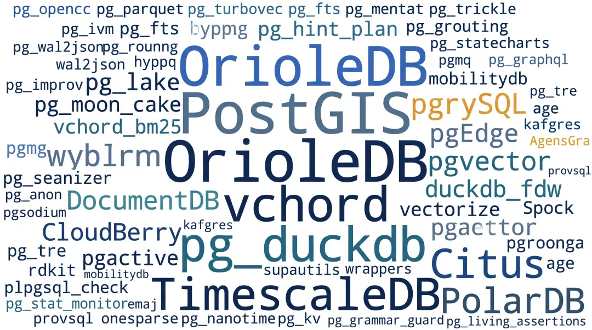
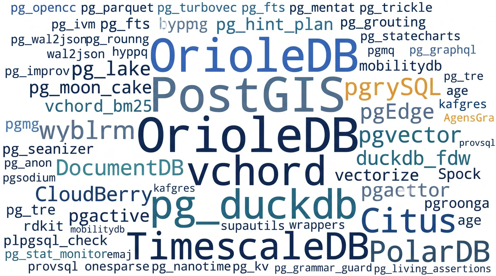
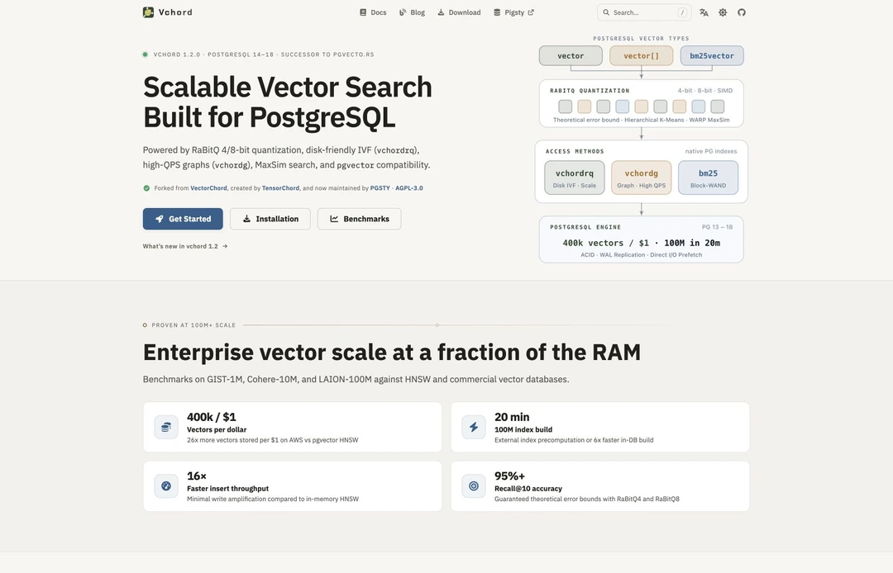
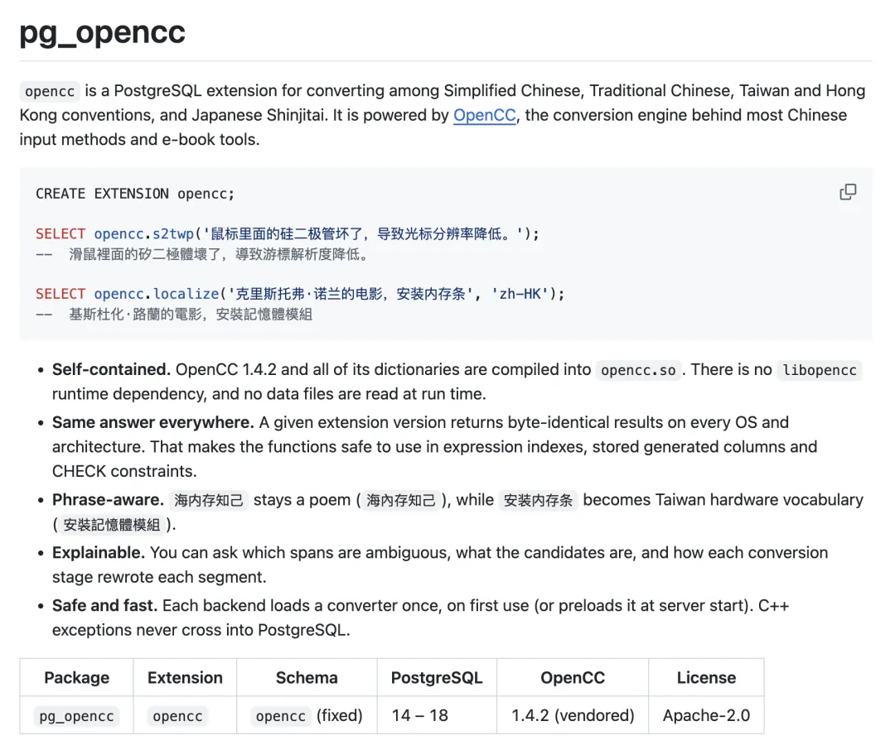
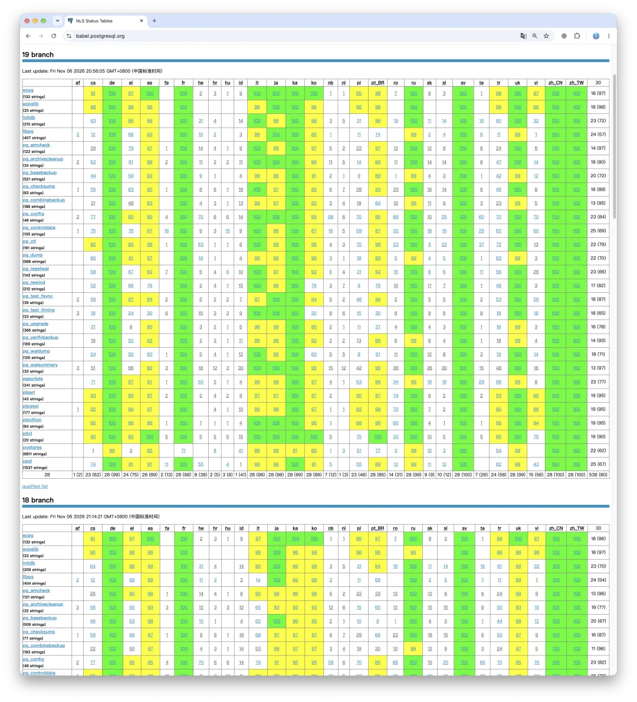
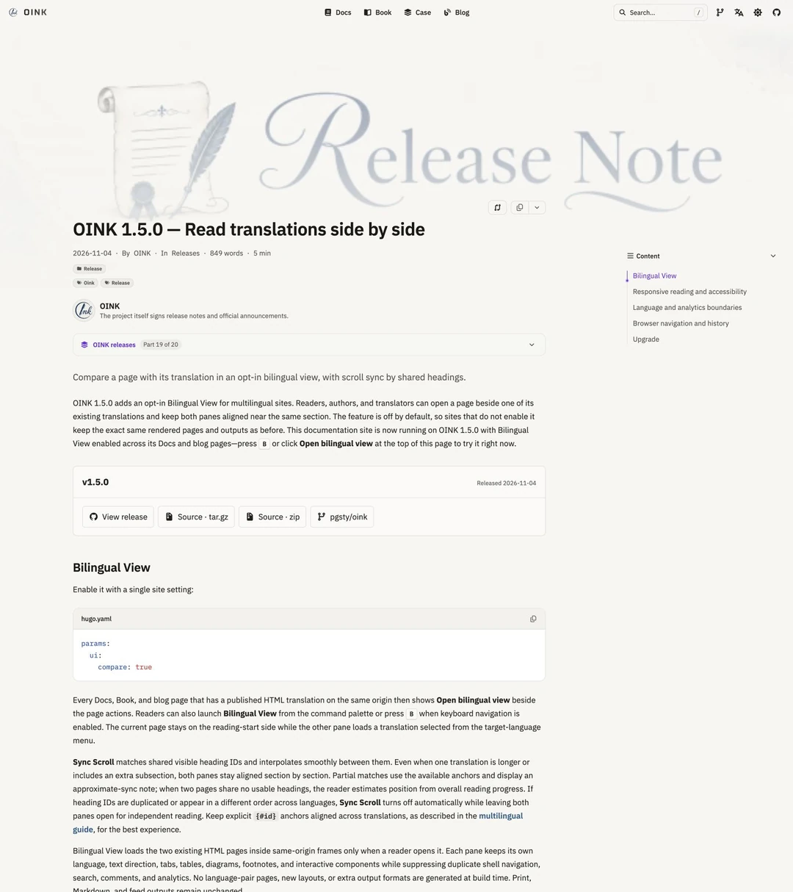
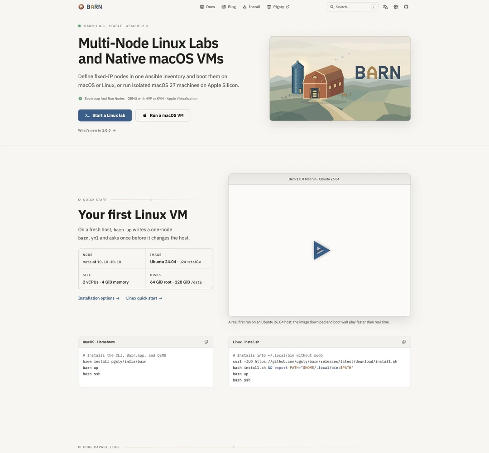
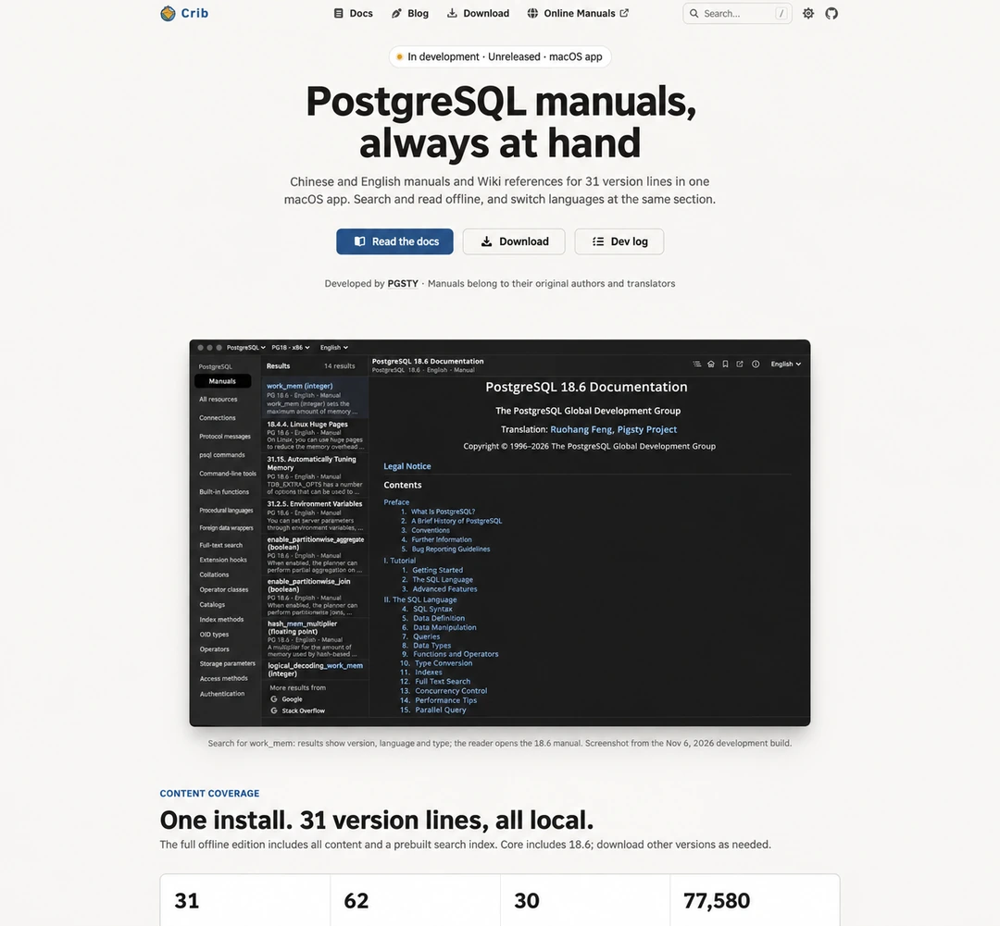

In two recent posts—[When the Cloud Gets Riddled with Holes](/en/cloud/blackwall/) and [The Internet Is Getting Shot Full of Holes](/en/cloud/net-attack/)—I wrote about an uncomfortable reality: **the entire software industry is going through an AI-driven security stress test.**

With AI-assisted vulnerability scanners and automated bug hunters running around the clock, open-source projects are fielding a daily flood of bug reports and security disclosures. Even the normally rock-solid PostgreSQL community hasn't been spared: **PostgreSQL 19 has already been delayed by the resulting wave of fixes.**

Under the current schedule, code freeze and packaging are set for November 9, with the general release following a week later. At this point, I'm just hoping no last-minute showstopper turns up over the next few days to push the date back again.

The core server isn't the only thing under pressure. Across the PostgreSQL extension ecosystem, maintainers have been cutting releases in rapid succession to stay ahead of security advisories.

The clearest indicator is **PostGIS 3.7.0**. Earlier security vulnerabilities in two of its companion extensions affected nearly every major managed PostgreSQL provider. In 3.7.0, the PostGIS team made a clean break: they **removed `address_standardizer` and `postgis_tiger_geocoder` from the core PostGIS distribution entirely**, splitting them out to be built and packaged independently. When automated tools are probing every code path for bugs, shedding non-essential components to shrink the attack surface is the pragmatic call.

A look through recent changelogs shows similar hardening across the board: `emaj 5.0.1` patched a privilege-escalation flaw, `pg_anon 3.3.2` shipped a security update, and dozens of other extensions have been pushing out rapid point releases. When upstream moves at that pace, downstream packagers don't get much rest either. Over the past two months, I've been tracking upstream core and extension updates at roughly **one release batch per week**. Here is a rundown of the most notable changes across the PostgreSQL ecosystem from this wave, along with a few side projects I've been building lately.

## 1. Core Engine Milestones: OrioleDB Reaches GA, Plus Major Fork Updates

The biggest milestone in this batch is **OrioleDB finally reaching its first stable release**.

Anyone who has operated PostgreSQL at scale knows the trade-offs of its native heap-based MVCC storage engine: table bloat and write amplification under update-heavy workloads. OrioleDB tackles those problems at the storage layer using undo logs and modern page-level concurrency control. After a long beta cycle—we were still packaging `1.8-beta16` and `1.10~beta19` just last month—OrioleDB has finally dropped the beta tag and shipped **version 1.10.1**, supporting three major PostgreSQL branches: **PG 16.15, PG 17.11, and PG 18.6**. Several other specialized PostgreSQL forks and engines also landed major updates:

- **Babelfish 6.2.0 adds PG 18 support**: Babelfish, which brings SQL Server wire-protocol and T-SQL compatibility to PostgreSQL, now ships `babelfish-18` at **6.2.0** (based on PG 18.6, complete with all four companion extensions), while the PG 17 branch has moved up to **5.7.0**.
- **CloudBerry 2.2.0**: A major release from one of the leading open-source MPP data warehouse forks.
- **Specialized PostgreSQL forks across the board**: Alongside standard PGDG builds, heavily modified PostgreSQL forks have been pushing frequent patch releases, and I've pulled all of them into the repository—including Alibaba Cloud's **PolarDB 17** (updated to `17.11.1.0-2PGSTY` with an updated PolarStore SDK), the graph database engine **AgensGraph 18** (updated to `2.18.6.1`), the Oracle-compatible **IvorySQL 5.6** (based on PG 18.6, bundling 38 extensions), the multi-master distributed engine **pgEdge 15–18** (bundled with the latest `Spock 5.0.13`), and **Percona's `pgtde-18`** for transparent data encryption (updated to 18.6.1).

I've built ready-to-install RPM and DEB packages for all of these across 16 Linux distributions.

- [RPM ReleaseNote 2026-11](https://github.com/pgsty/pgext/blob/main/content/release/rpm.md)
- [DEB ReleaseNote 2026-11](https://github.com/pgsty/pgext/blob/main/content/release/deb.md)

## 2. DuckDB 2.0 and Unconventional New Extensions

On the extension side, the past two months have brought a dense stream of new packages and major version upgrades. Here are the highlights:

### 1. DocumentDB 1.0 and the Move to DuckDB 2.0

Microsoft's open-source MongoDB-compatible engine, **DocumentDB**, has reached **1.0** (supporting PG 16–18). On the analytics and lakehouse front, the arrival of DuckDB 2.0 means both **`pg_duckdb 1.2.0`** and **`duckdb_fdw 2.0.2`** have been updated to embed the **DuckDB 2.0.0** engine (note that the two remain mutually exclusive within the same PostgreSQL instance—pick one). Combined with **`pg_lake` 3.6.0**, a **`pg_parquet`** update fixing temporary file leaks during streaming `COPY`, **Citus 14.3.0**, and **TimescaleDB 2.31.0**, PostgreSQL's native lakehouse stack continues to mature.

### 2. Search and Vector Retrieval

**`vchord`**, which we maintain, has been updated to `1.2.0-2PGSTY` with improved reranking precision for `vchordg` and `halfvec` candidate sets. Its companion extensions, **`vchord_bm25`** and **`pg_tokenizer`**, have both reached **1.0.0**, adding native `tsvector` support and external Lindera 6 dictionaries. Elsewhere in the search space, ParadeDB's `pg_search` (0.26.5), `pg_fts` (1.16.0), `pg_turbovec` (2.15.0), and `pgroonga` (4.1.0) have all been shipping frequent updates.

### 3. Unconventional New Extensions

We also added several unusual newcomers to the catalog:

- **`pg_agent_gate` (0.4.1)**: An access-control gatekeeper designed to enforce permission boundaries when LLM agents query or mutate a database.
- **`pg_opencc` (0.1.0)**: A thin wrapper around OpenCC (`libopencc`) that I built with Claude for in-database conversion between Simplified and Traditional Chinese (supporting PG 14–18), eliminating the need to round-trip text through the application layer just to normalize Chinese scripts.

- **`pg_statecharts` (0.1.0)**: Implements finite state machines and statechart transitions directly inside PostgreSQL.
- **`pg_grammar_guard` (0.4.9) and `pg_living_assertions` (0.5.10)**: In-database syntax guardrails and continuous, dynamically evaluated data assertions.
- **`kafgres` (0.3.2)**: Lets PostgreSQL act as a Kafka broker. Other additions include **`pg_tre` (4.6.1)** for approximate regular expression matching (fuzzy regex), **`pg_nanotime` (0.2.0)** for nanosecond-resolution timestamps, and **`pg_kv` (0.1.0)**, a fast, unlogged in-memory key-value store backed by shared memory.

## 3. Adopting Projects and Patching Upstream Bugs (Including AWS's)

Maintaining a package repository that spans more than a dozen Linux distributions and hundreds of extensions involves a lot of unglamorous supply-chain plumbing. A couple of behind-the-scenes episodes from recent batches are worth sharing:

### Almost Adopting `pg_mooncake`, Then Sending the Fixes Upstream

The `pg_mooncake` extension had gone unmaintained for a while and was stuck on an older release that wouldn't build against `pg_duckdb 1.2.0` (DuckDB 2.0) or newer `pgrx` versions. I stepped in, ported it forward to `0.3.0`, and prepared to take over maintenance myself:

- [Taking Over Another PostgreSQL Extension: vchord Yesterday, pg_mooncake Today](/en/pg/fork-pg-mooncake/)

Right after the packages went live, the CEO of Mooncake Labs reached out to let me know their team was still willing to maintain the project. Having the original authors stay on board is the best possible outcome, so I sent all of the compatibility patches upstream.

### Patching Upstream Bugs Across the Build Matrix

Compiling and running QA across a wide matrix of OS targets and CPU architectures routinely surfaces obscure upstream bugs. Half the time, rather than filing an issue and waiting, I just write a patch and ship the fix in the package build. Amusingly enough, that recently included `pgactive` and `pgcollection`—two of the relatively few open-source PostgreSQL extensions published directly by AWS, which had some surprisingly basic build and runtime bugs that I ended up patching along the way. A broad multi-distro packaging matrix turns out to be one of the most effective integration tests an open-source ecosystem can get.

## 4. Token-Fueled Side Projects

Beyond extension packaging, here are a few tools and projects I've been building on the side. With a generous token budget and a tuned AI workflow, it is easy to get carried away.

### 1. Teaching PostgreSQL Chinese: Core Server Messages and All 508 Historical Doc Releases

First, two updates on Chinese localization.

As I mentioned previously, I finished translating the PostgreSQL 19 core server messages into Simplified Chinese. Even better: **the backported translations for the supported PG 15 through PG 18 branches will ship in next week's minor releases.** Within about a week, every supported PostgreSQL release branch will have complete, idiomatic Chinese server messages out of the box.

*As of today, Simplified Chinese, Traditional Chinese, and Swedish are the only three languages with 100% message translation coverage.*

Another large project is now in the home stretch: **translating the entire historical archive of official PostgreSQL documentation into Chinese**. Earlier, I translated [the official manuals for all **31 major PostgreSQL versions**](https://mp.weixin.qq.com/s?__biz=MzU5ODAyNTM5Ng==&mid=2247493128&idx=1&sn=d28faa447c8f9b527d872189ca3aed7b&scene=21#wechat_redirect). Over the past couple of weeks, I **[pointed my entire GLM subscription token quota at the backlog](https://mp.weixin.qq.com/s?__biz=MzU5ODAyNTM5Ng==&mid=2247493329&idx=1&sn=2841675aa9c3e4c4c78d6901e096c73d&scene=21#wechat_redirect)** and kept background translation jobs running around the clock. After finishing those 31 major versions, I moved on to the documentation for **all 508 minor releases** in PostgreSQL's history, which is now **around 80% complete**. Once the remaining 20% finishes, every official PostgreSQL manual since the project's inception will have a complete Chinese edition.

To make reading bilingual technical material easier, I also shipped **version 1.5.1** of **Oink**, my documentation framework, adding a **side-by-side bilingual view**. When reading Chinese and English documentation or technical books together, the two panes scroll in lockstep. It didn't warrant a separate blog post of its own, so consider this a brief plug.

### 2. Barn: Spin Up a Local Fleet of Agent VMs on Your Laptop

We also quietly released **Barn**, a lightweight virtual machine manager. I've been using it daily for my own workflows, though I hadn't written about it publicly until now—my habit is to dogfood a tool thoroughly before talking about it.

Think of Barn as a stripped-down, self-contained Vagrant: **a tool for spinning up a fleet of VMs on a Linux or macOS laptop with a single click**, or more practically, **a local sandbox manager for AI agents**. Whenever an agent needs a clean OS environment to test packages or run commands, Barn can provision a fresh local VM in seconds.

Its best feature is **direct support for macOS guest VMs**. Apple's virtualization license limits each Mac host to two concurrent macOS VMs, but that still **expands a single Mac from 1 computer-use environment to 3**, cleanly isolated and at zero extra hardware cost. If you are running multiple computer-use agents locally, it makes a big difference. I'll write a dedicated post covering Barn's architecture and workflow soon.

### 3. Crib and CapsLock: Native macOS Utilities

Alongside Barn, I've built two small native macOS utilities that I use constantly:

**Crib**: A local PostgreSQL documentation browser that started as a personal tool and is now being polished for a public release. It packs the entire `pg.center` knowledge base into a fast, native macOS app for instant offline full-text search across every version of the PostgreSQL manuals, and it can also browse and search any documentation site built with the Oink framework offline.

*AI-translated English rendering of the Crib homepage.*

**CapsLock**: A keyboard and window-switching utility I trigger hundreds or thousands of times a day on my laptop. I used to maintain this setup as a sprawling pile of Karabiner configuration files; with spare tokens on hand, I decided to replace it with a dedicated native app where custom hotkeys and app-switching rules are much easier to manage. It also served as my first foray into native macOS app development.

**Barn, Crib, and CapsLock are all native macOS apps.** To distribute them properly outside the Mac App Store, I recently went through the full Apple Developer pipeline—account enrollment, Developer ID certificate signing, notarization, and packaging. Once they are ready for a broader public release, I'll introduce each one in its own post.

## Read More

- [Taking Over Another PostgreSQL Extension: vchord Yesterday, pg_mooncake Today](/en/pg/fork-pg-mooncake/)
- [Why I'm Maintaining a VectorChord Fork](/en/pg/maintain-vchord/)
- [When the Cloud Gets Riddled with Holes](/en/cloud/blackwall/)
- [The Internet Is Getting Shot Full of Holes](/en/cloud/net-attack/)
- [PostgreSQL 19 Beta 4: Five Major Features Reverted](/en/pg/pg19b4-release/)
- [PostgreSQL's Chinese Translations Went Seven Years Untended. I Fixed Them in Seven Days.](/en/pg/pg-nls/)
- [Why Localize PostgreSQL into Chinese?](/en/pg/pg-zh-tw/)
- [Chinese PostgreSQL Docs Are Live: All 11 Major Versions](/en/pg/pgsql-cc-online/)
- [Oink: Build Modern Websites with Markdown](/en/ai/oink-intro/)
- [SOW: Postpartum Care for 100,000 Packages](/en/db/sow/)
- [Pigsty v4.5: 575 Extensions, Silo, Valkey, Kafka, and MySQL](/en/pigsty/v4.5/)
- [504 Extensions: Expand the PostgreSQL Landscape](/en/pg/extension-504/)
