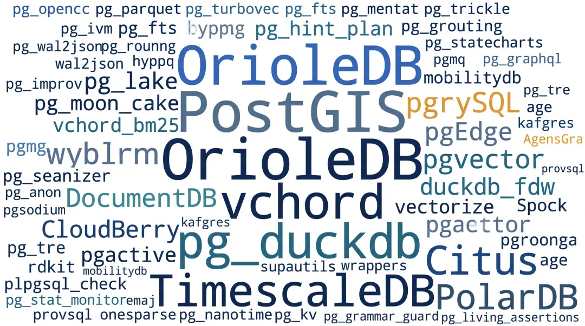
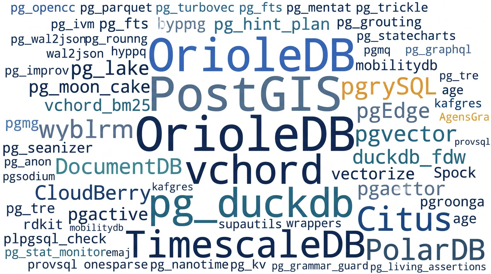
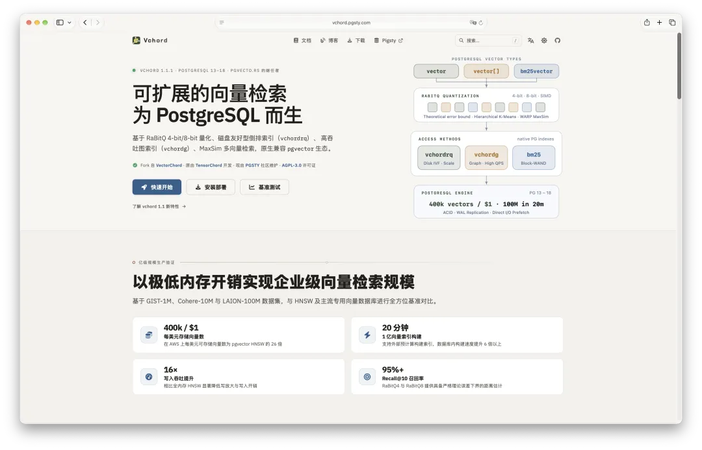
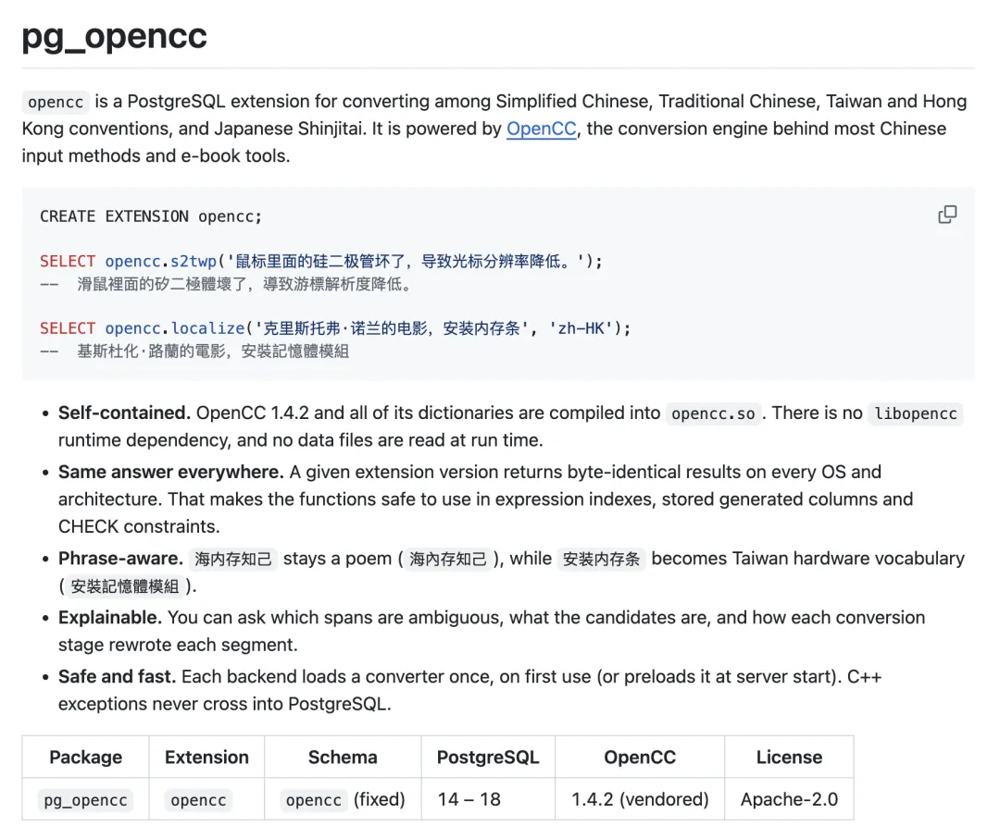
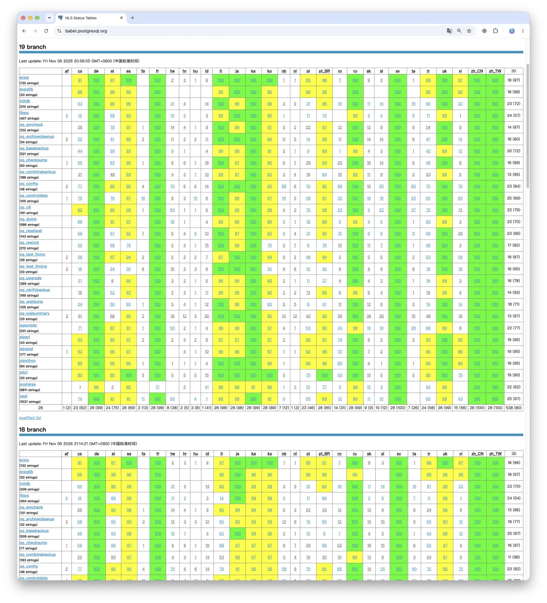
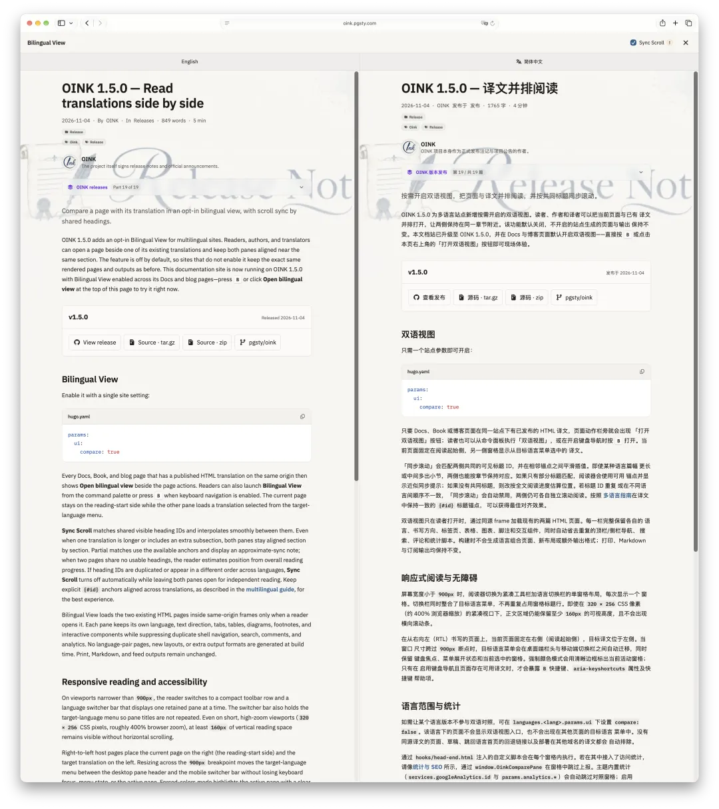
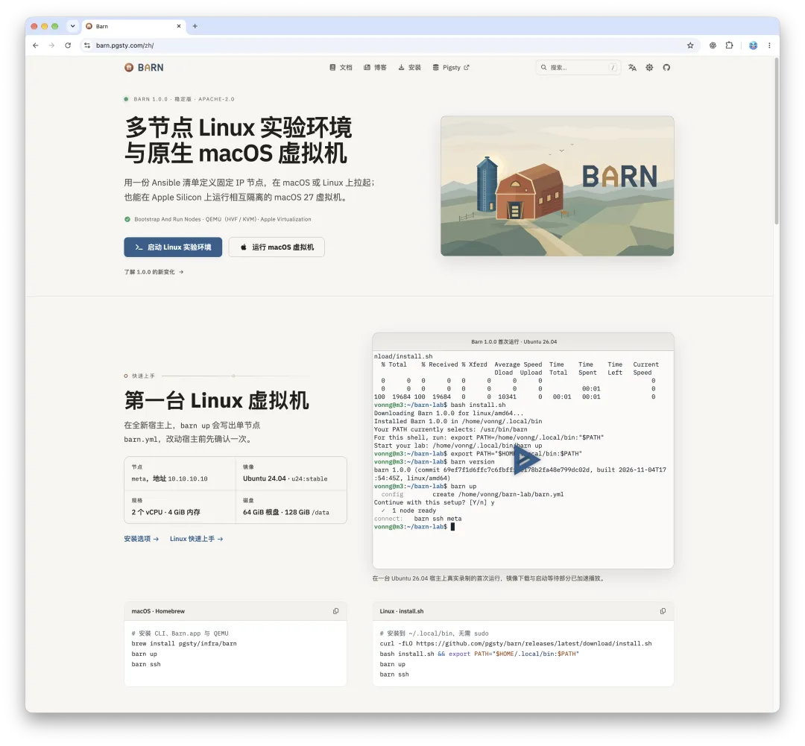
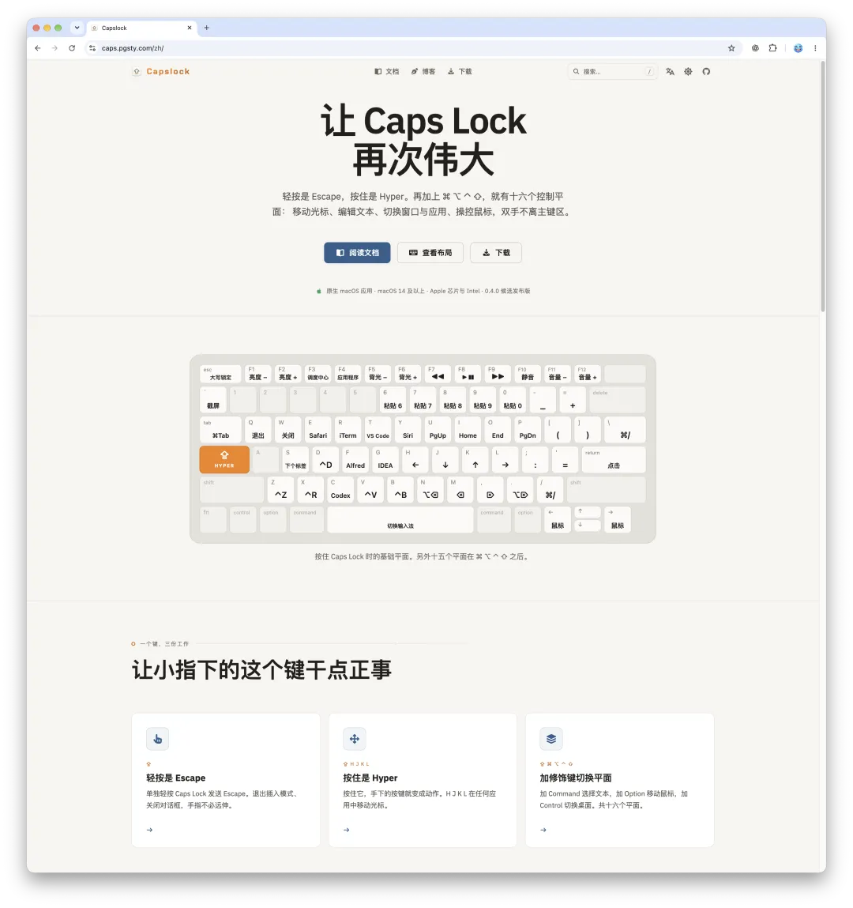

前段时间，老冯在《[云要被打成筛子](/cloud/blackwall/)》和《[互联网已经被打成筛子](/cloud/net-attack/)》两篇文章里聊过一个残酷的现实：**整个软件世界正在迎来一场“AI 渡劫”。**

随着各类 AI 驱动的漏洞挖掘与自动化扫描工具火力全开，开源社区几乎每天都在被海量的 Bug 报告和安全 Issue 狂轰滥炸，让人目不暇接。就连稳如老狗的 PostgreSQL 社区也未能幸免——**PG 19 因为这波密集的问题修复已经延期了**。

按照目前的节奏，理想情况下 11 月 9 号就要开始封版打包，再下一周就能看到正式版放出。老冯现在的心愿，就是这几天千万别再冷不丁掏出一个“大雷”导致继续延期了。

除了 PG 内核在渡劫，整个 PG 扩展生态最近也在密集发版，疲于应对各种各样的安全隐患。

最醒目的一个风向标就是 **PostGIS 3.7.0**。之前因为两个伴生扩展的安全问题，几乎所有主流托管 PG 云服务商都集体中招。到了这次 3.7.0 更新，PostGIS 干脆一不做二不休，直接上演了一出“壮士断腕”——**直接把 `address_standardizer` 和 `postgis_tiger_geocoder` 这两个伴生扩展从 PostGIS 核心包里彻底踢了出去**，改为单独独立构建、独立分发。在 AI 满地找洞的时代，主动剥离非核心组件、收敛攻击面，显然成了明智之举。

翻看最近的更新日志，你会发现类似的安全加固比比皆是：`emaj 5.0.1` 修复了提权漏洞，`pg_anon 3.3.2` 发布了安全更新，各种扩展开启了疯狂修洞发版模式。上游在狂飙，做软件供应链分发的自然也没法闲着。最近这一两个月，老冯密集跟进了上游内核与扩展的迭代，差不多保持着**每周滚动一个批次**的节奏。今天借着这波大规模更新，跟大家盘一盘最近 PG 生态有哪些重磅变化，顺便聊聊老冯这段时间手搓的几个新奇玩意儿。

## 一、重磅内核与里程碑：OrioleDB 转正，多模分支齐聚

这波更新里，最值得放鞭炮庆祝的里程碑，当属 **OrioleDB 终于发布了正式版**。

熟悉 PG 存储引擎痛点的朋友都知道，OrioleDB 主打 Undo Log 机制与现代化的页面级并发控制，旨在根治 PG 原生堆表 MVCC 带来的膨胀与高频更新瓶颈。熬过了漫长的 Beta 测试期（上个月我们还在打包 `1.8-beta16` 和 `1.10~beta19`），OrioleDB 这次终于摘掉了测试标签，正式推出 **1.10.1 版本**，同步覆盖 **PG 16.15、PG 17.11 和 PG 18.6** 三大主流内核分支。除了 OrioleDB，其他几个重量级内核与大版本也悉数到位：

- **Babelfish 6.2.0 正式支持 PG 18**：主打 SQL Server 协议与 T-SQL 兼容的 Babelfish 迎来了 `babelfish-18` 的 **6.2.0** 版本（基于 PG 18.6，完整包含四个伴生扩展），同时 PG 17 分支也跟进到了 **5.7.0**。
- **CloudBerry 2.2.0 大版本发布**：开源 MPP 数仓的重要扛旗者更新。
- **各路 PG 风味内核大团圆**：除了标准 PGDG 内核，各家深度定制的 PG 分支最近也在密集发版修问题，老冯顺手全都给拢进仓库里了——包括阿里云的 **PolarDB 17**（升级至 `17.11.1.0-2PGSTY` 并更新 PolarStore SDK）、图数据库内核 **AgensGraph 18**（升级至 `2.18.6.1`）、兼容 Oracle 的 **IvorySQL 5.6**（基于 PG 18.6，含 38 个扩展）、多主分布式内核 **pgEdge 15–18**（捆绑最新 `Spock 5.0.13`），以及主打透明数据加密的 **Percona `pgtde-18`**（跟进至 18.6.1）。

这些老冯都在 16 个 Linux 系统上做了开箱即用的 RPM/DEB 包，欢迎大家尝鲜。

- [RPM 变更日志 2026-11](https://github.com/pgsty/pgext/blob/main/content/release/rpm.zh.md)
- [DEB 变更日志 2026-11](https://github.com/pgsty/pgext/blob/main/content/release/deb.zh.md)

## 二、DuckDB 2.0 时代与脑洞新物种

在扩展层面，过去两个月合入的新包和大版本升级非常密集，挑几个有代表性的跟大家重点聊聊：

### 1. DocumentDB 1.0 转正与 DuckDB 2.0 浪潮

微软开源的 MongoDB 兼容引擎 **DocumentDB** 正式迈入 **1.0** 里程碑（支持 PG 16–18）。而在分析与湖仓赛道，随着 DuckDB 2.0 的到来，**`pg_duckdb 1.2.0`** 和 **`duckdb_fdw 2.0.2`** 双双换装了最新的 **DuckDB 2.0.0** 内核（注意这俩在同一个实例里依然互斥，二选一即可）。配合升级到 **3.6.0** 的 **`pg_lake`**、修复流式 COPY 临时文件泄漏的 **`pg_parquet`**、**Citus 14.3.0** 以及 **TimescaleDB 2.31.0**，PG 原生湖仓工具链又扎实了一大截。

### 2. 搜索与向量套件全面进化

由我们维护的 **`vchord`** 升级到了 `1.2.0-2PGSTY`（优化了 `vchordg` 与 `halfvec` 候选集的重排精度），配套的 **`vchord_bm25`** 和 **`pg_tokenizer`** 则双双迈入 **1.0.0 正式版**，原生支持 `tsvector` 并引入了外部 Lindera 6 词典。此外，ParadeDB 的 `pg_search`（0.26.5）、`pg_fts`（1.16.0）、`pg_turbovec`（2.15.0）和 `pgroonga`（4.1.0）也都在高频迭代。

### 3. 几个颇具脑洞的新扩展

目录里还新收录了一批很有意思的新面孔：

- **`pg_agent_gate`（0.4.1）**：专为 AI 时代打造的 Agent 权限守门员扩展，用来管控大模型 Agent 在数据库里的访问边界。
- **`pg_opencc`（0.1.0）**：老冯用 Claude 手搓的一个 OpenCC（`libopencc`）薄封装，支持在数据库内直接完成简繁中文转换（支持 PG 14–18），以后做繁简文本清洗再也不用把数据拉回应用层折腾了。

- **`pg_statecharts`（0.1.0）**：直接在 PostgreSQL 里实现有限状态机与状态图（Statecharts）流转。
- **`pg_grammar_guard`（0.4.9）与 `pg_living_assertions`（0.5.10）**：在数据库内部做语法护栏和动态持续数据断言。
- **`kafgres`（0.3.2）**：让 PG 直接客串 Kafka Broker；此外还有支持近似正则（模糊正则匹配）的 **`pg_tre`（4.6.1）**、纳秒级时间戳 **`pg_nanotime`（0.2.0）**，以及基于共享内存的非持久化高速键值存储 **`pg_kv`（0.1.0）**。

## 三、接盘、修 Bug 与给大厂“捉虫”

维护一个横跨十几个操作系统、覆盖数百个扩展的软件源，很多时候干的都是开源供应链里兜底的“手艺活”。这几个批次里，有几段幕后插曲值得一提：

### `pg_mooncake` 的“接盘未遂”与回馈上游

之前年久失修的 `pg_mooncake` 一直卡在旧版本，没法兼容新的 `pg_duckdb 1.2.0`（DuckDB 2.0）和 `pgrx`。老冯干脆亲自下场把它改造升级到了 `0.3.0`，本来打算一并接盘维护：

- [开源接盘侠又来了：昨天 vchord，今天吃月饼](/pg/fork-pg-mooncake/)

结果包刚打出来，Mooncake Labs 的 CEO 就找到了我，表示他们团队其实还是愿意继续维护这个项目的。既然原厂有人管，那自然是好事一桩，老冯顺手就把这波适配修改全部给上游提了上去。

### 顺手给上游（包括 AWS）修 Bug

在做全平台编译和 QA 测试时，经常能替上游抓到隐藏极深的坑。有时候懒得提 Issue，就直接写进打 Patch里顺手修了。特别有意思的是，像 `pgactive` 和 `pgcollection` 其实是 AWS 官方出品的少数几个 PG 扩展，按理说不该有这种低级错误，反正老冯也一起给擦屁股了。这也说明，高密度的打包分发矩阵，本身就是开源生态最好的试金石。

## 四、燃烧 Token 的副业

聊完了硬核的扩展包，再汇报几个老冯最近折腾出来的新玩意儿。手里有了充裕的 Token 和趁手的 AI 工作流，生产力确实容易刹不住车。

### 1. 让 PG 说一口地道中国话：内核与 508 个版本文档全史汉化

首先是关于汉化的两个好消息。

之前老冯提到过，我已经做完了 PG 19 内核的中文翻译。更棒的消息是：**PG 15 到 PG 18 这些仍在维护的历史版本，也会在下周的小版本发布中正式纳入中文翻译信息！** 也就是说，差不多再过一周，所有受支持的主流 PG 版本就都能说一口地道、流利的中国话了。

*截至目前，全球只有简体中文、繁体中文和瑞典语这三门语言实现了 100% 的消息翻译覆盖。*

另一件干得差不多、正在收尾的浩大工程是 **PG 文档的全史汉化**。之前老冯一口气翻译了 [PG 全部 **31 个大版本**的官方文档](https://mp.weixin.qq.com/s?__biz=MzU5ODAyNTM5Ng==&mid=2247493128&idx=1&sn=d28faa447c8f9b527d872189ca3aed7b&scene=21#wechat_redirect)；最近我干脆把 **[GLM 订阅的所有 Token 额度全砸了进去](https://mp.weixin.qq.com/s?__biz=MzU5ODAyNTM5Ng==&mid=2247493329&idx=1&sn=2841675aa9c3e4c4c78d6901e096c73d&scene=21#wechat_redirect)**，在后台日夜不停地跑翻译任务，已经跑了一两周了——翻完 31 个大版本后，直接向 PG 历史上所有的 **508 个小版本文档**发起总攻，目前进度已经完成了 **80% 左右**。等最后这 20% 跑完，我们就相当于把 PostgreSQL 自诞生以来的全部官方文档彻底汉化了一遍，想想都是一件极其有趣的事。

顺带一提，为了配合看双语资料，老冯自研的文档框架 **Oink** 最近也发布了 **1.5.1 版本**，新增了**双语对照视图**。在阅读中英文对照的技术书籍或文档时，左右两边可以丝滑地同步滚动，效果拔群。因为实在懒得单独水一篇文章介绍它了，就在这儿顺嘴安利一下。

### 2. Barn：在笔记本上拉起你的本地 Agent 虚拟机舰队

最近我们还悄悄发布了一款虚拟机管理软件 **Barn**。这是老冯自己私下用得非常爽的一个工具，但之前一直没对外说过，也没做任何推广——因为我的习惯向来是“自己先用爽了再说”。

你可以把它理解成 Vagrant 的绿色精简版——**一款在 Linux 或 macOS 笔记本上一键拉起“虚拟机舰队”的利器**，或者更直白一点：**AI Agent 的本地 Sandbox**。你的 Agent 需要折腾什么系统环境，本地“哗啦”一下就能秒级拉出一台干净的虚拟机。

它最妙的地方在于**支持直接拉起 macOS 虚拟机**。虽然受限于苹果官方虚拟化协议，一台 Mac 宿主机最多只能同时跑两台 macOS 虚拟机，但这直接让你的 **Agent Computer-Use 运行环境从 1 台原地裂变成了 3 台**，既安全隔离又极其经济实惠。如果你手里养着密集的 Agent 舰队，需要多套 Computer-Use 环境，不妨试试。关于 Barn 的设计与玩法，后面值得专门写一篇文章细聊。

### 3. Crib 与 CapsLock：试水 macOS 原生应用开发

除了 Barn，手头还有两个高频自用的 macOS 原生小工具：

**Crib**：老冯给自己做的一个本地 PG 文档浏览器，原本只是自留地，最近准备打磨出一个公开版本。它相当于把整个 `pg.center` 知识库装进了你的电脑里，让你在一个轻快的 macOS 原生 App 里离线秒搜 PG 有史以来的所有文档，同时还支持离线阅览和全文检索所有基于 Oink 框架制作的网站。

**CapsLock**：老冯在笔记本电脑上每天敲击成百上千次的效率工具。以前这套改键与应用切换逻辑是用 Karabiner 挂一堆配置文件攒出来的；后来一琢磨，既然手里有 Token，不如直接手搓一个专用软件，定制快捷键和调整应用切换规则都方便得多，也算是老冯试水 macOS 原生 App 开发的第一炮。

值得一提的是，**Barn、Crib、CapsLock 这几个工具全都是纯正的 macOS 原生 App**。为了把它们地道地分发出去，老冯最近把申请苹果开发者账号、证书签名、公证打包这一整套流程全都跑通了一遍，折腾下来还挺有意思。等它们正式公开亮相的时候，我再专门写文章挨个跟大家介绍。

## 扩展阅读

- [开源接盘侠又来了：昨天 vchord，今天吃月饼](/pg/fork-pg-mooncake/)
- [老冯又接盘新开源项目了](/pg/maintain-vchord/)
- [当云被打成筛子](/cloud/blackwall/)
- [当互联网真被打成筛子](/cloud/net-attack/)
- [PostgreSQL 19 Beta 4 发布：特性大砍](/pg/pg19b4-release/)
- [PostgreSQL 中文版来了](/pg/pg-nls/)
- [为什么要做 PostgreSQL 汉化？](/pg/pg-zh-tw/)
- [PG 中文文档发布：11 个大版本，一个不落](/pg/pgsql-cc-online/)
- [Oink：用 Markdown 快速创建美观的现代网站](/ai/oink-intro/)
- [SOW：论母猪的产后护理](/db/sow/)
- [Pigsty v4.5：575扩展、Silo、Valkey、Kafka与MySQL](/pigsty/v4.5/)
- [504 个扩展，PG 生态的天花板在哪？](/pg/extension-504/)
