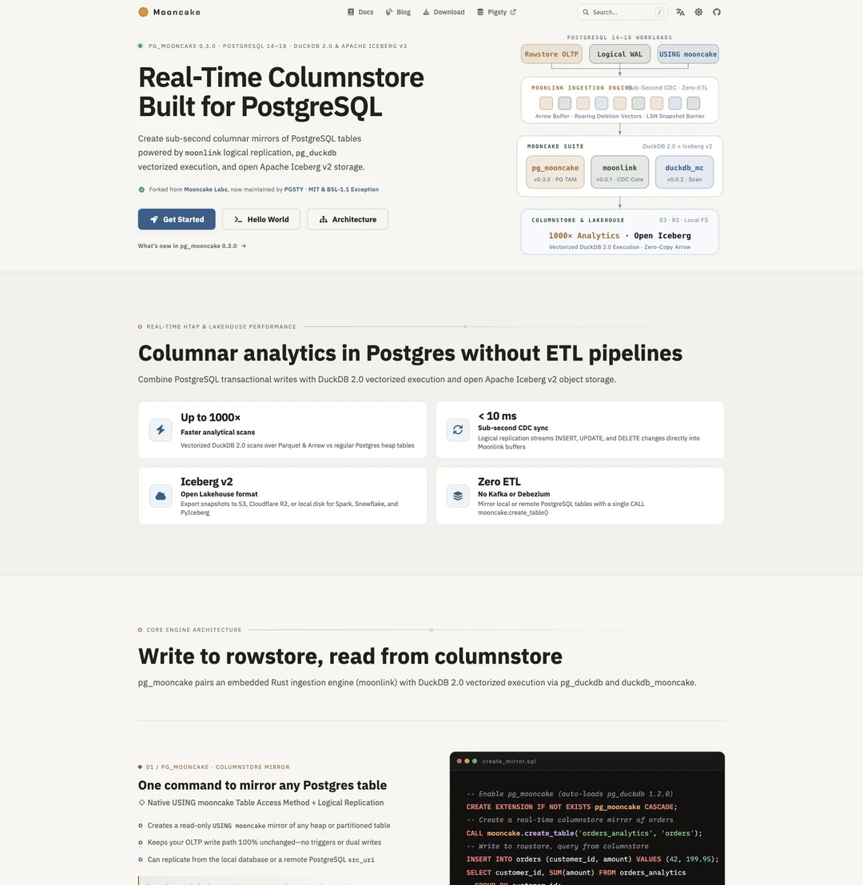
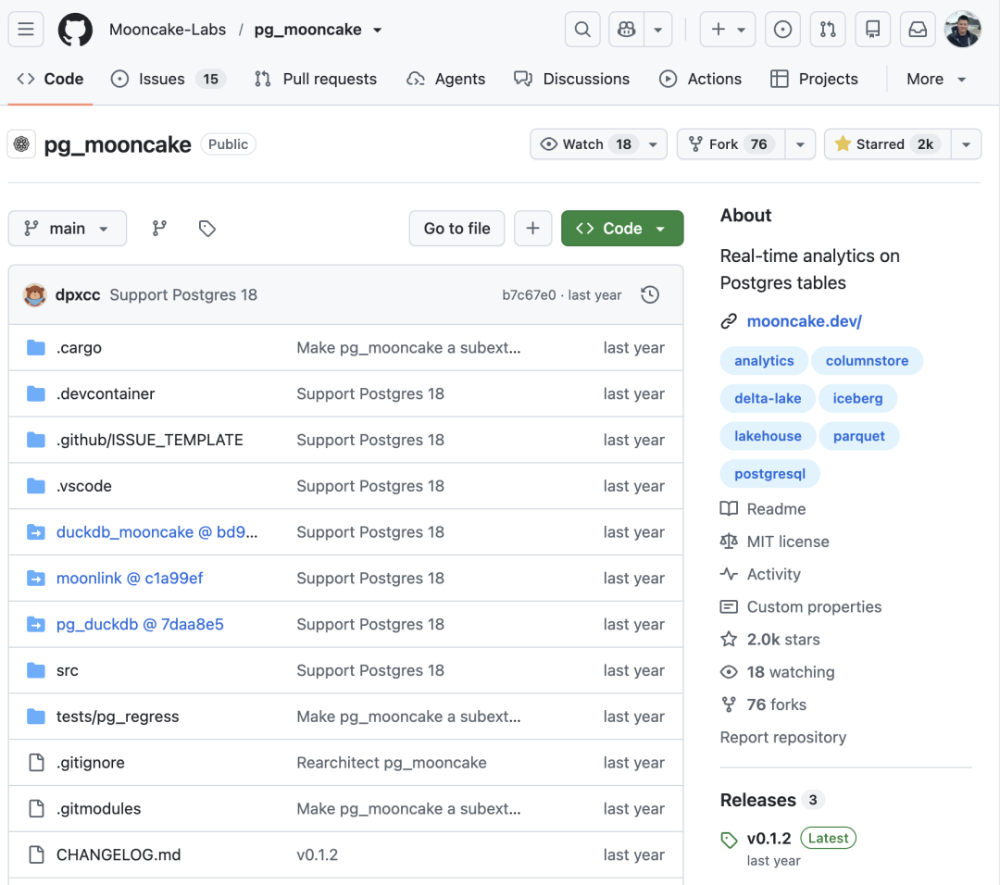
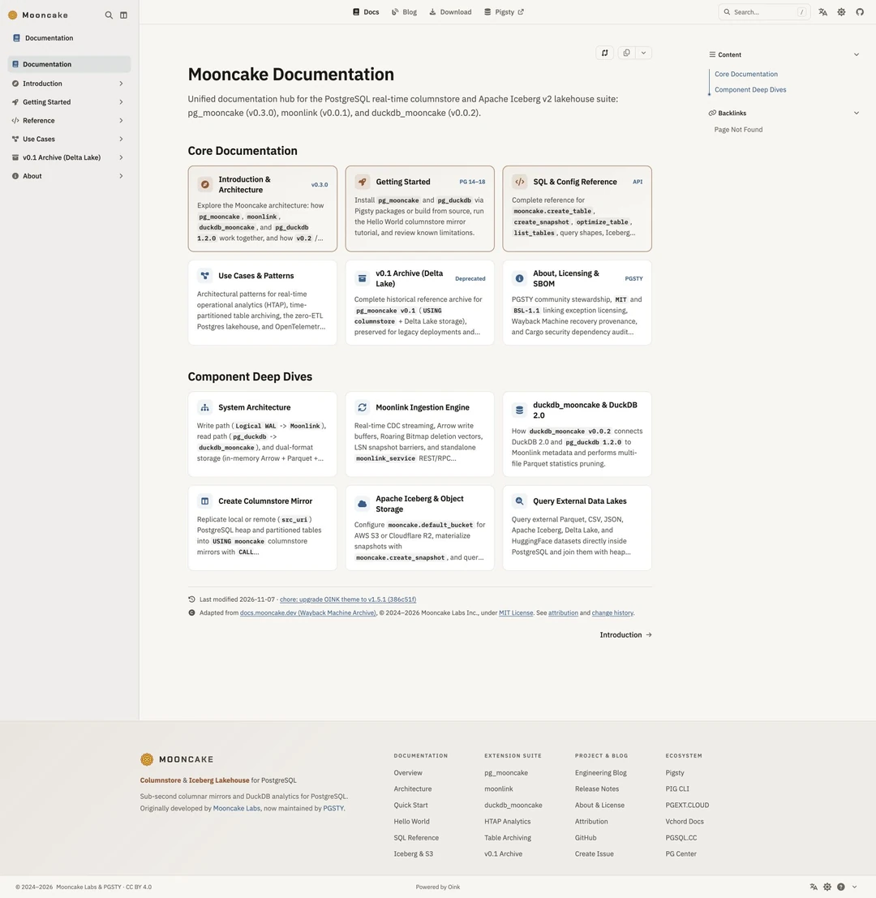
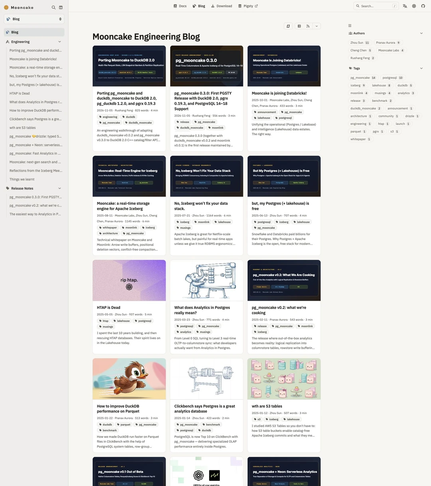
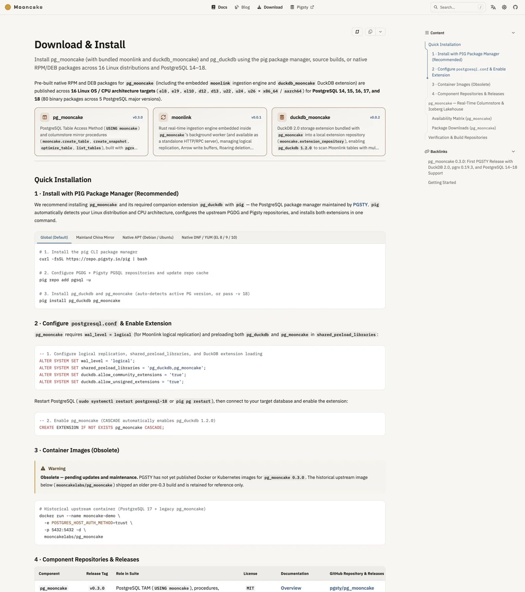
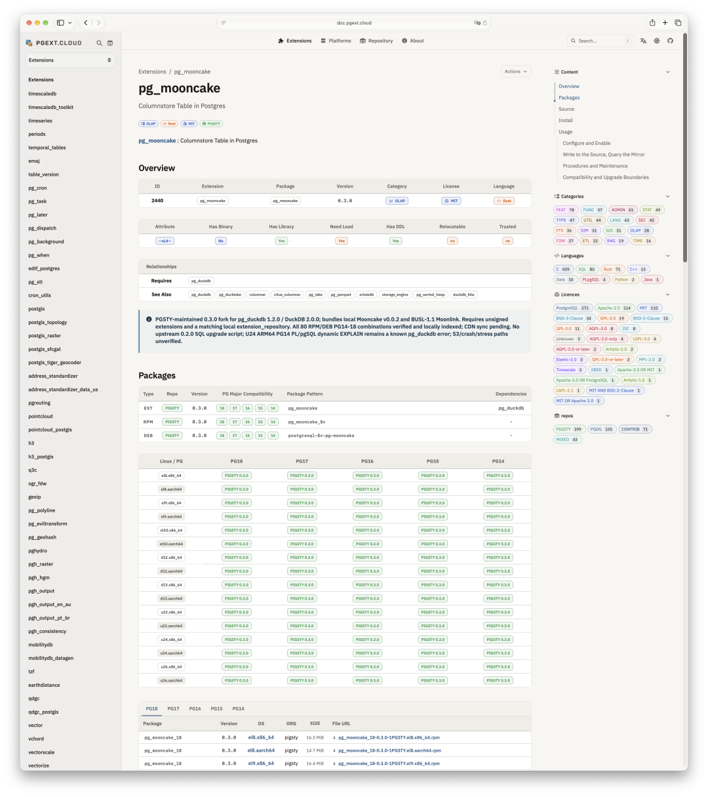

> [Originally published on WeChat](https://mp.weixin.qq.com/s/hvOHVOmZqFozun6O5eIkDg)

Here we go again with another orphaned open-source project.

Yesterday I wrote about [**how I spent a day taking over the `vchord` vector search extension**](/en/pg/maintain-vchord/). Barely a day later, I ended up taking on another PostgreSQL extension of roughly the same scale: **`pg_mooncake`**. Like `vchord`, it is written in Rust. Since I already had the tooling and workflow warmed up from `vchord`, pulling `pg_mooncake` under the same maintenance umbrella was a natural next step.

<https://mooncake.pgsty.com/>

## Why Take Over `pg_mooncake`?

The immediate reason is simple: **upstream was acquired, leaving a dependent extension stranded.**

Mooncake Labs, the team behind `pg_mooncake`, was acquired by Databricks. As often happens in open source, once a startup team is absorbed by a larger company, the standalone open-source repositories they leave behind rarely see active maintenance again.

The timing collided with a major upgrade in the underlying stack. `pg_mooncake` is a sub-extension built on top of `pg_duckdb`. Following the recent **DuckDB 2.0.0** release—which introduced substantial internal changes—the parent extension `pg_duckdb` shipped a new release of its own. Because `pg_mooncake` is tightly coupled to `pg_duckdb`, upgrading the parent breaks the child unless `pg_mooncake` is updated in lockstep.

With the original team long since folded into Databricks and the upstream repository silent for over a year, someone had to step in and maintain a fork.

## The Three-Step Playbook: Recover, Update, Maintain

Once I forked the repository, the work followed a straightforward three-step playbook:

**First, recover the documentation and engineering blog.** The original documentation site is gone; visiting `mooncake.dev` now redirects straight to Databricks. Fortunately, the Internet Archive still held complete snapshots, so I pulled the full documentation set and historical engineering blog posts out of the Wayback Machine and republished them. `pg_mooncake` is a well-designed extension, and letting its documentation vanish would have been a waste.

**Second, update the codebase for the current stack.** `pg_mooncake` had been frozen at version `0.2`. I bumped it to **`0.3`**, updated it to work with **`pg_duckdb 1.2`**, and upgraded the underlying **`pgrx`** framework to `0.19.3`. When **PostgreSQL 19** ships, I will update it for that as well.

Why go through the trouble? Because I know several Pigsty users run `pg_mooncake` in production. When you maintain a distribution, one of the worst things you can do to users is ship an extension in one release and tell them it disappeared in the next. Someone needed to keep it working—and having just gone through the exact same process with `vchord` the day before, doing it a second time was routine.

**Third, keep it on a low-overhead maintenance cadence.** Day-to-day maintenance doesn't require much effort. There is no need for constant churn—just periodic updates when a new PostgreSQL major version lands or when `pgrx` and `pg_duckdb` cut new releases. If users run into issues or have practical feature requests, I can fold in reasonable changes along the way.

## Upstream Can Move On; the Distribution Layer Has to Hold

As PostgreSQL continues to absorb more of the database landscape, having reliable, well-maintained extensions in the toolkit matters.

Take **Apache AGE**, a graph database extension for PostgreSQL. A while back, the project stalled after its core maintainer lost their job. At the time, I considered maintaining a fork if nobody else stepped up; fortunately, renewed demand for graph workloads brought fresh momentum, and the project recovered on its own.

Not every open-source project is that lucky. Startups get acquired, pivot, or wind down—that is simply the reality of the open-source ecosystem. **My job as a distribution maintainer is to compile, package, and deliver working software. Even when an upstream team moves on, the distribution layer should absorb the shock and keep the software supply chain intact for downstream users.**

Taking on `vchord` yesterday and `pg_mooncake` today are two practical steps in that direction. Once you understand PostgreSQL internals and its extension architecture, keeping these extensions building and passing tests across releases is a bounded, manageable problem. For users, knowing a dependency won't vanish on the next upgrade is what counts.

Both `vchord` and the updated `pg_mooncake` are now released and available in the **Pigsty** extension repository, with prebuilt packages for **PostgreSQL 14 through 18** across **16 operating systems**. You can download the packages directly or install them with a single command through your system package manager.

## Read More

- [Why I'm Maintaining a VectorChord Fork](/en/pg/maintain-vchord/)
- [PostgreSQL Ecosystem Update: The AI Bug-Hunting Crunch](/en/pg/eco-update-202611/)
- [AWS Acquires DuckDB: The Duck Flies into the Amazon Rainforest](/en/db/aws-get-duckdb/)
- [MinIO's One-Year Memorial: How to Revive a Dead Open-Source Project](/en/db/minio-silo-1year/)
- [Silo: A Maintained, MinIO-Compatible Object Store](/en/db/long-live-silo/)
- [MinIO Nuked Its Docker Hub Repos—Your Object Storage Doesn't Have to Go Down With It](/en/db/silo-is-coming/)
- [Extensions for Everyone](/en/pg/extensions-for-everyone/)
- [504 Extensions: Expand the PostgreSQL Landscape](/en/pg/extension-504/)
- [What Is a PostgreSQL Distribution?](/en/pg/what-is-pg-distro/)
- [Pig, The Postgres Extension Wizard](/en/pg/pig/)
- [SOW: Postpartum Care for 100,000 Packages](/en/db/sow/)
- [AI Software Engineering: Choose Problems You Care About](/en/ai/ikigai/)
