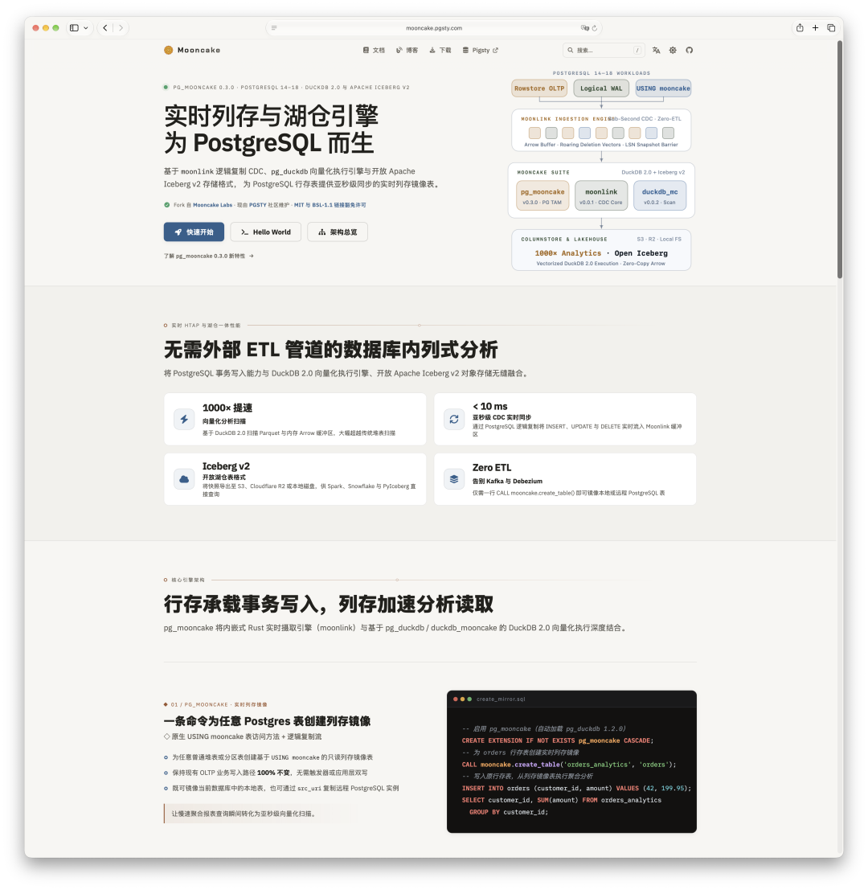
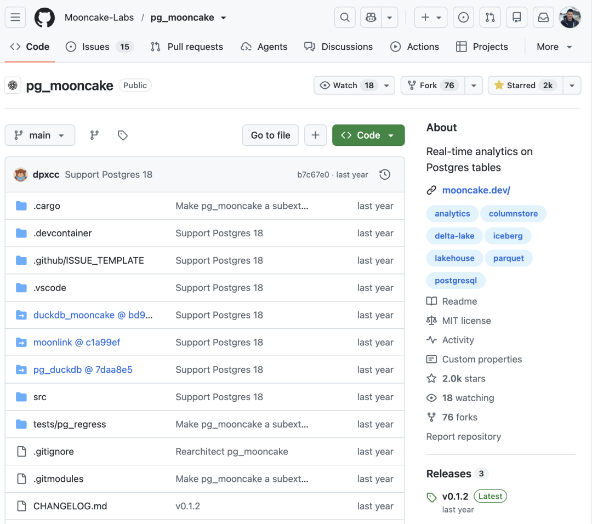
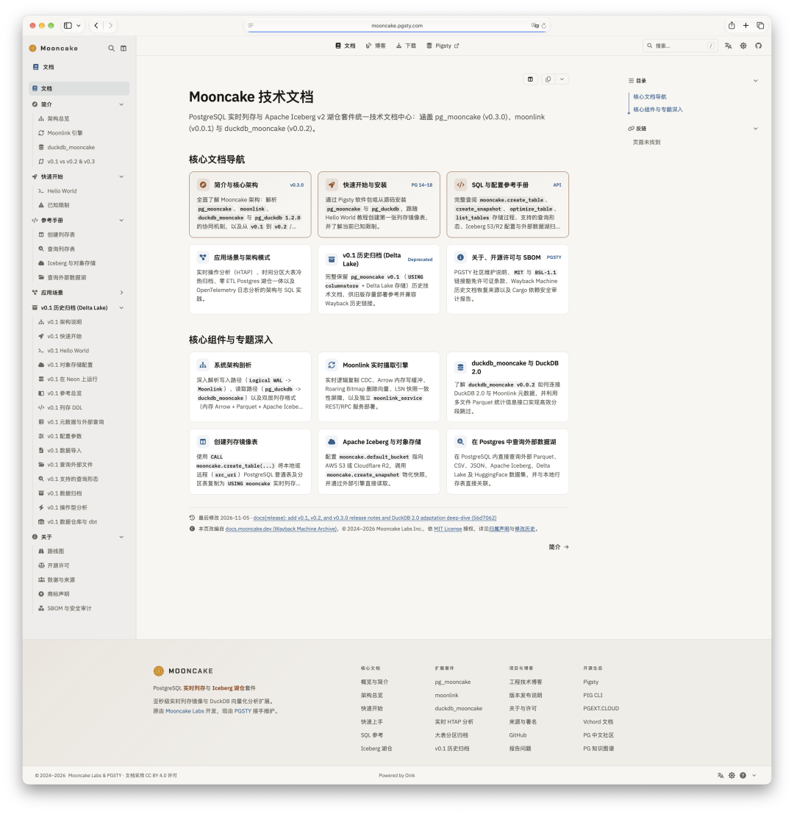
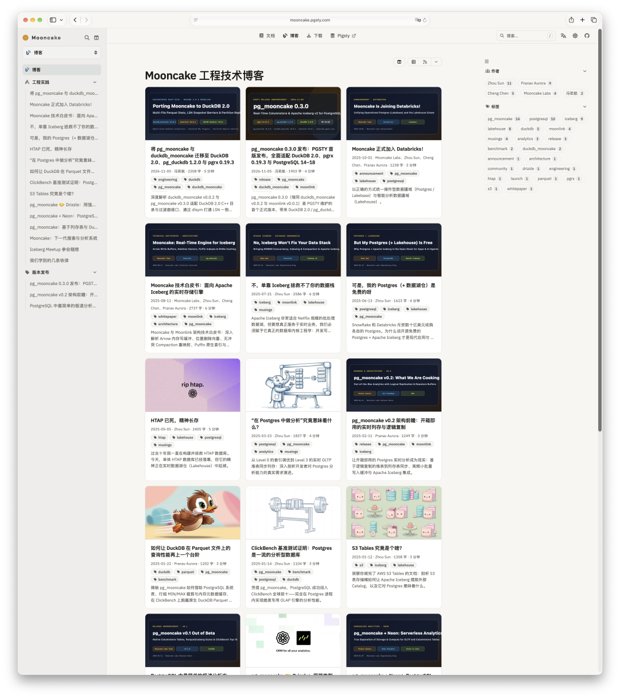
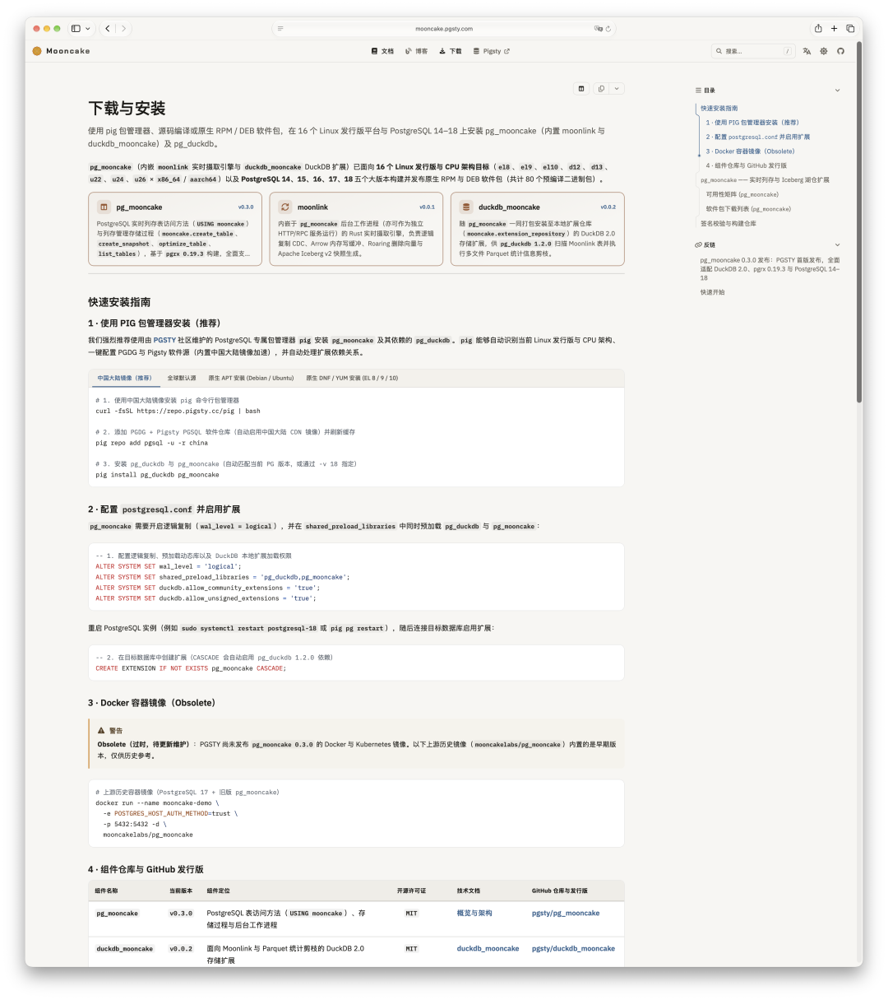
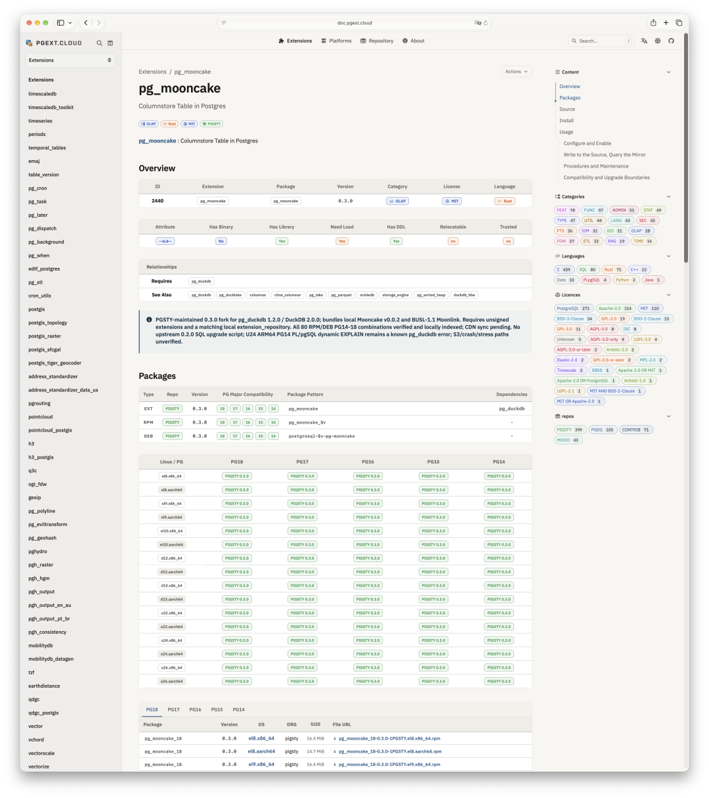

> [微信公众号原文](https://mp.weixin.qq.com/s/hvOHVOmZqFozun6O5eIkDg)

开源接盘侠老冯又双叒叕来了……

昨天老冯刚发了篇文章，[**聊了聊怎么花一天时间接盘向量数据库扩展 `vchord`**](/pg/maintain-vchord/)。结果话音未落，今天我又顺手接盘了一个同量级的扩展——**`pg_mooncake`**。巧的是，它也是用 Rust 写的。我想着既然连 `vchord` 都已经接盘完了，干脆一不做二不休，把 `pg_mooncake` 也拉下来一块维护算了。

<https://mooncake.pgsty.com/>

## 为什么要接盘 `pg_mooncake`？

直接原因很简单：**上游被收购，子扩展眼看要断粮了。**

`pg_mooncake` 背后的开发团队 Mooncake Labs（月饼实验室）此前被 Databricks 收购了。按开源界的常规剧本，初创团队一旦被大厂收编，原本这摊子开源项目大概率也就很难继续维护下去了。

偏偏这时候赶上了一次关键的底层大版本更新。`pg_mooncake` 是构建在 `pg_duckdb` 之上的子扩展；最近 **DuckDB 2.0.0** 发布，底层改了不少东西，父扩展 `pg_duckdb` 也紧跟着发布了新版本。在这种强依赖关系下，父扩展一升级，子扩展如果不跟着适配更新，直接就没法用了。

原团队已经被收购上岸，一年多没消息了。那怎么办呢？那就出手把它接下来呗。

## 老套路三板斧：抢救、续命、兜底

接手之后，还是熟悉的老套路三板斧：

**第一斧，把文档和博客抢救回来。** 它原本的官方文档站已经没了，现在访问 `mooncake.dev` 会直接跳转到 Databricks 官网。好在互联网档案馆（Internet Archive）里还留着历史归档，老冯从故纸堆里把它的全套文档和历史博客都给捞了出来。说实话，这么好的一个扩展，就这么扔在那儿烂尾实在太可惜了。

**第二斧，升级适配，给代码续命。** `pg_mooncake` 之前停留在 `0.2` 版本，这次我直接把它更新到了 **`0.3`**，同步完成了对 **`pg_duckdb 1.2`** 的兼容，顺手把底层的 **`pgrx`** 框架也升到了最新版本 `0.19.3`；等后续 **PostgreSQL 19** 出来，我也会继续跟进适配。

之所以非得干这活儿，是因为我知道有几个 Pigsty 用户真的在用它。做发行版最忌讳的一件事，就是上个版本还给用户提供得好好的，下个版本一更新突然说“这扩展没了”——那就太尴尬了。总归得有人出来接这一棒，况且刚盘完 `vchord`，再搞 `pg_mooncake` 完全是一回生、二回熟。

**第三斧，低频维护，按需演进。** 这事儿日常维护起来其实负担不大。平时不用瞎折腾它，每年等 PostgreSQL 发大版本，或者 `pgrx`、`pg_duckdb` 更新时集中跟进一下就好。用户要是有新需求尽管提，老冯看着合适、顺手的就给做了。

## 上游可以跑路，发行版必须“稳稳接住”

在 PostgreSQL 吞噬整个数据库世界的过程中，手里有几张好用的扩展牌，其实是件挺不错的事。

拿之前不少人用的 **Apache AGE**（一个 PG 图数据库扩展）来说，早些时候因为核心维护者失业，整个项目一度陷入停滞。当时老冯就想过，要是真没人接手，我就把它盘下来；好在后来赶上图数据库的需求又热了起来，这个项目自己又活过来了。

但不是所有开源项目都有这样的运气。上游创业公司被收购、转型甚至弃坑烂尾，都是开源生态里的常态。**老冯做发行版，干的就是打包、编译和分发的活儿——不管上游怎么烂尾跑路，只要发行版这一层能稳稳接住用户，不让软件供应链断掉，这就够了。**

昨天的 `vchord` 和今天的 `pg_mooncake`，算是老冯在这个方向上的两次尝试。只要吃透了 PG 内核机制与底层扩展架构，从宏观上看它就是一个可控、可靠的东西；对用户来说，能一直稳稳当当地用下去，比什么都强。

目前，昨天聊的 `vchord` 和今天刚更新的 `pg_mooncake` 都已正式发版，并悉数收录进 **Pigsty** 扩展仓库，支持 **PG 14 到 PG 18**，覆盖 **16 个操作系统**，开箱即用。大家可以直接下载安装包，或者用系统包管理器一键安装体验。

## 扩展阅读

- [老冯又接盘新开源项目了](/pg/maintain-vchord/)
- [渡劫期的 PostgreSQL 生态大更新](/pg/eco-update-202611/)
- [AWS 收购 DuckDB：鸭子飞进亚马逊雨林](/db/aws-get-duckdb/)
- [MinIO 周年祭：如何让死掉的开源项目重生](/db/minio-silo-1year/)
- [Silo 发布：兼容 S3/MinIO 的开源对象存储](/db/long-live-silo/)
- [MinIO 把 Docker Hub 仓库删了——但你的对象存储不必陪葬](/db/silo-is-coming/)
- [人人可用的 PG 扩展](/pg/extensions-for-everyone/)
- [504 个扩展，PG 生态的天花板在哪？](/pg/extension-504/)
- [什么是 PostgreSQL 发行版？](/pg/what-is-pg-distro/)
- [小猪骑大象：PG内核与扩展包管理神器](/pg/pig/)
- [SOW：论母猪的产后护理](/db/sow/)
- [AI 软件工程：愿力驱动选题](/ai/ikigai/)
