People keep asking me the same question lately: "How do I get started with PostgreSQL?" It has come up often enough that I figured I should write a proper tutorial and answer everyone at once.

The best way to learn PostgreSQL is **learning by doing**—getting your hands dirty rather than grinding through textbooks or signing up for training bootcamps.

Learning today is far easier than it used to be. Everyone now has a remarkably patient, knowledgeable tutor on standby: whenever you get stuck, just ask AI.

As the Chinese saying goes, "A master leads you through the door, but mastery is up to you." Even with AI at your side, getting through the door is still the hardest part—and most beginners stall out at step one: setting up an environment. I wrote this quick-start guide to get you past that first hurdle.

WeChat articles are clunky for copying commands, so I also published an online version at <https://pg36g.vonng.com/>, which is much easier to read and copy-paste from.

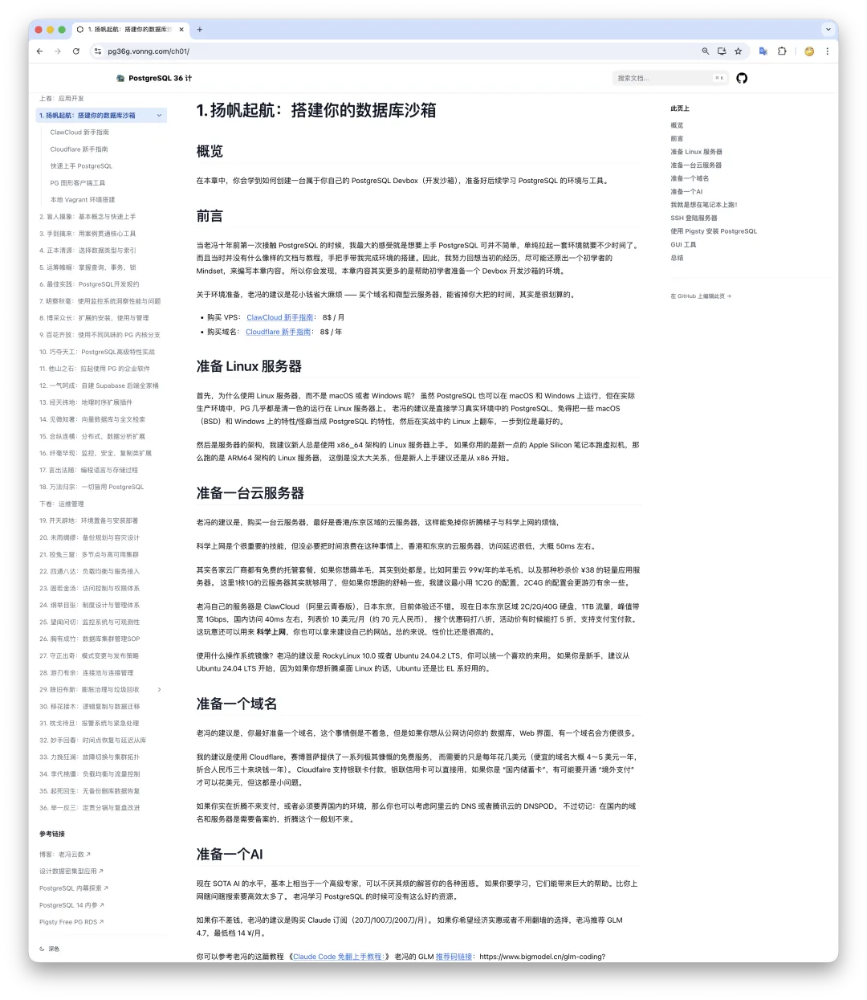

## How to Get Started with PostgreSQL

Step one in learning PostgreSQL is having a running PostgreSQL instance, not buying a book. Skip the manuals and textbooks for now. Spin up a real, production-grade single-node PostgreSQL instance first, inspect it, use it, and solve concrete problems one by one with AI's help.

My advice: don't waste time messing with Docker containers, Postgres.app, or managed cloud databases. Learn PostgreSQL the way it actually runs in serious production environments—natively on bare Linux, without extra abstraction layers or gimmicks in the way. And don't burn hours on environment setup; spending even 10 minutes on it is plenty.

That is where Pigsty comes in—it gives you an ideal environment for learning PostgreSQL. You can follow the [ClawCloud Beginner's Guide](/cloud/cheap-vps/)[1] to grab an inexpensive Linux VPS as your sandbox, then follow the **Pigsty Quick Start**[2] guide to install everything in 10 minutes with a single command.

It really is that simple. Without knowing any of the underlying details upfront, you can use a **prebuilt configuration template**[3] to spin up an enterprise-grade PostgreSQL deployment in one shot. From there, you can explore the **Web UIs**[4] and connect to the **PostgreSQL database service**[5].

## What Is Pigsty?

Pigsty is an open-source PostgreSQL RDS alternative that I built. It is one of the leading open-source PostgreSQL distributions globally, and the most-starred open-source PostgreSQL project from China. In short, it is a batteries-included toolkit for running self-hosted, production-grade PostgreSQL—enabling everyday developers and sysadmins to run enterprise-grade database infrastructure without a dedicated DBA team.

"Enterprise-grade" is usually synonymous with "complicated," but Pigsty is designed to make complex infrastructure simple to operate out of the box. Best of all, it is completely free, open-source, and runs comfortably on a single 1-vCPU / 1 GB RAM Linux VPS.

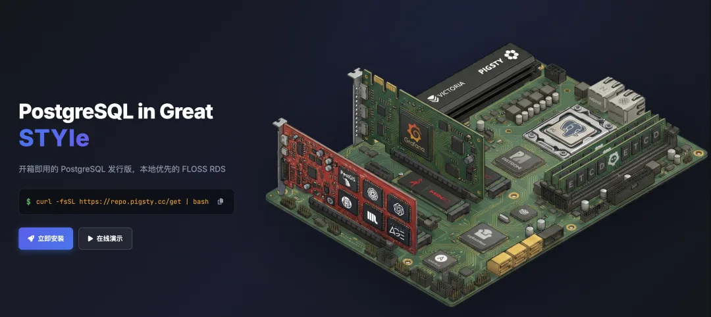

At Tantan—a social app startup known for its lean, Nordic-style engineering culture—Pigsty managed PostgreSQL fleets spanning 25,000 vCPUs. Yet the exact same stack runs in full on a 1C1G VM. Many of our developers used it as their personal development sandbox, keeping development, staging, and production on one unified stack. Everything you learn in this sandbox translates directly to production.

Beyond PostgreSQL, Pigsty ships with Nginx to automate domain routing and HTTPS certificate issuance for web deployment, plus a full observability stack so you can see exactly what is happening inside your database instead of poking around a black box in the dark.

Better yet, it comes preloaded with AI coding agents—Claude Code and OpenCode—so you have a tutor ready to guide you without spending a dime.

With the introductions out of the way, let's walk through how to use it.

## Quick Start

By now you should have a Linux VPS ready. If not, check out [this guide](/cloud/cheap-vps/)[6].

SSH into your server and run the installation command (see the [full installation guide](https://pigsty.cc/docs/setup/install/)[7]).

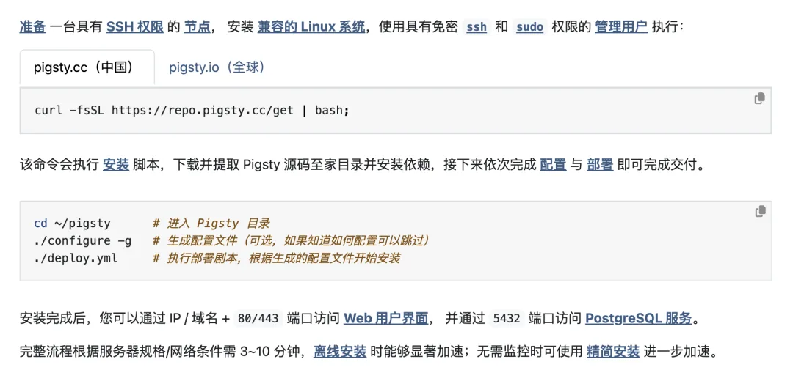

A few minutes later, you have a ready-to-use PostgreSQL sandbox. Let's see what is inside the box:

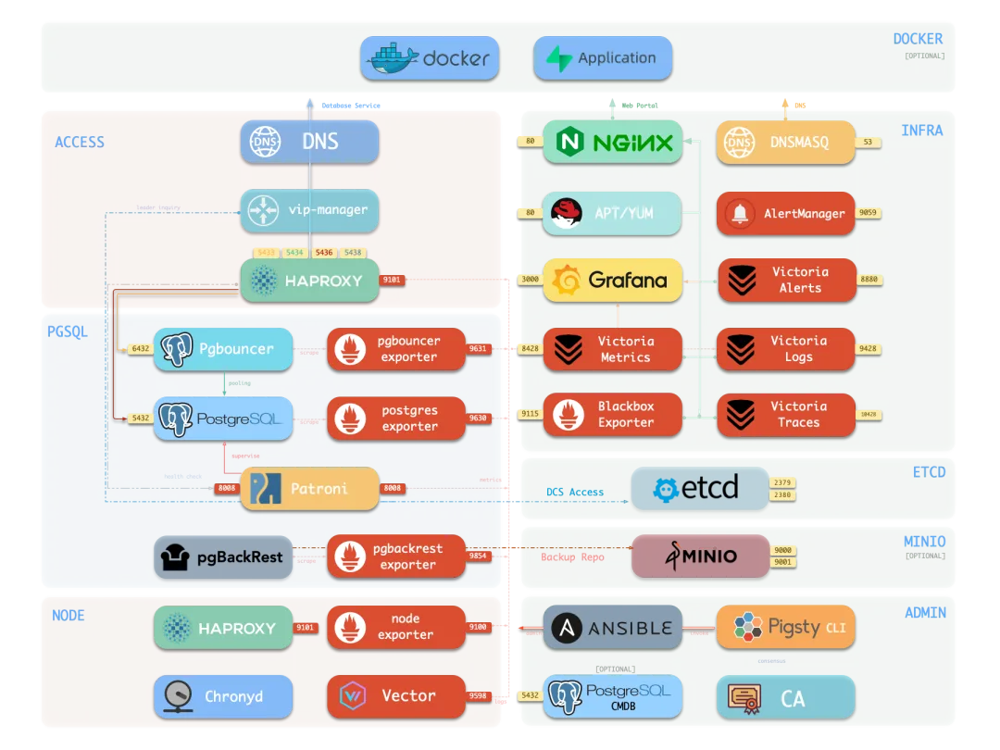

There is a lot packed in here, but you can ignore the rest for now. The centerpiece is the PostgreSQL database itself, listening on local port `5432` by default.

## Connecting to the Database

Log out of your SSH session, log back in, and type `p`. That single-letter alias drops you straight into the database via `psql`, PostgreSQL's built-in interactive CLI.

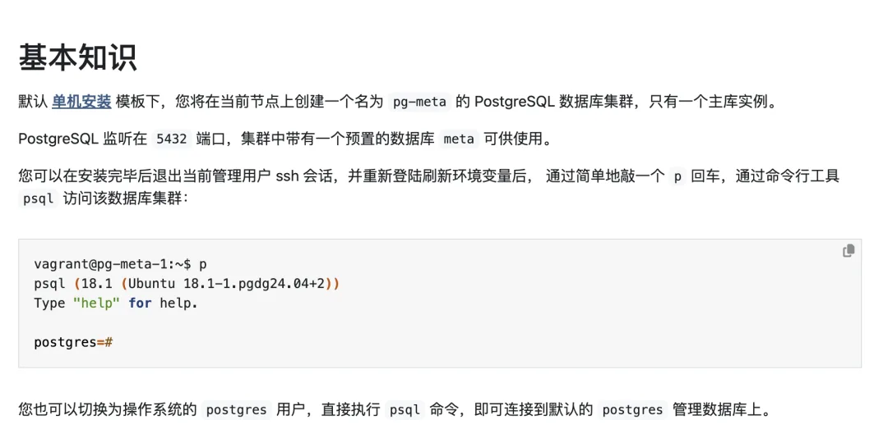

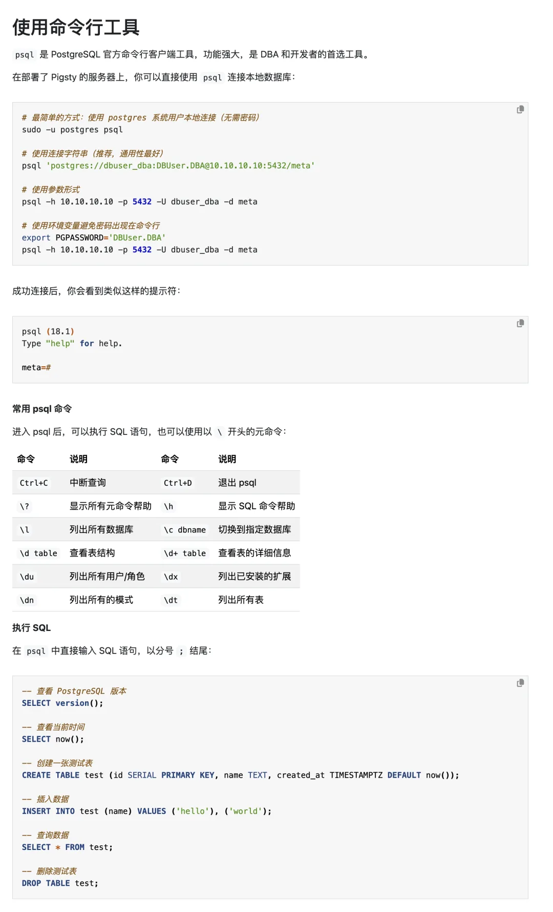

## Database Connection Strings

How does a client actually connect to PostgreSQL? Whether you use `psql` or a graphical client[8], every database connection comes down to five core parameters: `Host`, `Port`, `User`, `Password`, and `Database`.

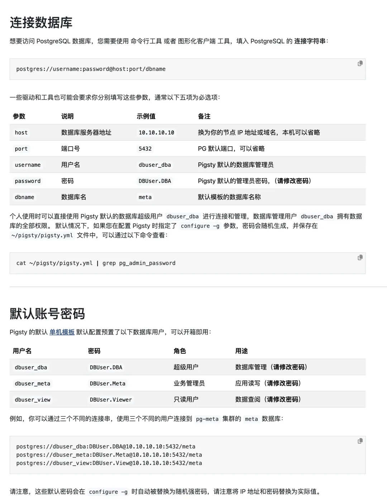

## Bring In Your AI Tutor

Now that your database is running, bring in an AI tutor. If you have the budget, a \$20/month Claude Pro subscription with Claude Code is hard to beat. If you prefer a free option, Pigsty's bundled OpenCode agent includes free models such as GLM 4.7, or you can follow my [Claude Code Setup Guide](/en/ai/claude-code-intro/)[9] to configure a coding plan subscription.

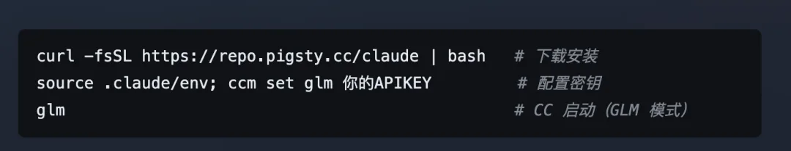

Let's use the bundled OpenCode agent as an example—it works out of the box with built-in free API keys. Change into `~/pigsty` and run `opencode` to launch its terminal UI (TUI), where you can chat with the agent directly:

<!-- -->

    cd ~/pigsty; opencode

Press `Ctrl+P` to switch models and select the free `GLM 4.7` model:

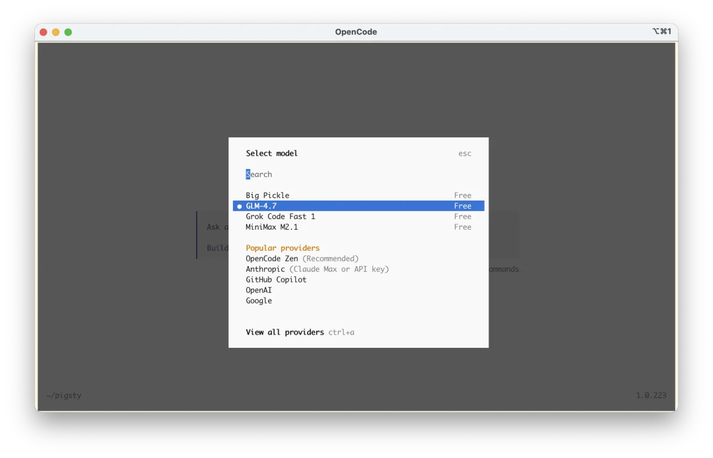

If you want to use a paid coding plan, run `opencode auth login`, select `Zhipu AI Coding Plan`, and paste your API key:

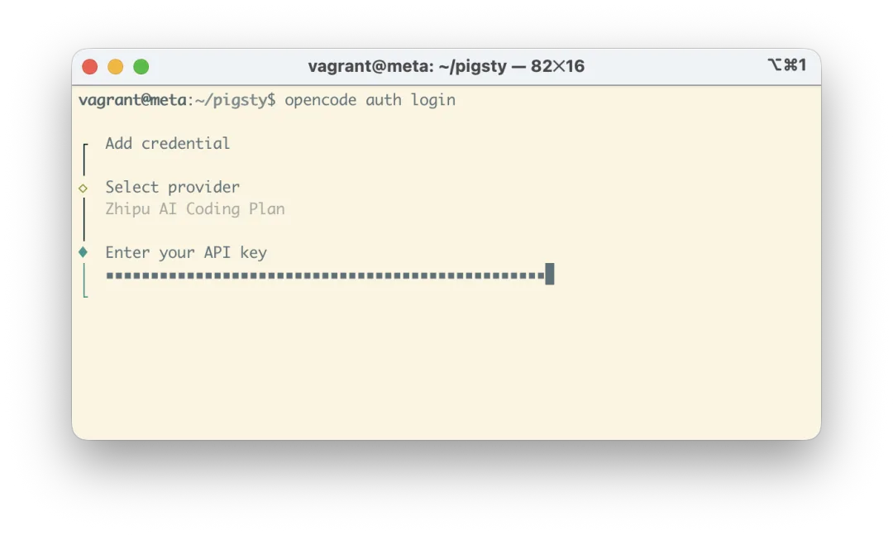

From there, just start asking questions. I have listed a set of starter prompts in the online tutorial to get you going, and you can chat directly with the AI tutor as it inspects and operates your live environment.

At this point you have two things: (1) a standard, production-grade PostgreSQL environment with every major extension ready to go, and (2) a patient tutor right inside your terminal to answer questions on the spot. Now the real practice begins.

Give a man a fish and you feed him for a day; teach a man to fish and you feed him for a lifetime—or better yet, hand him a fully automated fishing trawler.

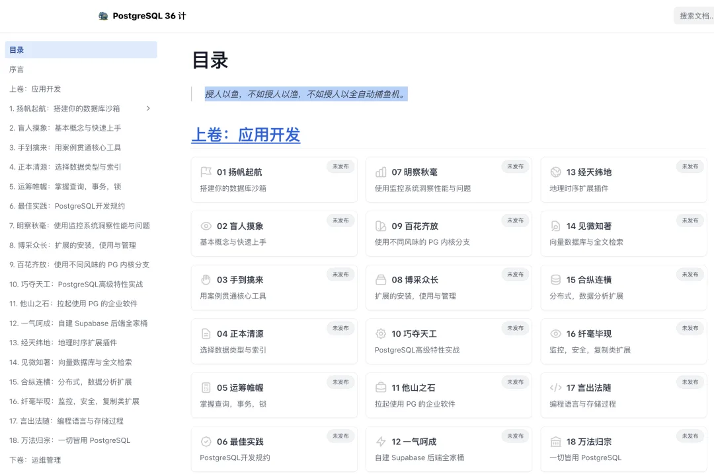

## What to Do Next

Start asking questions. AI coding agents are remarkably good at guided hands-on tutoring; the key is stating clearly what you want to explore. You can even begin by asking the agent to design a structured PostgreSQL learning path for you:

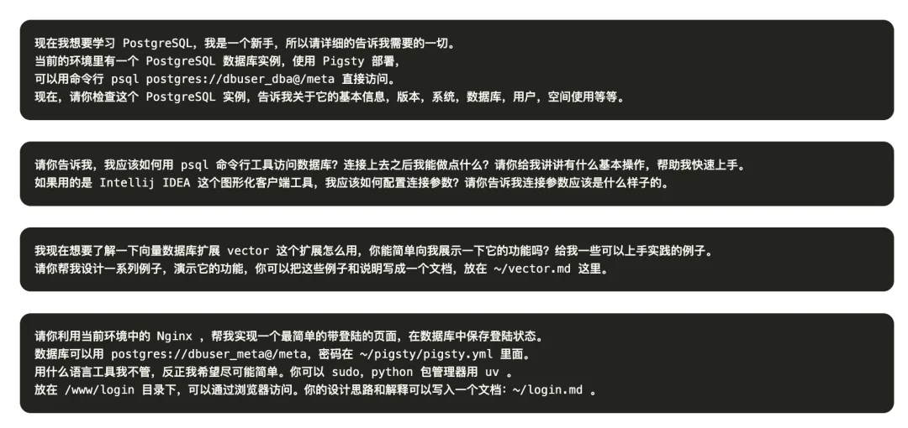

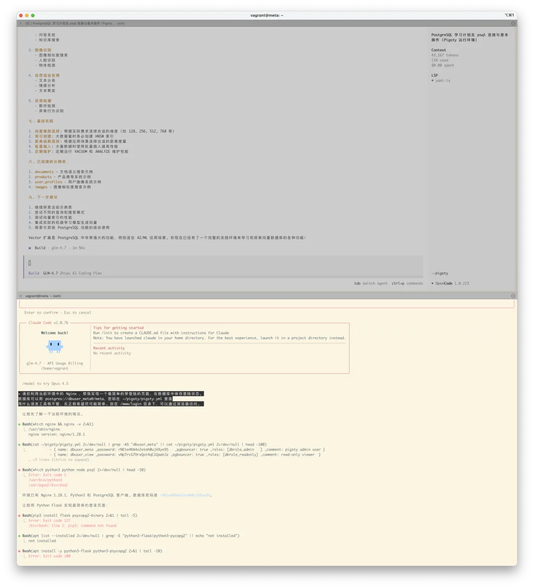

Feel free to experiment in full YOLO mode. Even if you break the cluster beyond repair, you can wipe it and rebuild a fresh one in two minutes:

<!-- -->

    ./pgsql-rm.yml  # Destroy the current database cluster
    ./pgsql.yml     # Re-create the database cluster

And if you have already loaded data worth keeping, you can use **instant cloning**[10] to spin up an identical copy of a database or instance in seconds—with zero extra storage overhead via copy-on-write—so you can experiment without risk.

Even better, pick an interesting project to build. In upcoming installments of the tutorial series, I will share hands-on, project-driven exercises like [ISD Dataset: Analyzing 120 Years of Global Climate Change](/en/misc/isd/). Walking through one real dataset end-to-end with your AI tutor will teach you more core PostgreSQL skills than weeks of passive reading.

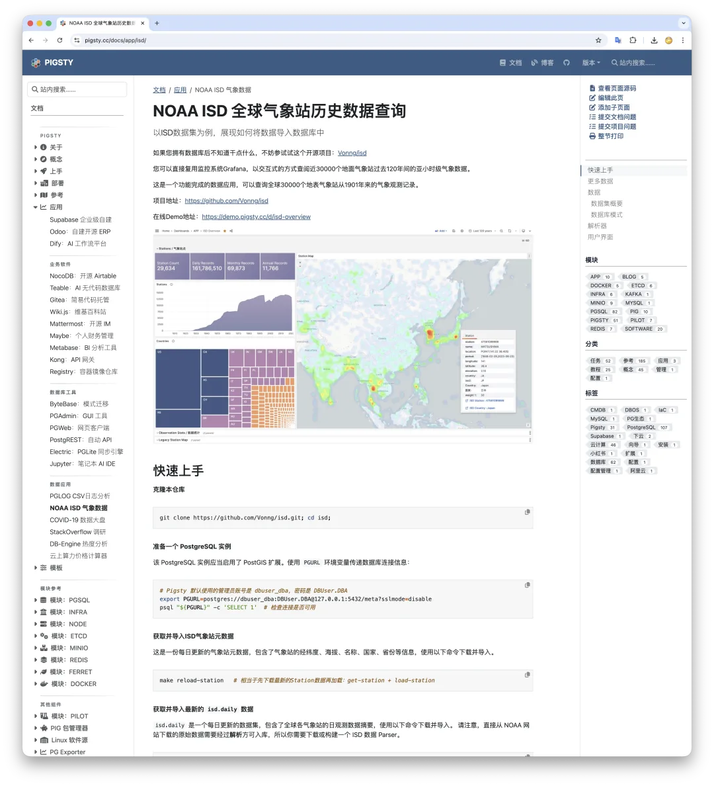

## If You Want a Systematic Curriculum

If you do want to study PostgreSQL systematically, reading the official PostgreSQL documentation cover to cover is essential. It is one of the best-written manuals in open-source software—thorough, well-structured, and worth revisiting repeatedly. For Chinese readers, Tang Cheng's book *PostgreSQL: From Apprentice to Expert* (*PostgreSQL 修炼之道：从小工到专家*), which walks through the official documentation with practical commentary, is also a solid companion.

Still, reading alone will not make you proficient. You need a live database environment and concrete workloads—real or self-invented—to practice on. In future posts, I will walk through practical PostgreSQL use cases and real-world problem solving.

I am currently writing an intuitive, hands-on PostgreSQL tutorial series for beginners, and this article is the opening chapter. Stay tuned for more.

### References

- `[1]` ClawCloud Beginner's Guide: */ch01/clawcloud*
- `[2]` **Pigsty Quick Start**: <https://pigsty.cc/docs/setup/>
- `[3]` **Prebuilt Configuration Templates**: <https://pigsty.cc/docs/concept/iac/template>
- `[4]` **Web UIs**: <https://pigsty.cc/docs/setup/webui/>
- `[5]` **PostgreSQL Database Service**: <https://pigsty.cc/docs/setup/pgsql/>
- `[6]` This Guide: */ch01/clawcloud*
- `[7]` Full Installation Guide: <https://pigsty.cc/docs/setup/install/>
- `[8]` Graphical Client Tools: */ch01/gui*
- `[9]` Claude Code Setup Guide: [/en/ai/claude-code-intro/](/en/ai/claude-code-intro/)
- `[10]` **Instant Cloning**: <https://pigsty.cc/docs/pgsql/admin/db>

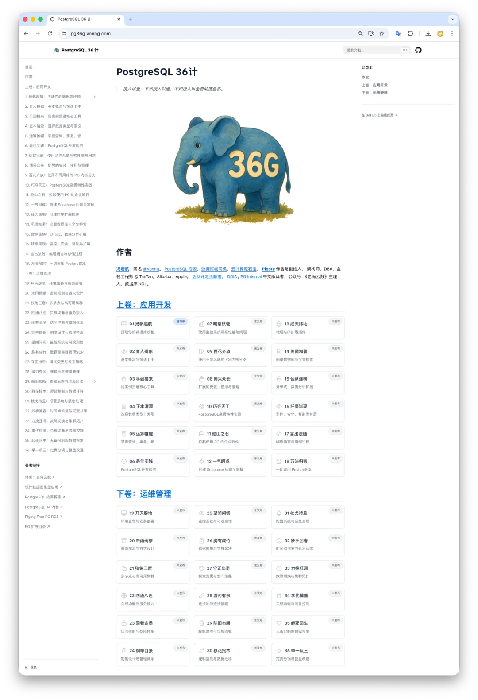

---

Original post: [WeChat Official Account](https://mp.weixin.qq.com/s/RFb8qcS22EM85hO5-tUNcQ)
