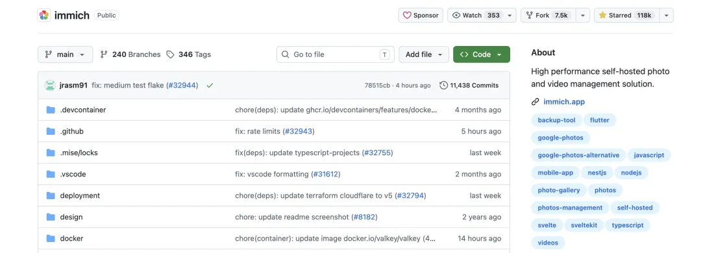
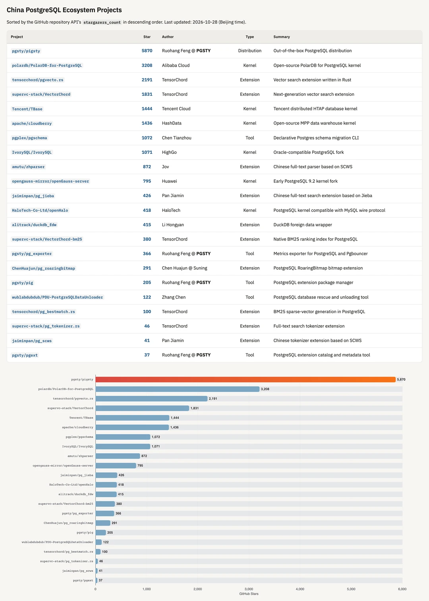
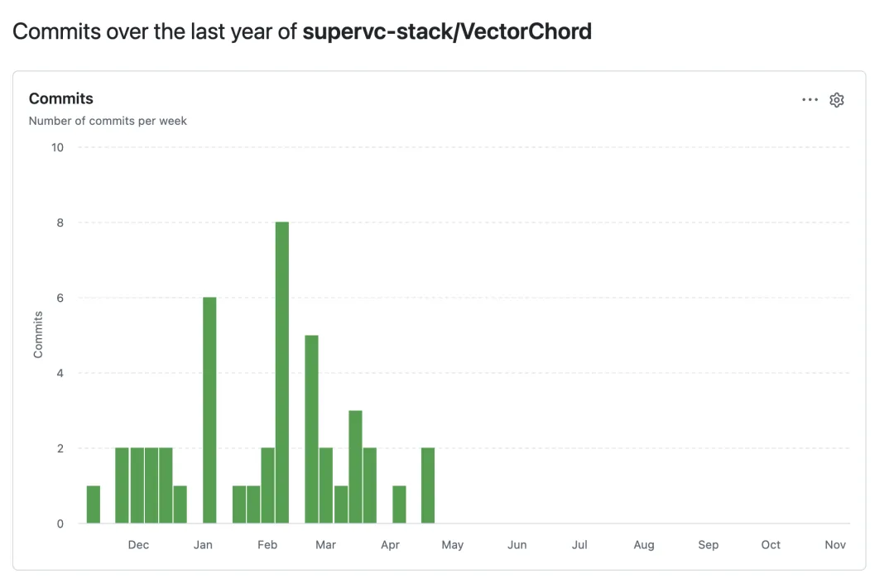
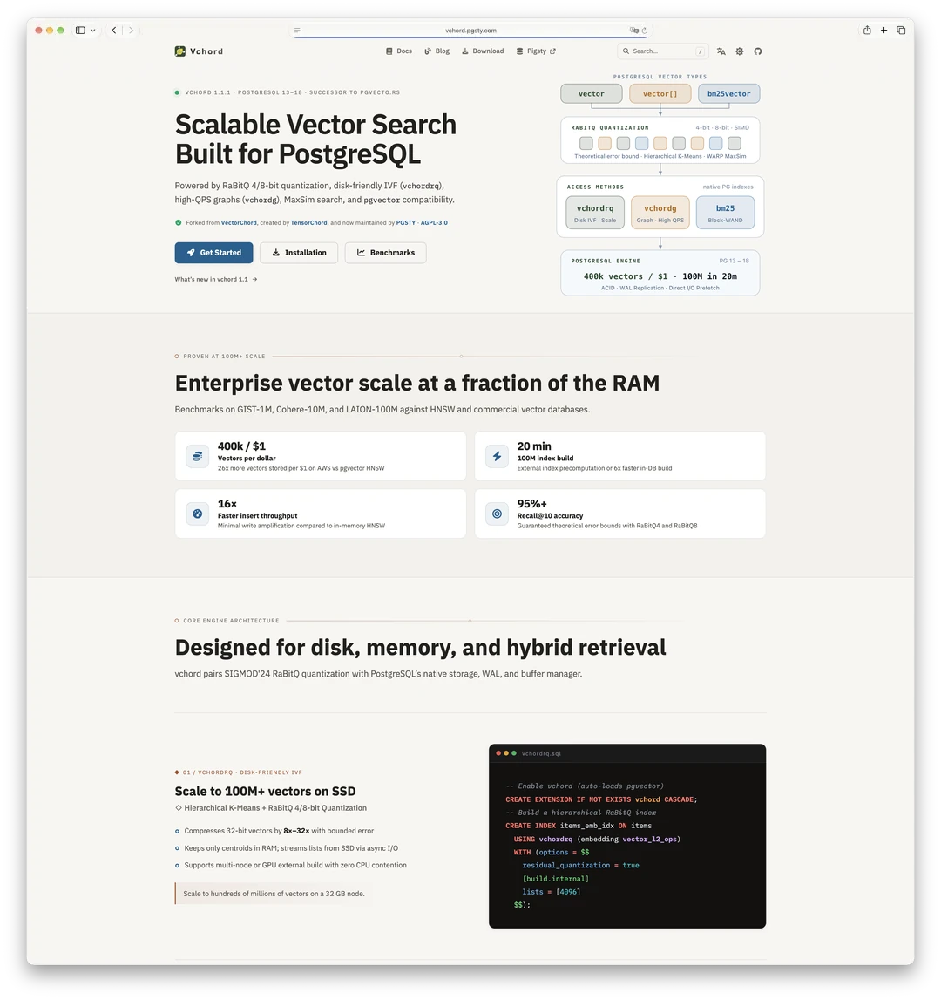
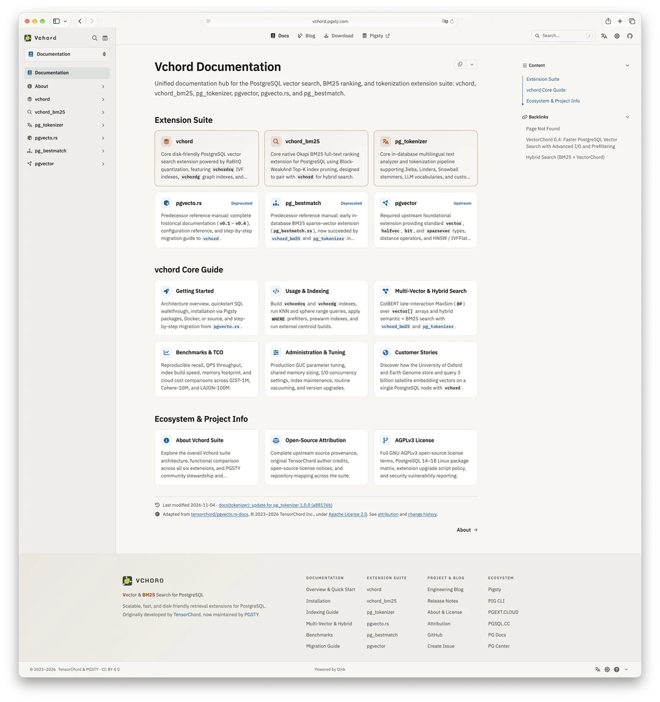
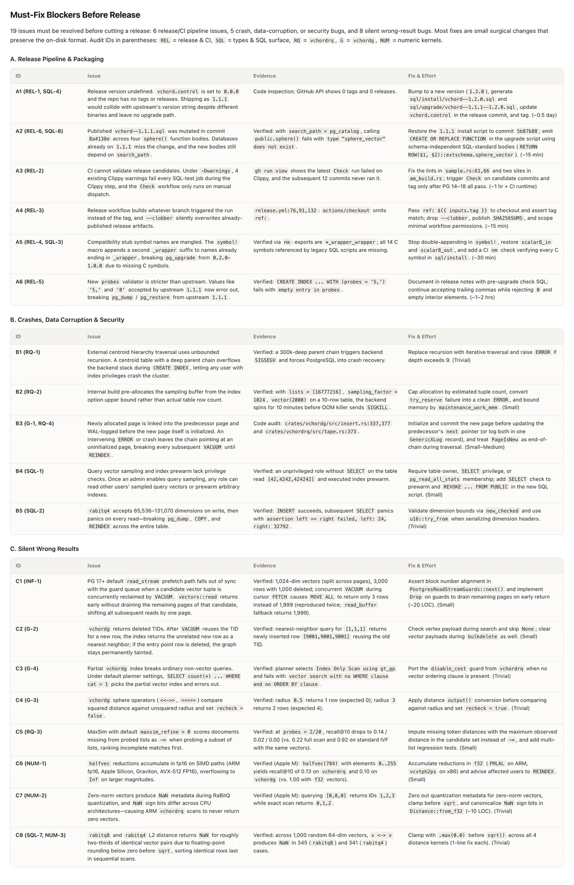
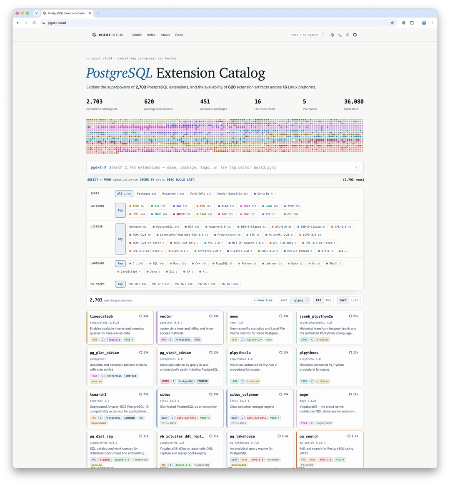
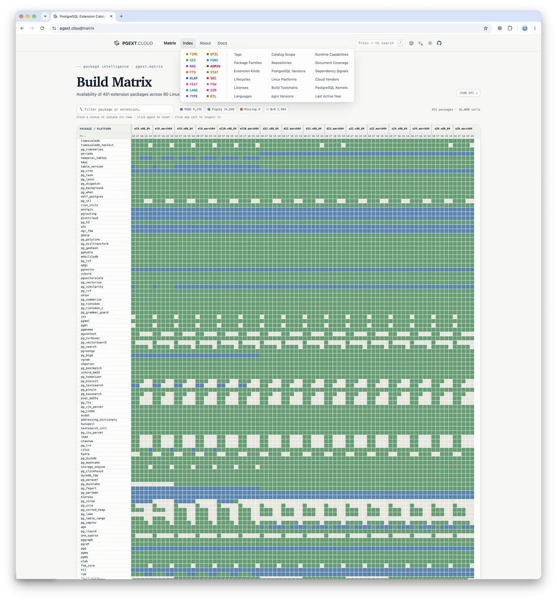
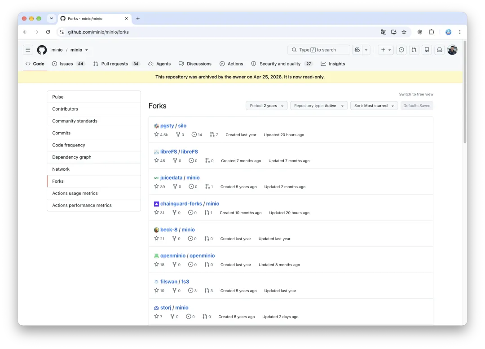

I am now maintaining forks of [VectorChord](https://github.com/tensorchord/VectorChord) ([`vchord`](https://github.com/pgsty/vchord))—one of the best-known vector search extensions in the PostgreSQL ecosystem—and its companion extensions, [`vchord_bm25`](https://github.com/pgsty/vchord_bm25) and [`pg_tokenizer`](https://github.com/pgsty/pg_tokenizer), under the [`pgsty`](https://github.com/pgsty) GitHub organization. When active upstream maintenance stalled, the original authors at [TensorChord](https://github.com/tensorchord) reached out to ask if I would step in, and the downstream [Immich](https://github.com/immich-app/immich) community offered to contribute bug reports, testing, and patches.

This isn't the first time I've stepped in to keep an upstream dependency alive. Last year, I [took on a MinIO fork](/en/db/minio-resurrect/) that became [Silo](/en/db/long-live-silo/), which has gained steady traction among [MinIO](https://github.com/minio/minio) forks. Along the way, I also built [`barn`](https://github.com/pgsty/barn), a lightweight [Vagrant](https://www.vagrantup.com/) replacement, and [Oink](/en/ai/oink-intro/), a Hugo documentation theme forked from [Docsy](https://www.docsy.dev/). I rely on all of them in my daily workflow, and they have steadily picked up outside users as well. Apparently, I've made a habit of this.

## 1. Why VectorChord Matters

[`vchord`](https://github.com/pgsty/vchord) was built by the [TensorChord](https://github.com/tensorchord) team as the successor to [`pgvecto.rs`](https://github.com/tensorchord/pgvecto.rs)—a ground-up Rust implementation designed to complement and challenge [`pgvector`](https://github.com/pgvector/pgvector) with disk-friendly RaBitQ quantization, IVF (`vchordrq`), and graph (`vchordg`) indexes.

Alongside `vchord` are two companion Rust extensions from the same organization: [`vchord_bm25`](https://github.com/pgsty/vchord_bm25) (succeeding [`pg_bestmatch`](https://github.com/tensorchord/pg_bestmatch.rs) for native BM25 full-text ranking in PostgreSQL) and [`pg_tokenizer`](https://github.com/pgsty/pg_tokenizer) for in-database multilingual tokenization.

In the vector search space, `vchord` and its predecessor have earned real production adoption. Their best-known downstream user is [**Immich**](https://immich.app/), the self-hosted photo and video library.

[](https://github.com/immich-app/immich)

[](https://immich.app/)

If you don't want to wrestle with a bloated NAS operating system, self-hosting [Immich](https://github.com/immich-app/immich) is one of the best ways to manage a personal photo library today—which is why [Pigsty's application templates](https://pigsty.io/docs/app/immich/) included it early on. Immich's visual similarity and semantic search rely on vector indexes provided by `vchord`. On purely technical grounds, that was a smart call.

Across `pgvecto.rs`, `VectorChord`, and their companion repositories, TensorChord's PostgreSQL projects have earned over 4,500 GitHub stars—a strong track record in the slow-moving, systems-heavy world of database extensions. On the [China PostgreSQL Open-Source Ecosystem leaderboard](https://pigsty.io/docs/about/compare/impact/), `pgvecto.rs` and `VectorChord` rank third and fourth among PostgreSQL open-source projects originated by Chinese teams, right behind [Pigsty](https://github.com/pgsty/pigsty) and Alibaba Cloud's [PolarDB](https://github.com/polardb/PolarDB-for-PostgreSQL).

[](https://pigsty.io/docs/about/compare/impact/)

## 2. Why Step In

After recent team changes at TensorChord, active maintenance stalled: `pg_tokenizer` has not had a release since September 2025, `VectorChord` cut its last upstream release (`1.1.1`) in February 2026, and commit activity across the repositories stopped after late April 2026—leaving the projects with over six months without substantive maintenance and more than eight months without a `VectorChord` release.

[](https://github.com/tensorchord/VectorChord/graphs/commit-activity)

In the past, a six- to ten-month pause might not have been an immediate problem. A mature low-level database extension could sit untouched and keep running fine across minor updates. Today, with new PostgreSQL major releases, `pgrx` framework updates, and automated vulnerability discovery moving much faster, an unmaintained extension accumulates risk quickly.

As I wrote in *[When the Cloud Gets Riddled with Holes](/en/cloud/blackwall/)*, LLMs have made continuous, large-scale code auditing cheap enough that attackers have effectively traded magnifying glasses for microscopes. When nobody is home to patch what turns up, foundational software ages badly. **Unmaintained code isn't "stable"—it's an open door.**

So when the original authors reached out to ask if I would take over maintenance, and the downstream [Immich](https://github.com/immich-app/immich) community made it clear they were ready to help with bug reports, testing, and patches, the decision was straightforward. The extensions solve a real problem, the production user base is active, and I hated the thought of watching a solid piece of engineering—built by a Chinese team and relied on by users worldwide—slowly rust away.

If you had asked me a year ago, I probably would have said no. Historically, maintaining low-level systems software was a grueling commitment with no finish line in sight. Today, having already [maintained Silo for a year](/en/db/minio-silo-1year/), the workflow is familiar and taking on another set of extensions adds manageable marginal overhead. And for someone with spare token capacity who occasionally goes [looking for nails to hit with an AI hammer](/en/ai/ai-machinegun-for-everyone/), having a genuinely worthwhile nail show up at my door was hard to turn down.

## 3. How the Handover Works

Deciding to step in was easy; executing a clean handover took four concrete steps:

### 1. Clean-Slate Forks Under pgsty

Because the original repositories were company assets, corporate changes made it impractical to add outside maintainers, adjust organization membership, or transfer repository ownership—even with thousands of GitHub stars on the originals. Rather than get bogged down in administrative hurdles, I created clean-slate forks under the [`pgsty`](https://github.com/pgsty) GitHub organization. Instead of keeping the umbrella `VectorChord` branding, each repository is named directly after the extension itself:

- [**`pgsty/vchord`**](https://github.com/pgsty/vchord): Scalable vector search core extension for PostgreSQL (forked from [`VectorChord`](https://github.com/tensorchord/VectorChord))
- [**`pgsty/vchord_bm25`**](https://github.com/pgsty/vchord_bm25): Native BM25 full-text ranking index extension for PostgreSQL (forked from [`VectorChord-bm25`](https://github.com/tensorchord/VectorChord-bm25))
- [**`pgsty/pg_tokenizer`**](https://github.com/pgsty/pg_tokenizer): In-database multilingual text tokenizer extension (forked from [`pg_tokenizer.rs`](https://github.com/tensorchord/pg_tokenizer.rs))

As for the earlier generation ([`pgvecto.rs`](https://github.com/tensorchord/pgvecto.rs) and [`pg_bestmatch`](https://github.com/tensorchord/pg_bestmatch.rs)), the [Pigsty package repositories](https://pgext.cloud) will continue to serve prebuilt RPM and DEB packages for archival preservation and existing users, while active source-level maintenance focuses on `vchord`, `vchord_bm25`, and `pg_tokenizer`.

### 2. Rebuilding the Documentation and Blog Hub

Next, I forked the original [technical blog and documentation repository](https://github.com/tensorchord/pgvecto.rs-docs), stood up a bilingual documentation site at [`vchord.pgsty.com`](https://vchord.pgsty.com/) powered by [Oink](/en/ai/oink-intro/), and updated it for the new repositories and release line.

[](https://vchord.pgsty.com/)

[](https://vchord.pgsty.com/docs/)

### 3. Auditing, Fixing, and Packaging the Extensions

With the repository and docs scaffolding in place, the real engineering work began. Using frontier-model code auditing paired with manual review and reproduction tests, we audited all three codebases and uncovered roughly 20–30 issues, including several severe bugs and release blockers:

- **Index-build crashes and OOMs ([`465d29f`](https://github.com/pgsty/vchord/commit/465d29f))**: External centroid hierarchy traversal used unbounded recursion, allowing a deep or cyclic `parent` chain to overflow the backend stack (`SIGSEGV`) during `CREATE INDEX` and force PostgreSQL into crash recovery. Internal `vchordrq` builds also pre-allocated the sampling buffer from the `lists` upper bound rather than actual row counts, so large `lists` settings on small tables could trigger the Linux OOM killer. We replaced recursion with iterative depth validation (`2..=9`) and bounded sampling allocations by estimated live tuples and `maintenance_work_mem`.
- **Missing privilege checks ([`f1d51d0`](https://github.com/pgsty/vchord/commit/f1d51d0))**: Once an admin enabled query sampling, any unprivileged role could read other users' sampled query vectors or run `vchordrq_prewarm` / `vchordg_prewarm` without `SELECT` privileges on the underlying table. Both paths now enforce table ownership, `SELECT` privilege, or `pg_read_all_stats` membership.
- **Post-`VACUUM` visibility and PostgreSQL 17/18 `read_stream` bugs ([`badddcc`](https://github.com/pgsty/vchord/commit/badddcc), [`b28175a`](https://github.com/pgsty/vchord/commit/b28175a))**: `vchordg` searches did not filter out deleted heap TIDs, so after `VACUUM` recycled a TID for a newly inserted row, nearest-neighbor queries could return an unrelated row. On PostgreSQL 17 and 18, `vchordrq.io_rerank = 'read_stream'` could lose alignment between buffer pin guards and candidate tuples when concurrent `VACUUM` reclaimed rows mid-scan, silently truncating results.
- **Distance, operator, and quantization edge cases ([`465d29f`](https://github.com/pgsty/vchord/commit/465d29f), [`badddcc`](https://github.com/pgsty/vchord/commit/badddcc), [`47864d8`](https://github.com/pgsty/vchord/commit/47864d8))**: Multi-vector `MaxSim` (`@#`) under partial probes defaulted missing token hits to `-Infinity` (ranking incomplete matches first); `vchordg` sphere operators (`<<->>`, `<<=>>`, `<<#>>`) compared unsquared radii against internal squared distances with `recheck = false`; `halfvec` SIMD reductions accumulated in `fp16` and overflowed to `Inf` on larger magnitudes; and `rabitq4`/`rabitq8` L2 distance could return `NaN` on identical vectors due to negative floating-point rounding residuals before `sqrt()`.
- **Upgrade and packaging blockers ([`f1d51d0`](https://github.com/pgsty/vchord/commit/f1d51d0), [`950ccad`](https://github.com/pgsty/vchord/commit/950ccad))**: A macro bug had double-appended `_wrapper_wrapper` to legacy C compatibility stubs (breaking `pg_upgrade` from `0.2.0–1.0.0`), and `vchord--1.1.1.sql` had been mutated in place with `search_path`-dependent `sphere()` definitions.

Every issue had to be reproduced, patched, and verified with regression tests before cutting a release.

[](https://github.com/pgsty/vchord/commits/main)

### 4. Releases, Compatibility, and How to Upgrade

All three extensions have now shipped their first releases under `pgsty` stewardship:

- [**`vchord 1.2.0`**](https://github.com/pgsty/vchord/releases/tag/1.2.0) ([Release Notes](https://vchord.pgsty.com/blog/release/vchord-1.2.0/), released November 4, 2026)
- [**`vchord_bm25 1.0.0`**](https://github.com/pgsty/vchord_bm25/releases/tag/1.0.0) ([Release Notes](https://vchord.pgsty.com/blog/release/vchord-bm25-1.0.0/), released November 3, 2026 — moving to native PostgreSQL `tsvector` indexing, relocatable schemas, concurrent `ShareUpdateExclusiveLock` maintenance, and table ACL/RLS checks)
- [**`pg_tokenizer 1.0.0`**](https://github.com/pgsty/pg_tokenizer/releases/tag/v1.0.0) ([Release Notes](https://vchord.pgsty.com/blog/release/pg-tokenizer-1.0.0/), released November 3, 2026 — adding `analyze_to_tsvector` and `tokenize_to_tsvector`, safe concurrent vocabulary writes, and `pg_database_owner` privileges)

All three extensions are built with [`pgrx 0.19.3`](https://github.com/pgcentralfoundation/pgrx) for **PostgreSQL 14 through 18** (with PostgreSQL 19 tracking underway), and shipped as native RPM and DEB packages across 16 Linux distributions (`EL 8/9/10`, `Debian 12/13`, `Ubuntu 22.04/24.04`) on `x86_64` and `aarch64`.

**Upgrading from upstream VectorChord**: `vchord 1.2.0` is binary- and on-disk-compatible with existing upstream indexes from `0.2.0` through `1.1.1`—no `REINDEX` is required unless an index was built with `halfvec` values affected by `fp16` overflow. Install the `1.2.0` package (for example via [`pig ext add vchord`](https://pig.pgsty.com/) or from [pgext.cloud](https://pgext.cloud/e/vchord)), restart PostgreSQL so the updated `vchord.so` is loaded via `shared_preload_libraries`, and run:

```sql
ALTER EXTENSION vchord UPDATE TO '1.2.0';
SELECT vchord_version();
```

See the [Upgrade & Migration Guide](https://vchord.pgsty.com/docs/vchord/admin/migration/) for full details.

## 4. The Freedom to Keep a Project Alive

The whole episode highlights why software freedom matters in practice.

Most people equate "open source" with "free of charge," even though veterans have spent decades explaining that the "free" in [Free Software](https://www.gnu.org/philosophy/free-sw.html) means *free as in speech*, not *free as in beer*. Still, human nature being what it is, most users treat it simply as software they don't have to pay for. It is sobering that a team capable of building database extensions of this caliber struggled to monetize them and eventually had to move on.

To me, the core value of open source is the right to **inspect, modify, and maintain the code so the software continues to fit your needs**—not an entitlement to someone else's labor for nothing, even if that is often how it plays out in practice. For an open-source author, the point is giving users control over their stack; zero price is just a side effect.

When an upstream team's priorities change or maintenance pauses, the source code and open-source licenses (`AGPL-3.0` and `Apache-2.0`) remain in place. Anyone with the technical capability and willingness to do the work has the legal right to step in and keep the stack running. Had this been a proprietary product, an upstream pause or company pivot would have left downstream users with no recourse at all.

## 5. Source Code Is Free, Supply Chains Are Not

While open-source code costs nothing to download, maintaining a dependable, enterprise-grade artifact supply chain carries very real costs.

**Code doesn't die, but supply chains break.**

[MinIO](https://github.com/minio/minio) is the clearest recent example. MinIO is open source, but that never meant its delivery pipeline was guaranteed forever. When production environments depended on official RPM/DEB packages and container images, and upstream abruptly archived the repository and [wiped its official Docker images](/en/db/silo-is-coming/), CI/CD pipelines around the world broke overnight. You could pin an old image and limp along, sure—until a year's worth of newly disclosed CVEs turns your deployment into Swiss cheese. That is what a broken software supply chain looks like.

The same applies to `vchord`. Once you put an extension into production, you depend on an actively maintained supply chain behind it.

Over the past few years, I built a PostgreSQL [extension repository at PGEXT.CLOUD](https://pgext.cloud/) cataloging nearly 600 extensions across 16 major Linux distributions—as far as I know, the most comprehensive package repository in the global PostgreSQL ecosystem. Originally, I built this infrastructure to provide high-reliability delivery with firm commitments to paying customers.

[](https://pgext.cloud/)

[](https://pgext.cloud/matrix)

Still, I decided to open it up to the entire open-source community. Today, the repository serves hundreds of millions of requests and nearly 2 TB of traffic every month. Paying enterprise customers account for only a tiny fraction of that bandwidth; almost all of the daily load comes from open-source users.

Candidly, the main reason this remains financially viable is [Cloudflare](https://www.cloudflare.com/), which generously hosts the site for free and absorbs nearly 2 TB of monthly egress without charging a dime. To give users inside mainland China fast downloads as well, I still pay out of pocket for a domestic mirror CDN—around 600 to 700 RMB (roughly 100 USD) every month like clockwork. Even so, bandwidth bills are pocket change. What actually costs real money is the ongoing engineering time, build maintenance, and human attention required to keep those packages working. Compared to human attention, bandwidth is cheap. That is the invisible cost behind "free" open source.

## 6. Are Open Source and Commercialization at Odds?

If open source brings in zero license revenue while consuming cash and engineering time, does it conflict with running a business?

Viewed strictly through the lens of traditional software licensing, open source works against the classic business model: once you publish your core intellectual property, you cannot build a business around selling copies of that IP. That does not mean open source has to run on charity alone—if you close the loop on a different dimension, you can build a model that works for both users and maintainers.

Consider why Cloudflare hosts millions of websites around the world for free. Part of it is genuine technical idealism, sure, but it is also a smart business model. By fronting a massive swath of the free internet, Cloudflare observes attack traffic at global scale, which strengthens its paid enterprise defense products. **The free tier sharpens the blade for the paid tier.** Free users benefit from better protection, while enterprise customers pay for mission-critical guarantees.

- [Cloudflare - The Cyber Buddha That Destroys Public Cloud](/en/cloud/cloudflare/)
- [Cloudflare Roundtable Interview and Q&A Record](/en/cloud/cf-interview/)

By the same logic, I am happy to let anyone—including competitors—use one of [Pigsty](https://pigsty.io)'s core assets, the [PostgreSQL extension repository](https://pgext.cloud), because **the greatest engineering value of open source is crowd-sourced testing at scale.**

The more people run infrastructure software across heterogeneous environments, the faster edge-case bugs surface and get fixed—which directly improves the reliability of what we deliver to paying customers. Especially in the AI era, as writing code gets cheaper, the bottleneck shifts toward testing, verification, and production burn-in. Open source puts your software in the hands of thousands of users who will stress-test it in combinations you would never think to simulate in-house. **Free users aren't a burden—they are a global QA team you couldn't buy at any price.**

## 7. What It Takes to Maintain a Fork

Even when the economics work out, maintaining open source still requires genuine care for the craft.

As I wrote in *[AI Software Engineering: Choose Problems You Care About](/en/ai/ikigai/)*, the personal cost of maintaining an open-source project is much lower today than it used to be—provided you shift how you work. When you had to roll up your sleeves and write every patch by hand, personal bandwidth ran out fast. Once your day-to-day role shifts to triaging feedback, making architectural calls, and enforcing verification gates, the personal overhead of maintaining ten projects is not drastically different from maintaining one.

Even so, maintaining a fork is much harder than simply clicking the Fork button. Take MinIO: after upstream locked down the project, more than a dozen forks popped up—OpenMaxIO and plenty of others. Why did [Silo](https://github.com/pgsty/silo) end up being one that gained steady traction and held its ground? Looking back, it came down to having four pieces in place at the same time:

1. **Skin in the game**: I am a heavy production user myself, with concrete workloads depending on it. If it breaks, I feel the pain first.
2. **Domain judgment**: This is where the bar has shifted the most. Writing the code used to be the hardest part; now AI coding agents handle most of the implementation heavy lifting. What cannot be delegated is scoping the right problems, weighing trade-offs, making design calls, and signing off on verification.
3. **Built-in distribution**: If you fix a project in a vacuum and nobody installs it, the fork is dead on arrival. Because I already maintain the [Pigsty](https://pigsty.io) distribution—which ships both MinIO and these PostgreSQL extensions—anything we build lands directly in users' hands.
4. **Reach and narrative**: For any fork to gain adoption, it needs visibility and trust. You have to explain the context clearly, lay out the technical case, and give people a reason to try your build. When [my essay on reviving MinIO](/en/db/minio-revive-hn/) hit the [front page of Hacker News](https://news.ycombinator.com/item?id=43055865), that was the spark that built initial community momentum around Silo.

[](https://github.com/minio/minio/forks?include=active&page=1&period=2y&sort_by=stargazer_counts)

Without those foundations, a fork can easily stall.

That is also why I feel comfortable taking on these extensions: AI agents help with bug-hunting and patching, over a decade of PostgreSQL experience backs up the architectural calls, the Pigsty extension repository handles package distribution out of the box, and this blog provides a direct channel to explain what we are doing. With that workflow already running, the marginal cost of maintaining one more project stays low enough to be sustainable for the long haul.

## Final Thoughts

On a long enough timeline, almost any open-source project can face a maintenance gap. Startups pivot, teams reorganize, and original authors move on to the next chapter of their lives. That is a normal part of the software industry.

What hurts to watch is when a well-engineered project used by thousands of people is left unmaintained, slowly accumulating unpatched bugs in production stacks.

Yet that is also the best thing about open source: **as long as the code is out there and the license holds, someone else can always pick up the torch.** The folks at [TensorChord](https://github.com/tensorchord) poured years of hard work into building extensions that proved themselves in production. Now I am stepping in to splice that supply chain back together—so existing users can keep running `vchord` with peace of mind, and a hard-won piece of open-source engineering keeps moving forward.

`vchord 1.2.0`, `vchord_bm25 1.0.0`, and `pg_tokenizer 1.0.0` are now out. Give them a spin, open issues, and let us know what breaks.

- Vector Extension Repo: [github.com/pgsty/vchord](https://github.com/pgsty/vchord)
- BM25 Extension Repo: [github.com/pgsty/vchord_bm25](https://github.com/pgsty/vchord_bm25)
- Tokenizer Extension Repo: [github.com/pgsty/pg_tokenizer](https://github.com/pgsty/pg_tokenizer)
- Official Documentation: [vchord.pgsty.com](https://vchord.pgsty.com)
- PostgreSQL Extension Catalog: [pgext.cloud](https://pgext.cloud)

## Read More

- [Taking Over Another PostgreSQL Extension: vchord Yesterday, pg_mooncake Today](/en/pg/fork-pg-mooncake/)
- [PostgreSQL Ecosystem Update: The AI Bug-Hunting Crunch](/en/pg/eco-update-202611/)
- [MinIO's One-Year Memorial: How to Revive a Dead Open-Source Project](/en/db/minio-silo-1year/)
- [MinIO Is Dead, Long Live MinIO](/en/db/minio-resurrect/)
- [Reviving MinIO in Two Hours — And Then My Website Blew Up](/en/db/minio-revive-hn/)
- [Two months into maintaining a MinIO fork](/en/db/minio-promise-kept/)
- [Silo: A Maintained, MinIO-Compatible Object Store](/en/db/long-live-silo/)
- [MinIO Nuked Its Docker Hub Repos—Your Object Storage Doesn't Have to Go Down With It](/en/db/silo-is-coming/)
- [AI Software Engineering: Choose Problems You Care About](/en/ai/ikigai/)
- [AGI Machine Guns Are Now Standard Issue](/en/ai/ai-machinegun-for-everyone/)
- [Documentation-Driven Development: The First Secret to AI Software Engineering](/en/ai/sdd/)
- [When the Cloud Gets Riddled with Holes](/en/cloud/blackwall/)
- [The Internet Is Getting Shot Full of Holes](/en/cloud/net-attack/)
- [The Karma of Open Source: When Code Is Worthless, Where Does Trust Come From?](/en/ai/oss-karma/)
- [Extensions for Everyone](/en/pg/extensions-for-everyone/)
- [504 Extensions: Expand the PostgreSQL Landscape](/en/pg/extension-504/)
- [What Is a PostgreSQL Distribution?](/en/pg/what-is-pg-distro/)
- [Pigsty Hits 5,000 GitHub Stars: A One-Man PostgreSQL Distribution](/en/pigsty/star-5000/)
- [Oink: Build Modern Websites with Markdown](/en/ai/oink-intro/)
- [Cloudflare - The Cyber Buddha That Destroys Public Cloud](/en/cloud/cloudflare/)
