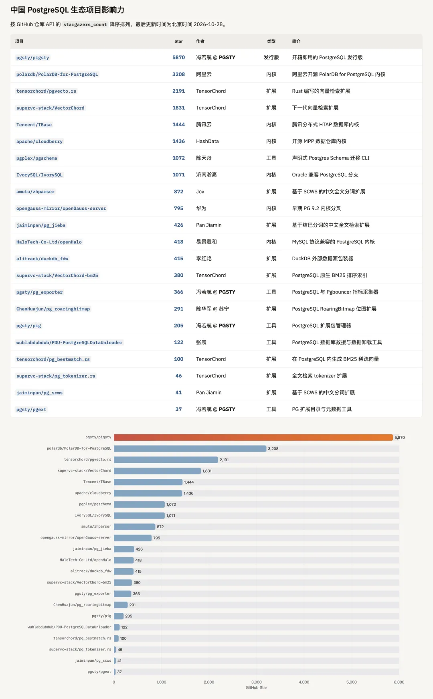
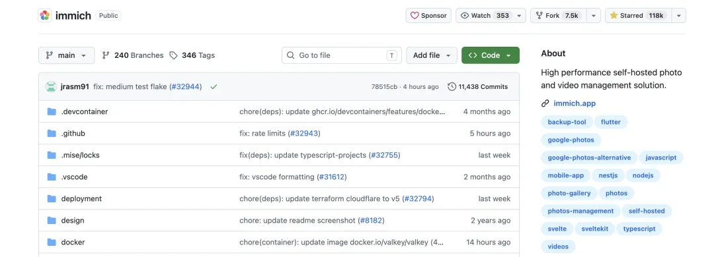
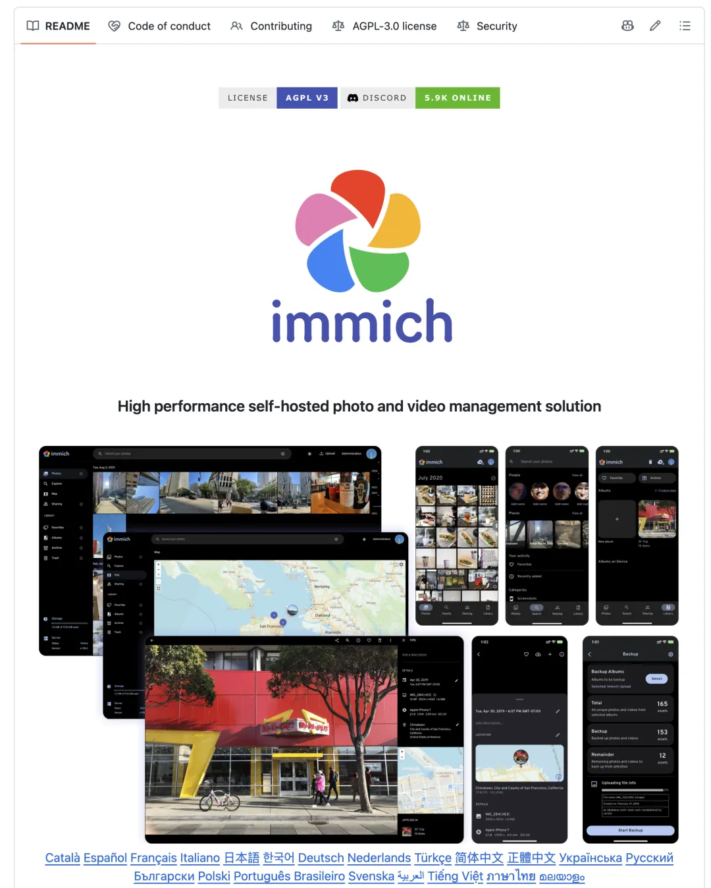
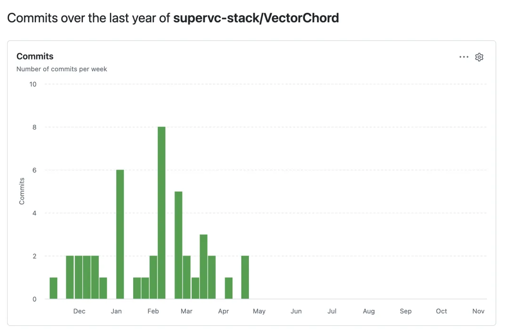
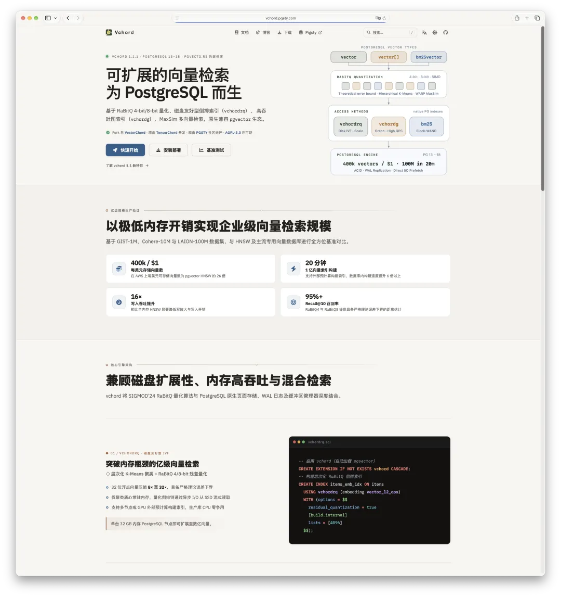
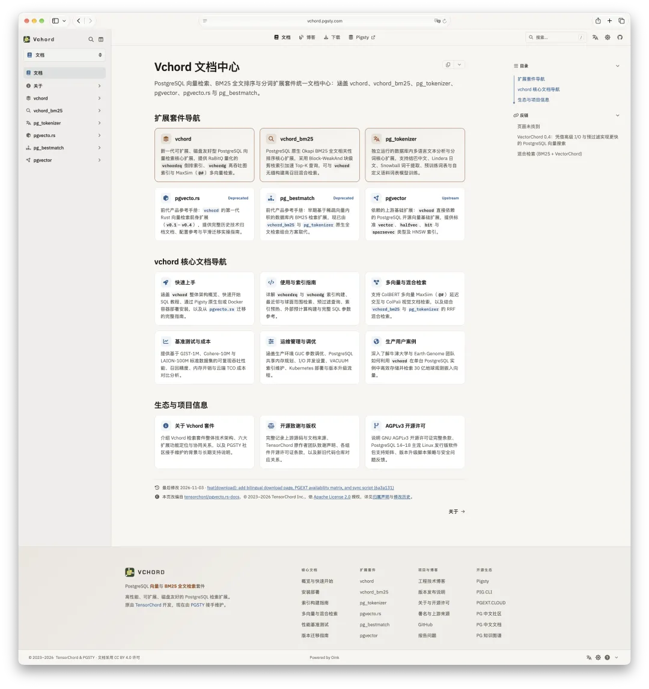
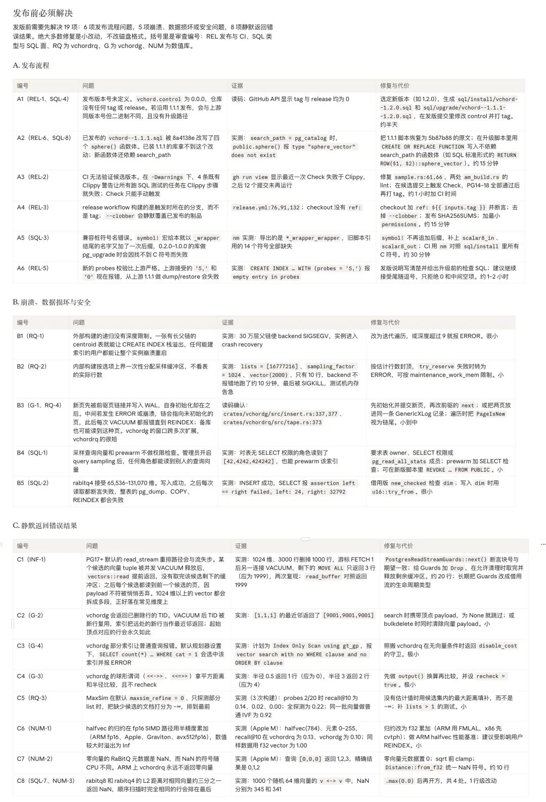
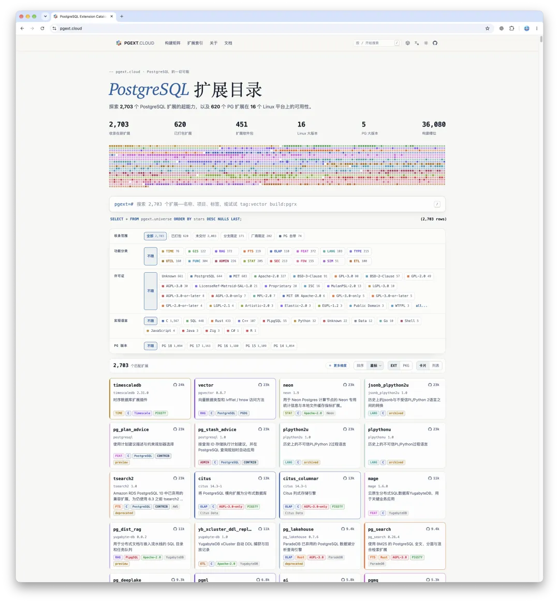
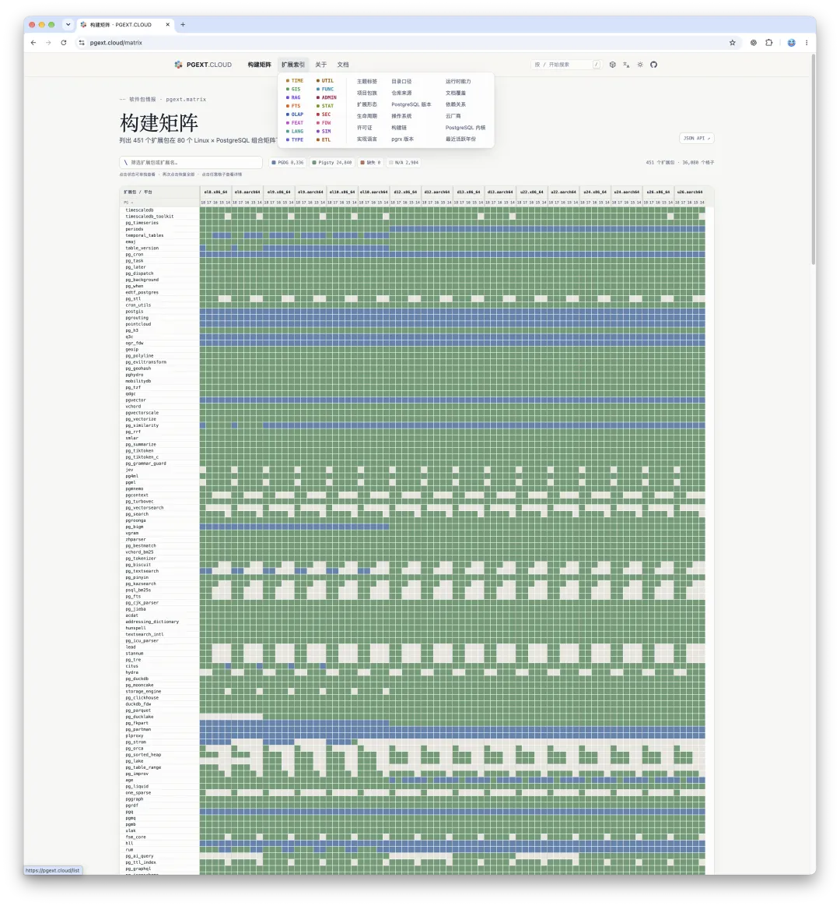
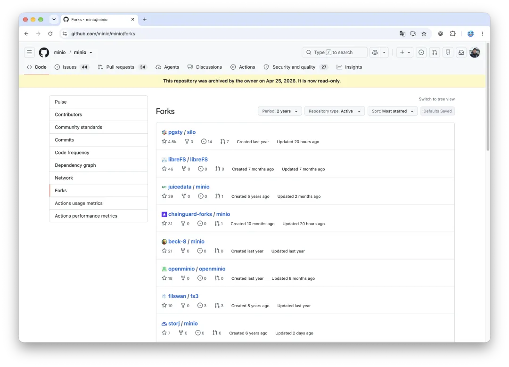

老冯又接盘了。

这话说出来，我自己都想笑。去年[接了 MinIO 的盘](https://mp.weixin.qq.com/s?__biz=MzU5ODAyNTM5Ng==&mid=2247491187&idx=1&sn=005af2d12f6f4d258040efbe4faf08bb&scene=21#wechat_redirect)，做成了 [Silo](https://mp.weixin.qq.com/s?__biz=MzU5ODAyNTM5Ng==&mid=2247492702&idx=1&sn=c45e85f69bb1f87aaebffc46dc49d90e&scene=21#wechat_redirect)，一年下来，它基本成了 MinIO 所有 fork 里最成功的那一个。后来又顺手接了几个：做了一个 Vagrant 的替代品 barn，fork 了 Docsy 改成文档[主题 Oink](https://mp.weixin.qq.com/s?__biz=MzU5ODAyNTM5Ng==&mid=2247492913&idx=1&sn=a16ef8f82c99603301e2d399f479a8ea&scene=21#wechat_redirect)。这些东西我自己天天在用，用得很顺手，外面也陆陆续续有了一些用户。

接一次盘是意外，接两次是巧合，接到第三第四次，老冯真成接盘侠了。

这一次接的，是 PostgreSQL 生态里大名鼎鼎的向量检索扩展——VectorChord，也就是 vchord。

## 四千星明珠蒙尘

`vchord` 出自国内的 TensorChord 团队。熟悉 PG 向量生态的朋友肯定听过它的前身 `pgvecto.rs`，看名字就知道，这是当年用 Rust 重写并挑战 `pgvector` 的一次硬核尝试。

这次连同 `vchord` 一块接过来的，还有同一个组织下的两个配套扩展：一个是 `vchord_bm25`，承接自早期的 `pg_bestmatch`，是用 Rust 在 PG 里原生实现 BM25 全文检索的又一次探索；另一个则是与它搭档的分词器扩展 `pg_tokenizer`。

把这几个仓库算到一块，GitHub 上已经攒下了 4,500 多颗 Star。在相对慢热、硬核的数据库扩展领域，这毫无疑问是一份相当亮眼的成绩单。如果把视线聚焦到中国团队、华人开发者维护的 PostgreSQL 开源项目上，TensorChord 更是格外醒目：在中国 PG 生态开源影响力榜上，`pgvecto.rs` 和 `VectorChord` 两个仓库分列第三、第四，仅次于老冯的 Pigsty 和阿里云的 PolarDB。

在向量检索这条赛道上，`vchord` 和它的前身名气不小，真实生产环境里用的人也多。其中最知名的下游用户，大概要数自托管的照片视频库 **Immich**。

如果你不想折腾一套笨重的 NAS 操作系统，自己搭一个 Immich，可能就是目前管理私人照片的最佳方式，Pigsty 的应用模板里也很早就收录了它。Immich 里最核心的相似图片检索、语义模糊搜索，底层全靠向量索引支撑，而他们官方选定的正是 `vchord`。在我看来，从技术上，这是一个相当明智的选型。

## 二、为什么要接

不幸的是，最近 TensorChord 团队出现了一些变动，这几个扩展也随之陷入了无人维护的状态——算下来，已经有快十个月没更新了。

这事儿放在过去，也许不算什么大问题。一个足够成熟的底层扩展，放着不动，照样能稳稳当当地跑上好几年。但放在 AI 四处挖洞的当下，九到十个月的沉寂，足够让一个好项目彻底烂掉。

之前那篇《[当云被打成筛子](https://mp.weixin.qq.com/s?__biz=MzU5ODAyNTM5Ng==&mid=2247493702&idx=1&sn=23231259ad592eb2f45e5a2f672298a8&scene=21#wechat_redirect)》里聊过这一波“AI 渡劫”的狂潮。当大模型可以不知疲倦地批量翻代码、找破绽，攻击者手里的放大镜一夜之间换成了显微镜。在这样的浪潮里，缺乏维护的基础软件很快就会腐化成千疮百孔的后门。**没人修的代码不叫“稳定”，叫“敞着门”。**

所以，当原作者找到老冯，问我有没有兴趣接手维护的时候，我没犹豫太久。与此同时，下游的 Immich 社区也明确表示，愿意一起参与反馈、维护和贡献。扩展有价值，真实用户在，核心场景在，下游还有人搭把手——这事儿确实可以搞，对吧？

说句实在话，看着一个由中国团队打磨出来、在全世界都有大量真实用户的好项目，就这么冷清地在角落里一点点生锈，我心里挺不忍的。

当然，要是放在一年以前问我，老冯大概不会接这个活。按过去的经验，维护一个底层开源项目是很耗心力的事，一旦接过来，就是一份看不见尽头的责任。但站在今天这个时间点，情况不一样了：我已经接过一次盘，完整趟过了一遍路，手里再多接一个、两个、三个，边际负担其实差不了太多。

何况对我这种日常 Token 过剩、有时候甚至拿着锤子满世界找钉子的人来说，眼下有一颗值得敲的钉子主动送上门来，我是很乐意接招的。

## 三、怎么接

念头很容易定，真要落地，却没法直接“拿来”。

原来的仓库属于公司资产。公司一旦发生变动，仓库的归属和交接就会牵扯太多：Maintainer 权限加不了，组织成员转不动，仓库迁移（Transfer）更是做不了。哪怕原仓库已经攒下了几千颗星，也没法原样保留。老冯不纠结这些，干脆利落地另起炉灶，开出全新的 Fork。

新分支不再沿用过去 VectorChord 那套品牌名，而是朴素地直接用扩展本身的名字命名：`vchord`、`vchord_bm25`、`pg_tokenizer`，统统放在 `pgsty` 组织下面。至于更早一代的 `pgvecto.rs` 和 `pg_bestmatch`，出于“数字收藏”与照顾存量老用户的考虑，Pigsty 软件源里依然提供打好的 RPM 和 DEB 包，但源码层面不再继续跟进，精力全集中在这三个还在活跃使用的扩展上。

紧接着，我把原来的技术博客和文档也完整 fork 出来，搭起了新的文档站 `vchord.pgsty.com`，重新梳洗成清爽的新样式。

做完这些铺垫，真正的硬活儿才刚开始。大半年没人管，老冯直接拉起 Astra / Argon / Fable 这样的顶级模型开足马力一扫——哗啦啦扫出来二三十个隐患，里面甚至藏着好几个 Crash、Segfault 级别的严重缺陷。

这就是前面说的“腐化”——不是危言耸听的修辞，而是实打实摆在眼前的 Bug 清单。每一个问题都得老老实实去复现、去修补、去验证，绝不是改个名字、拍拍屁股就能立刻发版的。

好在紧锣密鼓地啃到今天，`vchord`、`vchord_bm25`、`pg_tokenizer` 三个扩展的修复工作已经基本收尾，从 PG 14 到 PG 18 的软件包均已打好，后续也会持续跟进 PG 19 内核与 `pgrx` 框架的更新。

我们接手后的第一个正式版本，就在这两天发布。

## 四、开源的 free，是自由

聊完接盘的始末，老冯顺便谈几点背后的感想。

大家在潜意识里往往默认：开源就等于免费。很多开源前辈喊了几十年：Free Software 里的 Free，是 Freedom 的自由，不是免费啤酒的免费。但架不住人性使然，大多数人依然习惯把它理解成“白用”。一家能做出这么优秀内核扩展的团队，却很难靠它赚到钱，最后走到今天这一步，确实让人唏嘘。

在老冯看来，开源真正的意义，在于赋予你**按需修改源代码、让软件贴合自身需求**的自由，而不是强调别人可以白用你的劳动成果——虽然实际效果往往确实如此。作为开源作者，真正在乎的是让大家拥有掌控软件的自由，免费不过是个顺带的副产品。

这次接盘，恰恰就是这份自由最好的注脚。原来的维护团队离场了，但代码还在，许可证还在，任何有能力、有意愿的人都有权把摊子接过来继续干。要是换成一个闭源的商业产品，上游公司一变动，成千上万的下游用户除了干瞪眼，没有任何退路。

## 五、代码免费，但供应链有成本

不过，开源软件的源代码虽然免费，一条稳定、可靠的企业级软件制品供应链，却从来都有着实打实的成本。

**代码不会死，但供应链会断。**

举个最典型的例子。MinIO 是开源的，但这并不意味着它的交付供应链可以一直白用。当你的生产体系依赖着官方的 RPM/DEB 包与容器镜像，而 MinIO 直接选择把仓库一归档、官方 Docker 镜像一删，全世界所有用到 MinIO 镜像的 CI/CD 流水线瞬间就一起炸了。你说，那我锁死老镜像继续凑合用呗？这一年里新爆出来的漏洞，足够把你的应用打成筛子。这就是软件供应链断裂的风险。

`vchord` 也是一样。既然在生产环境里选择了它，你就需要一条有人持续负责的供应链。

老冯之前为 PostgreSQL 打造了一套扩展仓库，收录了将近 600 个扩展，覆盖 16 个主流 Linux 发行版，应该是目前全球 PG 生态里最全的一套。坦白讲，这个仓库原本是给付费企业客户做高可靠交付用的，背后背着严肃的商业承诺。

但我不介意把它敞开给所有开源用户使用。如今整个站点的月请求量已经在亿级，每月将近 2TB 流量，商业客户的下载流量其实很小，每天跑出来的海量带宽几乎全来自开源用户。

老实说，这事能一直做下去，首先要感谢“赛博菩萨” Cloudflare 愿意免费托管网站——每个月2TB的流量费一分钱不要，而为了让国内用户也能顺畅下载，国内的镜像 CDN 依然得真金白银地花钱，每个月雷打不动六七百块。这都是毛毛雨，比流量费贵得多的，是背后持续投入的人力、时间与注意力——跟人的精力比起来，那点带宽费微不足道。这，就是开源背后看不见的真实成本。

## 六、开源与商业化冲突吗？

既然不收钱还要搭进去真金白银和精力，那开源与商业化到底冲不冲突？

老冯一直认为，单从传统软件售卖的角度看，开源确实是“反商业模式”的。至少在软件这个行当里，如果你把核心知识产权都直接公开出去了，自然没法再靠售卖知识产权本身赚钱。但这并不意味着开源只能用爱发电——换个维度，依然有不少办法能跑通互利共赢的闭环。

比如，Cloudflare 凭什么免费给全世界托管无数网站？一方面，这确实有技术理想主义的慷慨；但另一方面，它本身就是一套极其精妙的商业模式：通过免费托管，把全球各路黑客的攻击火力都吸引到自己这里，就能在真实攻防中收集最鲜活的安全威胁情报，最终为付费企业客户提供更顶级的防御服务。**免费的那部分，是在为付费的那部分磨刀。**更好的安全防护，免费用户也依然能享受到，但企业级用户更加需要。

[吊打公有云的赛博佛祖 Cloudflare](https://mp.weixin.qq.com/s?__biz=MzU5ODAyNTM5Ng==&mid=2247487240&idx=1&sn=ba535fd0c1026bc2482ea6ad1e1fb8bf&scene=21#wechat_redirect)

[赛博菩萨Cloudflare圆桌访谈与问答录](https://mp.weixin.qq.com/s?__biz=MzU5ODAyNTM5Ng==&mid=2247487400&idx=1&sn=cf5b94165d2791030e0e874dca8383c7&scene=21#wechat_redirect)

同理，老冯之所以不介意把 Pigsty 的核心价值主张之一——“PG 扩展仓库”——免费开放给所有用户甚至是同行搭便车，最根本的原因就在于：**开源最大的工程价值，是众测。**

基础软件用的人越多、跑的环境越杂，潜伏在角落里的问题就暴露得越早、反馈得越快，连带着企业版在内的整体交付质量也就越扎实。特别是在今天这个 AI 时代，写代码本身越来越便宜，真正的瓶颈与门槛正在迅速转移到“测试与验证”上。开源能让成千上万的用户，以作者根本意想不到的各种方式去使用和折腾你的软件——**免费用户从来不是负担，而是遍布全球的测试团。** 这是一种非常健康、体面且互利共赢的模式，对打磨基础软件的质量有着花钱都买不来的助益。

## 七、接盘也不是谁都能接

当然，商业逻辑理得再顺，维护开源底子里终究还得有一份情怀和热爱撑着。

我在之前《[愿力驱动选题](https://mp.weixin.qq.com/s?__biz=MzU5ODAyNTM5Ng==&mid=2247493780&idx=1&sn=65dcd6b0f1d0ac4202312a30353f5d46&scene=21#wechat_redirect)》中聊过：站在今天，维护开源项目的个人成本其实已经不高了。当然，这个“不高”是对**舰队指挥官模式**而言的。在这种模式下，以前事事要自己挽起袖子写代码，精力根本耗不起；现在日常工作变成了收集反馈、拍板关键决策和守住最终验收，同时维护 1 个项目和维护 10 个项目，体感上的差别其实并不大。

但话又说回来，接盘开源这件事，听起来很美好，却绝不是谁冲上去都能做成的。就拿 MinIO 来说，官方停摆后市面上冒出来的 fork 有十几个，OpenMaxIO 之类的都有，为什么最后真正跑出来、立住脚跟的是老冯的 Silo？仔细复盘下来，主要是手里的这四样东西刚好凑齐了：

1. **利益相关（Skin in the game）**：我自己就是重度真实用户，有具体的落地场景，利益高度绑定。它要是炸了，我自己会难受。
2. **专业判断力**：这一项在当下的变化其实最大。以前“写得出代码”是最高的门槛；现在 AI Coding Agent 已经足够强悍，执行层面不太需要你亲力亲为，但在提需求、做取舍、拍板和验收的关口，依然极度依赖顶级专业判断。
3. **现成的分发渠道**：做出来的东西如果分发不出去、没人用，那就等于白做。因为老冯有自己的发行版 Pigsty，而且已经在分发 MinIO 和这些扩展了，所以做出来的东西能直接被用户使用上。
4. **流量与叙事能力**：任何事情想做成气候，最后都绕不开流量与信任。你得把来龙去脉讲透，把故事讲好，让大家理解这东西为什么有用、愿意来试一试。老冯当初写的那篇复活 MinIO 的长文直接冲上了 Hacker News 首页，那才是引爆 Silo 社区共识的关键一步。

只有这几块拼图凑在一起，接盘开源才有可能跑通；否则，大概率只是感动自己的白折腾。

而这也是老冯敢一个接一个往回捡项目的底气：繁重的代码修补有 AI 顶上，关键判断有十多年 PG 经验兜底，现成的扩展仓库直接打通分发，公众号和博客又是天然的叙事阵地。对我来说，整套体系早就转起来了，多接一个项目的边际成本极低，这事儿才真正做得成、做得久。

## 写在最后

拉长时间看，任何一个开源项目都可能迎来成为“孤儿”的那一天。公司会转型，团队会聚散，原作者也会奔赴人生的下一程——这在技术圈里本就是常态。

真正让人觉得惋惜的，是那些明明打磨得很好、外头还有成千上万人在用的好项目，仅仅因为断了维护，就在角落里一点点生锈，最后从大家手里的利器变成系统里的一颗暗雷。

而开源最迷人的地方，恰恰也就在于此：**只要代码还在、许可证还在，熄掉的火种就总有人能重新接过去。** TensorChord 的朋友们用过去几年的心血，做出了真正经得起生产检验的好东西；现在老冯把它接过来，替大家把这条断掉的供应链重新续上——存量老用户可以安安心心地继续用下去，好不容易跑出来的项目也不至于半途夭折，怎么算都是一桩皆大欢喜的好事。

接手后的第一个正式版本就在这两天发布，欢迎各位新老朋友多多尝鲜、提 Issue、拍砖指教。

- 项目地址：[github.com/pgsty/vchord](https://github.com/pgsty/vchord)
- 网站文档：[vchord.pgsty.com](https://vchord.pgsty.com)
