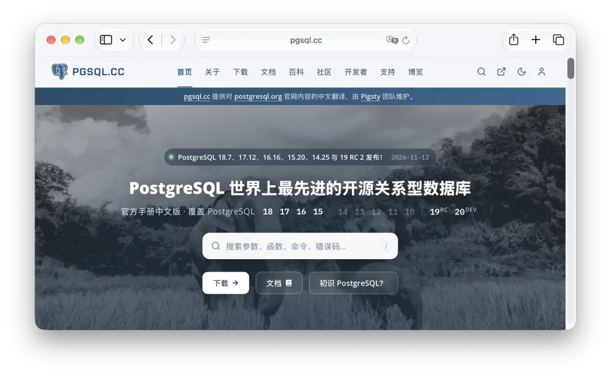
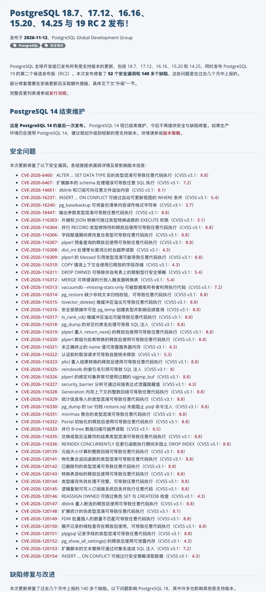
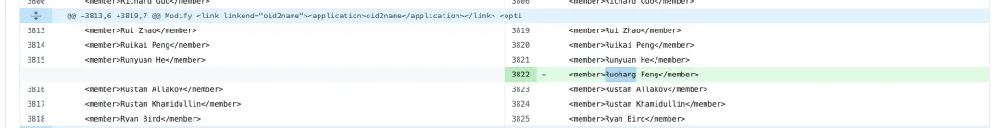
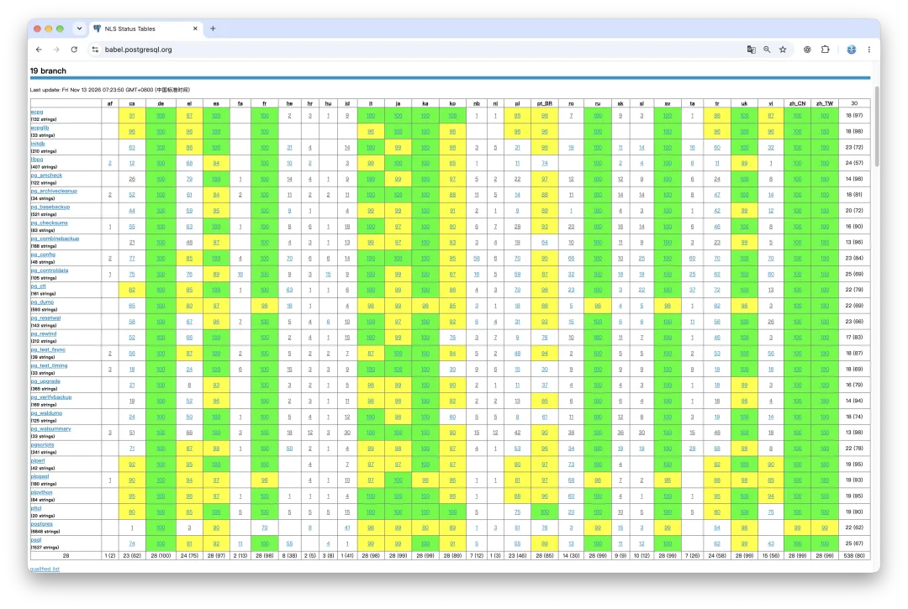

On November 12, the PostgreSQL Global Development Group shipped minor updates across every supported branch: **18.7, 17.12, 16.16, 15.20, and 14.25** (the final release before PostgreSQL 14 reaches end of life), along with **PostgreSQL 19 RC 2**.

Anyone who follows PostgreSQL's release calendar can tell this year's schedule is off. Annual major releases almost always land in September or October, yet **PostgreSQL 19 didn't reach RC 2 until mid-November**. Late September's [Beta 4 reverted a batch of headline features](/en/pg/pg19b4-release/), RC 1 came out in mid-October, and general availability is now set for **November 19**.

Why the slip? The release management team laid it out in an [October 10 mailing list post](https://www.postgresql.org/message-id/f161fbb7-e193-42eb-bec7-4cfc1af74a50@postgresql.org): a large backlog of fixes had piled up across the maintenance branches, and all of them had to merge into PostgreSQL 19 RC 2 before upstream was willing to cut 19.0. Today's [release announcement](https://www.postgresql.org/about/news/postgresql-187-1712-1616-1520-1425-and-19-rc-2-released-3442/) shows what they were holding the gate for: **52 security vulnerabilities (CVEs) and more than 140 bug fixes in a single minor release**.

In a normal year, a quarterly PostgreSQL minor release patches three to five CVEs. [August's minor releases fixed 28 CVEs and over 110 bugs](/pg/pg-186-cve/), which already felt heavy at the time. Three months later, we're looking at 52 CVEs and 140+ bugs. Even across thirty years of PostgreSQL releases, a point update this dense is rare.

## Open Source Under Continuous AI Audit

There's no mystery behind why vulnerabilities are surfacing in clusters this year: AI-assisted code auditing has ramped up hard.

As I've written recently in [When the Cloud Gets Riddled with Holes](/en/cloud/blackwall/), [The Internet Is Getting Shot Full of Holes](/en/cloud/net-attack/), and [PostgreSQL Ecosystem Update: The AI Bug-Hunting Crunch](/en/pg/eco-update-202611/), core open-source infrastructure is going through an industry-wide shakeout as frontier models audit foundational codebases around the clock. Check the Acknowledgments section of the [official 18.7 release notes](https://www.postgresql.org/docs/release/18.7/): OpenAI Security Research Team, OpenAI Codex Security, Anthropic OSS program, and Claude alongside Ada Logics appear one after another.

The CVE breakdown has automated auditing written all over it. **32 of the 52 CVEs carry a CVSS v3.1 score of 8.8**, with a large share allowing arbitrary code execution. Most fall into classic C memory and type-safety bugs: type confusion, use-after-free, heap buffer overflows, and integer wraparound. And they span almost the entire source tree, from composite types, `plperl`/`pltcl`, `dblink`, and the recently added statistics import functions all the way to everyday client utilities DBAs run by muscle memory, including `pg_dump`, `pg_restore`, `reindexdb`, and `vacuumdb`. Even a codebase refined over thirty years by some of the sharpest C programmers around is going to turn up long-dormant bugs in bulk when continuous automated auditing hits it all at once.

I know the feeling firsthand. Beyond PostgreSQL, [**Silo**](/en/db/minio-silo-1year/), the open-source object store I maintain, has spent recent weeks triaging security reports, auditing code paths, and shipping patches; its [November 12 release](https://github.com/pgsty/silo/releases/tag/RELEASE.2026-11-12T00-00-00Z) closed out another round of security and correctness bugs.

Alongside the 52 CVEs, the 140+ regular bug fixes also address several serious data-integrity traps: running a parallel `pg_dump` against a standby could corrupt both the dump output and the standby's own data; incremental backups could produce corrupted backup sets; GIN indexes and `pg_trgm` GiST indexes could become corrupted or fail to return matching rows; and B-tree index deduplication on unbounded `bpchar` columns could cause index-only scans to return wrong results. Upstream even **rewrote the query planner's join removal logic** in this minor release. As the release notes admit plainly, a change of that scope is unusual in a minor update, but incremental fixes to the old code had hit a wall and would only keep leaking bugs.

## Don't Sit on This Upgrade

Every time PostgreSQL cuts a minor release, people ask me the same question: how urgent is this one?

My usual rule of thumb hasn't changed: as long as your database sits behind an internal firewall and only trusted applications and engineers connect to run SQL, scheduling the update for a normal maintenance window is fine. There's no reason to panic over every advisory.

Not panicking doesn't mean dragging your feet, though—especially on an update of this weight. Network isolation stops public internet scanners, not privilege escalation from a low-privileged database role after an application server gets compromised. Plenty of vulnerabilities in this batch only require basic object-creation privileges to trigger (such as [CVE-2026-6460](https://www.postgresql.org/support/security/CVE-2026-6460/)), and even `pg_dump` and `pg_restore` can get exploited by a malicious source database or an untrusted backup file. And no firewall can help you with corrupted incremental backups or wrong query results from a broken index. With PostgreSQL 14 also reaching end of life (EOL) today, this upgrade belongs near the top of your schedule.

Upgrading within the same major branch doesn't require `pg_upgrade` or a logical dump and reload, **but swapping out the server binaries alone isn't enough this time**. Per the [official upgrade announcement](https://www.postgresql.org/about/news/postgresql-187-1712-1616-1520-1425-and-19-rc-2-released-3442/) and the [18.7 release notes](https://www.postgresql.org/docs/release/18.7/), you also need to run through several post-upgrade tasks:

- **Recompile C extensions**: Closing [CVE-2026-6460](https://www.postgresql.org/support/security/CVE-2026-6460/) completely requires recompiling C extensions against the updated headers, and some extensions need source-code changes too. If you install from distribution repositories, verify that rebuilt extension packages have caught up; if you build from source, recompile and test compatibility properly rather than turning off the `composite_type_mismatch` check as a shortcut. As [that earlier minor-release ABI breakage](/en/pg/pg-faint/) showed, the core server and its extensions are joined at the hip.
- **Check and rebuild affected indexes**: Inspect potentially corrupted GIN indexes; rebuild GiST indexes that use `gist_trgm_ops`; rebuild B-tree indexes on unbounded `bpchar` columns (fixed-length `char(n)` columns aren't affected); and if you run into `missing chunk number` errors, reindex the affected tables as described in the release notes.
- **Reset incremental backup baselines and check partitions**: If you use incremental backups, take a fresh full backup after upgrading to reset the baseline. While you're at it, check partitioned tables for unintended `NOT NULL NO INHERIT` constraints.
- **Plan your move off PostgreSQL 14**: `14.25` is the end of the line. Anyone still running PG 14 in production should put a major-version upgrade on the calendar.

Enterprise subscription customers can just ping me for a maintenance window and we'll run through the binaries, extensions, and post-upgrade index and constraint checks together; if you run your own clusters, put this checklist on the calendar soon.

What the past few months have really exposed is which open-source projects still have active maintainers on the hook. Fifty-two CVEs in one minor release looks grim at first glance, but in practice it's a good sign: it means **somebody is minding the store** and shipping patches when bugs turn up. The real danger sits in abandoned projects, half-dead repositories, and orphaned forks. Automated AI tools find just as many vulnerabilities in those codebases, except nobody is around to fix them, leaving ready-made backdoors sitting in production. [The pgBackRest archival-and-rescue episode](/en/pg/pgbackrest-resume/) came down to the same reality: open-source infrastructure only stays safe as long as living people keep showing up to maintain it.

## Day-One Packages in Pigsty 4.6

Telling everyone else to upgrade doesn't carry much weight if a distribution maintainer lags behind.

[**Pigsty v4.6.0**](https://github.com/pgsty/pigsty/tree/v4.6.0) shipped on the same day as upstream PostgreSQL, aligning the default baseline with **PostgreSQL 18.7** and **Pig 1.11.0**, along with rebuilt extensions across all supported platforms, synced package mirrors, and updated offline installation bundles.

This cycle went well beyond swapping in the new PostgreSQL server. To stay ahead of the recent wave of security audits, I went through third-party dependencies and hundreds of packaged PostgreSQL extensions across our repositories one by one, and cut fresh releases across the Go infrastructure projects I maintain:

- Object storage: [**Silo 20261112**](https://github.com/pgsty/silo/releases/tag/RELEASE.2026-11-12T00-00-00Z)
- Package manager: [**Pig 1.11.0**](https://github.com/pgsty/pig/releases/tag/v1.11.0)
- Repository manager: [**SOW 0.7.1**](https://github.com/pgsty/sow/releases/tag/v0.7.1)
- Metrics exporter: [**pg_exporter 1.6.1**](https://github.com/pgsty/pg_exporter/releases/tag/v1.6.1)
- Updated Go toolchains and underlying component dependencies

From the database engine and extension ecosystem to the package supply chain, monitoring stack, and backup storage layer, the whole baseline is back in sync. The [**Chinese PostgreSQL documentation**](/en/pg/pgsql-cc-online/) I maintain has also been updated for all of the latest minor releases.

## Some Good News: Simplified Chinese Localization Shipped

After all the talk of CVEs and broken indexes, let's end on some good news.

**The Simplified Chinese message catalogs (NLS `zh_CN`) that I reworked and proofread from top to bottom have landed across all six major versions, from PostgreSQL 14 through 19.** Check the release tags from this batch and every branch picked them up, right down to [**PostgreSQL 14.25 in its farewell release**](https://github.com/postgres/postgres/blob/REL_14_25/src/backend/po/zh_CN.po), without a single version missed.

From here on out, the PostgreSQL server and its command-line tools finally emit prompts and error messages in clean, idiomatic Chinese. For the full backstory, see [PostgreSQL's Chinese Translations Went Seven Years Untended. I Fixed Them in Seven Days.](/en/pg/pg-nls/) and [Why Localize PostgreSQL into Chinese?](/en/pg/pg-zh-tw/).

My name, Ruohang Feng, was also added to the Acknowledgments section of the PostgreSQL 19 release notes. On November 11, upstream merged [Add translators to release notes credits](https://github.com/postgres/postgres/commit/8f8e68b62bd253b959ee3f47b5919bc4963dd005), crediting a group of translators including me.

On the [official Babel status board](https://babel.postgresql.org/), Simplified Chinese coverage now stands at 99%–100% across every component in PostgreSQL 19 and 98%–100% across PostgreSQL 14–18. The handful of strings modified right before the release freeze are already back at 100% in my [`pgnls` repository](https://github.com/pgsty/pgnls/releases/tag/20261112), and I'll keep tracking upstream going forward.

There's a bit of dark comedy to how long this sat untouched. For years, China's database industry has been full of slogans about building "homegrown Chinese databases." Dozens of domestic vendors forked PostgreSQL and wrapped upstream code in commercial pitches, yet upstream PostgreSQL's own Chinese localization—pioneered years ago by early contributors like Weiping He—went seven straight years without anyone touching the main server message catalog, aside from occasional updates to a few client tools. Maintaining gettext `.po` files takes real effort and doesn't help you raise a venture round, so the work sat there until someone finally rolled up their sleeves and did it.

Griping aside, open source is a commons. I genuinely hope those downstream vendors pull these upstream translations into their own distributions. It's an easy win, and it spares a "domestic sovereign database" the embarrassment of spitting out half-broken English the moment an error fires.

I'm writing this from a hotel room on a work trip, the night before giving a talk at the China Enterprise AI Conference. Tonight I've been cross-checking the upstream advisories while remotely directing my crew of coding agents back home to run cross-platform package builds, sync the mirrors, ship Pigsty 4.6, and rebuild the Chinese documentation, so verified packages are ready by the time people wake up.

It's rough weather out there right now, but there's no reason to panic. Skip the anxiety, don't press your luck, upgrade what needs upgrading, and keep your own stack in order.

## Further Reading

- 2026-11-06: [PostgreSQL Ecosystem Update: The AI Bug-Hunting Crunch](/en/pg/eco-update-202611/)
- 2026-11-05: [Taking Over Another PostgreSQL Extension: vchord Yesterday, pg_mooncake Today](/en/pg/fork-pg-mooncake/)
- 2026-11-04: [Why I'm Maintaining a VectorChord Fork](/en/pg/maintain-vchord/)
- 2026-10-31: [Industrial Pipeline: Translating 30 PostgreSQL Books in a Single Day](/pg/translate-30-books/)
- 2026-10-22: [The Internet Is Getting Shot Full of Holes](/en/cloud/net-attack/)
- 2026-10-21: [When the Cloud Gets Riddled with Holes](/en/cloud/blackwall/)
- 2026-10-12: [Reviving the Chinese-Speaking PostgreSQL Community](/en/pg/revive-pg-cn-community/)
- 2026-10-10: [Why Localize PostgreSQL into Chinese?](/en/pg/pg-zh-tw/)
- 2026-09-25: [PostgreSQL 19 Beta 4: Five Major Features Reverted](/en/pg/pg19b4-release/)
- 2026-09-19: [PostgreSQL's Chinese Translations Went Seven Years Untended. I Fixed Them in Seven Days.](/en/pg/pg-nls/)
- 2026-09-10: [Chinese PostgreSQL Docs Are Live: All 11 Major Versions](/en/pg/pgsql-cc-online/)
- 2026-08-14: [PostgreSQL Minor Releases Patch 28 CVEs and 110+ Bugs](/pg/pg-186-cve/)
- 2026-05-15: [PostgreSQL 18.4, 17.10, 16.14, 15.18, and 14.23 Released](/pg/pg-184-release/)
- 2026-05-05: [The pgBackRest Rescue and Open Source's Forced Price Discovery](/en/pg/pgbackrest-resume/)
- 2026-02-26: [PostgreSQL Out-of-Cycle Emergency Minor Releases Are Out](/en/pg/pg-emergency-patch/)
- 2026-02-19: [Urgent Advisory: Pause PostgreSQL Minor-Release Installs and Upgrades](/en/pg/pg-out-of-sync-202602/)
