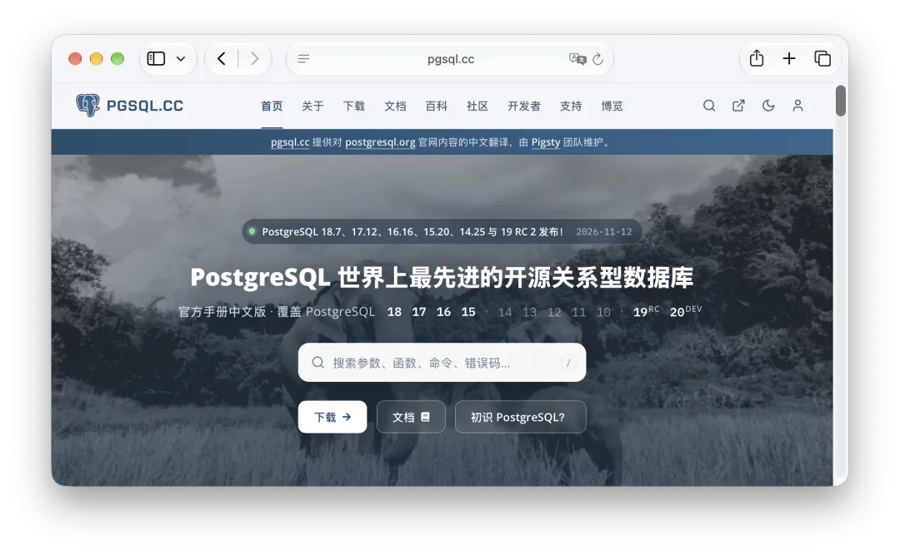
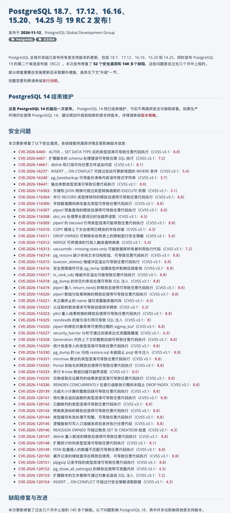
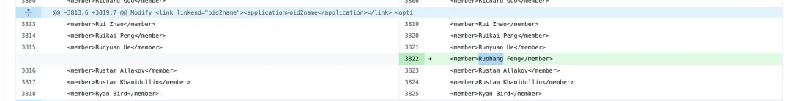
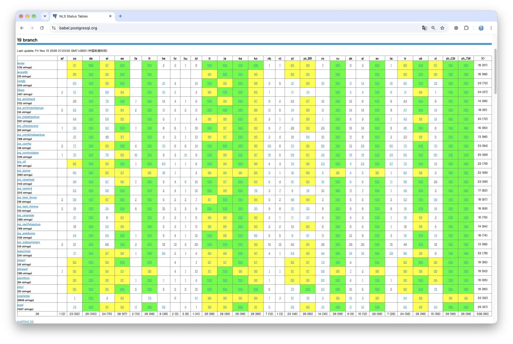

11 月 12 日，PostgreSQL 全球开发组发布了全线受支持分支的小版本更新：**18.7、17.12、16.16、15.20、14.25**（这也是 PG 14 退役前的最后一版），同时放出了 **PostgreSQL 19 RC 2**。

熟悉 PG 社区节奏的老朋友一眼就能看出反常：往年年度大版本大多在 9 月或 10 月发布，今年 **PostgreSQL 19 拖到 11 月中旬才出 RC 2**。9 月底的 [Beta 4 先砍掉了一批大特性](/pg/pg19b4-release/)，10 月中旬出 RC 1，现在正式版排到了 **11 月 19 日**。

为什么拖这么久？发布团队在 [10 月 10 日的邮件](https://www.postgresql.org/message-id/f161fbb7-e193-42eb-bec7-4cfc1af74a50@postgresql.org)里交了底：各维护分支攒下了大批修复，得先把这些改动全合进 PG 19 RC 2，才敢发正式版。看看今天的[发布公告](https://www.postgresql.org/about/news/postgresql-187-1712-1616-1520-1425-and-19-rc-2-released-3442/)就明白分量有多重了——**单次修复 52 个安全漏洞（CVE），外加 140 多个 Bug**。

搁在往年，PostgreSQL 一个季度小版本也就修三五个 CVE。[8 月那一轮修了 28 个 CVE 和 110 多个 Bug](/pg/pg-186-cve/)，当时大家已经觉得够多了，结果三个月后直接涨到了 52 个和 140 多个。放在 PostgreSQL 三十年的发布史上，这个密度也相当罕见。

## 开源软件“渡劫”

今年漏洞扎堆往外冒，原因并不复杂：AI 辅助代码审计上强度了。

老冯在《[当云被打成筛子](/cloud/blackwall/)》《[当互联网真被打成筛子](/cloud/net-attack/)》和《[渡劫期的 PostgreSQL 生态大更新](/pg/eco-update-202611/)》里聊过几次，眼下核心开源基础软件都在集体“渡劫”。翻开 [18.7 官方发布注记](https://www.postgresql.org/docs/release/18.7/)的致谢栏，OpenAI Security Research Team、OpenAI Codex Security、Anthropic OSS program，以及 Claude 与 Ada Logics 的名字排成了一串。

看这 52 个 CVE 的类型，自动化审计的特征也很明显：**32 个漏洞的 CVSS v3.1 评分都是 8.8**，大片涉及任意代码执行。问题集中在类型混淆（Type Confusion）、释放后使用（Use-After-Free）、堆缓冲区溢出和整数回绕；从复合类型、`plperl`/`pltcl`、`dblink`、刚进内核不久的统计信息导入，一直到 `pg_dump`、`pg_restore`、`reindexdb`、`vacuumdb` 这些 DBA 日常顺手敲的工具，几乎翻了个遍。哪怕是一帮顶尖 C 语言老手打磨了三十年的代码库，遇上这种全天候的自动化扫描，陈年隐患也得排着队露出来。

这滋味老冯自己也很熟。不光 PostgreSQL，我维护的开源对象存储 [**Silo**](/db/minio-silo-1year/) 最近也一直在接安全报告、审代码、发补丁，刚放出的 [11 月 12 日版本](https://github.com/pgsty/silo/releases/tag/RELEASE.2026-11-12T00-00-00Z)又修掉了一批安全与正确性问题。

除了这 52 个 CVE，顺手修掉的 140 多个常规 Bug 里也有几个分量不轻的坑：在备库上跑并行 `pg_dump`，可能把导出文件和备库自身数据一起搞坏；增量备份可能打出损坏的备份集；GIN 索引和 `pg_trgm` 的 GiST 索引可能损坏或漏数据；未限定长度的 `bpchar` 列，B-tree 索引去重会让仅索引扫描返回错误结果。社区甚至趁这次小版本**重写了查询优化器的连接消除（Join Removal）逻辑**——官方说得很实在：小版本做这么大改动确实少见，但老代码实在补不动了，再打补丁还得接着漏。

## 该升还得升

每次发小版本，总有朋友来问老冯：这次急不急着升？

老冯平时的口径一直是：只要数据库老老实实待在内网防火墙后面，连进来跑 SQL 的也都是自己人，按常规维护窗口排期就行，犯不着自己吓自己。

但不用慌不等于拖着不升，尤其遇上今天这种分量的更新。内网隔离防得住公网扫描，防不住应用被打穿后的低权限账号提权——这批漏洞里有不少只要建对象这类普通权限就能触发（比如 [CVE-2026-6460](https://www.postgresql.org/support/security/CVE-2026-6460/)），连 `pg_dump`、`pg_restore` 都可能栽在恶意源库或来路不明的备份文件手里；至于备份损坏、索引查错数据，防火墙更帮不上忙。再加上 PostgreSQL 14 今天正式退役（EOL），这轮升级还是尽早排上日程。

同一大版本内升级不用折腾 `pg_upgrade` 或逻辑导出导入，但**这回光换内核二进制还不算完**。对照[官方升级说明](https://www.postgresql.org/about/news/postgresql-187-1712-1616-1520-1425-and-19-rc-2-released-3442/)和[发布注记](https://www.postgresql.org/docs/release/18.7/)，有几件手尾得一并处理：

- **C 语言扩展得重编**：想把 [CVE-2026-6460](https://www.postgresql.org/support/security/CVE-2026-6460/) 彻底堵上，C 扩展必须拿新版头文件重新编译，部分扩展还得改源码。用发行版软件源的，盯一眼扩展包跟上了没有；自己编译的，老老实实重编并测一遍兼容性，别图省事把 `composite_type_mismatch` 检查关掉。之前那次[小版本 ABI 翻车](/pg/pg-faint/)已经敲过警钟：内核和扩展从来是绑在一起的。
- **问题索引得排查重建**：检查受影响的 GIN 索引；重建用了 `gist_trgm_ops` 的 GiST 索引；重建未限定长度 `bpchar` 列上的 B-tree 索引（定长 `char(n)` 不受影响）；要是撞上 `missing chunk number` 报错，按说明把对应表的索引重做一遍。
- **备份基线与分区表巡检**：开了增量备份的，升完级重打一次全量备份刷新基线；分区表顺手查一下有没有不该存在的 `NOT NULL NO INHERIT` 约束。
- **PG 14 准备搬家**：`14.25` 是最后一班车，还在跑 14 的同学该排大版本升级计划了。

企业订阅客户直接找老冯就行，约个窗口，我们把内核、扩展升级和后续索引约束巡检一并办了；自建团队就辛苦对照上面几条，自己排期跑一轮。

说到底，最近这几个月就是对开源基础软件维护能力的一次集中检验。单次爆出 52 个 CVE 看着吓人，换个角度想反倒是好事——说明这软件**有人管**，出了问题还有人兜底发补丁。真正麻烦的是那些没人管、半死不活的项目和孤儿分支：漏洞照样被人用 AI 一抓一把，但没人修，摆在那儿就是现成的后门。之前 [pgBackRest 停更又续命的风波](/pg/pgbackrest-resume/)讲的也是同一个理：开源底座这摊活，总得有活人接着干。

## Pigsty 4.6 首日跟进

光催大家升级不够，做发行版的自己手脚得先利索。

PostgreSQL 发版当天，[**Pigsty v4.6.0**](https://github.com/pgsty/pigsty/tree/v4.6.0) 同步跟进，版本基线对齐到 **PostgreSQL 18.7** 与 **Pig 1.11.0**，配套的全平台扩展重编译、软件源同步和离线安装包也一并推了出去。

这轮更新不只是换个 PG 内核。为了应对最近密集的安全审计，老冯把仓库里的第三方依赖和几百个 PG 扩展挨个梳理了一遍；手里维护的几个 Go 基础设施项目也集中发了一轮新版：

- 对象存储 [**Silo 20261112**](https://github.com/pgsty/silo/releases/tag/RELEASE.2026-11-12T00-00-00Z)
- 包管理器 [**Pig 1.11.0**](https://github.com/pgsty/pig/releases/tag/v1.11.0)
- 仓库管理器 [**SOW 0.7.1**](https://github.com/pgsty/sow/releases/tag/v0.7.1)
- 监控采集器 [**pg_exporter 1.6.1**](https://github.com/pgsty/pg_exporter/releases/tag/v1.6.1)
- 配套 Go 工具链与底层组件依赖更新

从数据库内核、扩展生态、包管理供应链到监控与备份存储底座，这一轮都重新对齐了。另外，老冯维护的 [**PostgreSQL 中文文档**](/pg/pgsql-cc-online/) 也已经更新了这批最新小版本。

## 聊个高兴点的：汉化来了

前面聊了一堆修洞渡劫的糟心事，最后说点开心的。

**老冯前阵子系统重做并审校的简体中文消息（NLS `zh_CN`），已经正式进了 PostgreSQL 14 到 19 全部六个大版本。** 翻一翻这轮各版本的发布标签，连收官的 [**14.25 都带上了**](https://github.com/postgres/postgres/blob/REL_14_25/src/backend/po/zh_CN.po)，一个不落。

从现在起，PG 服务端和命令行工具吐出来的提示与报错，总算能说一口利索的中国话了。前因后果可以看《[PostgreSQL 中文版来了](/pg/pg-nls/)》和《[为什么要做 PostgreSQL 汉化？](/pg/pg-zh-tw/)》。

老冯的名字 Ruohang Feng，也写进了 PostgreSQL 19 发行说明的致谢名单（Acknowledgments）。11 月 11 日上游合入了 [Add translators to release notes credits](https://github.com/postgres/postgres/commit/8f8e68b62bd253b959ee3f47b5919bc4963dd005)，把包括老冯在内的一批译者加了进去。

目前[官方 Babel 状态表](https://babel.postgresql.org/)上，PG 19 简体中文各组件覆盖率在 99%–100%，PG 14–18 在 98%–100%；封版前临时变动的几条零星消息，老冯在 [`pgnls` 仓库](https://github.com/pgsty/pgnls/releases/tag/20261112)里也已经补齐到了 100%，后面会一直跟着上游走。

想来这事多少也带点黑色幽默。过去这么多年，到处都在喊“做中国人自己的数据库”；放眼一圈，国内多少下游厂商吃着 PostgreSQL 的红利，拿 PG 代码包装出各种商业故事，结果上游最基础的中文消息目录，自何伟平等前辈早年开荒之后，除了几本客户端目录偶有修补，服务端主干一晃七年没人动过。这种费工夫、又没法拿去融资讲故事的苦活，最后还是得有人挽起袖子自己干。

吐槽归吐槽，开源世界本就天下为公。老冯挺希望国内这些下游厂商顺手把上游这波汉化接过去——好事一桩，免得顶着“国产数据库”的招牌，真到报错的时候连句囫囵中国话都说不利索，白白让人看笑话。

写这篇文章的时候，老冯正猫在外地出差的酒店房间里，明天还要去中国企业 AI 大会讲一场。今晚就在一边对着上游公告核细节，一边远程指挥“家里的 Agent 小弟”跑全平台编译打包、同步软件源、发 Pigsty 4.6、编中文文档，争取让大伙儿睁眼就能用上验证妥当的新包。

外头风急，但也不用慌。别焦虑，别侥幸，把该升的版本升了，把自家的底座看住就行。

## 延伸阅读

- 2026-11-06：[渡劫期的 PostgreSQL 生态大更新](/pg/eco-update-202611/)
- 2026-11-05：[开源接盘侠又来了：昨天 vchord，今天吃月饼](/pg/fork-pg-mooncake/)
- 2026-11-04：[老冯又接盘新开源项目了](/pg/maintain-vchord/)
- 2026-10-31：[工业流水线：一天翻译完 30 本 PG 书籍](/pg/translate-30-books/)
- 2026-10-22：[当互联网真被打成筛子](/cloud/net-attack/)
- 2026-10-21：[当云被打成筛子](/cloud/blackwall/)
- 2026-10-12：[复兴 PostgreSQL 中文社区](/pg/revive-pg-cn-community/)
- 2026-10-10：[为什么要做 PostgreSQL 汉化？](/pg/pg-zh-tw/)
- 2026-09-25：[PostgreSQL 19 Beta 4 发布：特性大砍](/pg/pg19b4-release/)
- 2026-09-19：[PostgreSQL 中文版来了](/pg/pg-nls/)
- 2026-09-10：[PG 中文文档发布：11 个大版本，一个不落](/pg/pgsql-cc-online/)
- 2026-08-14：[井喷：修了 28 个 CVE、110 个 BUG，PG 最新小版本发布](/pg/pg-186-cve/)
- 2026-05-15：[PostgreSQL 18.4、17.10、16.14、15.18 与 14.23 发布](/pg/pg-184-release/)
- 2026-05-05：[pgBackRest 续命战与开源世界的逼定价](/pg/pgbackrest-resume/)
- 2026-02-26：[PostgreSQL 号外紧急补丁版本发布！](/pg/pg-emergency-patch/)
- 2026-02-19：[号外：暂缓 PG 最新小版本安装与升级](/pg/pg-out-of-sync-202602/)
