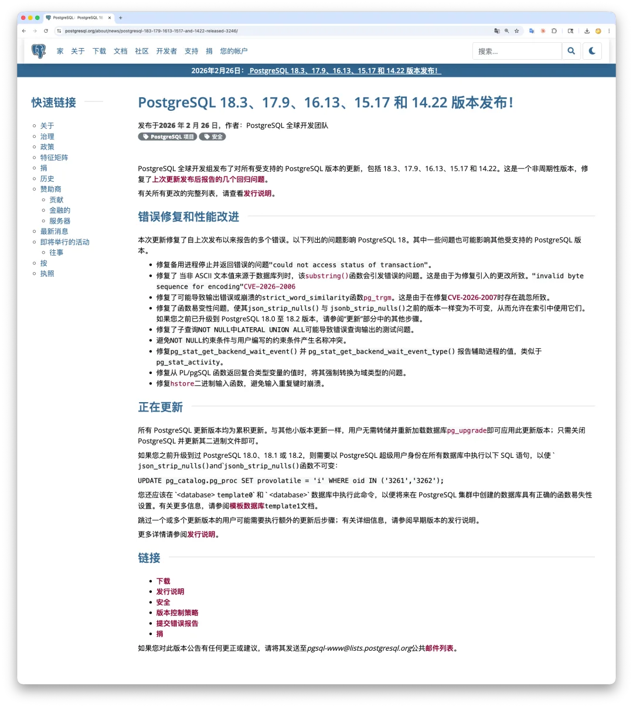
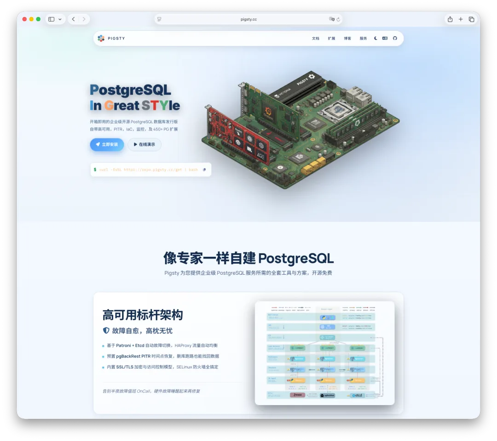
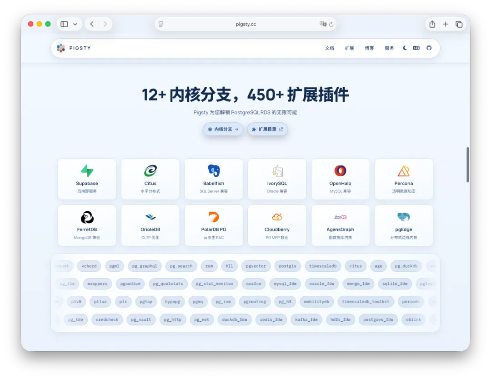
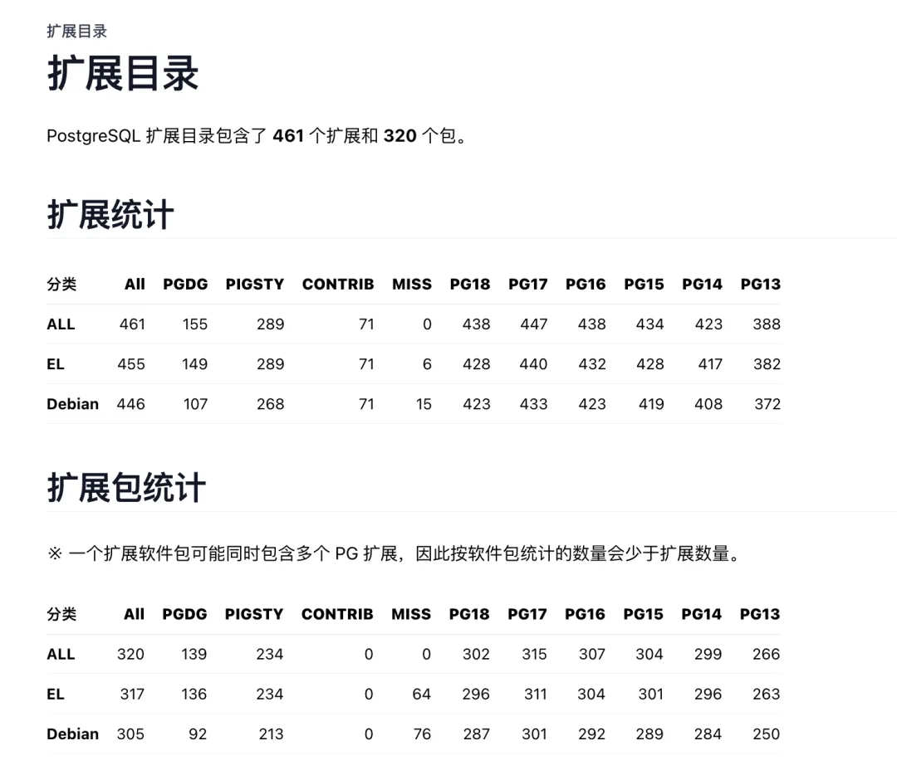

As I noted earlier in [Urgent Advisory: Pause PostgreSQL Minor-Release Installs and Upgrades](/en/pg/pg-out-of-sync-202602/), the previous batch of PostgreSQL minor releases shipped with regressions, making it wiser to hold off on deployments until the out-of-cycle fixes arrived. Right on schedule—less than ten days later—PostgreSQL 18.3, 17.9, and the rest of the minor release series are out.



That said, the PGDG binary packages are not out yet, and mirror sites will likely take another day to catch up. I am currently wrapping up testing for Pigsty v4.2; as soon as the PGDG packages land, I will build the offline package bundles and cut the new release.

## PostgreSQL 18.3, 17.9, 16.13, 15.17, and 14.22 Released!

**Release Date: 2026-02-26** | PostgreSQL Global Development Group

The PostgreSQL Global Development Group has released an update to all supported versions of PostgreSQL, including 18.3, 17.9, 16.13, 15.17, and 14.22. This is an **out-of-cycle release** to address several regressions reported after the previous update<sup>[1]</sup>.

For the full list of changes, please review the release notes<sup>[2]</sup>.

## Bug Fixes and Improvements

This update fixes several bugs reported since the previous release. The issues listed below affect PostgreSQL 18, and some may also affect other supported versions.

- Fix an issue where a standby could halt with the error `"could not access status of transaction"`.
- Fix `substring()`<sup>[3]</sup> raising an `"invalid byte sequence for encoding"` error on non-ASCII text values when the value comes from a database column. This regression was introduced by the fix for `CVE-2026-2006`<sup>[4]</sup>.
- Fix an issue in the `pg_trgm`<sup>[5]</sup> extension where `strict_word_similarity` could produce incorrect output or crash, introduced by an oversight in the fix for CVE-2026-2007<sup>[6]</sup>.
- Restore the function volatility marking of `json_strip_nulls()` and `jsonb_strip_nulls()` to `IMMUTABLE`, matching previous releases so they can be used in indexes. If you previously upgraded to PostgreSQL 18.0 through 18.2, see the "Updating" section below for additional post-upgrade steps.
- Fix incorrect query results caused by `NOT NULL` tests in `LATERAL UNION ALL` subqueries.
- Prevent system-generated `NOT NULL` constraint names from colliding with user-specified constraint names.
- Fix `pg_stat_get_backend_wait_event()` and `pg_stat_get_backend_wait_event_type()` so they report wait events for auxiliary processes, matching `pg_stat_activity`.
- Fix an error in PL/pgSQL functions when returning a composite-type variable cast to a domain type.
- Fix a potential crash in the `hstore`<sup>[7]</sup> binary input function when processing input with duplicate keys.

## Updating

All PostgreSQL update releases are cumulative. As with other minor releases, users are not required to dump and reload their database or use `pg_upgrade`<sup>[8]</sup> in order to apply this update release; you may simply shut down PostgreSQL and update its binaries.

If you have previously upgraded to PostgreSQL 18.0, 18.1, or 18.2, you need to run the following SQL as a PostgreSQL superuser in **all databases** to mark `json_strip_nulls()` and `jsonb_strip_nulls()` as `IMMUTABLE`:

```sql
UPDATE pg_catalog.pg_proc SET provolatile = 'i' WHERE oid IN ('3261','3262');
```

You should also execute this command in the `template0` and `template1` databases so that future databases created in the PostgreSQL cluster have the correct function volatility setting. See the template databases<sup>[9]</sup> documentation for more information.

Users who have skipped one or more update releases may need to run additional post-update steps; please see the release notes from earlier versions for details.

For more details, please see the release notes<sup>[10]</sup>.

### References

- `[1]` Several regressions reported after the previous update: <https://www.postgresql.org/about/news/out-of-cycle-release-scheduled-for-february-26-2026-3241/>
- `[2]` Release notes: <https://www.postgresql.org/docs/release/>
- `[3]` `substring()`: <https://www.postgresql.org/docs/current/functions-string.html#FUNCTIONS-STRING-FORMAT>
- `[4]` `CVE-2026-2006`: <https://www.postgresql.org/support/security/CVE-2026-2006/>
- `[5]` `pg_trgm`: <https://www.postgresql.org/docs/current/pgtrgm.html>
- `[6]` CVE-2026-2007: <https://www.postgresql.org/support/security/CVE-2026-2007/>
- `[7]` `hstore`: <https://www.postgresql.org/docs/current/hstore.html>
- `[8]` `pg_upgrade`: <https://www.postgresql.org/docs/current/pgupgrade.html>
- `[9]` Template databases: <https://www.postgresql.org/docs/current/manage-ag-templatedbs.html>
- `[10]` Release notes: <https://www.postgresql.org/docs/release/>


## Pigsty v4.2 Preview

**Pigsty v4.2 is scheduled to ship tomorrow or the day after, complete with offline installation packages for PostgreSQL 18.3.**



**Beyond the minor-version bump, v4.2 packs several major additions: Pigsty now builds Cloudberry (a Greenplum 7 MPP data warehouse), AgensGraph (a native graph database kernel), and pgEdge (multi-master replication), along with repackaged builds of OpenHalo (MySQL wire compatibility) and the latest OrioleDB (OLTP storage engine, beta14).**

**That brings the total number of supported database kernels in this release to 12 (16+ in practice), covering nearly every PostgreSQL-ecosystem kernel with a distinct value proposition.**



**Meanwhile, the total number of available PostgreSQL extensions has reached a record 461.**



**Stay tuned for the full release notes.**

---

Originally published on [WeChat Official Account](https://mp.weixin.qq.com/s/whfw9Om3aGI7po1TpKJxtA)
