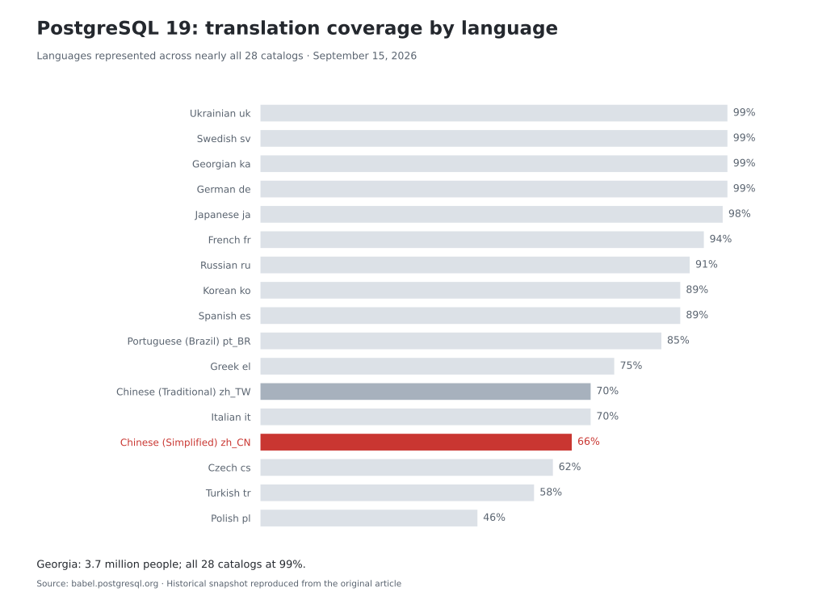
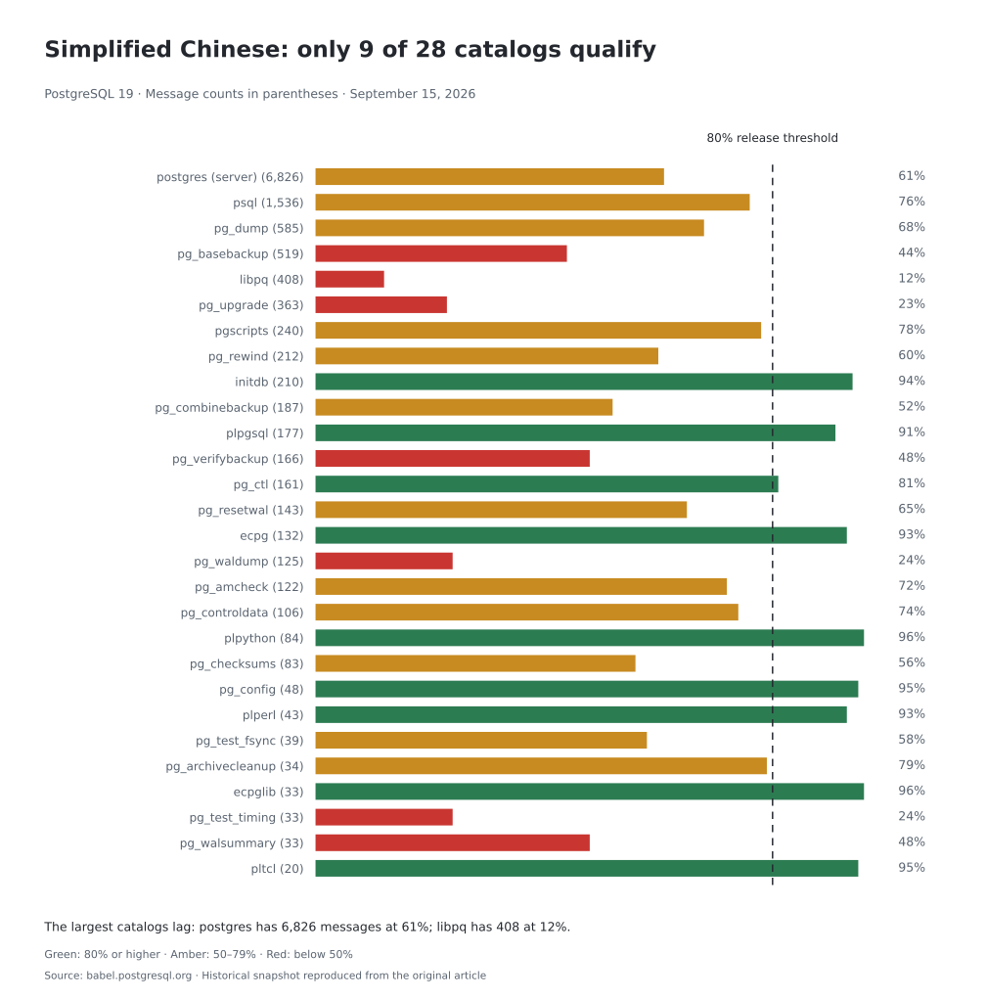
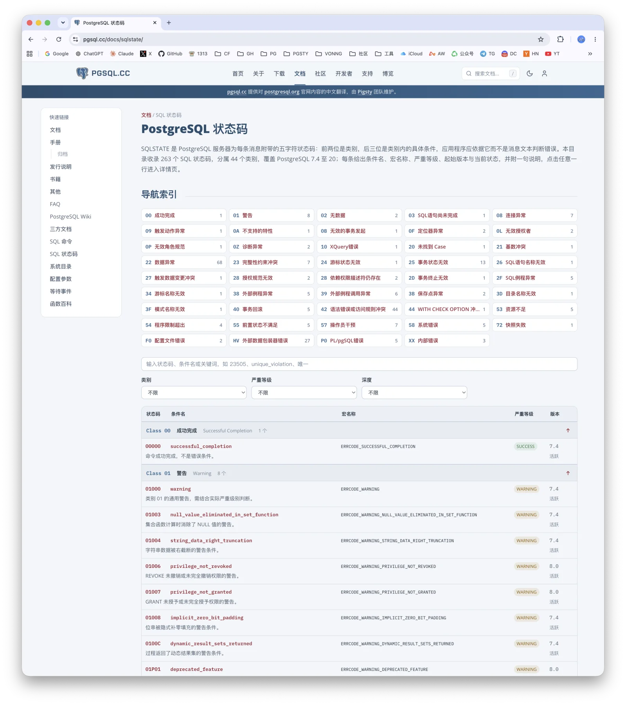
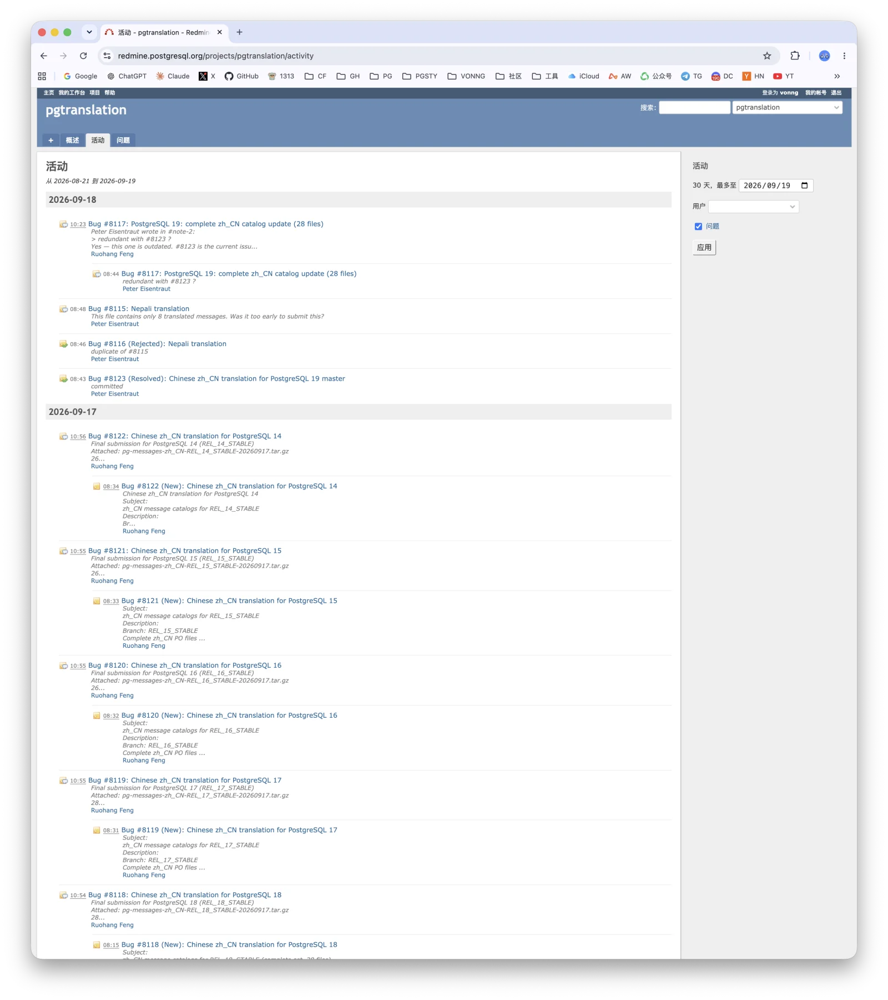
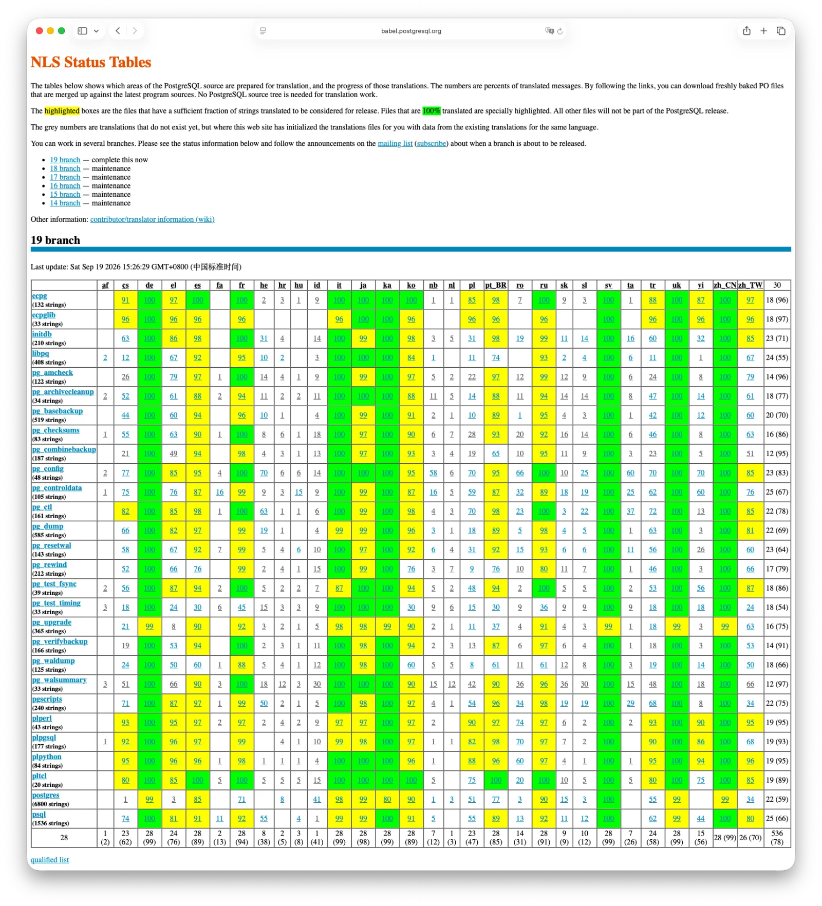
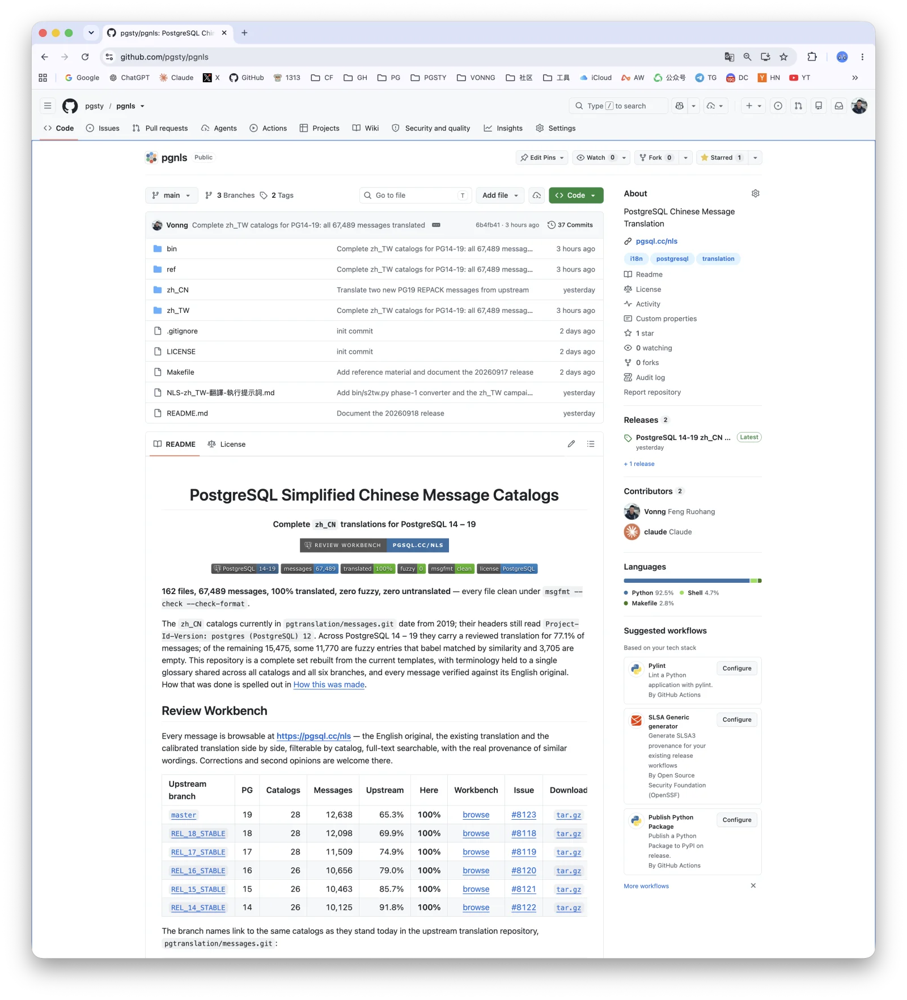
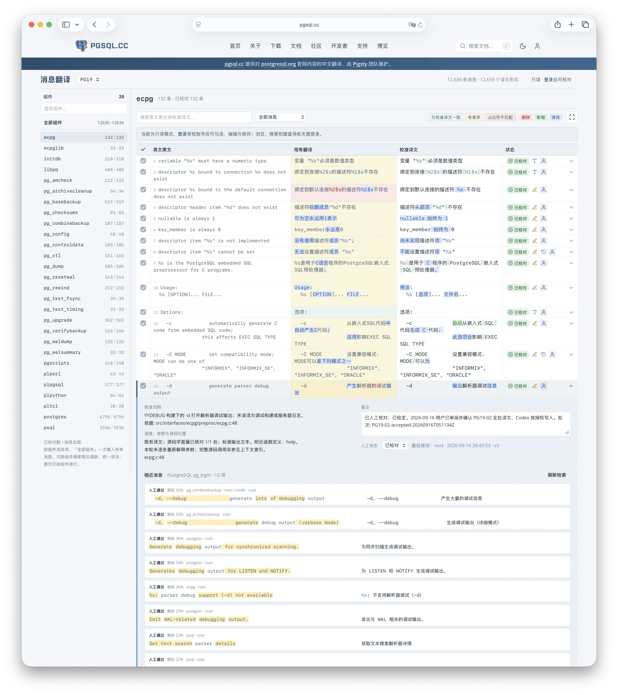

If you have used PostgreSQL for any length of time in China, you have probably heard the unwritten rule:
when you install the database, do not set the message locale (`lc_messages`) to `zh_CN` (Simplified Chinese).
Use `en_US` and be done with it.

The rule is not superstition. A generation of DBAs learned it the hard way.
But read what it actually says: to get a database that talks to you properly, a Chinese user has to start by turning off their own language.

With PostgreSQL 19, that rule no longer applies.

I rewrote PostgreSQL's Simplified Chinese localization from scratch. Six major versions, PG 14 through 19.
28 message catalogs. 67,487 strings. 100% coverage.
Peter Eisentraut merged it into the upstream translation repository on September 18, and it ships with PostgreSQL 19.

## Chinese Almost Got Dropped Entirely

PostgreSQL has native support for localization. Official message catalogs provide translations of the server's English messages;
the system is called [NLS](https://www.postgresql.org/docs/current/nls.html).

Supporting the mechanism is not the same thing as any particular language being usable.

On July 24 this year, Thom Brown posted to the [`pgsql-translators`](https://www.postgresql.org/list/pgsql-translators/2026-09/) list: six languages,
in their current state, were not going to make it into PG 19. Czech, Greek, Italian, Brazilian Portuguese, Simplified Chinese, Traditional Chinese.

Here is why. PostgreSQL has a hard rule: a language ships in a release only if its message catalogs clear 80% coverage.
Catalogs below that line do not get packaged. The status table at [babel.postgresql.org](https://babel.postgresql.org/) makes the problem plain.

Simplified Chinese: 66%. Traditional Chinese: 70%. Both under the line.



Compare languages first. German, Swedish, Ukrainian and Georgian were at 99%, Japanese at 98%, Russian at 91%, and Korean at 89%.
Georgia has 3.7 million people, barely more than a single district of Shanghai, and it has all 28 catalogs at 99%.

Now look within Simplified Chinese. Of its 28 catalogs, only 9 clear the line, and the more essential the catalog, the worse it looks.

The server's own `postgres` catalog contains 6,826 strings, more than half the total and the source of most ERROR messages users see. Its coverage: 61%.
`libpq`, which client drivers across many languages rely on, has 408 strings. Its coverage: 12%.



66% does not mean "the Chinese is a bit rough."
When gettext cannot find a translation it falls back to the English source, so what you actually get is an error whose first half is Chinese and second half is English.
One tool speaking Chinese and the next speaking English inside the same upgrade. The same concept under two different words in two different places.

The problem is not that the Chinese is bad. The problem is that it is half there, and for any serious environment that is worse than plain English.
Which is exactly why the old hands tell you to turn localization off.

## Seven Years Without Maintenance

Open the file header and you can see how it happened.

When I inspected [the file on REL_19_STABLE](https://github.com/postgres/postgres/blob/REL_19_STABLE/src/backend/po/zh_CN.po) for this work, its header was still the one below; `master` had the same header. From PG 12 in 2019 to PG 19 in 2026: seven years and three months, eight major releases, without a single byte of that header changing.

PG 12 reached end of life two years ago. Seven full years, and nobody had taken care of this.

**Historical header excerpt: `src/backend/po/zh_CN.po`**

```text
# simplified Chinese translation file for PostgreSQL server
# Weiping He <laser@...>, 2001.
"Project-Id-Version: postgres (PostgreSQL) 12\n"
"POT-Creation-Date: 2019-05-22 17:56+0800\n"
"PO-Revision-Date: 2019-06-05 18:00+0800\n"
"Last-Translator: Jie Zhang <...@cn.fujitsu.com>\n"
"X-Generator: Poedit 1.5.7\n"
```

*Transcribed from the [original illustration](crime-scene.png), including its masked email addresses. The header still named PostgreSQL 12 and a June 5, 2019 revision, with Poedit 1.5.7 as the generator.*

A few client catalogs got sporadic repairs: `psql` and `libpq` in 2021, `pg_ctl` in 2023, and `initdb` in 2024. The largest catalog stayed untouched.

Messages added over those seven years for logical replication, JIT, parallel queries and asynchronous I/O have an empty Chinese column. Of the server catalog's 6,826 strings, roughly 2,660 have never had a Chinese translation at all. And of the 5,213 translated back then, about 1,000 no longer match the current `msgid` because the source has changed. They are still sitting in the file, but will never be matched again.

## The Museum of Mistranslations

Worse than untranslated is mistranslated.

The following exhibits come from the `REL_19_STABLE` Simplified Chinese catalogs as recorded for this article. These tables transcribe the [original illustration](museum.webp), keeping the Chinese as evidence. The `libpq` query-result message and the `ecpg` source message are abbreviated in the illustration.

| Catalog | English source as shown | Chinese rendering as shown | English gloss and assessment |
| --- | --- | --- | --- |
| `postgres` | `out of memory` | `内存用尽` | Memory used up; correct. |
| `postgres` | `out of memory\n` | `内存溢出` | Memory overflow; incorrect. |
| `libpq` | `out of memory` | `内存不足` | Insufficient memory; correct. |
| `libpq` | `...for query result` | `内存耗尽` | Memory exhausted; correct. |
{.expand .wide caption="Exhibit 1: four Chinese renderings of out of memory"}

| Exhibit / scope | English source as shown | Chinese rendering as shown | English gloss and problem |
| --- | --- | --- | --- |
| Bug-report footer: 14 catalogs | `Report bugs to` | `臭虫报告至 <%s>.` | Report bedbugs to the address; mistranslates a software bug as an insect. |
| Bug-report footer: 3 catalogs | `Report bugs to` | `报告缺陷: <%s>.` | Report defects to the address; uses the correct sense of bug. |
| `pg_ctl`: missing operating-system error | `invalid binary "%s": %m` | `无效的二进制码 "%s"` | Invalid binary code "%s"; drops `%m` and therefore the operating-system error text. |
| `ecpg`: nonexistent second argument | `descriptor %s bound to the default ...` | `绑定到默认连接%2$s的描述符%1$s不存在` | Descriptor `%1$s` bound to default connection `%2$s` does not exist; requests a second argument that the source never supplies. |
{.expand .wide caption="Exhibits 2–4: bedbugs, a missing error message, and an invented argument"}

`Report bugs to` comes out as `臭虫报告至`: the word `臭虫` means the insect, not a software defect.
Fourteen catalogs use that rendering. It dates to the first translator's work in 2001 and has survived all the way to 2026.

`out of memory` has four Chinese renderings in the tree I examined: 内存用尽, 内存不足, 内存耗尽, and **内存溢出**.
The first three are fine. The fourth says *memory overflow*, and it is wrong.
OOM is asking for memory and not getting it, a clean failure. An overflow is a write past the end of a buffer that corrupts whatever sits next to it.
In the middle of an incident those two point in opposite directions: one sends you to add RAM, check connection counts and tune `work_mem`, the other sends you to read code.
The confusion spread from Java, where `OutOfMemoryError` and `StackOverflowError` are so often taught side by side that they end up sharing one Chinese term.

Two more are outright bugs.

In `pg_ctl`, `invalid binary "%s": %m` loses the `%m` entirely in Chinese.
The same message is translated correctly in other catalogs. In `pg_ctl`, you learn which file is wrong but lose the operating-system error associated with `errno`, which is most of what makes the message useful.

The `ecpg` one is nastier. The `msgid` has exactly one `%s`; the translation writes `%1$s` and `%2$s`.
Under a Chinese locale, formatting that string reads a second argument that was never passed.

So the old-timers' rule was earned. And more people walk into this than you would guess:
install PostgreSQL on a macOS or Linux desktop running a Chinese UI and the locale follows the system,
which means Chinese. Unless you have deliberately set it otherwise, it is easy to end up there.

## Fine, I'll Do It

Why did I pick this up?

A while back I translated the whole PostgreSQL documentation set into Chinese, 18 major versions from 9.0 to 20,
and published the [documentation](https://pgsql.cc/docs) on [pgsql.cc](https://pgsql.cc). I also maintain a PostgreSQL knowledge graph alongside it.
One thing the graph tracks is error messages and where they come from in the source.
Working through that, the state of the Chinese became impossible to unsee.



*The Chinese heading reads "PostgreSQL Status Codes." This snapshot lists 263 SQLSTATE codes in 44 classes, covering PostgreSQL 7.4–20. "Navigation Index" groups them by class; the search box accepts a code, condition name or keyword, with filters for class, severity and depth. The columns show the status code, condition name, macro name, severity and version, with the current status beneath the version. Each row opens a detail page. As the introduction explains, applications should use the five-character SQLSTATE code—two characters for the class, three for the condition—rather than match translated error text.*

Having come that far, I might as well finish the job.

On September 11 I [wrote to pgsql-translators](https://www.postgresql.org/message-id/CA1188D8-97A4-4F09-9E7F-42207C43BC34@vonng.com) volunteering to take over the Simplified Chinese catalogs.

I laid the method out plainly in that email. The models produce a draft using the glossary from pgsql.cc.
I review every string against the English source and the existing translation,
and submit only reviewed output that passes `msgfmt`. I offered two options, a full redo or filling the gaps and fixing the obvious errors,
and said I preferred the first. Most of the inconsistencies are cross-file, and one pass against a fixed glossary solves what a pile of small patches cannot.

Nobody on the list objected. So I got to work.

September 13: a first batch, all 28 catalogs for PG 19, 12,702 strings, with an issue opened on Redmine.

September 17: every catalog on six branches, PG 14 through 19. 162 files, 67,487 strings,
100% translated, zero fuzzy, zero empty, `msgfmt --check --check-format` green across the board.

September 18: Peter Eisentraut merged them into PostgreSQL 19's translation repository.



*The translation project's Redmine activity feed records the submissions and Peter Eisentraut's September 18 "committed" reply on issue #8123 for PG 19.*

Seven years untouched. Seven days start to finish.

I burned through eight 20x subscriptions.



*Babel on September 19, 2026: rows are message catalogs, columns are languages, and cells give the percentage translated. Green means 100%; yellow marks catalogs that qualify for release. The `zh_CN` column is almost entirely green, with `postgres` and `pg_upgrade` at 99% as upstream messages continue to change.*

PG 19 is not frozen yet and upstream strings are still moving.
The `postgres` catalog shifted a few in the last couple of days and coverage slipped from 100% to 99%.
So I also maintain [pgsty/pgnls](https://github.com/pgsty/pgnls),
which tracks upstream changes with a release a day, and I will submit a final 100% pass after the freeze.

Traditional Chinese got the same treatment and is essentially done. When PG 19 ships, both `zh_CN` and `zh_TW` will be at 100%.



*The `pgsty/pgnls` repository holds `zh_CN` and `zh_TW` catalogs, shared reference material and release archives. Its README compares upstream coverage with the replacement catalogs for PG 14–19 and links to the review workbench, submission issues and downloads.*

## How the Seven Days Went

I make no secret of it: ChatGPT Astra 6 and Claude Fable 5.1 did most of the translation work.

AI has made translation work far cheaper than it used to be.
But this was not a matter of saying "please translate all of this into Chinese."
Even by a conservative estimate, I put dozens of hours into it,
including writing a workbench to make side-by-side human review easier:

[](https://pgsql.cc/nls)

*My [translation review workbench](https://pgsql.cc/nls), headed "Message Translation." The version selector is set to PG 19; the left sidebar lists 28 components with reviewed/total counts. The main columns are "English Source," "Existing Translation," "Revised Translation" and "Status"; green status badges mean "Reviewed." Search and message filters help locate entries, while the color legend identifies matches, differences, placeholder mismatches, deletions, additions and edits. Expanding a row reveals the review rationale, source references, notes, manual review status and similar messages. Browsing is read-only; signing in enables review, editing and saving. The selected `ecpg` entry illustrates why human comparison matters, down to whether `-d` means parser debugging or server debugging.*

The hard part of translation has always been consistency. There are 67,487 strings across 28 components and six major versions:
the same English has to be the same Chinese, and similar English has to be similar Chinese.
A human doing that by hand burns out. A model doing it drifts.
The rules have to be settled before the translation starts.

I started with a full trial translation to extract the terminology. Several models independently proposed translations for those terms.
I compared their suggestions, assembled an initial glossary and checked it entry by entry.
Anything uncertain got careful scrutiny, down to modal verbs:
*cannot*, *shall not* and *must not* each needed a fixed Chinese rendering, with no improvisation.
Once the glossary was settled, I wrote a style guide and translation rules with plenty of good and bad examples, then used those rules for the first proper draft.
After that came consistency checks across components and across versions, with every mismatch sent back for review.

A [**glossary**](https://github.com/pgsty/pgnls/blob/main/ref/glossary.tsv) is the soul of professional translation.
Translating [*Designing Data-Intensive Applications*](https://ddia.vonng.com) (both editions), [*PostgreSQL Internals*](https://pgint.vonng.com),
and 18 major versions of the PostgreSQL docs is what produced it. The quality of the glossary determines much of the quality a professional translation can achieve.

AI cut the cost of this work by an order of magnitude. A job left undone for seven years could now be finished in seven days.
But that cuts both ways: if seven days is enough now, seven years of neglect is even harder to excuse.

## What Did China's "Homegrown" Databases Actually Build?

The first thing I wondered before starting was whether somebody had already done this.
There is no shortage of databases marketed as Chinese-built PostgreSQL derivatives.
Surely one of them had already done the Chinese localization? Was there work I could reuse?

I went and looked. Again and again, their `zh_CN.po` catalogs carried the same old mistranslations as upstream.
Search for `臭虫` (bedbugs) or `内存溢出` (memory overflow) and there they were.

The following table reproduces the article's historical ChatGPT research snapshot of Chinese projects and other PostgreSQL derivatives. The recurring literal `臭虫报告至<%s>.` means "Report bedbugs to <%s>."

Except for YugabyteDB, paths are relative to `src/bin/` at the repository root. For example, `psql/po/zh_CN.po:2550` means line 2550 of `src/bin/psql/po/zh_CN.po`. YugabyteDB's row gives its full repository-relative path. The report says none of the listed entries had an obsolete (`#~`) or `fuzzy` flag.

| Project | Public repository / branch | Match location | Retained wording |
| --- | --- | --- | --- |
| IvorySQL | `IvorySQL/IvorySQL`<br>`master` | `psql/po/zh_CN.po:2550` | `臭虫报告至<%s>.` |
| PolarDB for PostgreSQL | `polardb/PolarDB-for-PostgreSQL`<br>`POLARDB_17_STABLE` | `psql/po/zh_CN.po:2550` | `臭虫报告至<%s>.` |
| Tencent TBase | `Tencent/TBase`<br>`master` | `psql/po/zh_CN.po:2432` | Fixed bug-report address: `pgsql-bugs@postgresql.`… (clipped in the screenshot). |
| Kunlun<br>(public compute-node repository) | `zettadb/kunlun`<br>`main` | `psql/po/zh_CN.po:2656` | Fixed PostgreSQL bug-report address. |
| openHalo | `HaloTech-Co-Ltd/openHalo`<br>`master` | `psql/po/zh_CN.po:2550` | `臭虫报告至<%s>.` |
| Apache Cloudberry | `apache/cloudberry`<br>`main` | `psql/po/zh_CN.po:2550` | `臭虫报告至<%s>.` |
| YugabyteDB | `yugabyte/yugabyte-db`<br>`master` | `src/postgres/src/bin/psql/po/zh_CN.po:2550` (full path) | `臭虫报告至<%s>.` |
| Neon<br>(PostgreSQL fork) | `neondatabase/postgres`<br>`REL_17_STABLE_neon` | `psql/po/zh_CN.po:2550` | `臭虫报告至<%s>.` |
| OrioleDB<br>(PostgreSQL fork) | `orioledb/postgres`<br>`master` | `psql/po/zh_CN.po:2550` | `臭虫报告至<%s>.` |
| Postgres-XC | `postgres-x2/postgres-x2`<br>`master` | `psql/po/zh_CN.po:2044` | Fixed PostgreSQL bug-report address. |
{.expand .wide caption="Historical ChatGPT research snapshot: which downstream databases retained the bug-report wording?"}

Source: [original ChatGPT research screenshot](downstream.webp); branch names and line numbers reflect the original snapshot.

That is hard to let pass. What are the two most basic things a Chinese database is expected to ship?
Chinese documentation and Chinese localization. Turning PostgreSQL's English errors into decent Chinese,
so that Chinese users can understand what their own database is telling them, is the bare minimum. Surely that deserves some attention?

The upstream Chinese translation has names in its file headers. He Weiping in 2001. Zhang Jie of Fujitsu from 2019 to 2023. Wang Dianjin of Cloudberry.

Not one of the Chinese database vendors making a living off PostgreSQL is among them. In the end it fell to me, a one-person operation, to get it done.

Commitment to the work can accomplish things that state subsidies cannot.

## Finally

Open source has no one handing out assignments, only people claiming them.
The role was vacant for seven years. Anyone could have taken it. Nobody did. Georgia, with 3.7 million people, had all 28 catalogs at 99%.
They did not have some inherent advantage. Somebody there volunteered.

And now there is a clock on it.

Those mistranslations do not sit quietly in a `.po` file.
They propagate into PostgreSQL forks, into blog posts and Q&A threads and support tickets,
out onto the open web, into training corpora, into models, and back out again as the standard answer,
repeated by people who never saw the original. 内存溢出 started as four characters somebody typed years ago without thinking hard about it.
Give it a few more years and it could be what the entire Chinese-speaking technical world believes OOM means,
and fixing it at that point is no longer a matter of editing one file.
Cleaning the source while you still can is cheaper than plugging ten thousand holes downstream.

`臭虫报告至` lasted twenty-five years. It does not survive PostgreSQL 19.

So next month, when you install PostgreSQL 19, try setting the locale to `zh_CN`. This time it actually works.
