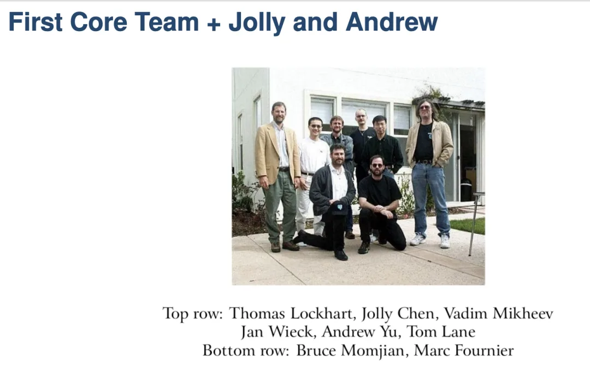
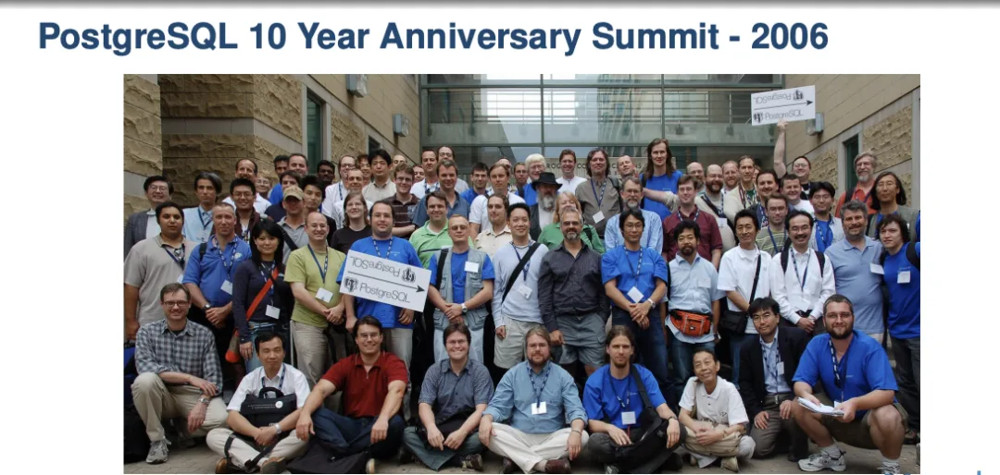
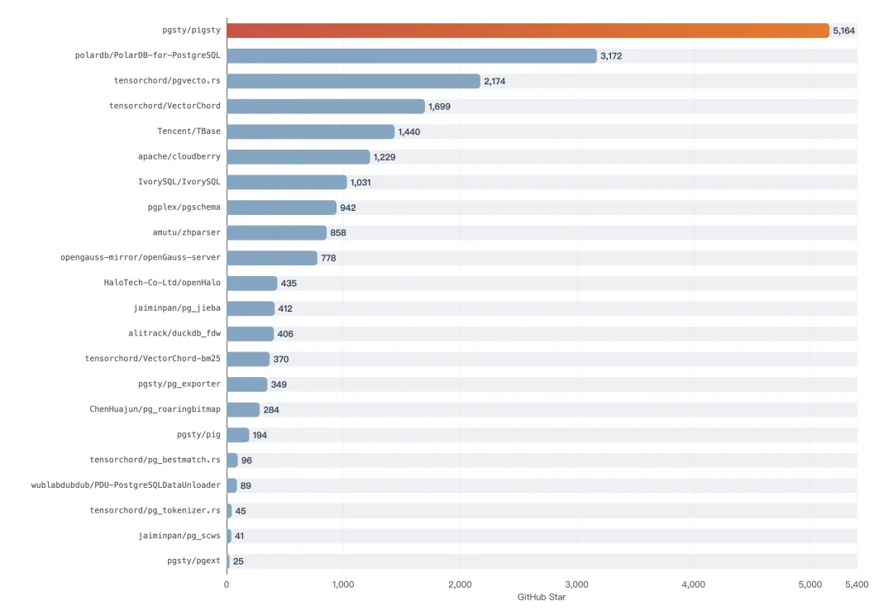
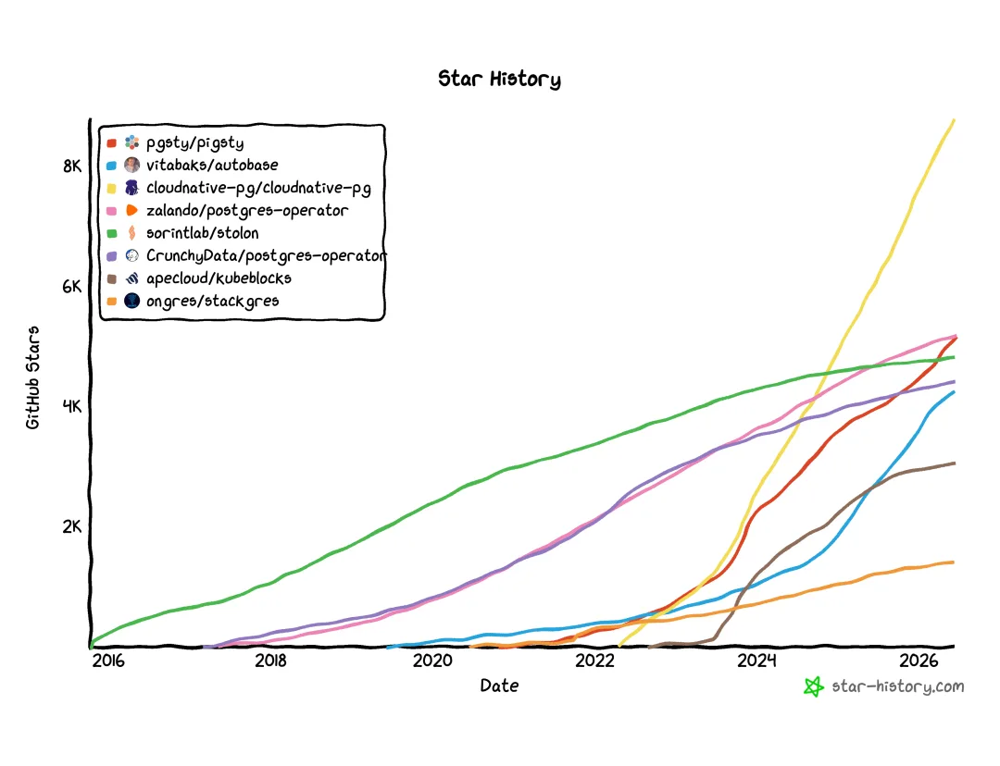
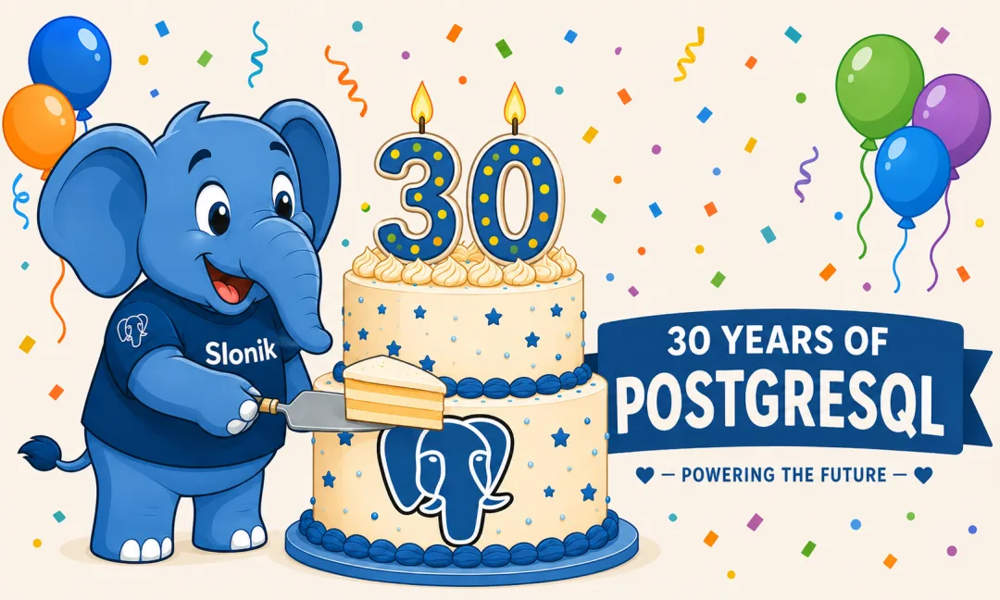

> I joined a 90-minute livestream today for PostgreSQL's 30th anniversary. Since most people don't have time to sit through a full stream, I turned my remarks and reflections into this essay.

## 1. How Do We Count to Thirty?

First, a historical footnote: how exactly do we calculate PostgreSQL's 30th birthday?

If you trace the lineage back to the beginning, you start in 1986. That year, database pioneer and Turing Award laureate Michael Stonebraker at UC Berkeley—whose surname I like to render in Chinese as *Shi Potian* ("Stone-Breaker")—launched the successor to Ingres: Post-Ingres, or Postgres for short. By that clock, the project turns forty this year. And its predecessor, INGRES, dates all the way back to 1974.

By community convention, however, PostgreSQL's official birthday is July 8, 1996. That was the day the project's first mailing list post went out and the CVS server came online—the true starting point of its version control history under community stewardship.

How did that date come about? Briefly: Stonebraker's academic project ran its course in 1994. The papers were published, the grant money was spent, and by academic convention the code was supposed to gather dust on a hard drive somewhere. Two graduate students, Andrew Yu and Jolly Chen, couldn't bear to let it die. They replaced its homegrown query language, POSTQUEL, with SQL, and put it on the internet as Postgres95.

The following year, both graduated and moved on. Just as the torch was about to go out again, a group of internet volunteers who had never met in person took over the codebase and renamed it PostgreSQL. July 8, 1996, was the day of that handoff. For the next thirty years, the project ran with no parent company, no CEO, and no venture funding—just a mailing list.

Strictly speaking, PostgreSQL is still twenty-nine years and eleven months old; it does not officially turn thirty until next month. Nobody wanted to wait, though, so the community threw the birthday party early in Vancouver this May. Celebrating a month ahead is easy to forgive—in thirty years, the birthday crowd has never been bigger.

## 2. A Living Legend

That early birthday party was PGConf.Dev 2026 in Vancouver, which drew a record 259 attendees. I was there, and I got to meet Jolly Chen in person—the name from the history books in the previous section, sitting a few meters away chatting with everyone.

With Jolly Chen

Still, as memorable as it was to meet the person who midwifed PostgreSQL into the world, the project itself is the bigger story. Over thirty years, it pulled off two improbable reinventions.

The first was turning a university research project into an ownerless community project. That sounds routine only in hindsight. Academic projects are a dime a dozen, and almost all of them go quiet after the thesis defense. Postgres survived, and it survived by becoming something nobody owned.

The second was growing from a volunteer project into default infrastructure for the world's data. Year after year, it tops developer surveys as the most admired database. It is the starting codebase for a huge share of database startups, and the foundation underneath more than half of China's "domestic" databases. **It has become the Linux of the database world**—the layer you might not always see directly, because it is simply assumed to be there. A project with no sales force, no marketing department, and not a dime of funding outlasted and outcompeted a long list of ten-billion-dollar rivals.

Confucius said that at thirty, a person stands firm on their own feet (*sanshi er li*). PostgreSQL has earned that phrase, and it stands on solid ground.

## 3. The Wilderness Years

During today's livestream, Digoal (Zhou Zhengzhong) recalled what it was like when he first picked up PostgreSQL more than a decade ago: hardly anyone in China knew what it was. When he gave a talk on PG at DTCC, the audience just stared back at him in confusion.

My own history with PostgreSQL started in 2015. I had just graduated and joined Alibaba—the stronghold of MySQL in China. While evaluating databases for a solo project that needed JSON support, I stumbled across PostgreSQL after wrestling with MySQL's JSON features. PG's JSON capabilities blew me away; by comparison, the MySQL in my hands felt like a relic from a previous era. Even so, choosing PostgreSQL back then was an uphill battle. It was still treated as an eccentric, fringe option, and picking it meant pushing back against everyone around you. Yet even then, I was convinced it was the future of data.

Over the next few years, I worked with almost every database on the market: processing tens of terabytes of daily pageview logs on ODPS at Alibaba, running Cassandra, HBase, Hive, MongoDB, and Redis in anger, and translating *Designing Data-Intensive Applications* (*DDIA*) into Chinese. The more time I spent in the trenches across the database landscape, the more convinced I became that PostgreSQL had gotten the fundamentals right. From then on, every time I changed jobs, I had one non-negotiable requirement: the work had to involve PostgreSQL. How many times in life do you find something you are that sure about? A job pays the bills; this was different—**it became a vocation.**

Ten years have passed in a blink.

## 4. Thirty Years, Three Leaps

Over the past decade, I watched PostgreSQL go from a "promising contender" to the undisputed king of the database world. Zoom out to the full thirty years, and you can see how PostgreSQL caught three successive waves, completing a classic triple jump.

**Wave one: GIS.** PostGIS arrived in 2001 and gave PostgreSQL a foothold in traditional enterprise software through geospatial workloads. Government agencies, mapping bureaus, telecoms—anyone sitting on serious spatial data ended up needing it. That was the traditional software wave.

**Wave two: JSON.** When the web exploded, the NoSQL movement declared war on relational databases. PostgreSQL didn't respond with op-eds or manifesto debates; it shipped JSON straight into the core—`json` in 9.2, `jsonb` in 9.4. You wanted a document database? PostgreSQL absorbed MongoDB's core value proposition in stride.

**Wave three: AI.** Vector search led the charge, making `pgvector` the busiest extension of the AI boom, with full-text search and graph queries right behind it. Once again, PostgreSQL was standing in the right place when the wave hit.

Catching three major waves in a row sounds like an absurd run of luck. Look closer, though, and luck has very little to do with it. This is what PostgreSQL's tagline—"The World's Most Advanced Open Source Relational Database"—actually means. Being "advanced" isn't about shipping one flashy feature three years ahead of the competition; a lead like that gets erased in half a generation. **True advancement is the capacity to evolve with the times.**

### [Postgres is eating the database world](/en/pg/pg-eat-db-world/)

## 5. The Torah and the Talmud

That raises the obvious question: how does a thirty-year-old project keep evolving with the times?

It reminds me of Judaism. The *Torah* is fixed—not a single letter of the canon may be altered. Around it, however, grew the *[Talmud](https://mp.weixin.qq.com/s?__biz=MzU5ODAyNTM5Ng==&mid=2247492215&idx=1&sn=9590547590ce7e891e1dd8d41734c83b&scene=21#wechat_redirect)*: centuries of rabbinic debate, commentary, and interpretation that continuously answer the new questions of each era. That living layer of commentary is how a core text written millennia ago remains vital today.

PostgreSQL has the exact same architecture. **The core server is its Torah**: small, stable, conservative, slow to change, and relentlessly focused on reliability across three decades. **The extension ecosystem is its Talmud**: hundreds of extensions flourishing at the edges, answering each era's new questions on behalf of the core. For GIS, PostGIS answered; for NoSQL, `jsonb` answered; for AI, `pgvector` answered. The more rock-solid the core remains, the more boldly the commentary layer can grow; the richer the commentary layer becomes, the less the core needs to churn itself to stay relevant.

That is the secret behind the triple jump: the core never had to chase every wave itself, because it was designed to let the extension ecosystem catch the wave for it. Extensibility is not just another feature on PostgreSQL's checklist—it is the soul of the architecture.

Even the best extensible architecture is not enough on its own, though. More important than the technology is community governance. PostgreSQL is one of the very few genuinely open-source databases—the only major database that operates as an ownerless public good. No single commercial vendor controls PostgreSQL. Precisely because it belongs to no one, it belongs to everyone: contributors have every incentive to add bricks to the wall, because nobody has to worry that their work is secretly fencing in someone else's private yard.

Technical capability paired with open-source integrity—it took both to bring PostgreSQL to where it stands today.

## 6. Negative Scores and Standard-Bearers

When the livestream turned to China, the host asked Digoal a pointed question: if the North American and European PostgreSQL communities score a 10 out of 10, what score does China get? I figured Digoal would give it a 4 or 5 to save face for domestic database vendors. Instead, he didn't hesitate: "Negative points."

I laughed out loud on the spot. Once the laugh faded, though, it was hard to argue with him. China has produced an endless parade of rebadged, reskinned, and heavily hacked PostgreSQL forks whose changes amount to negative optimizations. Viewed honestly, their net contribution to the global PG ecosystem has been negative—without them fragmenting attention and muddying the waters, PostgreSQL in China might well be in better shape. With positive contributions scarce and negative ones piling up, the math really does come out below zero.

Perhaps the sharpest irony is that the most globally visible project in China's PostgreSQL ecosystem is Pigsty—a PostgreSQL distribution built by one person, a literal one-person company (OPC), with more GitHub stars than the PG forks backed by tech giants like Alibaba, Tencent, and Huawei. When a solo indie developer ends up as the storefront for an entire country's ecosystem, it isn't much of a badge of honor; it is mostly an indictment of the industry's priorities.

[Forging a China-Rooted, Global PostgreSQL Distro](/en/pg/forge-a-pg-distro/)

Still, complaining doesn't write code; someone has to do the work. If nobody else wants to carry the flag, I will carry it for now. Over the past few years, I have focused on two things—the distribution and the extension ecosystem: packaging, testing, and shipping hundreds of extensions across more than a dozen Linux distributions so they work out of the box, and putting Pigsty into the top tier of open-source PostgreSQL distributions worldwide. One person may not be able to pull the national average above zero, but at least the "positive contributions" column for China doesn't have to sit empty.

Since PGConf.Dev was reorganized under its new name, it has held three conferences, and I have attended all three. My talk proposal for the first one was rejected, and I flew over anyway—frankly, just to show up in person and turn the handles on the mailing list into real faces across a dinner table. Nothing builds trust faster than talking face to face. Without a slot on the main track, I gave an unconference session on observability. The second year, I grabbed a five-minute lightning talk slot at pgext Day so people knew what I was building. By the third year, I had done the deep legwork on a problem the whole community cared about—the extension ecosystem—brought the results to the table, and earned a spot on the main stage.

[PGCon.Dev 2024, The conf that shutdown PG for a week](/en/pg/pgcondev-2024/)

[PGCon.Dev Extension Ecosystem Summit Notes @ Vancouver](/en/pg/pgcondev-2024/)

[Notes from PGConf.Dev 2025 in Montreal](/trip/20250514-montreal-notes/)

[Five Minutes on the Clock: My PGConf.Dev Lightning Talk](/pg/pgcondev-lightning/)

[A Chinese Vendor Takes the Keynote Stage at PGConf.Dev for the First Time](/en/pg/pgconfdev-china-keynote/)

[Extensions for Everyone: PGConf.Dev 2026 Talk](/en/pg/extensions-for-everyone/)

From the audience, to the side room, to the main stage—three steps across three years. Trust is accumulated one increment at a time. Open source doesn't run on venture capital theatrics; **the only way to build trust is to show up, participate in good faith, and do work that is genuinely useful to the community.**

## Epilogue

Writing this down, it struck me that this path looks familiar—because it is the exact same path PostgreSQL itself has walked for thirty years.

It never bought an ad, never hired a salesperson, and never pitched a valuation story to investors. It simply shipped one reliable release after another, stayed useful from one computing era to the next, and met each new wave when it arrived. After thirty years of that, the world entrusted its most valuable data to it. A person and a software project earn trust the exact same way: do useful work, do it solidly, and keep showing up.

My own story is just a small reflection of PostgreSQL's story. And there are more reflections like it taking shape: across these thirty years, China's relationship with PostgreSQL has also moved from hearing about it, to running it, to taking the first real steps toward contributing back. I believe those two arcs will converge more and more closely—until one day, when Digoal or anyone else is asked that scoring question again, we can give a positive number with a straight face.

On the day the conference wrapped up, I found myself thinking about Jolly Chen again. Thirty years ago, two graduate students couldn't bear to watch a good project die, bolted SQL onto it, and put it on the internet. Thirty years later, it has grown into a towering tree.

At thirty, PostgreSQL stands firm. It didn't miss a single major wave in its first thirty years, and I see no reason it will miss the next one. It is in its prime.

Next month, on July 8, it officially turns thirty. So let me say it a little early:

Happy birthday, PostgreSQL.

May your next thirty years stay just as evergreen—and may you keep showing up.

---

Originally published on [WeChat Official Accounts](https://mp.weixin.qq.com/s/8pyFVnS7xbYuSXdif1Crgw)
