The PostgreSQL 19 release schedule is set: RC1 arrives next Thursday, October 15, with the final release expected on October 29 if all goes well.

With that approaching, here's some good news for Chinese-speaking users: after Simplified Chinese, **Traditional Chinese message localization has also made it into PG 19**. Starting with this release, PostgreSQL will speak both varieties of Chinese properly.

I've already written about [Simplified Chinese support](/en/pg/pg-nls/). Today, I want to explain why this work matters.

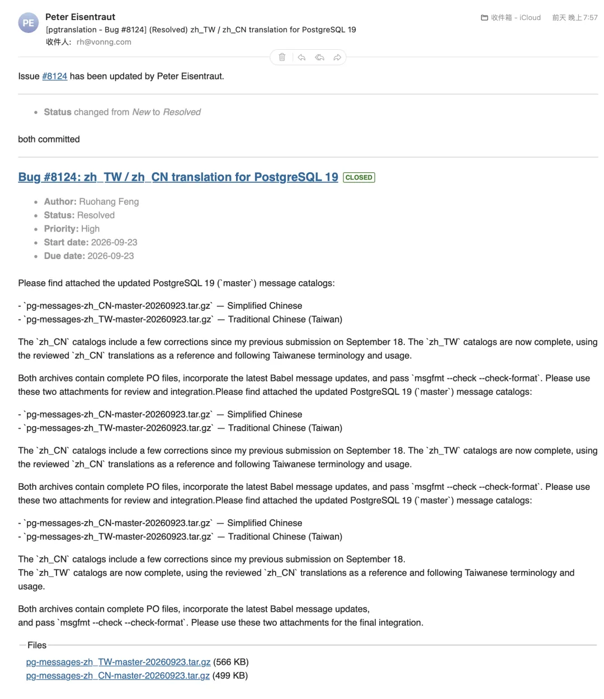

## Both Chinese translations meet the release requirements

A quick recap: the Simplified Chinese (`zh_CN`) message translations [I submitted upstream](/en/pg/pg-nls/) shipped with PostgreSQL 19 Beta 4. Over the past few days, I've made another round of corrections and filled in gaps, then used that version as the basis for a Traditional Chinese (`zh_TW`) translation. That has also been submitted upstream and will ship with next week's RC1.

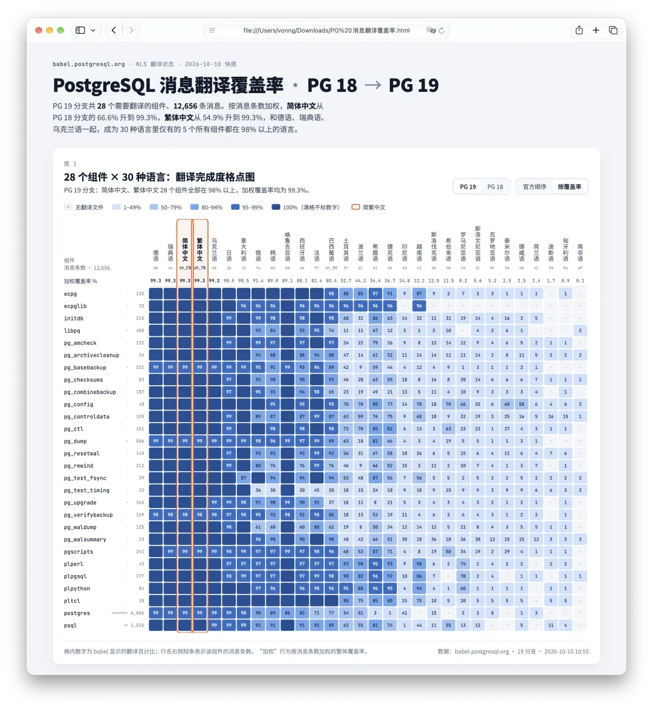

You don't have to take my word for it. PostgreSQL's official translation status site, [babel.postgresql.org](https://babel.postgresql.org/), has the numbers. The PG 19 branch has 28 components with more than 12,600 messages to translate, from the database server's `postgres` catalog and the `psql` command-line client to tools such as `pg_dump`, `pg_basebackup`, and `pg_upgrade`.

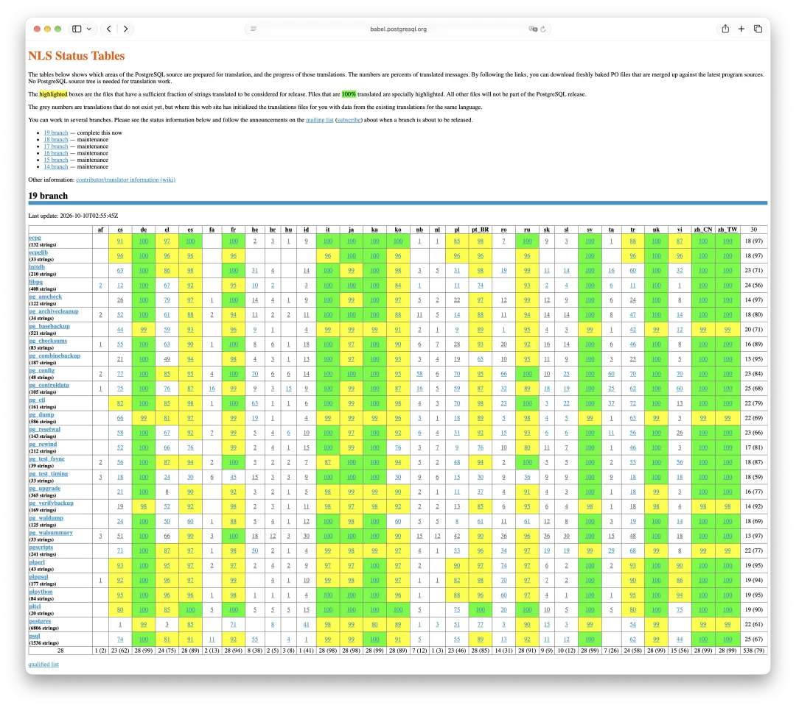

As of today, all 28 components are at least 98% translated in both Simplified and Traditional Chinese. The `postgres` catalog has 6,806 messages and is 99% complete; `psql`, with 1,536 messages, is at 100%.

Across all 30 languages, **only five have every component at 98% or above: German, Swedish, Ukrainian, Simplified Chinese, and Traditional Chinese.** Even long-established translations such as Japanese, French, Russian, and Spanish still have components with more work left.

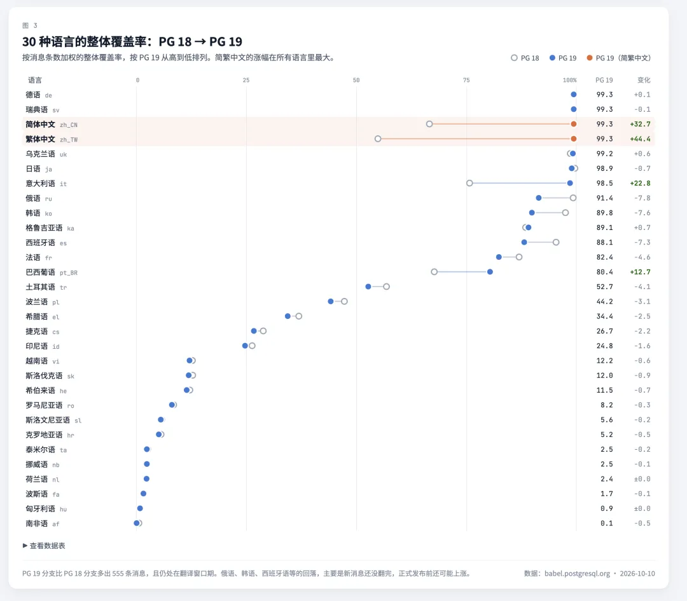

Compare that with the PG 18 branch. In Simplified Chinese, `libpq` is only 13% translated, `pg_upgrade` 25%, and `pg_waldump` 31%. In Traditional Chinese, `pg_combinebackup` is at 52% and `pg_basebackup` at 62%. Translations below the required coverage threshold are excluded from the release. Those that qualify but remain incomplete fall back to English for untranslated messages. That's why so many users see a mixture of Chinese and English on Chinese-language systems.

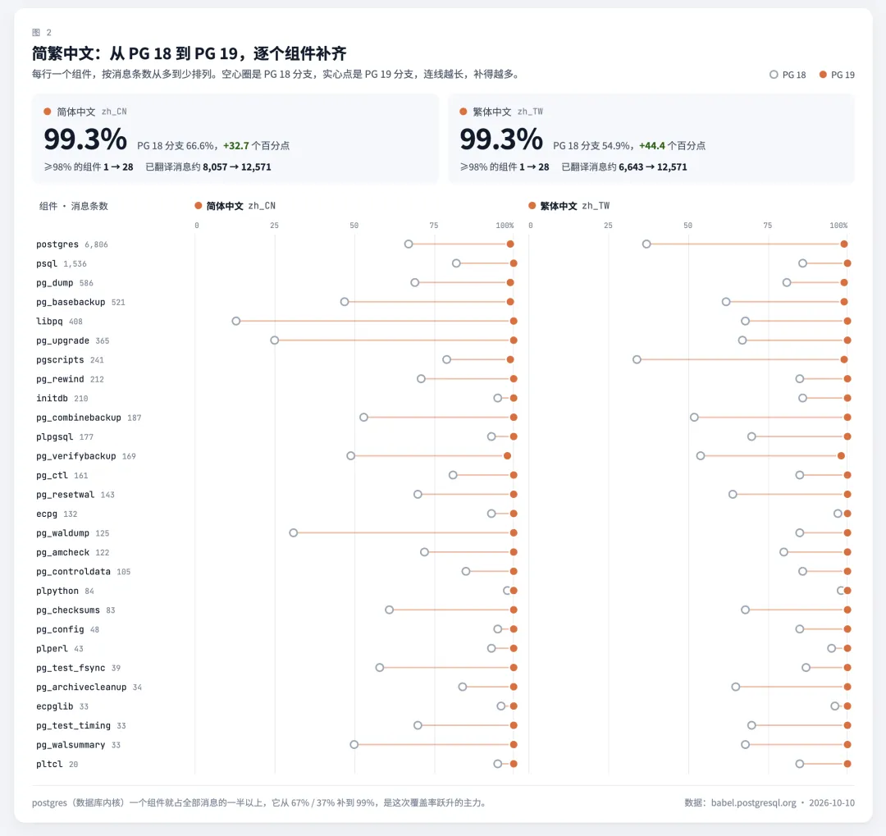

(Figures above are from [babel.postgresql.org](https://babel.postgresql.org/), as of October 10, 2026.)

With PG 19, we also have a workflow for automated translation and ongoing updates. There will be another merge before the final release, with the aim of bringing every component to 100%. We'll keep up with new messages and update both Chinese versions together, so coverage will no longer be a problem.

## Traditional Chinese takes more than character conversion

The easiest approach would be to run the Simplified Chinese translation through a converter such as OpenCC. But mainland China and Taiwan use different technical terminology. Dictionary-based conversion handles only some common terms; what it misses or gets wrong immediately sounds awkward to readers in Taiwan. Here are a few familiar examples:

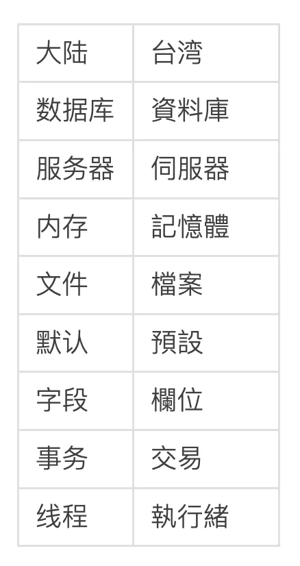

For this version, I started with the corrected Simplified Chinese translation and then went through the terminology entry by entry. Claude and Codex helped me settle the term mappings, and I'm reasonably confident in the result. Both translations share a common foundation, with consistent structure, tone, and wording. They will also be maintained together.

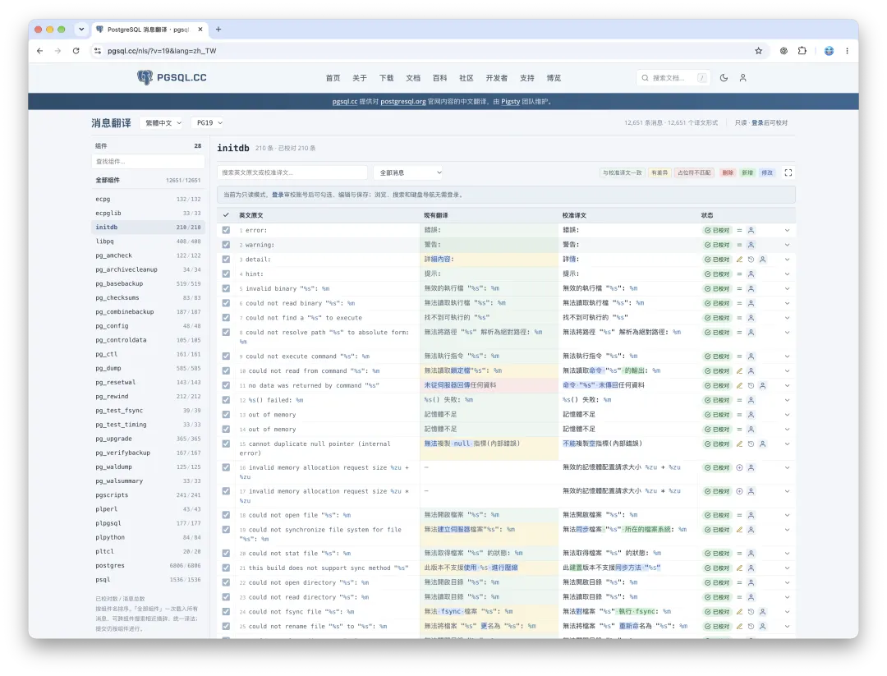

Still, usage differs between mainland China and Taiwan. If you're in Taiwan or normally use Traditional Chinese, I'd welcome your feedback. Tell me which messages sound awkward or which terms aren't idiomatic. You can look up every translated message in the workbench at [pgsql.cc/nls](https://pgsql.cc/nls/).

## Why localize when AI is already this good?

People have asked me this more than once: programmers use English, so why spend time on this? It's a fair question. I force my own command-line locale to English, and all my code comments are in English too. English is the common language of technology. Now that we have AI, you can paste in an unfamiliar error and get a translation. Why go to all this trouble?

I still think the work is worth doing, for a few reasons.

**First, people read faster in their native language.** I can read English, but I can scan Chinese at a glance. English takes me a moment longer. That's barely noticeable during ordinary coding. During a production incident in the middle of the night, with errors filling the screen, that moment matters. Nobody has time to open a chat window and work through a conversation with AI.

**Second, developers' English skills don't tell us how well every user reads English.** Better Chinese error messages let more Chinese-speaking users understand a problem faster and more thoroughly. Localization is for the majority of users, not just experts.

**Third, half-finished localization makes a poor first impression and raises the barrier to getting started.** Most Chinese-speaking users have their system language set to Chinese. The vast majority won't change their `locale` and `LANG` settings as I do. Install PostgreSQL on a Chinese-language system, and Chinese messages are what you see by default. Before PG 19, those messages were outdated, patchy, and mixed with English. That was much worse than having everything in English.

A newcomer looking at that translation quality could reasonably wonder: **Is this the standard PostgreSQL holds itself to?** If we offer localization, we should finish it. Leaving a half-done version in front of users is the worst outcome.

## A few related sites

Translated messages help users understand errors. To use PostgreSQL well, they also need documentation and reference material. I've built three sites for that: [pgsql.cc](https://pgsql.cc/), [pg.center](https://pg.center/), and [pgext.cloud](https://pgext.cloud/).

**[pgsql.cc](https://pgsql.cc/)** is a Chinese version of postgresql.org, maintained by the Pigsty team. Everything on the official PostgreSQL site has a Chinese counterpart here. Its most distinctive resource is a collection of official PostgreSQL manuals covering all 31 major versions, from 6.3 through 20devel. They're translated into Chinese with consistent standards, style, and terminology, and backed by a better full-text search that makes it easy to find objects across versions.

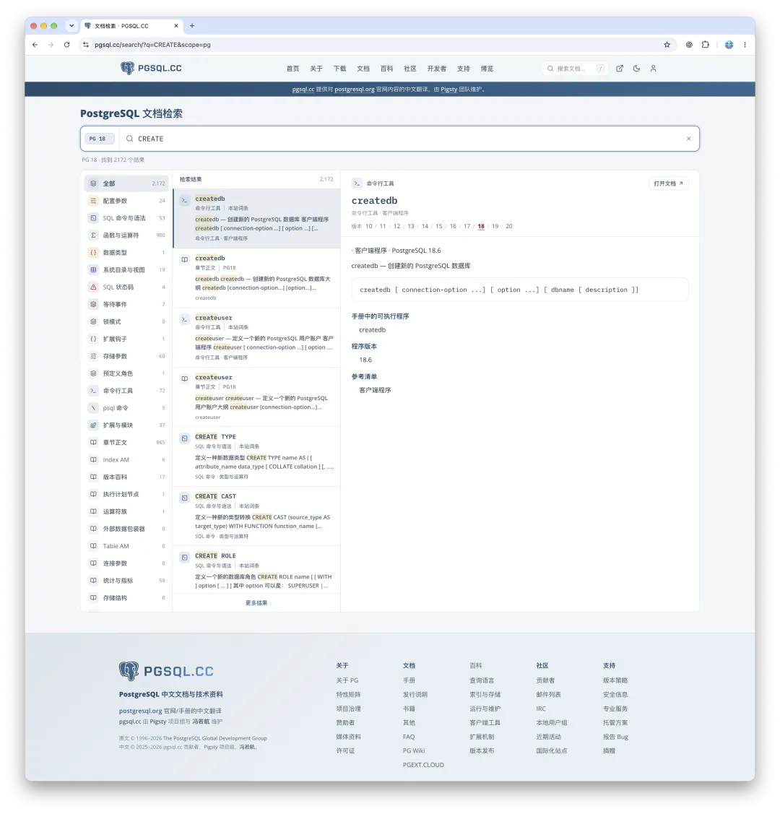

There are also an extension encyclopedia, daily PostgreSQL news, and a PostgreSQL knowledge graph. News and updates from the Chinese PostgreSQL community will be published here too.

[Chinese PostgreSQL Documentation: All 11 Major Versions](/en/pg/pgsql-cc-online/)

[A Daily News Column for the Chinese PostgreSQL Site](https://mp.weixin.qq.com/s?__biz=MzU5ODAyNTM5Ng==&mid=2247493166&idx=1&sn=67e34928473b23e7cbf6169f9e0260cb&scene=21#wechat_redirect)

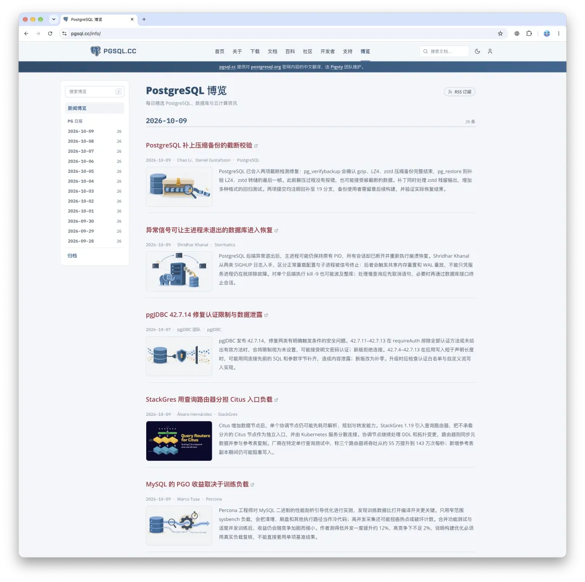

**[pg.center](https://pg.center/)** is a bilingual site, with English as the default. Its goal is to collect and organize knowledge from across the PostgreSQL world into the most comprehensive PostgreSQL encyclopedia we can build. Recently, for example, we cataloged PostgreSQL's objects—SQL commands, data types, functions, configuration parameters, and more—and traced their history across 31 major versions.

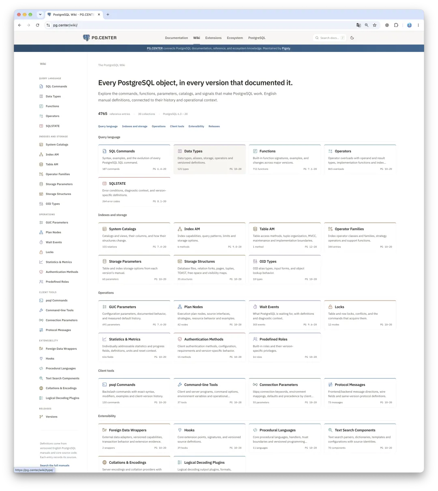

The site also maintains PostgreSQL manuals for 31 major versions, along with bilingual documentation and indexes for Patroni, pgBackRest, PgBouncer, etcd, and HAProxy. If there's something else you'd like to see, let us know. We'll keep adding to and maintaining the collection.

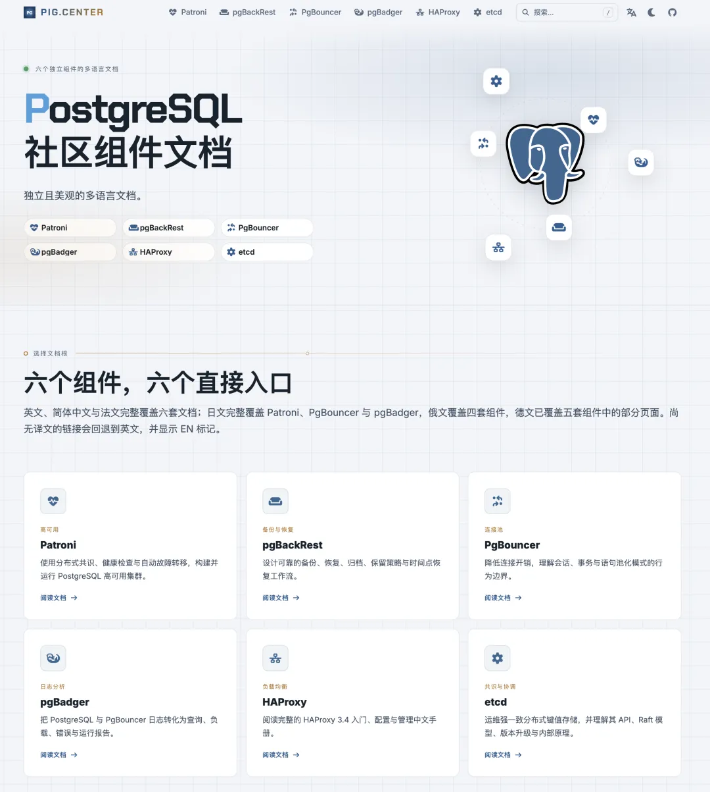

**[pgext.cloud](https://pgext.cloud/)** focuses on the PostgreSQL extension ecosystem, with more than 2,600 extensions in its catalog. We collect their metadata and provide usage documentation in both Chinese and English for those 2,600 extensions. Beyond the catalog, the PGSTY repository delivers prebuilt binaries for 600 high-quality extensions, covering 16 major Linux distribution releases as ready-to-install RPM and DEB packages.

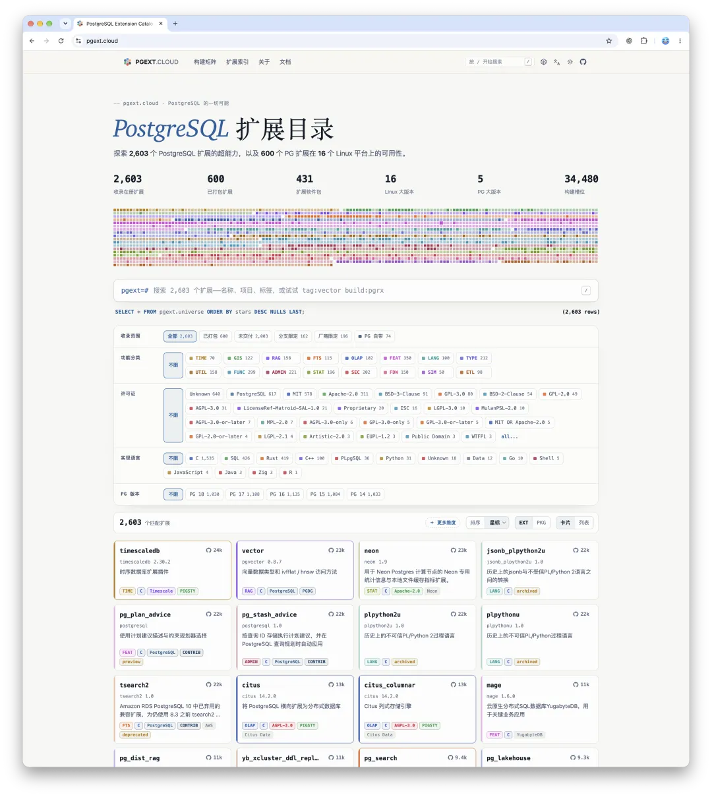

Together, these sites form a gateway to Chinese-language PostgreSQL resources.

## One last thought

Localization may be a small job. But while doing it, I kept coming back to another question: why had nobody taken care of this for so many years? What has the Chinese PostgreSQL community been doing? What about all those PostgreSQL-based products marketed as "domestic databases" in China?

I think the main reason is the decline of the Chinese PostgreSQL community and its absence from this work. That brings us back to the title: why translate PostgreSQL into Chinese? My own environment is in English. I rarely read Chinese documentation. I probably won't use most of this myself.

But I know many Chinese-speaking users need it. By doing useful things for those users, I also want to help [revive the Chinese PostgreSQL community](/pg/revive-pg-cn-community/). That's a larger subject, though, and I'll write about it separately tomorrow.

That's all for today. Once PostgreSQL 19 is released, try installing it on a Chinese-language system. If a translation sounds awkward, let me know.
