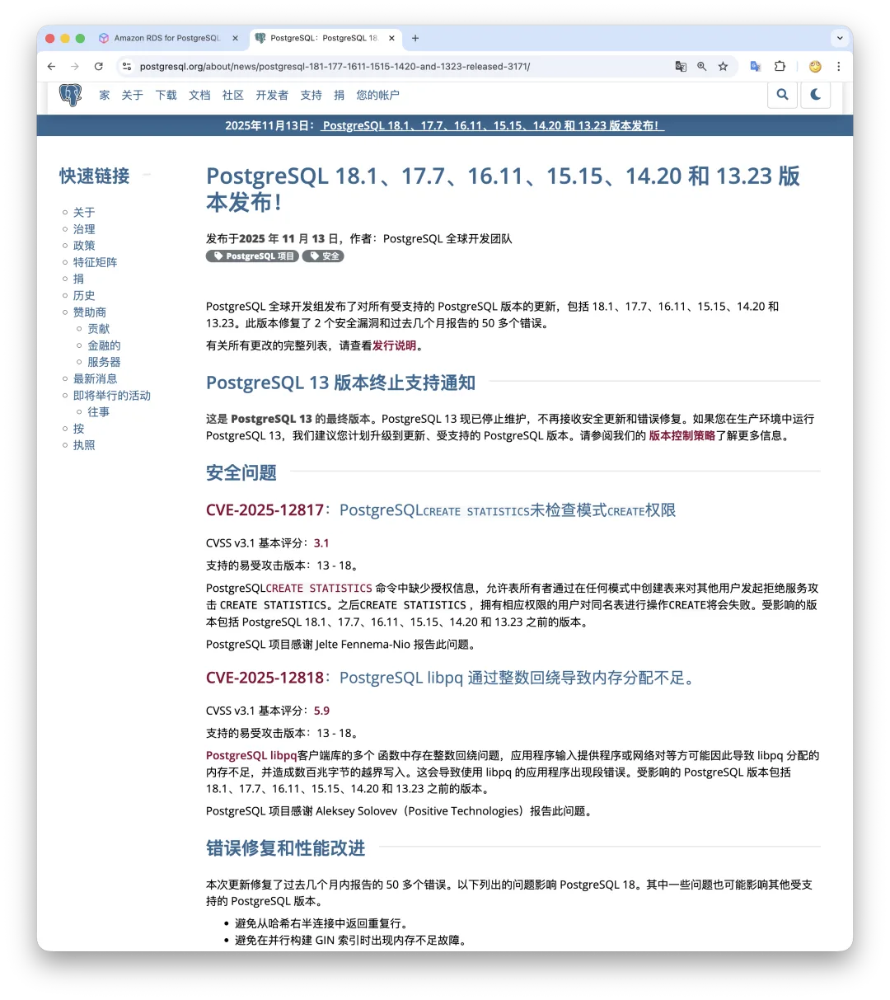
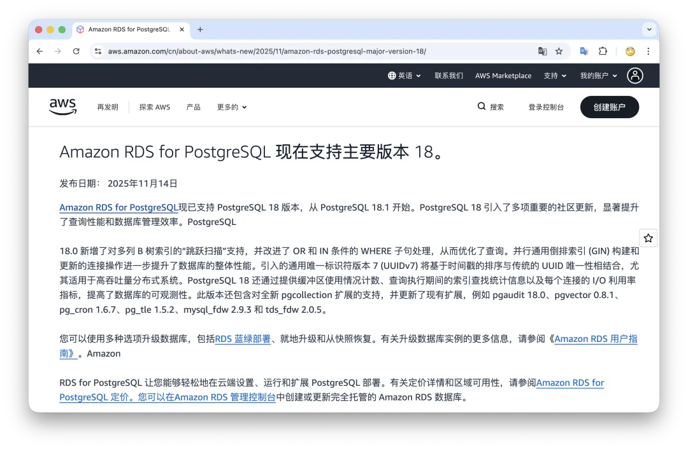
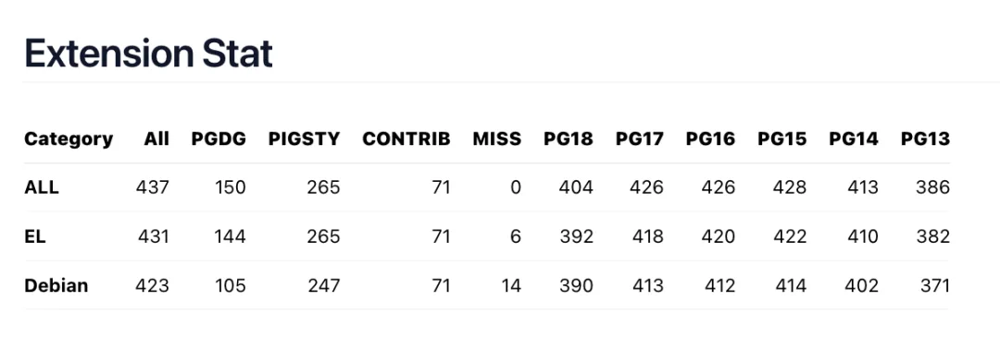
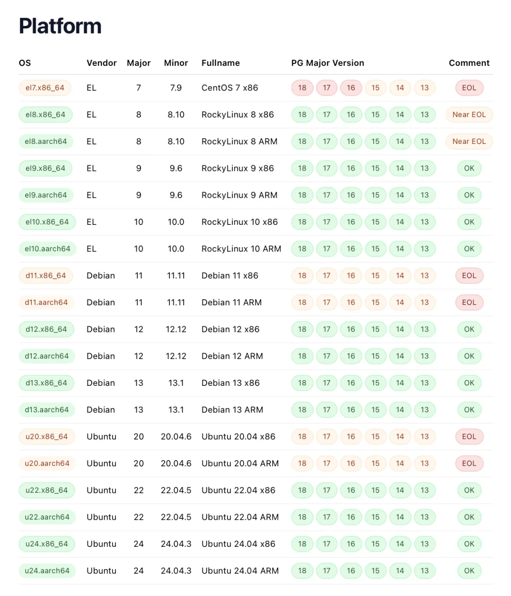
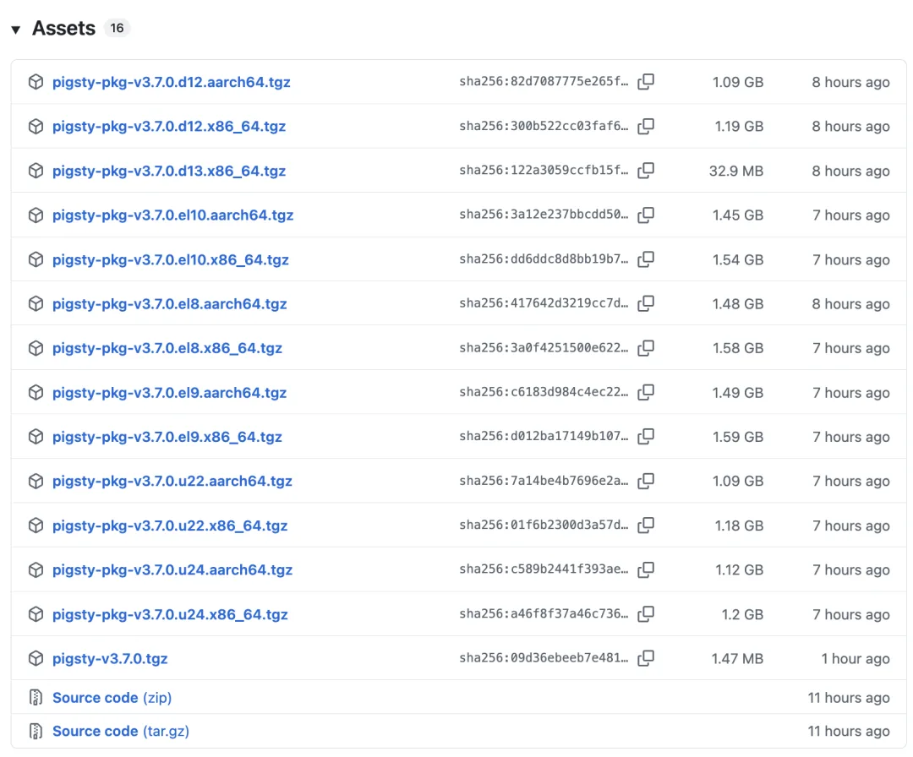
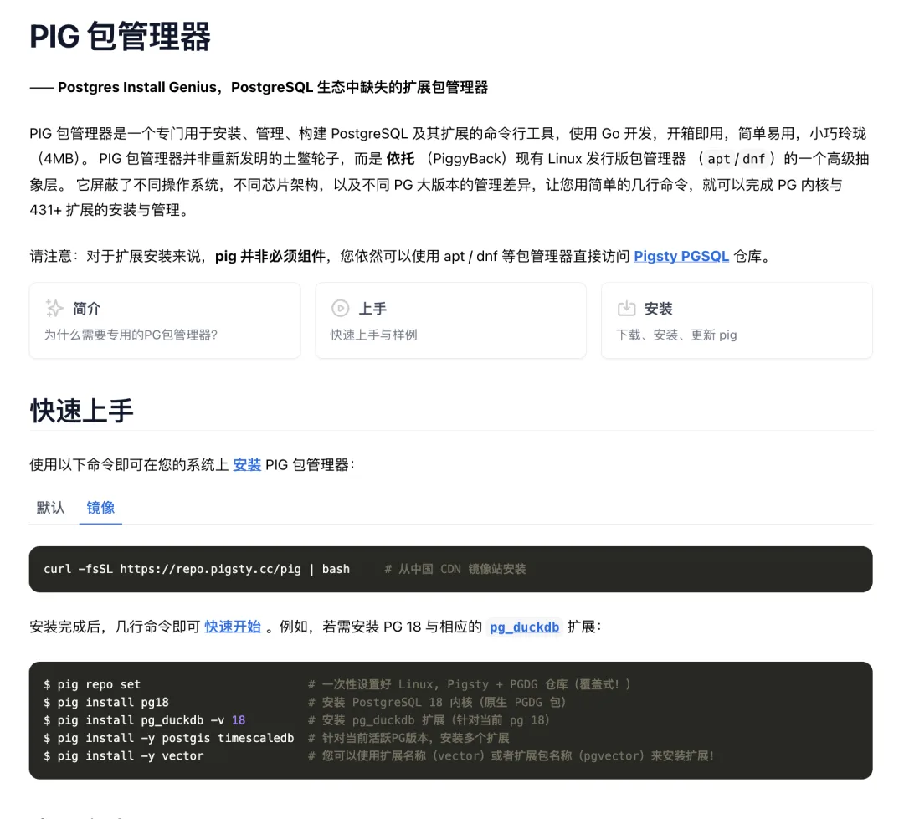

In [*Beware the Bleeding Edge: A PostgreSQL Storage Engine Postmortem*](/pg/new-storage-engine-risk/), I briefly shared my rule of thumb for adopting new PostgreSQL major versions: wait until the second point release (`x.1`) before putting a new major version into production. Now that PostgreSQL 18.1 is out and the extension ecosystem has largely caught up, I consider PG 18 ready for production workloads.

## Waiting for the First Bug-Fix Release

PostgreSQL follows a predictable release cadence: one major version per year, typically in late September, followed by quarterly minor releases in February, May, August, and November. Out-of-cycle releases only happen when urgent issues arise. The recent 18.1, 17.7, 16.11, 15.15, 14.20, and 13.23 updates are the scheduled November 2025 minor releases, patching two CVEs and more than 50 bugs—which is why you shouldn't rush a `.0` release like 18.0 into production.

Of course, this conservative policy targets mainstream users and stable production environments, not seasoned DBAs or early adopters. Pigsty has supported deploying PostgreSQL 18 ever since `18beta1` shipped, though I only bumped the **default** major version from 17 to 18 a few days ago.

AWS RDS for PostgreSQL follows almost the exact same timeline. When a beta version comes out, it lands in the Database Preview Environment first. General availability on RDS waits until the `.1` release ships (such as 17.1 or 18.1)—which is why the "Amazon RDS for PostgreSQL now supports major version XX" announcement typically arrives in mid-November.

## The Extension Ecosystem

PostgreSQL's secret weapon is its unmatched extension ecosystem, and extensions need time to adapt to a new major version. More than half of all extensions compile against a new PostgreSQL major release without code changes, which means the rest still require active porting work. Over the past three months, most of the ecosystem has completed that transition.

I am proud to have contributed a fair share of that effort—submitting compatibility patches to dozens of upstream extensions while building, packaging, and maintaining 265 extensions myself. Beyond adding PostgreSQL 18 support, I also added packaging for the newly released Debian 13 and Enterprise Linux 10 (EL10). Out of 437 tracked extensions, only about 20 have yet to support PG 18; among the major ones, Citus is the main holdout still finishing its port.

I also launched [PGEXT.CLOUD](https://pgext.cloud/)[1], a dedicated catalog tracking the PostgreSQL extension ecosystem, including packaging status, availability across 14 Linux distributions, and installation guides. If you rely on PostgreSQL extensions, it serves as a handy reference.

For example, here is the current extension availability on Debian 13 (`aarch64`):

## Deploying PG 18 in Production

So how should you deploy PostgreSQL 18 in production? [Run it in Docker?](/en/db/no-docker-pg/) (Just kidding.) Use Pigsty. It delivers production PostgreSQL best practices, 437 extensions, observability, high availability, and point-in-time backup and recovery as Infrastructure as Code on mainstream Linux distributions in a single pass—free and open source.

Frankly, I don't recommend rolling your own PostgreSQL setup from scratch, because the packaging layer is full of sharp edges. For instance, the official PGDG Yum repository recently upgraded its default Clang/LLVM toolchain from version 19 to 20, triggering package conflicts against system libraries on EL9 and EL10. Right now, completing a full PG 18 installation on those systems sometimes requires removing a few base utilities (`bpftool`, `python3-perf`) and filling in missing dependencies manually.

Similarly, the upstream Ansible packaging on EL10 is still incomplete—I had to build and ship several missing Ansible packages myself. If you try to assemble all of this by hand from upstream repos, you will likely hit a wall. It is easy to see why some developers reach for Docker instead. Still, if you want production-grade reliability without wrestling with distro packaging quirks, you are better off using a mature, battle-tested distribution.

Pigsty v3.7 is set for general release soon, and the newly released `v3.7.0-beta1` already defaults to PostgreSQL 18. It runs cleanly on the latest EL10 and Debian 13 releases, and bundled templates—including self-hosted Supabase—have been updated to their latest versions on PG 18. The workflow hasn't changed; spin up a fresh Linux machine and run:

      curl https://repo.pigsty.cc/beta | bash
      cd pigsty; ./configure; ./install.yml

The only difference is that you no longer need `-v 18` during `./configure`, since PG 18 is now the default. If you want to download and install the entire extension suite in one go, use the `configure -c rich` template.

The core work for v3.7 beta1 is complete, with documentation updates and smoke testing underway. If you want to take PG 18 for a spin in production, it is ready to go. I will cover the full feature set when Pigsty v3.7 officially ships.

If you don't need the full Pigsty platform, we also provide [the `pig` package manager](/en/pg/pgext-cloud/). This 4 MB Go CLI works cleanly on both bare-metal Linux and containers, orchestrating official PGDG and Pigsty repositories so you can add any PostgreSQL extension or tool with a single command. For example, installing PostgreSQL 18 alongside `pg_duckdb` takes just two lines:

Give it a try, and feel free to open an issue on GitHub or drop feedback in the community channels if you run into anything. Enjoy PostgreSQL 18!

---

Originally published on [WeChat](https://mp.weixin.qq.com/s/immOsWr2lkqWADx_6yOGCQ)
