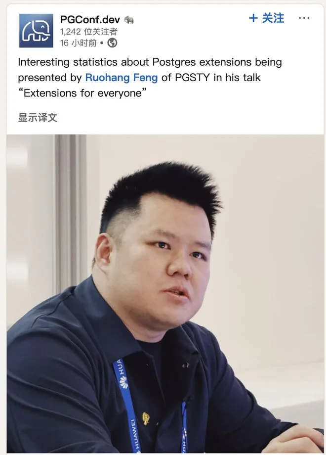
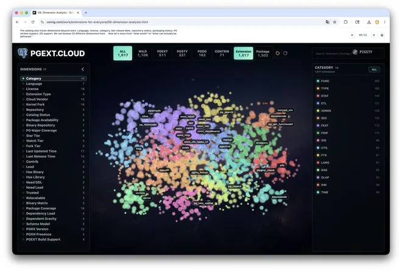
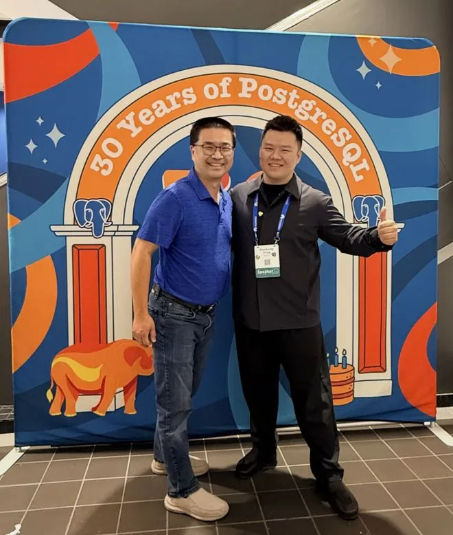
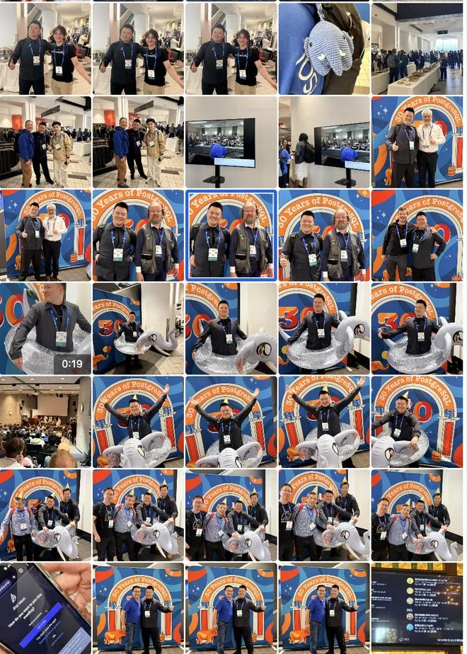
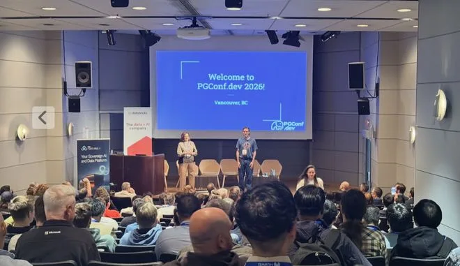
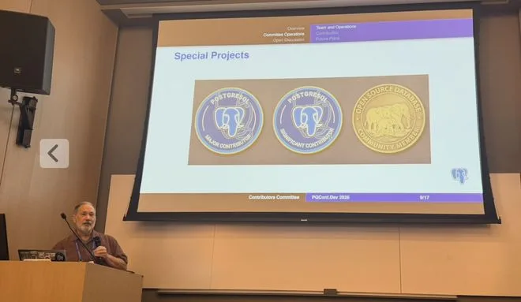
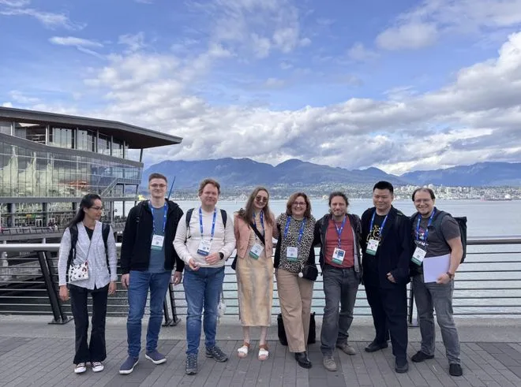
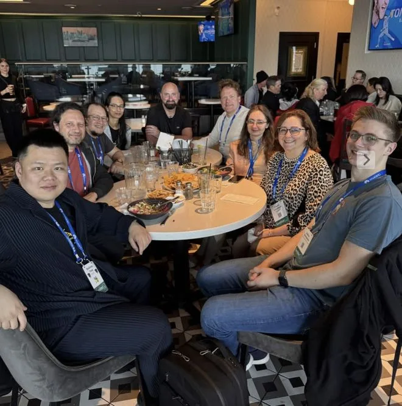
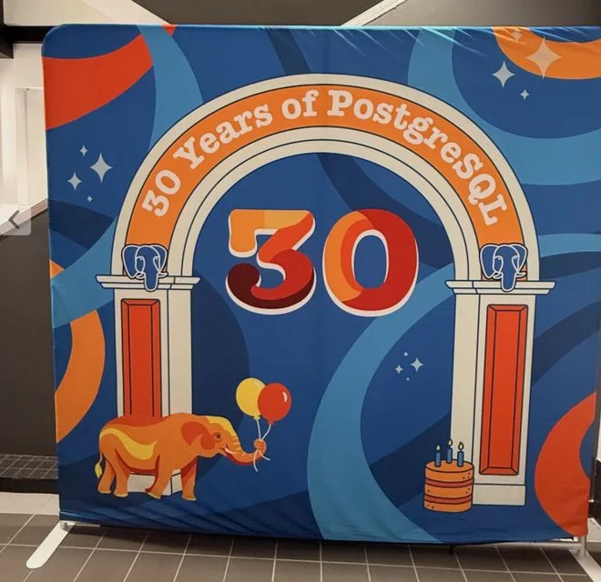

> The original WeChat post is no longer available; the text below was recovered from an attributed public mirror: [https://www.163.com/dy/article/KTG7NBBQ0556CSY5.html](https://www.163.com/dy/article/KTG7NBBQ0556CSY5.html).

Today is the opening day of PGConf.dev 2026. I gave a 25-minute talk, *Extensions for Everyone*, covering my work over the past two years on PostgreSQL extension packaging and distribution—and how that work helps everyone across the ecosystem: users, DBAs, extension authors, Postgres vendors, and core hackers.

The official slides and video recording will be posted later, but if you are interested in the topic now, I have already published the slide deck on my site: </work/extensions-for-everyone>

Rather than putting together a traditional PowerPoint deck this time, I had Codex generate an interactive HTML presentation directly from my talk draft, and it turned out pretty well.

This year's conference is special because it marks PostgreSQL's 30th anniversary. Tickets sold out completely, pushing the venue past capacity with a packed, lively crowd. What made the occasion even more special was the presence of the "father of PostgreSQL"—not Michael Stonebraker, but Stonebraker's student, Jolly Chen.

In short, while Stonebraker won the Turing Award, the first real push that turned POSTGRES from an officially abandoned academic prototype into the PostgreSQL we know today came from two of his graduate students, Jolly Chen and Andrew Yu. In 1994–1995, they did two crucial things: **they swapped in SQL and put the code on the Internet**. In that sense, Jolly Chen was the true midwife of PostgreSQL, before passing the baton to Bruce Momjian, Tom Lane, and the generation of core developers who followed.

It was an honor to meet a PostgreSQL pioneer like Jolly in person. Plenty of old friends were there too, and we spent a lot of time catching up. Because I have been working on extension distribution for a while now, many extension authors already knew who I was and greeted me warmly; we took plenty of photos together. It is gratifying to see Pigsty's reach expand beyond China and start helping users around the world.

There were quite a few Chinese faces at the conference this year, and if I am not mistaken, this was the first time Chinese companies gave talks at the PostgreSQL developer conference. Besides me, HighGo was also represented: Grant Zhou from HighGo North America gave a talk titled *The Missing Link: How to Connect Tens of Thousands of Chinese Users with the PostgreSQL Core*. Unfortunately, his session ran in the exact same time slot as mine, so I couldn't attend. Chao Li from HighGo was originally scheduled to speak as well, but his visa didn't come through in time—a real shame.

Beyond catching up with people, I came to the conference with several practical errands on my list. Two years ago, for example, the Loongson team in China reached out to ask whether the official PGDG repositories could add support for Loongson CPUs. That was tough to pull off at the time, but now that Debian 13 has shipped with official Loongson support, I brought the question back to Christoph Berg. He said it is very doable: as long as someone is willing to sponsor a Loongson server with decent network bandwidth to serve as a Build Farm machine, PGDG can add Loongson build support. That is great news.

Another thing on my agenda is applying for recognition as a Significant Contributor. While I don't submit patches to the PostgreSQL core, I have spent years building in the broader PG ecosystem. Over the past couple of years, the Postgres community has been moving to include contributions to related open-source projects and the extension ecosystem within the scope of official contributor recognition. I talked with members of the Contributors Committee at the conference, and they encouraged me to submit an application.

Related to that, the community is also working on a badge feature for `postgresql.org` that hasn't been publicly launched yet. In short, community members who meet specific criteria will be able to display corresponding badges on their PostgreSQL website profile. The current categories include badges for core contributors, conference speakers, and contributors to major related open-source projects and extensions—something like a wall of honor to encourage broader community participation. The exact rules and implementation details are still being discussed at the conference, but it is a great initiative worth watching.

In the evening came the ever-popular social event, hosted by PostGIS author Paul Ramsey.

Afterward, everyone split into more than a dozen small dinner groups and headed off to different restaurants around town. At our table, Chilean contributor Álvaro Herrera shared plenty of stories about moving to Germany. I also learned a funny backstory from him: the first time I submitted a community news item for a new project called Pigsty, he wondered whether the name was some kind of prank. He held it in the queue for a long time until he confirmed the project really was called Pigsty, and only then approved it.

There was also a larger group social reception at Rogue Kitchen inside Vancouver's Pacific Central Station, the same venue as two years ago. The food and drinks left a lot to be desired—and unfortunately, between jet lag, losing sleep rushing my slides, and a bout of diarrhea over the past couple of days, I had zero appetite anyway. By the afternoon I was struggling to stay awake and running purely on coffee. Word was there would be a late-night Postgres karaoke session afterward, but there was no way I could hold up for that, so I called it a night.

The best part of the day was simply getting my talk done. What a relief—now I can enjoy the rest of the conference with zero pressure. I wasn't the only one feeling that way: Daniele, the author of `psycopg`, told me a huge weight came off his shoulders as soon as his talk was over, and I suspect Grant Zhou felt the exact same way.

That is more or less it for today. I will write dedicated posts later to cover the technical topics and takeaways in detail; today is just a casual recap of the conference experience, along with a few photos.

## 0% AI-Generated

Veteran Database Driver

---

Originally published on [WeChat Official Accounts](https://mp.weixin.qq.com/s/CFCumCJtuxM8sV-rGirD_A)
