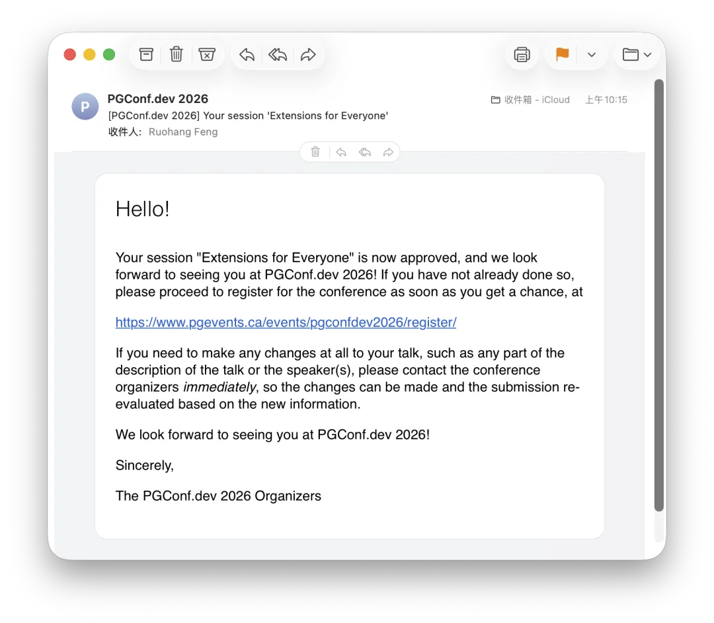

This morning I got the email: my talk proposal, **"Extensions for Everyone"**, has been officially accepted for a full session at PGConf.dev 2026.

That means a lot to me personally. Having my work in the PostgreSQL ecosystem recognized by the core community is gratifying enough, and there is a broader milestone here too: **this appears to be the first time a homegrown Chinese "vendor" will give a main-track talk at PostgreSQL's flagship developer conference.**

— Or more accurately: **a one-man database shop** 😊

## Why Does This Matter?

PGConf.dev is the PostgreSQL Development Conference, the successor to PGCon, which ran for 17 years before being rebooted under its new name in 2024. It isn't a typical user conference—it is the annual gathering where PostgreSQL core developers and contributors debate and shape the future of the database. Getting a full session slot here means the core community considers your work worth hearing.

Honestly, getting here took persistence.

In 2024, for the inaugural PGConf.dev, my proposal was rejected. In 2025, my main-track submission was rejected again, though I drew a 5-minute lightning talk slot and gave a talk at PGEXT.DAY, the pre-conference community event the day before. In 2026, on my third try, I finally made the main program.

I don't carry a Big Tech badge or a PostgreSQL Committer title—I'm not even on any company's payroll. I'm just an independent developer working on things I find worthwhile. Maybe that "in the wild" independence is what lets me focus on solving practical problems the community actually faces.

Pigsty has grown from zero to 4.6K GitHub stars, and [PGEXT.CLOUD](/en/pg/pgext-cloud/) has turned from a rough idea into community infrastructure serving a million downloads a month. None of this is slideware; it is working code and live services. The program committee's decision to accept this talk shows that "talk is cheap, show me the code" still carries weight.

## Chinese Developers on the Global Stage

China's PostgreSQL ecosystem is an odd paradox: we have the world's largest crop of "domestic databases" (most of them PostgreSQL forks or derivatives), one of the largest DBA communities anywhere, and an active Chinese-language scene. Yet on the international upstream stage, we are nearly invisible.

When I flew to Vancouver in 2024 for the first PGConf.dev, there were only about five Chinese attendees in the entire venue, and not a single speaker. During the unconference session "Making PostgreSQL Hacking More Inclusive" led by Robert Haas, participants talked about bringing more developers from India and Japan into the core circle—**[China wasn't even mentioned](/en/pg/pgcondev-2024/)**.

Things improved at the second edition in 2025. [Bohan Zhang from OpenAI](/en/db/openai-pg/), William Zhang from CMU, and Zhijie Hou from Fujitsu all delivered full session talks, while Richard Guo from EDB attended the closed-door Committers meeting. Chinese engineers were on stage, though still none from Chinese companies or database vendors. Outside the main session track in 2025, Grant Zhou from HighGo and I each landed a [lightning talk](/pg/pgcondev-lightning/), and I also spoke at the pre-conference community event, [PGEXT.DAY](/en/pg/pgext-day/). Still, 2025 marked a real zero-to-one step forward.

This year, I landed a full session talk. The complete 2026 schedule isn't out yet, so I don't know whether any other Chinese vendors were accepted. What I do know is that we have at least one breakthrough this year. I don't know how much a single talk can change. Still, the next time someone asks "[What has China contributed to the PostgreSQL community?](/pg/china-pg-contribution/)", we will have one more concrete answer.

## What Is My Talk About?

My talk is titled "**Extensions for Everyone**"

— making PostgreSQL extensions effortless to use for everyone.

This isn't an abstract pitch; it is what I have spent the past two years building with **[PGEXT.CLOUD](/en/pg/pgext-cloud/)**.

By the numbers:

- **444 extensions**: packaged as native RPM and DEB binaries
- **14 Linux distributions**: from EL8 to Ubuntu 24.04, and from Debian 12 to Anolis OS
- **6 major PostgreSQL versions**: full coverage across PostgreSQL 13 through 18
- **~1 million downloads/month**: already used in production by multiple PostgreSQL vendors
- **~50 upstream fixes**: build and packaging issues uncovered and patched along the way

The official PGDG repositories ship around 150 extension packages, while more than 1,000 extensions exist in the wild. That distribution gap holds PostgreSQL back, and PGEXT.CLOUD is built to close it.

This infrastructure benefits every group in the PostgreSQL ecosystem. End users get out-of-the-box packages without the hassle of compiling and packaging from source. Extension authors get an extra distribution channel to reach more users without maintaining their own build infrastructure. And database vendors can fold the superpowers of the PG extension ecosystem into their own PostgreSQL products at virtually zero cost.

Just as importantly, this infrastructure helps core developers. As extensions become central to PostgreSQL's appeal, core patches have to account for extension compatibility alongside core stability. Want to test how a core patch affects 400+ extensions? That used to be a major headache; now it takes a single command. In fact, extension compatibility is one of the primary blockers on PostgreSQL's roadmap to move from a process-based model to multithreading. I'm glad my work can help move that effort forward.

That is what "Extensions for Everyone" means: shared extension distribution infrastructure where everyone benefits from everyone else's work.

## What's Next

PGConf.dev 2026 takes place starting **May 19, 2026** at Simon Fraser University in Vancouver, Canada. In my session, I will cover:

- Real data from the extension ecosystem: what's popular, what's fading, and what's growing.
- Hard-won lessons from cross-platform packaging at scale, and how AI helped along the way.
- `pig` — an agent-native CLI tool for PostgreSQL.

If you care about PostgreSQL extensions, stay tuned for updates.

### References

- `[1]` : <https://pgext.cloud>
- `[2]` : <https://pigsty.cc/pig>
- `[3]` : <https://pigsty.cc>
- `[4]` : <https://github.com/pgsty/pigsty>

---

Originally published on [WeChat Official Account](https://mp.weixin.qq.com/s/rThnqXp2JXVV9UQncNV3kg)
