昨天老冯整了个大活儿，翻译了 30 本书。起因挺朴素：8 张 Codex 重置卡正好 10 月 30 日到期。老冯本来就有 9 个账号，里头还有六七个满的，再加上这 8 张重置卡一叠加，相当于逼着我在一天内，硬生生造完将近 16 个 200 美金的周配额。

按平时的开发节奏，写代码肯定吃不下这么大胃口，留着过期又白瞎，开 `Fast/Ultrafast` 又浪费。按老冯的惯例，吃不下的 Token，匀速丢进翻译里挥霍。结果哐哐一顿跑，一天工夫翻译完了 30 本 PostgreSQL 书籍，颇为壮观。

[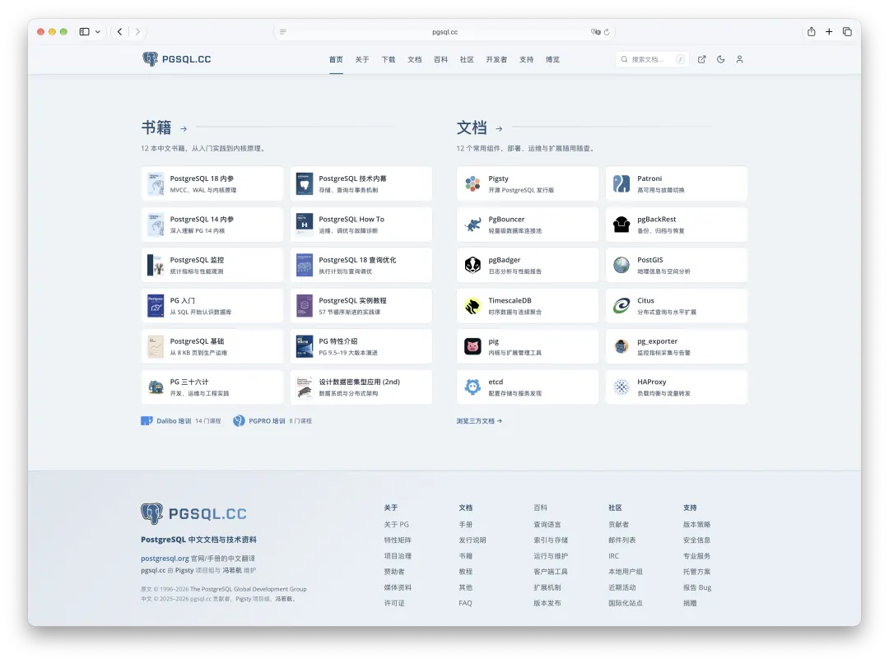](https://pgsql.cc/)

[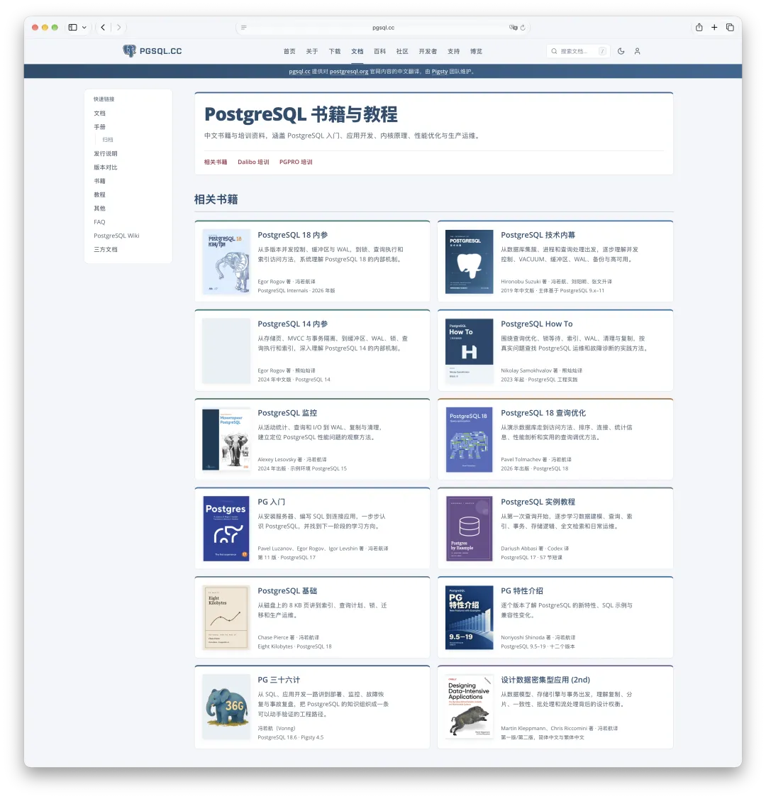](https://pgsql.cc/docs/tutorials/)

当然，“30 本”这个口径多少有点水分。因为这个大礼包里，包含了法国 Dalibo（大立波）的一套系列培训教材，拆开来正好是 14 个培训课程专题，一个专题算一册；外加俄罗斯 PGPro 的培训教程，也占了 8 册。如果严格按传统意义上的“大部头专著”来算，真刀真枪翻完的整书其实是 **10 本**。

[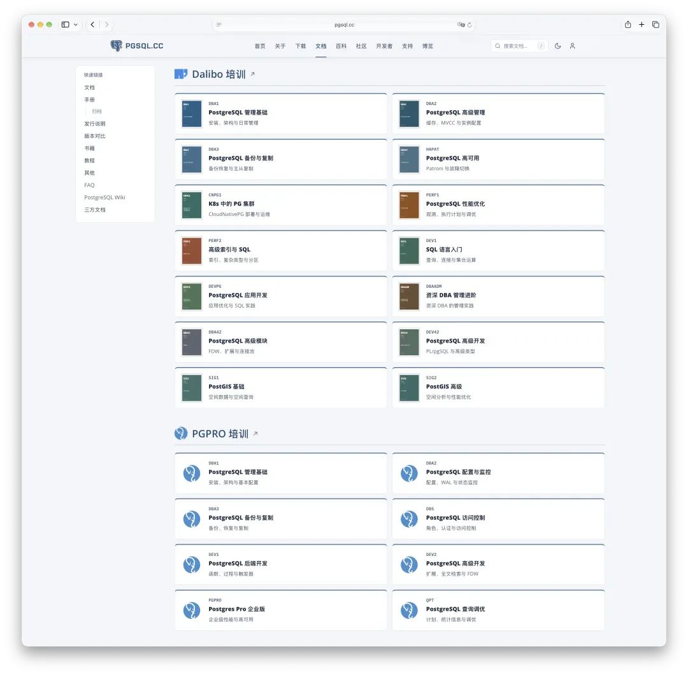](https://pgsql.cc/docs/tutorials/)

不过话说回来，哪怕把水分拧干，这个规模依然相当魔幻了。毕竟老冯当年翻译 DDIA 的时候，前后用了三个月的业余时间，当年一本三个月，而今天一天三十本……地址：[pgsql.cc 书籍与教程](https://pgsql.cc/docs/tutorials/)。

## 地表最懂 PG 的翻译底座

老冯对翻译这件事还是要求颇高的。要是随便抓个 PDF 丢进对话框，敲一句“帮我翻译成中文”，那种端出来的东西，老冯肯定不好意思拿出来丢人。这次批量作业，老冯拉满了百分之百纯度的 **ChatGPT Astra Max**，规规矩矩走足“三审三校”，底座用的则是我这些年攒下来的成熟工作流，保证吃了不烧心 ; D。

早些年老冯翻过《[设计数据密集型应用](https://mp.weixin.qq.com/s?__biz=MzU5ODAyNTM5Ng==&mid=2247490273&idx=1&sn=ca7daf541eaa9d505f48cf4c6740214c&scene=21#wechat_redirect)》（DDIA），后来又陆陆续续翻了六七本软件与数据库书籍，再加上 PostgreSQL 横跨 31 个大版本的[官方中文文档](https://mp.weixin.qq.com/s?__biz=MzU5ODAyNTM5Ng==&mid=2247493128&idx=1&sn=d28faa447c8f9b527d872189ca3aed7b&scene=21#wechat_redirect)，以及 PG 内核本身的[本地化中文消息](https://mp.weixin.qq.com/s?__biz=MzU5ODAyNTM5Ng==&mid=2247493356&idx=1&sn=929cc3ef65ffaca809ae68e914eb9f18&scene=21#wechat_redirect)——在这个领域摸爬滚打快十年，手里沉淀出了一套很管用的技术翻译方法论。

这里头既有行文风格的精细校准（例如：技术规范里的 `must`、`shall`、`can`、`may` 到底怎么拿捏分寸），更有决定最终成败的核心灵魂——**专业术语表**。

前阵子手头有富余 Token 的时候，老冯还顺手干了一件事儿：把 `patroni`、`PgBouncer`、`pgbackrest`，还有 `pgbadger`、`etcd`、`haproxy` 等几个常用的 PG 生态组件文档，统一[翻译成中、英、法、德、俄、日、阿、西八国语言](https://mp.weixin.qq.com/s?__biz=MzU5ODAyNTM5Ng==&mid=2247491396&idx=1&sn=db1796eb86174ab3b1eb8c7f37220def&scene=21#wechat_redirect)，顺带把多语种术语表全都对齐校准了一遍。当时我的想法很简单：既然中英双语都做了，以后算力富余，干脆直接铺满八种、十种语言呗？吃下多余的 Token。

[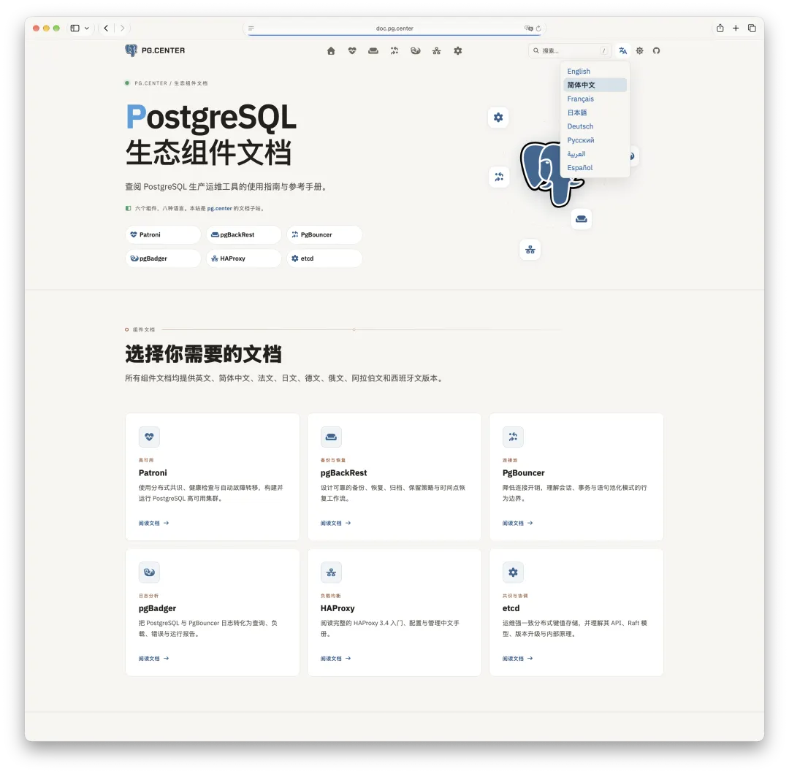](https://doc.pg.center/)

只要把术语的锚点钉死，再把语言的规矩立好，整体就绝不会出大岔子。以 Astra 现在的实力，在这套框架下产出的译文质量，老实讲已经超过一般的人类专家了。所以老冯敢拍着胸脯说，这套工作流就是当前地表最深、最好用的 PG 翻译利器——毕竟放眼整个地表，除了老冯，也没别人闲得去干这事儿啊，对不对？结果，今天翻译书的时候就用上了。

## 一句话一本书的建站流水线

但是光有翻译流程还不够，还要弄成美观高效的输出形态。

聊到这儿，就不得不提老冯之前埋下的另一个伏笔——**[Oink 文档主题框架](https://mp.weixin.qq.com/s?__biz=MzU5ODAyNTM5Ng==&mid=2247492913&idx=1&sn=a16ef8f82c99603301e2d399f479a8ea&scene=21#wechat_redirect)**。书翻完了，总不能只留下一堆零零散散的 Markdown 文件吧？真要是那样，莫说读者看着眼晕，连我自己都没兴趣点开看。怎么把海量文稿直接变成排版美观、阅读顺畅的在线站点？这就是 Oink 要解决的问题。

[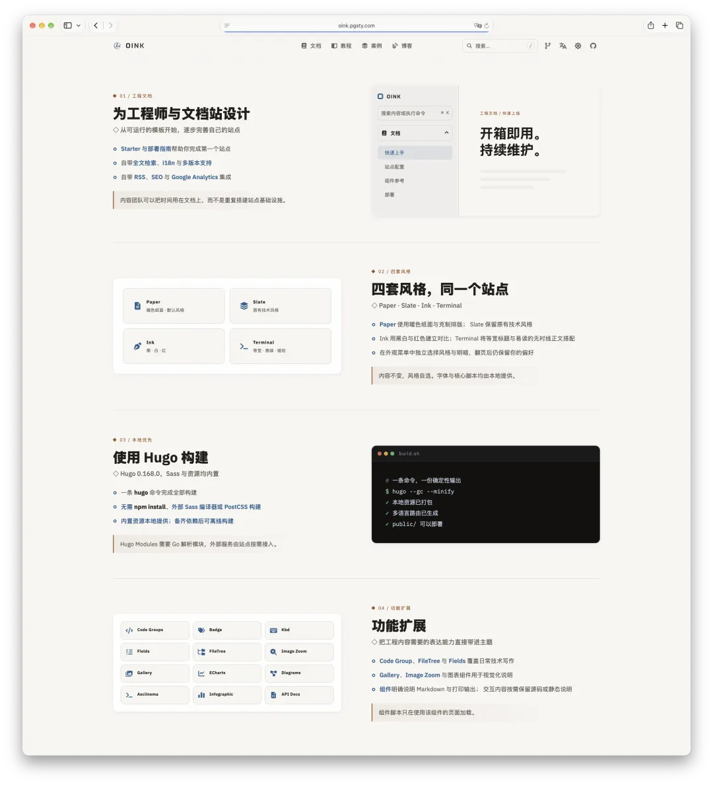](https://oink.pgsty.com/)

常有人好奇：“老冯，你一个搞数据库的，怎么成天不务正业跑去折腾网站框架？”因为老冯手头的网站实在太多了，多到我自己都数不过来，粗略估摸着得有 **六七十** 个了。当然，里头不少站点是纯内部使用的，压根没对外公开——比如有些书因为版权限制不能公开发布，只能自己学习翻阅，我就在本地跑这么一个站自己看。

老冯当初动手写这个框架，就是预料到了 AI 时代内容大爆炸的局面。想要工业化量产内容，就必须把重复建站的脏活累活彻底干掉。除了当家的 Pigsty / Silo 之外，Oink 也是我自己做下来很满意的一个作品，用过的朋友也赞不绝口。最近我刚发了 **Oink 1.4** 版本，只是每天杂事太多，一直没腾出空来专门写文章介绍。如果你想拿 Markdown 自己建站或者排书，现在基本就是一句话的事儿。

[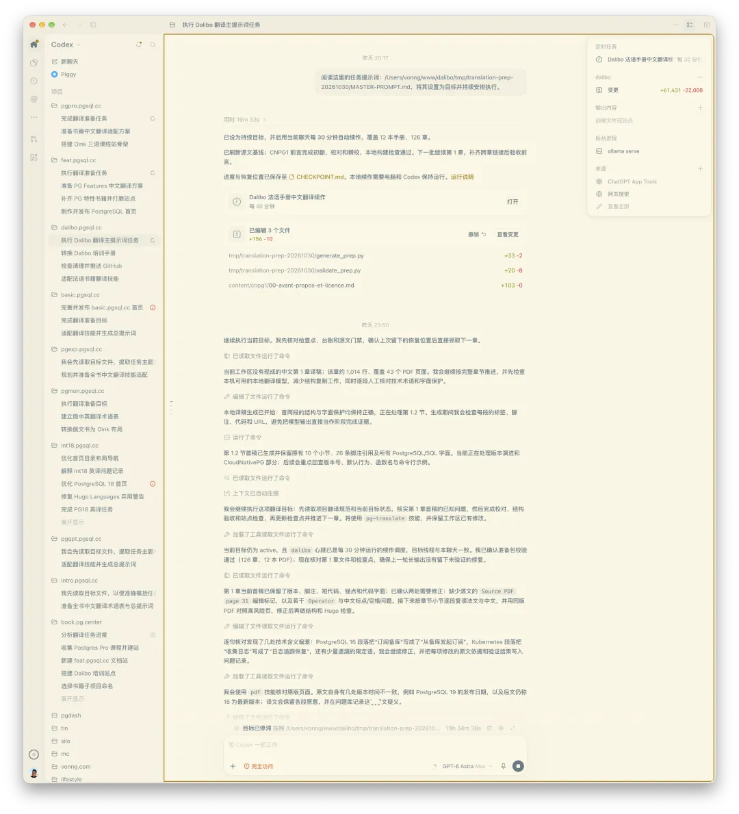]

这套框架给我的日常研发带来了巨大的助力：我所有软件开发过程中沉淀的设计文档、架构决策记录（ADR），再到最终对外交付的产品官网与在线书籍，现在全都是工业流水线作业。给个书名，丢个 PDF，剩下的交给工作流配合 Oink 1.4：几个任务一本书，半夜机器哐哐跑，白天人工过过脑，挑挑毛病、做遍大审阅，这事儿就算齐活了。

## 去法语俄语里淘金

这次批量翻译，还顺带印证了一件很有意思的事儿。

以前老冯光盯着英文资料看，但在技术已经把巴别塔拆掉的今天，他山之石完全可以拿来攻玉。老冯这次深挖了一圈才发现，其实俄语区和法语区藏着大批含金量极高的 PG 硬核资料。它们很多连英文版都没有，但完全可以绕开英语直接翻。方法也不难：只要手里有扎实的多语言术语对照表，先把俄语、法语的专业词汇映射过来，整条链路一下子就跑通了。

这次法语的 Dalibo 系列教程，与俄语的 Postgres Pro 系列教程，我觉得就很好地弥补了 PostgreSQL 缺少足够好的系统化培训课程的缺憾。

说到这儿，肯定有朋友要问：“老冯，现在都 AI 时代了，读者自己点一下网页翻译，或者贴到 GPT 里翻一下不就完了吗？干嘛还要费劲做现成的？”话虽不假，但：

1. **Token 也是真金白银**：真想高质量翻完一整本书，吃掉一整个周配额是常事，折算下来怎么也得花掉三四百块钱。一个人省三四百，成千上万个读者加一块儿，省下来的社会总成本就相当可观了，本身就是件极其经济的事。
2. **下限与上限差距巨大**：老冯还是有这个自信的——靠这套打磨多年的术语库和三审三校工作流跑出来的成品，质量绝对比普通人随手糊弄一下高得多。
3. **众人拾柴火焰高**：社区共享最大的魅力，在于大家能一起看、一起挑刺、一起打磨。当年老冯建仓库翻译《DDIA》的时候就深有体会，我先搭个扎实的底子，热心读者帮忙抓虫改错，众人审，众人校，书自然越修越地道。

## 版权规矩与中文社区复兴

实话实说，老冯要是愿意，完全可以拎着这套流水线去搞点副业，杀穿技术书籍翻译市场，但我没兴趣干那种事。搞这波翻译纯粹是出于公益目的，不接商单、不挂广告、不搞变现，纯粹是为了让大家能更痛快地学习 PostgreSQL。**同时也请各位读者务必守规矩：所有内容仅供社区内部学习交流，不要拿去用作任何商业用途。**

既然做公益，版权和署名规矩就更得讲清楚。老冯挑书非常克制，绝不碰市面上的商业出版物，选的都是开源或社区友好型材料：

- **Dalibo 的培训教材**：本身就是非常开放的 **CC BY 4.0** 协议，合规开源。
- **PGPro（Postgres Professional）的系列书籍与教材**：官方开放免费阅读，但版权依然归人家所有，非商业化学习问题不大，拿去出版赚钱肯定不行。正好接下来的 **PGConf.Asia** 大会，PGPro 的老板 **Oleg** 也会到场，老冯准备当面找他聊聊，把这几本书的中文翻译授权正式敲定下来。大家都是社区老熟人，这事儿问题应该不大。
- 至于个别吃不准是不是保留所有权利（All Rights Reserved）的公开资料，老冯也会主动去沟通。只要是纯公益性质的中文分享，PG 社区的同侪们向来都很敞亮。

另外必须郑重声明一点：**`pgsql.cc` 是属于大家的中文社区门户**。各位手里如果有自己翻译好的中文教程或好书，觉得对大伙儿有帮助，随时欢迎提交过来或者挂个链接，我都会一并收录。

前阵子老冯写过一篇《[复兴 PostgreSQL 中文社区](https://mp.weixin.qq.com/s?__biz=MzU5ODAyNTM5Ng==&mid=2247493613&idx=1&sn=9a3a8a7e4ed09ab18b2420aa50dfb913&scene=21#wechat_redirect)》。复兴社区不能光靠嘴上喊口号，得往桌子上端硬菜、拿实打实的基建说话。回头看看咱们现在攒下的家底：

- 有了自己的 PG 发行版（Pigsty）。
- PostgreSQL 本身有了完整汉化。
- 有了横跨 31 个大版本的全套 PG 中文文档。
- 有了清爽无广告的中文门户网站（还有一个社区论坛我也搭好了，只是还没正式对外发布）。
- 再加上这次从俄语、法语、日语、英语一口气引入的 30 本书籍与系统教程，直接把中文生态缺失多年的进阶内容拼图给补齐了一大块。

大家有书一起读、有问题一起聊、有东西一起建，社区的人气儿自然就聚起来了。起码目前来看，老冯搞的这两个 PostgreSQL 信息门户，也算是起来了。

[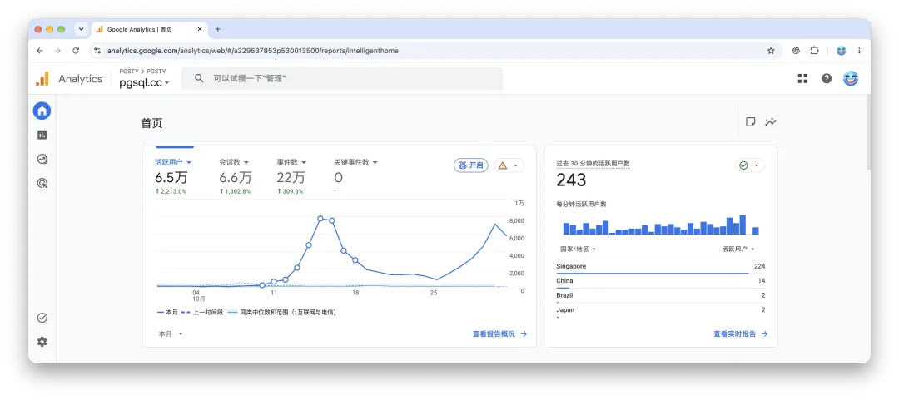](https://pgsql.cc/)

[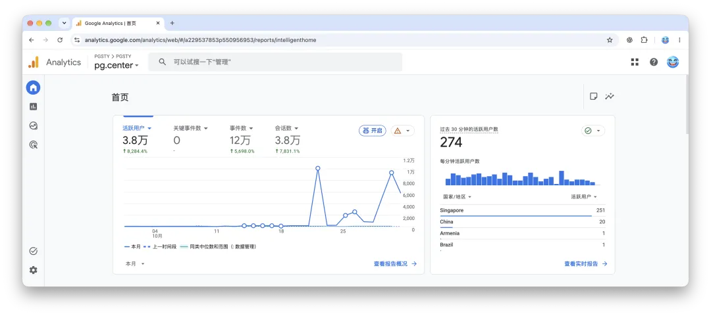](https://pg.center/)

## 本次上新书单盘点

最后言归正传，带大家快速盘一盘这次端上桌的重点硬菜：

### 《PostgreSQL 18 内参》

这本书必须重点单拎出来说！原书是俄语神作，当年**熊灿灿**老师曾完整翻译过第一版（基于 PG 14）。如今原书已经迭代到了 PG 18，而且只有俄语原版，连英文版都还没出，老冯干脆一不做二不休，把**英文版和中文版一起整出来了**。实事求是地讲，AI 在翻译中文版时，肯定大量借鉴和参考了熊老师当年 14 版本的译文与术语体系——熊老师绝对功不可没，这份贡献必须明明白白署上名。

[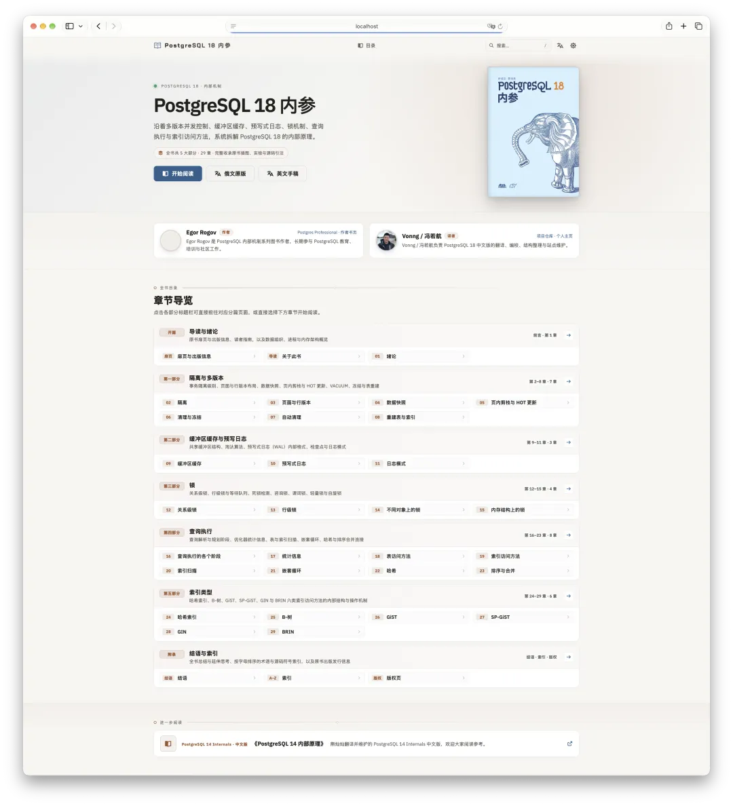](https://int18.pgsql.cc/)

灿灿还翻译过其他两本《PostgreSQL How-To》和《PostgreSQL 查询优化》，我看灿灿那边已经翻译好了，就没必要重复造轮子，直接加了个友链指过去，大家点开就能看。

### 《PostgreSQL 18 查询优化》

专门讲 SQL 与查询优化的实战好书，对平时写业务查询的朋友非常受用。说来也巧，灿灿同一天也翻了这本，不过老冯这头流水线跑得快，已经翻完先贴上去了。

[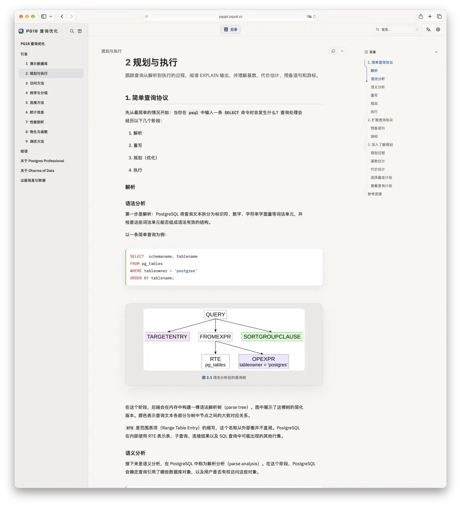](https://pgqpt.pgsql.cc/)

### 《PostgreSQL 监控》

这本书是很少见的专门介绍 PostgreSQL 监控体系的书籍，把 PostgreSQL 里头五花八门的统计视图与监控指标扒得明明白白，读起来相当有意思。

[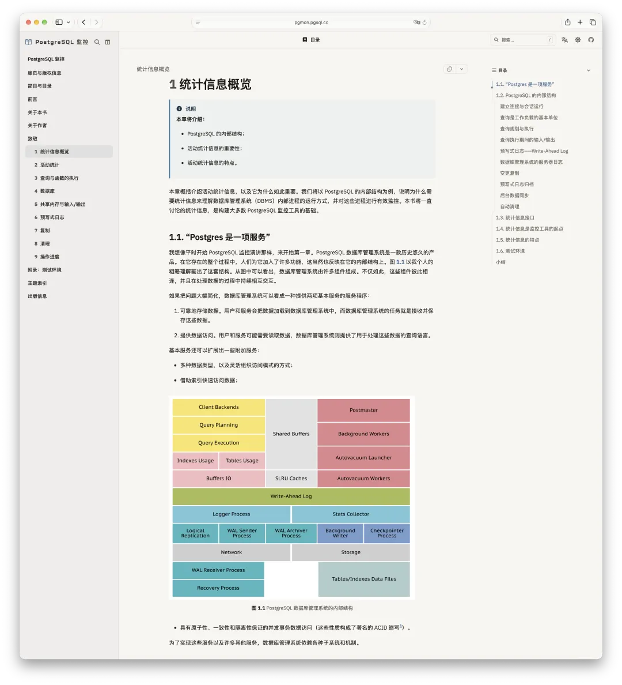](https://pgmon.pgsql.cc/)

### 《PostgreSQL 入门》

面向新手的零基础入门好书，脉络清晰、门槛友好，非常适合刚接触 PostgreSQL 的初学者拿来打底子。

[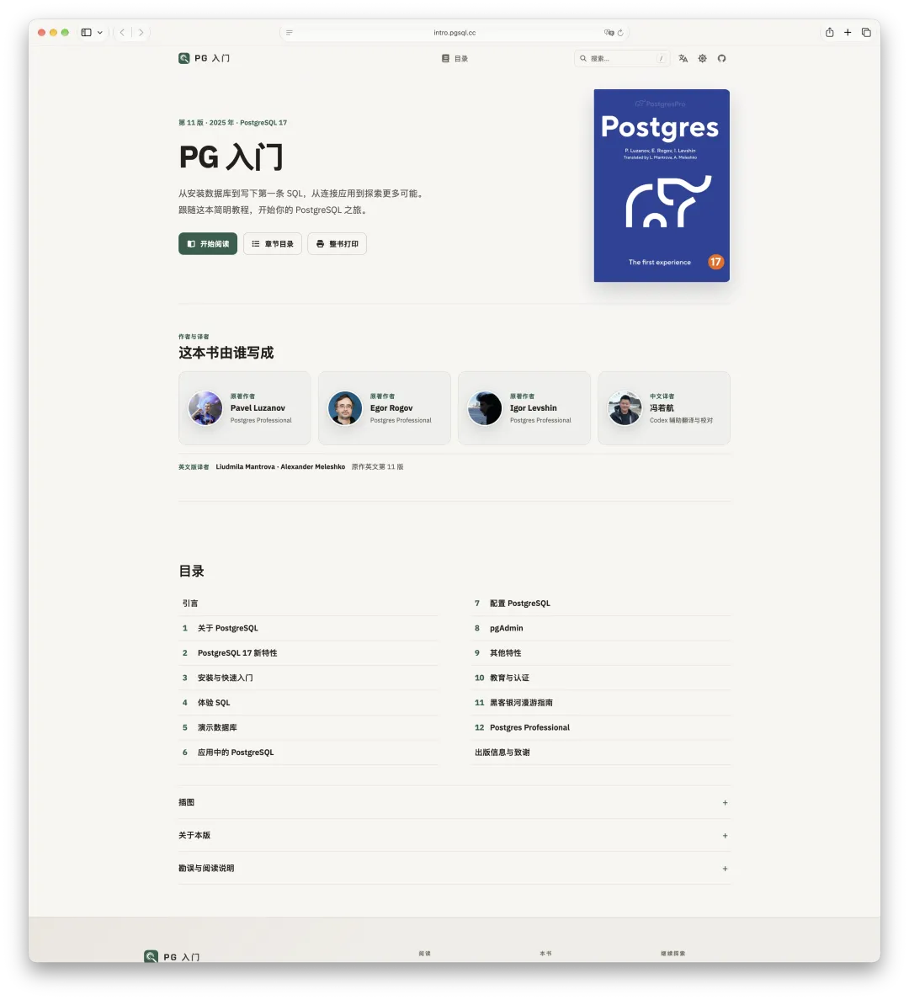](https://intro.pgsql.cc/)

### 《PostgreSQL by Examples》

另一本新手友好的实战型入门书，手把手带着敲例子，非常适合初学者跟着实操循序渐进上手。

[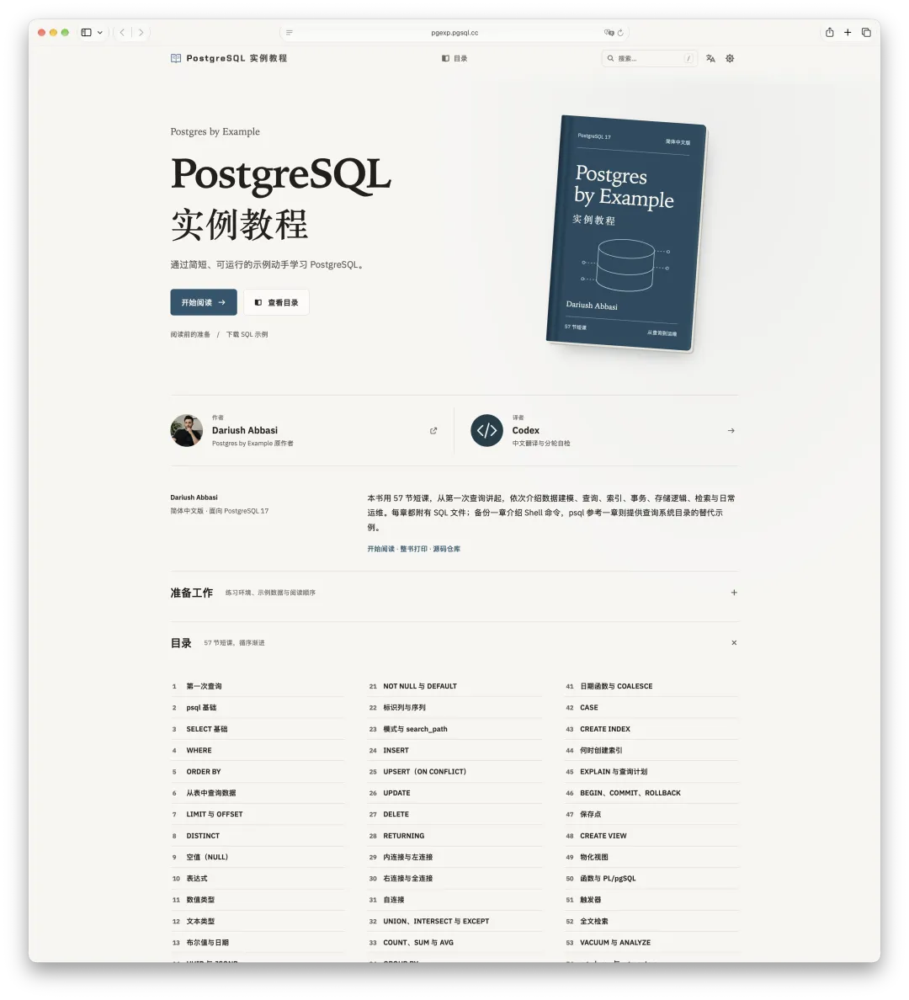](https://pgexp.pgsql.cc/)

### 《PostgreSQL 8 Kilobytes》

书名叫 8KB，直接致敬了 PG 经典的 8KB 数据页，我粗看感觉还是一本很不错的书籍，会讲很多有意思的底层细节。

[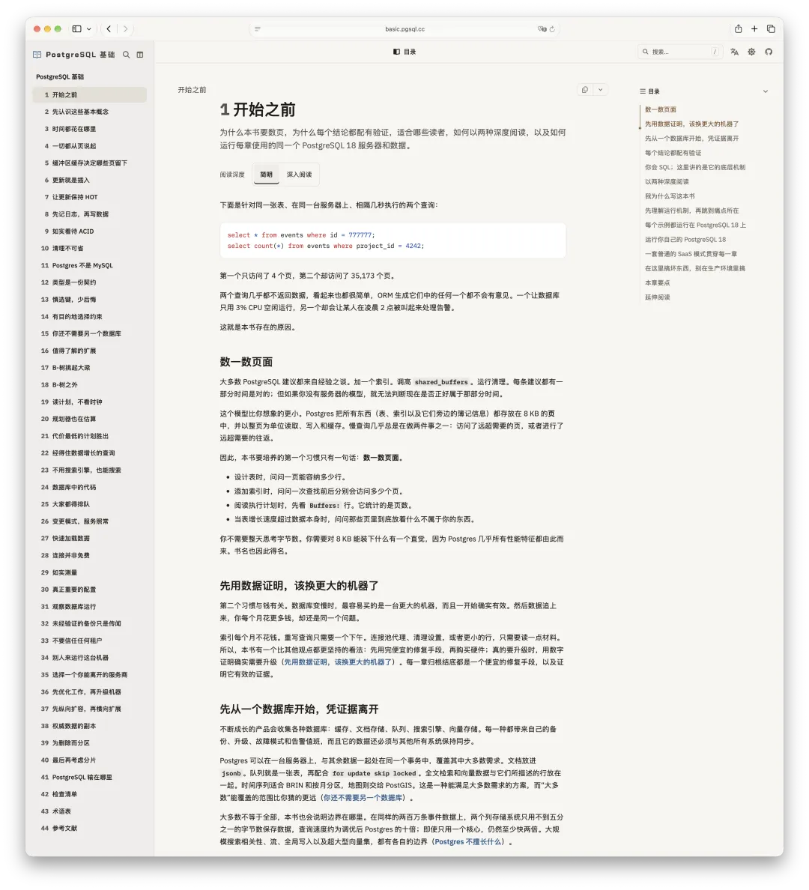](https://basic.pgsql.cc/)

### 《PostgreSQL 特性介绍》

一位日本作者整理的宝藏资料。从 PG 9.5 一路盘点至今，把历代大版本的每一个新特性都列得清清楚楚，而且每个特性都配了直观的实操例子，用来查漏补缺再合适不过。

[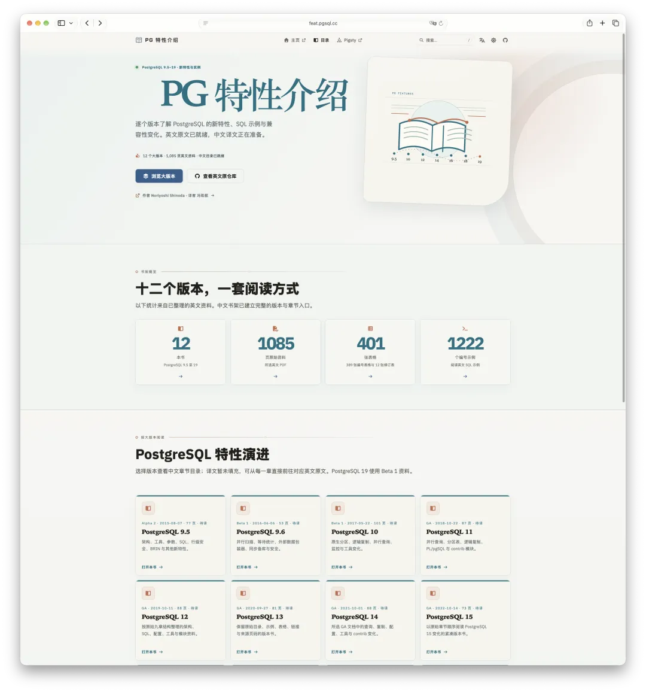](https://feat.pgsql.cc/)

除了上面这批专著，还有两套含金量极高的系列培训教材：

### Dalibo 系列培训（共 14 册）

体系极其严整，把全套教案与 PPT 都用 CC 许可证开源了出来，不管是自学还是给团队做内训，都是顶级的参考材料。可以从 [Dalibo 培训入口](https://dalibo.pgsql.cc/) 开始。

### PGPro 系列培训（共 8 册）

俄罗斯数据库大厂 Postgres Professional 的内部看家培训材料，以前基本只有俄文版，现在全套公开讲义也都能直接啃中文了。

[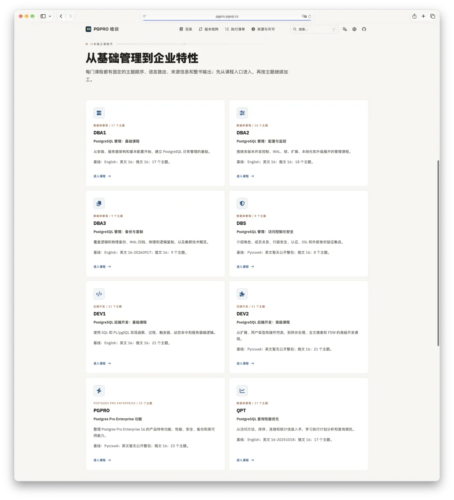](https://pgpro.pgsql.cc/)

目前大礼包里还有几册正在老冯本地跑最后的审校收尾，不过上面点到名的重点书目基本都已经上线发布了。毕竟一天之内吞吐量实在太大，难免会有疏漏之处，欢迎大家在阅读过程中随时挑刺、多多指正。

希望这批热乎的精神食粮能帮到大伙儿，也盼着咱们的 PostgreSQL 中文社区越办越好，搞得红红火火！
