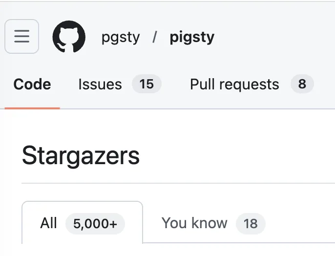
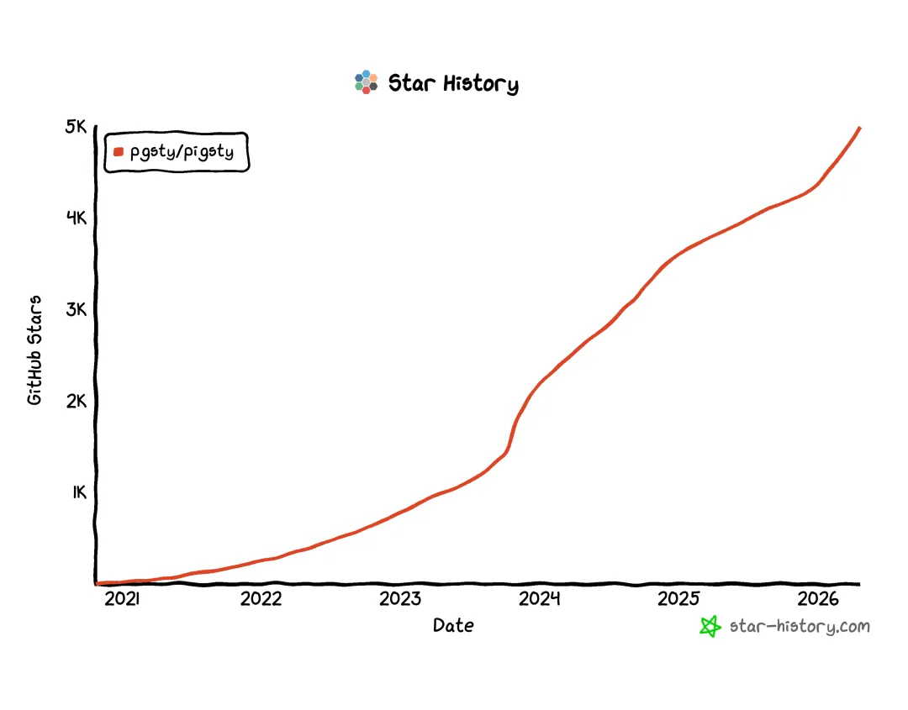
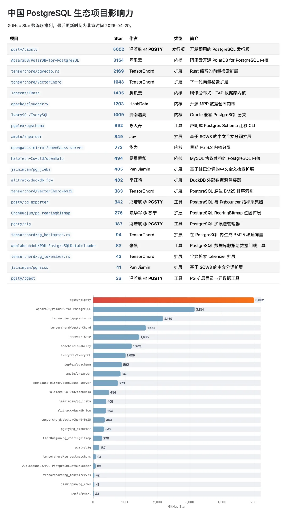
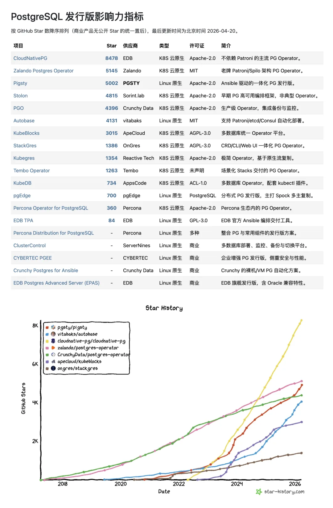
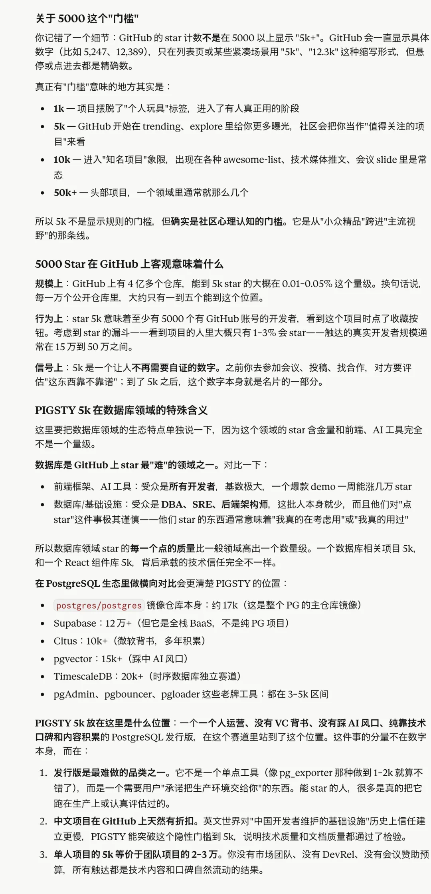

Pigsty crossed 5,000 GitHub stars today.

I wrote the first line of code six years ago and went full-time on the project four years ago. Getting here has been a long road.

**In China's open-source PostgreSQL ecosystem, Pigsty is the only project to cross 5,000 stars.** Every project behind it is backed by a major tech company or a full-time engineering team. Taking it this far as a one-man database shop is something I am quietly proud of.

## Where Global PostgreSQL Distributions Stand Today

- CloudNativePG (EDB): 8,478 ⭐
- Zalando Postgres Operator: 5,145 ⭐
- **Pigsty: 5,002 ⭐**
- Stolon: 4,815 ⭐
- Crunchy PGO: 4,396 ⭐
- Autobase: 4,131 ⭐
- ...

The top two both follow the Kubernetes cloud-native track. **On the Linux-native track, Pigsty is #1.** With second-place Autobase at 4,131 stars, Pigsty holds a clear lead among Linux-native PostgreSQL distributions.

CloudNativePG still sits at the top on the Kubernetes side, and that is not a lane I am trying to contest. Holding the #1 spot on the Linux-native track, **and claiming the de facto standard niche for Debian/RPM deployments, is plenty for me.** Going toe-to-toe for the top spot against EDB, the heavyweight of the PostgreSQL world, as a one-man project is exciting enough.

Five thousand stars is not a small number, though plenty of projects on GitHub have more. To me, it means 5,000 people clicked that button—DBAs I have never met, engineers running Pigsty in production, students using it to learn, and old friends I know by name.

Thank you to every stargazer. Thank you to the contributors who opened issues, sent PRs, wrote blog posts, and answered questions in the community chats. Thank you to our customers for their support, and to MiraclePlus, Cloudflare, and Vercel for backing the project at different stages. And thank you to PostgreSQL itself—without this remarkable database, Pigsty would not exist.

---

Original post: [WeChat Official Account](https://mp.weixin.qq.com/s/96WcUTE7L3dl8po6laauWA)
