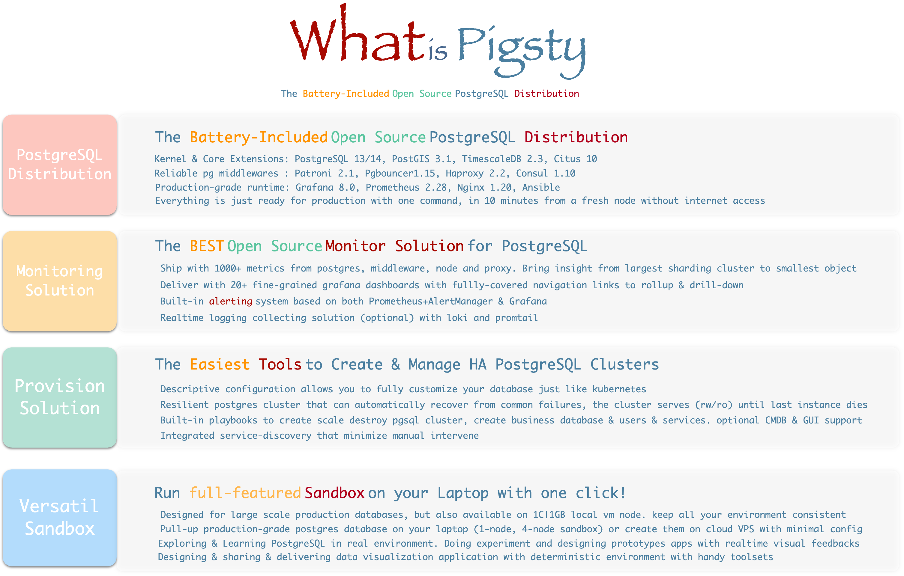
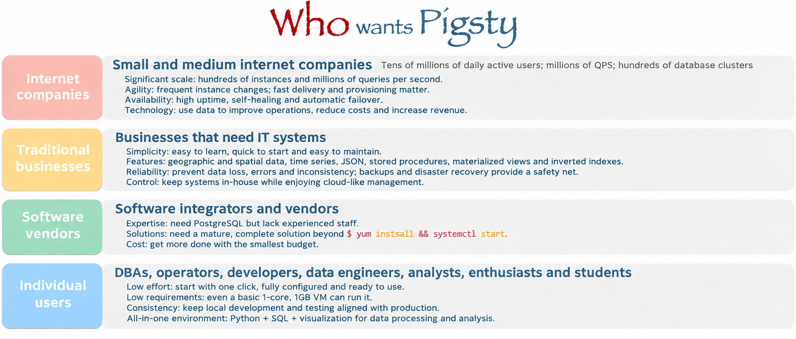
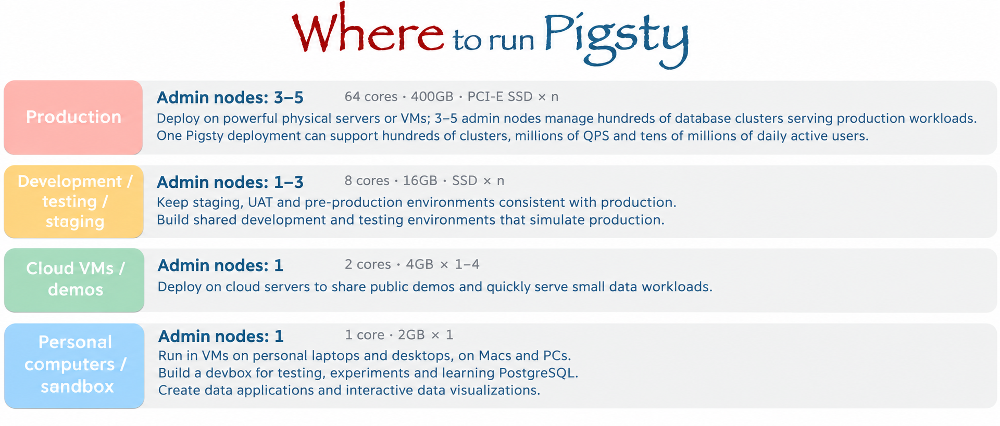
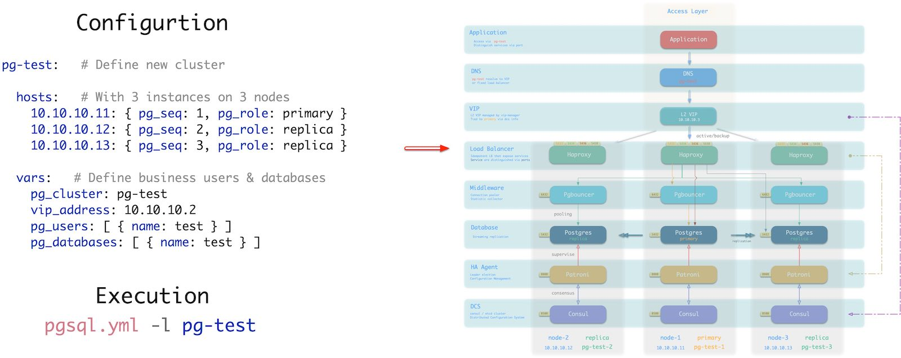
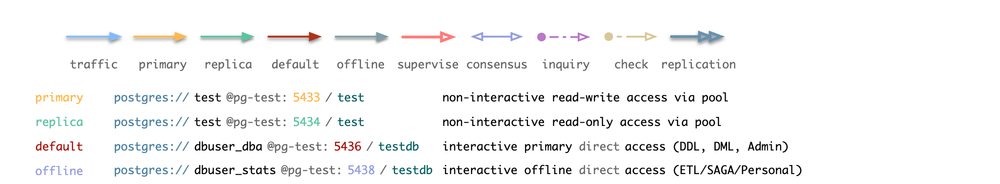
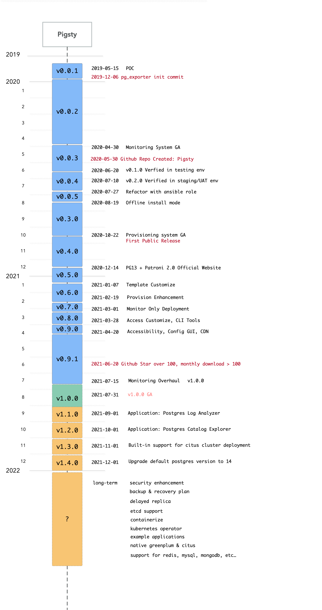
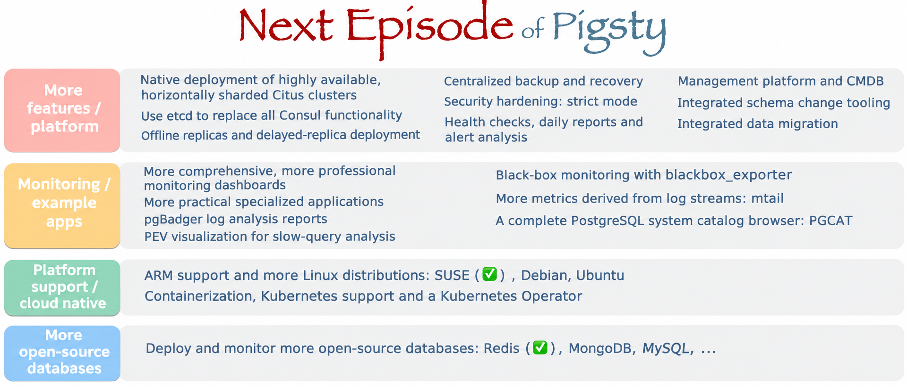

> [**GitHub Release**](https://github.com/pgsty/pigsty/releases/tag/v1.0.0) | [**Release Note**](https://pigsty.io/docs/about/release/#v100)

After over a year of iterations and refinement, Pigsty officially ships **v1.0.0 GA**.

**Pigsty** (/ˈpɪɡˌstaɪ/) stands for **P**ostgre**S**QL **I**n **G**raphic **STY**le — PostgreSQL, visualized.

## What is Pigsty?

Pigsty is a **batteries-included PostgreSQL distribution** that bundles production-grade cluster deployment, scaling, replication, failover, traffic routing, connection pooling, service discovery, access control, monitoring, alerting, and logging into a single cohesive package. It solves the hard problems you'll face when running **PostgreSQL — the world's most advanced open-source relational database** — in production.

| Role | Description |
|------|-------------|
| Distribution | Batteries-included PostgreSQL distribution |
| Monitoring | Professional-grade PostgreSQL observability |
| Deployment | Simple, HA-ready deployment solution |
| Sandbox | Versatile local sandbox & data visualization environment |
| Open Source | Free as in freedom, Apache 2.0 licensed |

### Core Features

[Original English feature slide, v1.0.0](https://github.com/pgsty/pigsty/blob/v1.0.0/docs/_media/what.svg), with its historical wording intact. The Chinese slide specifies PostgreSQL 13.3/14-beta2 where the English artwork says 13/14. It also specifies a fresh CentOS 7 host, excludes the roughly 1GB download from the ten-minute installation time, and describes built-in alert rules and automatic database labels during scaling.

English localization of the original audience slide. The illustrative command retains the source's `instsall` typo.

Deployment environments and hardware examples from the 2021 slide.

## Distribution

A distribution is a **complete solution** built from a database kernel plus a curated set of software packages. Linux is an OS kernel; RedHat, Debian, and SUSE are distributions built on top of it. PostgreSQL is a database kernel; Pigsty, BigSQL, Percona, and various cloud RDS offerings are distributions built on top of it.

As a database distribution, Pigsty's core strengths are:

- **Comprehensive, professional** monitoring system
- **Simple, easy-to-use** deployment solution
- **Stable, reliable** high-availability architecture
- **Versatile, powerful** sandbox environment
- **Free, friendly** open-source license

## Batteries Included

**Batteries-included** means: start with a fresh VM, run one command, and within 10 minutes you'll have infrastructure, database, monitoring, and control plane fully operational.

Pigsty pushes **deployment** and **monitoring** to the extreme, turning the historically high-barrier work of deploying, managing, and operating large-scale database clusters into something any developer can handle.

**For power users, Pigsty provides the most comprehensive monitoring system available. For everyone else, Pigsty provides the simplest deployment experience.** For data engineers, Pigsty also integrates tools like JupyterLab and ECharts, making it a complete IDE for data development and visualization.

[Original English installation slide, v1.0.0](https://github.com/pgsty/pigsty/blob/v1.0.0/docs/_media/how.svg). The Chinese slide additionally recommends downloading packages from upstream during installation when the host is not running CentOS 7.8.

## Monitoring System

Pigsty ships with a professional-grade PostgreSQL monitoring system designed for large-scale database fleet management. It includes ~1200 metric types, 20+ dashboards, and thousands of panels, covering everything from fleet-wide overviews down to individual object details. Compared to alternatives, it leads by a wide margin in metric coverage and dashboard richness — delivering irreplaceable value for professionals.

A typical Pigsty deployment can manage hundreds of database clusters, collect thousands of metric types, handle millions of time series, and organize them into thousands of panels across dozens of dashboards in real-time. From global fleet overviews to per-object details (tables, queries, indexes, functions), it's like having a real-time MRI/CT scanner for your database — everything laid bare.

Dashboard gallery

Single query monitoring

Single table monitoring

Instance-level monitoring dashboard

### Three Core Applications

Pigsty's monitoring system is composed of three tightly integrated core **applications**:

**PGSQL** — Collect and visualize monitoring metrics

**PGCAT** — Browse database system catalogs directly

**PGLOG** — Real-time log search and analysis

Pigsty's monitoring system is built on industry best practices, using Prometheus and Grafana as the monitoring infrastructure. Open source, easy to customize, reusable, portable, no vendor lock-in. It can integrate with existing PostgreSQL instances and can also be used to monitor and manage other databases or applications (like Redis).

## Deployment Solution

A database is software that manages data. A control plane is software that manages databases.

Pigsty includes an Ansible-based database management solution, with CLI and GUI wrappers on top. It handles core database management functions: cluster creation, destruction, scaling; user, database, and service provisioning.

Pigsty embraces the **Infrastructure as Code** philosophy, using Kubernetes-style declarative configuration. Describe your database and runtime environment through extensive config options, and idempotent playbooks automatically create the clusters you need — delivering a private-cloud-like experience.

Users simply describe "what kind of database they want" via config files or GUI — no need to worry about how Pigsty creates or modifies it. Pigsty will spin up the desired database cluster from bare metal nodes within minutes.

Define a cluster in a few lines, then create it with `pgsql.yml -l pg-test`. [Original English configuration figure, added to the upstream documentation on July 28, 2021](https://github.com/pgsty/pigsty/blob/2147b752a18e0ff0294d4110623b955942358d99/docs/_media/provision.jpg). Its original spelling is retained. The sample configuration uses VIP `10.10.10.2`; the accompanying architecture artwork uses `10.10.10.3`. The Chinese figure illustrates application clients with Go, Python, and Java logos.

Connection and arrow legend from the [original v1.0.0 architecture SVG](https://github.com/pgsty/pigsty/blob/v1.0.0/docs/_media/access.svg), retaining the details shown beneath the Chinese article's deployment diagram.

For users who prefer not to work with config files and Ansible playbooks, Pigsty also offers optional CMDB mode and CLI/GUI tools wrapping common operations.

For power users, Pigsty provides 160+ configurable parameters, allowing fine-grained control over every aspect of cluster and infrastructure runtime. Beginners can create reliable database clusters without changing a single config setting.

## High Availability Clusters

Pigsty creates distributed, highly-available database clusters. In practice, as long as any instance in the cluster survives, the cluster can provide full read-write and read-only services.

Every database instance in the cluster is functionally equivalent — any instance can serve full read-write traffic through the built-in load balancer. **Clusters automatically detect failures and perform primary-replica failover; typical failures self-heal in seconds to tens of seconds, with read-only traffic unaffected during the process.**

Pigsty's HA architecture is battle-tested in production, achieving complete high availability with minimal complexity — making traditional primary-replica databases feel like distributed databases.

Default access topology (DNS + L2 VIP + HAProxy, 7 options total)

## Sandbox Environment

PostgreSQL users aren't just enterprises — countless individuals use it for software development, testing, experiments, demos, or for data cleaning, analysis, visualization, and storage. Setting up the environment is often the first hurdle.

The Pigsty sandbox solves this problem. **With one click, spin up a complete production-grade PostgreSQL service on your laptop or PC** (Vagrant calls VirtualBox to automatically create the VMs). The default sandbox is single-node (2c/4g) with all essential tools, suitable for various use cases. There's also a four-node full sandbox for production-like environments, fully exploring Pigsty's HA architecture and monitoring capabilities.

Four-node sandbox architecture diagram

## Data Analysis

Pigsty provides PostgreSQL as the backend database, JupyterLab as the Python IDE, Grafana as the frontend/backend runtime, and the Grafana ECharts Panel for advanced visualization. Together, these tools form a complete toolkit for data processing, analysis, and data application development.

Build your data analysis workflow on Pigsty, rapidly prototype data application POCs, and package/distribute/deploy them in a standardized way. Pigsty ships with two sample data applications:

**COVID** — Pandemic data visualization app

Click to view individual country details and timeline maps

**ISD** — Global surface weather station historical data explorer

Click to view individual station details and historical weather data

## Roadmap

[Original English timeline, saved July 22, 2021](https://github.com/pgsty/pigsty/blob/v1.0.0/docs/_media/pigsty-timeline.svg). This artwork preserves an earlier planning revision: it shows GA on July 31 and a separate July 15 monitoring milestone, whereas the Chinese announcement dates GA to July 26. Its September–November feature plans also differ. The tables below preserve the Chinese figure's complete milestone and event captions; entries after July 2021 were plans at publication time.

| Date | Development milestone in the Chinese figure |
|------|--------------------------------------------|
| 2019-05-15 | Proof of concept: the `pg-test` sandbox. |
| 2020-04-30 | Overall architecture finalized. |
| 2020-06-20 | v0.1.0 validated in a testing environment. |
| 2020-07-10 | v0.2.0 validated in a staging environment. |
| 2020-07-27 | Refactored around Ansible roles. |
| 2020-08-19 | Offline installation mode. |
| 2020-10-22 | Complete database provisioning solution available. |
| 2020-12-14 | PostgreSQL 13 and Patroni 2.0 support; official documentation site launched. |
| 2021-01-07 | Custom database templates supported. |
| 2021-02-19 | Provisioning improvements. |
| 2021-03-01 | Standalone monitoring deployment supported. |
| 2021-03-28 | Custom services and access methods; CLI tools. |
| 2021-04-20 | Installation and usability improvements; GUI tools; extension mechanism proof of concept; official CDN. |
| 2021-07-26 | v1.0.0 GA released. |
| 2021-09-01 | Planned v1.1.0: improve the PGSQL and PGCAT applications. |
| 2021-10-01 | Planned v1.2.0: improve the PGDOG and PGFOX applications. |
| 2021-11-01 | Planned v1.3.0: TimescaleDB and Citus deployment support. |
| 2021-12-01 | Planned v1.4.0: upgrade the default database to PostgreSQL 14. |

| Date | Community and adoption event in the Chinese figure |
|------|---------------------------------------------------|
| 2019-12-06 | `pg_exporter` repository created. |
| 2020-04-18 | PostgreSQL Chinese community livestream: “PostgreSQL High Availability in Practice: Patroni.” |
| 2020-05-30 | GitHub repository created. |
| 2020-06-06 | PostgreSQL Chinese community livestream: “PostgreSQL Monitoring: Golden Metrics and Cluster Monitoring.” |
| 2020-08-20 | Representative external user: a military unit. |
| 2020-08-23 | PostgreSQL Chinese community livestream: “PostgreSQL and Data Visualization.” |
| 2020-10-22 | First public release. |
| 2020-11-20 | Beijing, 2020 Database Carnival: “Pigsty: A PostgreSQL Monitoring System.” |
| 2021-01-07 | Alibaba Cloud's seven-day PostgreSQL training camp: “PostgreSQL Monitoring in Practice: Solving Real Monitoring Problems with Pigsty.” |
| 2021-01-16 | Guangzhou, 2020 PostgreSQL China Technical Conference: “Pigsty: A Production-Grade PostgreSQL Monitoring System.” |
| 2021-02-24 | Representative external user: a bank's consumer finance division. |
| 2021-05-23 | PostgreSQL Chinese community livestream: “Getting Started with the Open-Source PostgreSQL Toolkit: Pigsty v0.9.1.” |
| 2021-06-08 | Public lecture at Dalian University of Technology: “An Introduction to the Database Industry: What, Why, How & Pigsty.” |
| 2021-06-20 | GitHub stars passed 100; monthly downloads passed 100. |
| 2021-08-01 | Scheduled Open Source China Summit, distributed databases track: “New Life for PostgreSQL: Pigsty, a Batteries-Included PostgreSQL Distribution.” |
| 2021-08-31 | Scheduled DTCC 2021, time-series databases track: “The Prometheus Data Model.” |

English localization of the 2021 feature roadmap. The original marks SUSE and Redis with checkmarks.

## Open Source

Pigsty is open-source under the Apache 2.0 license — free for commercial use, with modifications and derivatives subject to Apache License 2.0's attribution requirements.

Pigsty's mission: **Use databases well**, use **good databases**.

Give SMBs a truly self-controlled choice, and let everyone enjoy the power of PostgreSQL.

## v1.0.0 Release Notes

**Monitoring System Overhaul**

- New dashboards on Grafana 8.0
- New metric definitions, added PG14 support
- Simplified labeling system: static label set (job, cls, ins)
- New alerting rules and derived metrics
- Monitor multiple databases simultaneously
- Real-time log search & csvlog analysis
- Richly-linked dashboards, click through for drill-down/roll-up

**Architecture Changes**

- Added Citus and TimescaleDB to default installation
- Added PostgreSQL 14beta2 support
- Simplified HAProxy admin page indexing
- Decoupled infrastructure and PGSQL by adding new role `register`
- Added new roles `loki` and `promtail` for logging
- Added new role `environ` to setup environment for admin user on meta node
- Default to `static` service discovery for Prometheus (instead of `consul`)
- Added new role `remove` for graceful cluster and instance removal
- Upgraded Prometheus and Grafana provisioning logic
- Upgraded to vip-manager 1.0, node_exporter 1.2, pg_exporter 0.4, Grafana 8.0
- Every database on every instance auto-registers as a Grafana datasource
- Moved Consul registration to `register` role, changed Consul service tags
- Added cmdb.sql as pg-meta baseline definition (CMDB & PGLOG)

**Application Framework**

- Extensible framework for new features
- Core app: PostgreSQL monitoring system `pgsql`
- Core app: PostgreSQL catalog explorer `pgcat`
- Core app: PostgreSQL csvlog analyzer `pglog`
- Added sample app `covid` for COVID-19 data visualization
- Added sample app `isd` for ISD weather data visualization

**Other**

- Added JupyterLab for full Python data science environment
- Added `vonng-echarts-panel` to restore ECharts support
- Added wrapper scripts `createpg`, `createdb`, `createuser`
- Added CMDB dynamic inventory scripts: `load_conf.py`, `inventory_cmdb`, `inventory_conf`
- Removed obsolete playbooks: `pgsql-monitor`, `pgsql-service`, `node-remove`, etc.

**API Changes**

- New variable: `node_meta_pip_install`
- New variable: `grafana_admin_username`
- New variable: `grafana_database`
- New variable: `grafana_pgurl`
- New variable: `pg_shared_libraries`
- New variable: `pg_exporter_auto_discovery`
- New variable: `pg_exporter_exclude_database`
- New variable: `pg_exporter_include_database`
- Variable renamed: `grafana_url` → `grafana_endpoint`

**Bug Fixes**

- Fixed default timezone Asia/Shanghai (CST) issue
- Fixed nofile limits for pgbouncer & patroni
- pgbouncer user list and database list now generated when running tag `pgbouncer`

## v1.0.1 Release Notes

2021-09-14

**Documentation Update**

- Chinese documentation now available
- Machine-translated English documentation now available

**Bug Fixes**

- `pgsql-remove` no longer removes primary instances
- Replaced pg_instance with pg_cluster + pg_seq (Start-At-Task could fail when pg_instance undefined)
- Removed Citus from default shared preload libraries (Citus forces max_prepared_transaction to non-zero)
- Added ssh sudo check in `configure` (now uses `ssh -t sudo -n ls` for permission check)
- Fixed `pg-backup` script typo

**Optimizations**

- Removed NTP sanity check alert (duplicate of ClockSkew)
- Removed collector.systemd to reduce overhead
