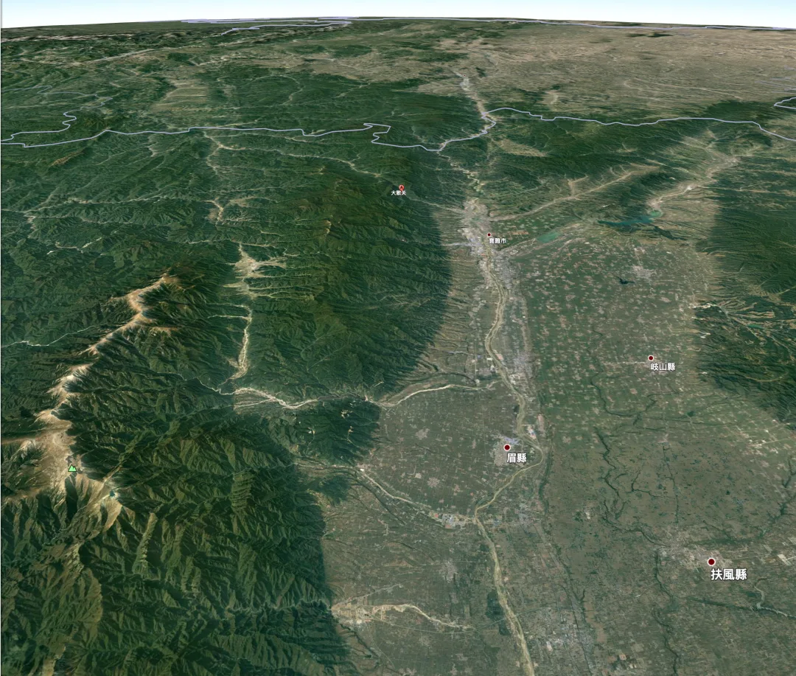
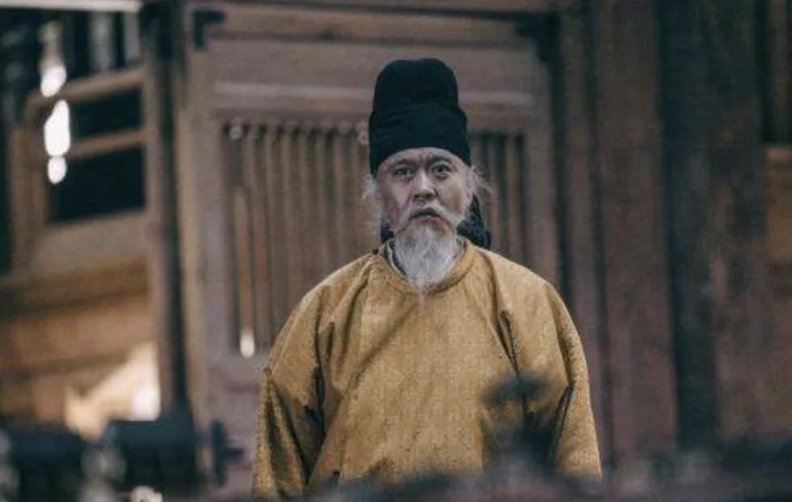
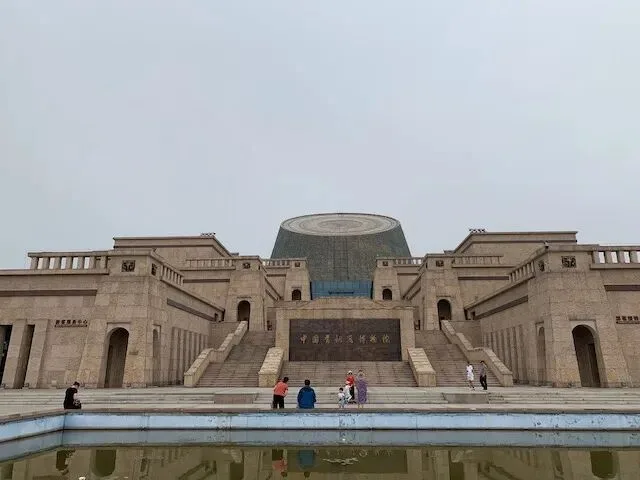
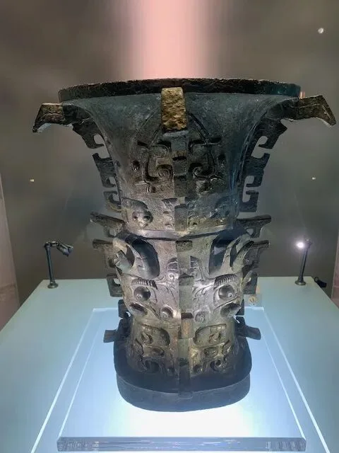
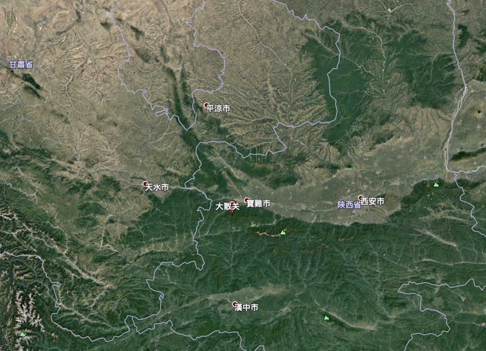
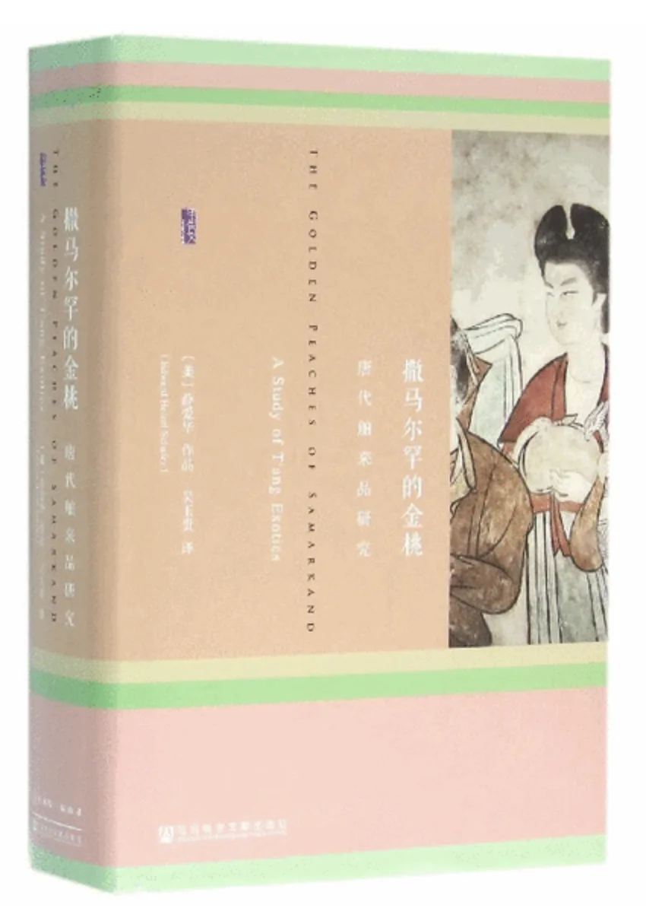
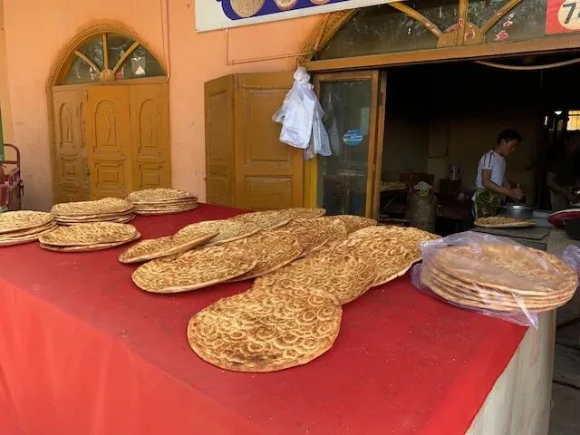

从西安出发，沿丝绸之路西行，第一站就是宝鸡。

## 关陇照片地图 {#photo-map}

下面这张交互地图结合照片库原始 EXIF GPS 与 OpenStreetMap 公开地标 WGS 84 坐标整理，将宝鸡陈仓、古大散关、宝成铁路秦岭段以及从长安西行至陇山与乌鞘岭的关陇地理节点串联起来；点击任意标记或下方图例可预览对应实拍与地形图并跳转至正文段落，亦可切换「关陇地理与西行足迹」俯瞰宏观山川格局。

```map {tab="宝鸡陈仓与大散关" group="guanlong" value="baoji" caption="宝鸡青铜器博物院、古大散关遗址与宝成铁路观音山展线—秦岭站实拍与坐标" height="460px"}
- name: 宝鸡青铜器博物院 · 何尊
  lat: 34.3488
  lng: 107.1914
  text: 坐落于中华石鼓园的全国唯一青铜器专题博物馆与国家一级博物馆，珍藏刻有「宅兹中国」最早铭文的西周国宝何尊。
  image: 05.webp
  link: "#bronze-museum"
- name: 古大散关遗址
  lat: 34.2723
  lng: 107.0120
  text: 「铁马秋风大散关」，关中平原西大门；韩信暗度陈仓与樊哙明修栈道于此汇聚，向西可以得陇，向南可以望蜀。
  image: 07.webp
  link: "#dasanguan"
- name: 宝成铁路 · 观音山展线
  lat: 34.2642
  lng: 106.9881
  text: 中国第一条电气化铁路宝成线的经典爬坡段，以三线重叠的观音山大展线闻名火车迷圈，穿行峻岭峡谷与江水之间。
  image: 03.webp
  link: "#baocheng"
- name: 宝成铁路 · 秦岭站
  lat: 34.2351
  lng: 106.9012
  text: 宝成铁路翻越秦岭分水岭的制高点车站，列车一路穿行在云雾缭绕的秦岭山谷中，正是「云横秦岭家何在」的写照。
  image: 04.webp
  link: "#baocheng"
```

```map {tab="关陇地理与西行足迹" value="guanlong" caption="从西安出发西行经马嵬坡、秦岭太白山、陈仓宝鸡、天水、六盘山至河西走廊门户乌鞘岭的关陇地理格局" height="460px"}
- name: 西安 · 长安起点
  lat: 34.2552
  lng: 108.9470
  text: 从盛唐故都长安出发，沿丝绸之路一路西行，开启穿越关中与陇山的西行漫记。
  link: "#baoji"
- name: 马嵬驿 · 马嵬坡
  lat: 34.3244
  lng: 108.3756
  text: 关中平原西行道上的历史转折点；安史之乱唐玄宗经马嵬坡兵变后继续西逃陈仓，由此衍生出「宝地神鸡」的宝鸡得名传说。
  link: "#baoji"
- name: 太白山 · 秦岭最高峰（3767m）
  lat: 33.9551
  lng: 107.7653
  text: 龙脉秦岭主峰与中国南北地理分界线的制高点；从西安方向俯瞰宝鸡与关中平原，卫星图中绿色山峰标识即太白山。
  image: 01.webp
  link: "#baoji"
- name: 宝鸡 · 古陈仓与何尊
  lat: 34.3488
  lng: 107.1914
  text: 西行首站古陈仓，亦为中国版图几何中心与宝成、宝中、陇海三线铁路枢纽；在青铜器博物院近观刻有「宅兹中国」的何尊。
  image: 06.webp
  link: "#bronze-museum"
- name: 汉中 · 越秦岭望蜀
  lat: 33.0691
  lng: 107.0189
  text: 出大散关翻越秦岭南下汉中，「向南可以望蜀」；楚汉相争时刘邦由汉中王出陈仓平三秦，让「汉」最终成为华夏民族之名。
  link: "#dasanguan"
- name: 天水 · 渭河峡谷（西行入陇）
  lat: 34.5250
  lng: 106.1371
  text: 告别宝鸡后继续沿渭河峡谷西行进入甘肃天水麦积一带，跨越关中与陇右之间的天然走廊。
  link: "#guanlong"
- name: 六盘山 · 古称陇山（2942m）
  lat: 35.5589
  lng: 106.2371
  text: 宝鸡以西的陇山（主峰米缸山）；关中平原与陇山周边共同孕育了北周、隋、唐三朝立国之本——关陇军事贵族集团。
  link: "#guanlong"
- name: 乌鞘岭 · 河西走廊东界（2661m）
  lat: 37.1305
  lng: 102.9606
  text: 关陇地理范围的西界（河西走廊以乌鞘岭为界）；翻过这座海拔两千六百余米的山口，西行之路便正式步入河西走廊与西域。
  link: "#guanlong"
```

## 宝鸡（古陈仓） {#baoji}

宝鸡这个地名虽然很有特色，但它古时候的名字——陈仓，也许要比当代的地名知名度高得多，就是那个“暗度陈仓”的陈仓。

宝鸡的曾用名包括：岐山，雍州，扶风郡，岐州，凤翔府；如今下辖的几个区县：渭滨区、金台区、陈仓区，凤翔县、岐山县、扶风县、眉县、陇县、千阳县、麟游县、凤县、太白县。都透露出一种古典的华夏审美，唯独宝鸡这个名字独树一帜，略带滑稽感。



图为从西安的方向俯瞰宝鸡，左侧山脉为龙脉秦岭，南北方分界线。绿色山峰标识即最高峰太白山。

不过宝鸡这个名字倒也不是谁拍脑袋定出来的，来源众说纷纭，一种比较主流的说法与安史之乱有关。大体意思就是唐玄宗在马嵬坡驿兵变后继续逃跑，跑到陈仓这儿眼瞅着就要被叛军干翻了，突然天降祥瑞出来两只山鸡，做法下了一场大冰雹把叛军砸的七荤八素，玄宗得以脱身。乃曰：“陈仓，宝地也，山鸟，神鸡也”，宝地神鸡金口玉言就成了宝鸡。



华夏历史上的巅峰，莫过于盛唐。文明迭起兴衰，起起落落，但在大趋势上，安史之乱乃整个华夏历史由盛转衰的关键转折点。宝鸡名字背后的故事后，实在是让人唏嘘不已。

### 宝成铁路与秦岭 {#baocheng}

宝鸡是中国版图的几何中心（重心，采用多次悬吊方法），本身是一个交通枢纽，宝成铁路，宝中铁路，陇海铁路在这里交汇，去新疆，甘肃，四川，宁夏通常都会路过这里。其中宝成线名气很大，它是中国历史上第一条电气化铁路，风景绝美，还有着著名的观音山展线大爬坡，火车迷的最爱。我在小学时坐过一次宝成线，对路上的风景记忆犹新。主要是秦岭的山景和四川的水景。


 图为宝成铁路路上拍摄，我小的时候，路上的江水都是青蓝色或者碧绿色。


云横秦岭家何在，一路上都是这种云雾缭绕的风景。

### 宝鸡青铜器博物院与何尊 {#bronze-museum}

宝鸡的钛产业很发达，据说钛产品产量占了全国 80%，全世界五分之一。另外汽车变速箱也占了很大份额。不过旅游的人一般都不会关心这个，通常都会关注另一个地方，就是全国唯一一家青铜器专题博物馆—— 宝鸡青铜器博物馆。这是一个国家一级博物馆，建筑样式还是很有特色的。



宝鸡青铜器博物馆，也是一个国家一级博物馆。

通常来说，我对锅碗瓢盆一类的东西也不是特别感冒。不过，这里有一件很有名的宝贝 —— 何尊。当年农民地里刨出来 30 块卖到废铁站，但是因为这玩意上面刻了“中国”两个字，于是就牛逼大发了。上面有“宅兹中国”这几个字，成为“中国”这一词最早的来源。



 著名的何尊

这件器物让我突然对“中国”这个概念产生的兴趣，特意研究了一番。

民族国家(Nation)这个概念诞生才不过两百多年，要说周朝就有中国那不是扯淡嘛。考证后，“中国”一词，至少有三层涵义。

第一层涵义始于先秦时代，也就是古典华夏时代，这个“尊”的时代。中，即中央，而“國”则是与“野”相对应的概念，按照造字法，指的是由武士持戈守卫的城墙。城墙的出现是文明演化成功的可靠标志，拥有城墙的部族会被称为国。因此这里的中国，就是位置居中的城池。

第二层涵义出现在汉魏时期，这时候的中原通常指的就是与“江表”对应的以洛阳许昌为中心的中原地区。那个著名的“五星出东方利中国”（还原后的完整卜辞：五星出东方利中国，讨南羌，四夷服，单于降，与天无极）应该就是这种涵义。

最后是现在主权国家意义上的“中国”，不幸的是，这个“中国”的词源来自《尼布楚条约》，当代语境里的“中国”一词最早出现的地方应该就是这里了，这个确实是有点让人沮丧的。

### 铁马秋风大散关 {#dasanguan}

宝鸡再往西走，就是另一处知名的古迹——铁马秋风大散关。大散关乃是关中平原的西大门，向西可以得陇，向南可以望蜀。楚汉相争，先入关者王。明修栈道的樊哙与暗度陈仓的韩信就是在这里汇聚，一举平定三秦，夺取关中，让汉中王的“汉”变成一个民族的名字，大一统与多国体系的争斗尘埃最终落定，奠定两千年来的华夏基本格局。



## 关陇 {#guanlong}

宝鸡的西边是六盘山，古称陇山。隋唐立国之本关陇军事贵族集团即起源于这一地区。关陇指的是关中平原和陇山周边，确切的说，就是河西走廊（以乌鞘岭为界）以东，河套以南，函谷关以东的这一片地区。

说起关陇集团，这个概念还是陈寅恪提出来的，他的观点还是很有趣的。北周宇文氏，隋朝杨氏，唐朝李氏都是关陇集团出来的，有着浓厚的鲜卑血统。不过血统民族和文化民族是两种事情，按照传统华夏政治秩序，夷狄入中国，则中国之，中国入夷狄，则夷狄之。强盛的帝国总会包容多元文化，唐朝即使真的是鲜卑人搞起来的，只要接下汉魏衣钵，也仍然是华夏，这跟罗马帝国有异曲同工之妙。不管是朝鲜，岭南还是西域，只要你说中文，写汉诗，大家就认同你是华夏的一份子。\

所谓夷狄是对周边民族的蔑称，但实际在唐朝，很多邻居也是高度富裕，文明，强大的。《撒马尔罕的金桃》一书详细介绍了唐朝的外来文明，包括人口，家畜，野兽，飞禽，毛皮，植物，木材，香料，食物，医药，纺织品，颜料，矿石，宝石，金属制品，手工艺品，宗教器物，等等等等，很多习以为常默认是华夏出产的东西，我都甚至没想到也是进口的。唐朝人是很喜欢搞这些东西的，譬如吃胡饼，那个胡饼其实就是新疆烤馕，确实好吃。唐玄宗喜欢看的那个胡旋舞，也是西域舞蹈。波斯对中原的文化输出与技术输出也俯拾皆是。尽管这些都系都不是“国产的”，但这一点儿也不妨碍唐朝的伟大。所谓“天下英雄入吾彀中”也。



白居易是一个显著的代表，根据库车博物馆的说法，白居易是龟兹人。但写得一手好唐诗，显然没人会怀疑他是一位标准的唐朝士大夫，白居易非常好胡风，自己有屋子不住，还非要在院子里搭个突厥帐篷住里面。尽管如此，不会有什么人会指责他崇洋媚外。这一点显然是真正强盛与自信的表现。



美味的胡饼 —— 烤馕

关于盛唐景象，我觉得《长安十二时辰》这部剧拍的非常好，好就好在对唐代的历史风貌做了一个非常全面，直观，贴切的呈现。


又扯远了，再往西去，就要到河西走廊和西域了。河西走廊算是我的故乡之一，但一直没有好好欣赏一下，详情请听下回分解。

---

发布版本：[微信公众号](https://mp.weixin.qq.com/s/ndSV5o3FfMDTx5cV2MkKKA)
