从 1.24 到 2.7，我和家人朋友在泰国度过了两周难忘的度假体验。今天正式回家**开工了**。不过在开工前，简单写写在泰国的感受与体验。

在出发前和刚到泰国时，不少朋友网友都关心俺不要被 **噶腰子**了，我倍感温暖，不过这种担忧确实大可不必。实际上今年去泰国的老中不减反增了，目测还是因为免签的缘故。

## 主要行程

这次在泰国的行程主要是三站：普吉岛 - 苏梅岛 - 清迈。全程基本以花式酒店躺平为主，出了趟海（斯米兰岛），玩了玩枪（清迈），胡吃海喝了一遍。

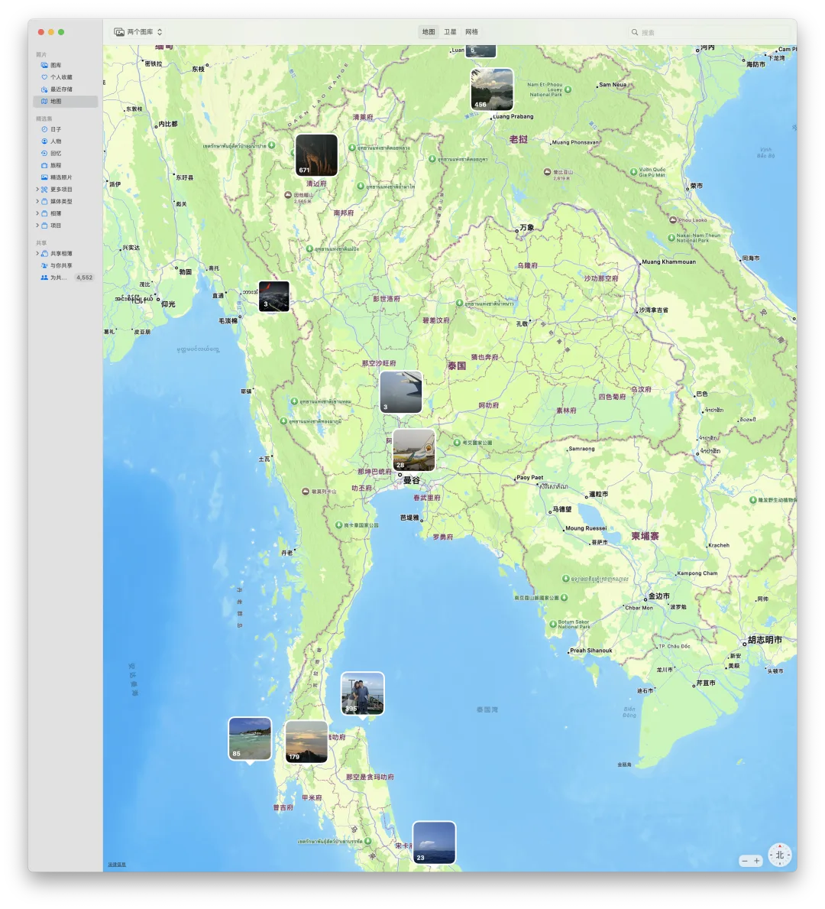

## 泰国照片地图 {#photo-map}

下面这张交互地图基于 Mac 照片库原始 EXIF GPS 坐标（斯米兰岛补以公开 WGS 84 地标坐标）整理，按行程顺序串联起 14 天泰国之旅的主要节点；点击标记或下方图例可预览实拍并跳转对应段落，也可切换至「南部海岛与出海」或「清迈慢游打卡」查看局部详细点位。

```map {tab="泰国两周全览" group="thailand" value="overview" caption="2025 年春节泰国 14 日总行程（普吉岛攀牙湾 → 苏梅岛海景别墅 → 清迈大峡谷与慢游 → 曼谷机场返程）" route=true height="460px"}
- name: 普吉岛 · 攀牙湾 COMO Point Yamu
  lat: 7.9860
  lng: 98.4216
  text: 1 月 24 日飞抵普吉，在攀牙湾畔连住三晚花式躺平，其间出海跳岛斯米兰并打卡米其林泰餐。
  image: 07.webp
  link: "#phuket"
- name: 苏梅岛 · 山顶海景大别墅
  lat: 9.5357
  lng: 100.0270
  text: 1 月 27 日渡轮登岛在此过春节，七人同住五卧海景别墅，泳池、麻将、台球与私人大厨一应俱全。
  image: 09.webp
  link: "#samui"
- name: 清迈 · 大峡谷靶场与慢游
  lat: 18.6973
  lng: 98.8903
  text: 1 月 31 日自普吉乘亚航飞抵清迈连住六天，在大峡谷靶场痛快“打爆 MySQL”，慢逛咖啡馆与夜间动物园。
  image: 03.webp
  link: "#shooting"
- name: 曼谷 · 机场返程经停
  lat: 13.7171
  lng: 100.7434
  text: 2 月 6 日由清迈飞抵曼谷经停返程，遇上堵车与图文不符的机场酒店小插曲，次日顺利回家开工。
  link: "#mishaps"
```

```map {tab="南部海岛与出海" value="islands" caption="安达曼海与泰国湾南线点位（普吉国际机场、攀牙湾 COMO Point Yamu、斯米兰群岛风帆石、苏梅岛山顶海景别墅）" height="460px"}
- name: 普吉国际机场（HKT）
  lat: 8.1061
  lng: 98.3051
  text: 1 月 24 日落地开启泰国之行，也是 1 月 31 日从苏梅折返后乘亚航飞往清迈（托运行李被摔开）的起降点。
  link: "#mishaps"
- name: 普吉岛 · 攀牙湾 COMO Point Yamu
  lat: 7.9860
  lng: 98.4216
  text: 坐落于攀牙湾岬角的极简度假酒店，连住三晚非常舒适，适合彻底放空躺平。
  image: 07.webp
  link: "#phuket"
- name: 斯米兰群岛 · 8 号岛风帆石
  lat: 8.6696
  lng: 97.6479
  text: 1 月 26 日从普吉驱车一小时赴码头乘船跳岛浮潜，坐船头扛住风浪还偶遇大海龟，唯独游客实在太多。
  image: 08.webp
  link: "#similan"
- name: 苏梅岛 · 山顶海景大别墅
  lat: 9.5357
  lng: 100.0270
  text: 海拔约 265 米的五卧俯海别墅，配司机、管家与兼职吉他手的大厨管三餐，七人在此热闹过年。
  image: 10.webp
  link: "#samui"
```

```map {tab="清迈慢游打卡" value="chiangmai" caption="清迈六日慢游与实弹打卡点位（清迈国际机场、大峡谷靶场、Chom Cafe、Tongna Cottage、夜间动物园、古城与湄平河畔）" height="460px"}
- name: 清迈国际机场（CNX）
  lat: 18.7703
  lng: 98.9680
  text: 1 月 31 日傍晚自普吉乘亚航抵达清迈，托运行李箱被摔开但好在无失物，现场获赔 600 泰铢。
  link: "#mishaps"
- name: 清迈大峡谷靶场（333 Shooting Range）
  lat: 18.6973
  lng: 98.8903
  text: 2 月 1 日在杭东大峡谷靶场实弹畅打霰弹枪、冲锋枪、步枪与手枪，没有铁链束缚，人均千把块玩得过瘾。
  image: 02.webp
  link: "#shooting"
- name: Chom Cafe 森林咖啡馆
  lat: 18.7482
  lng: 98.9455
  text: 2 月 2 日打卡清迈人气“绿野仙踪”主题花园咖啡馆，苔藓、溪流、瀑布与人工薄雾交织得精致入微。
  image: 13.webp
  link: "#chiangmai"
- name: Tongna Cottage · 水牛稻田咖啡
  lat: 18.6807
  lng: 98.9597
  text: 2 月 4 日上午探访杭东郊外的稻田度假区与 Jungle De Cafe，水牛门楼、木桥稻田与人造瀑布极具格调。
  image: 12.webp
  link: "#chiangmai"
- name: 清迈夜间动物园（Night Safari）
  lat: 18.7424
  lng: 98.9166
  text: 2 月 4 日傍晚入园游览清迈夜间动物园，乘观光车穿行展区，是清迈行程中拍照最多的一站。
  link: "#chiangmai"
- name: 清迈古城与湄平河畔
  lat: 18.7897
  lng: 98.9944
  text: 连住湄平河畔与古城一带，逛商场、吃人均两百的米其林泰餐、打牌喝咖啡，尽享《小城故事多》的闲适节奏。
  link: "#chiangmai"
```

## 泰国危险吗？

作为老牌旅游国家，别去边境瞎晃悠，在经典旅游地点，我觉得根本没有什么危险。当地人都非常友善，老实说那些搞诈骗的基本都是福建台湾一带的，出门防好“老乡”，基本就没啥问题了。

## 泰国可以打枪 {#shooting}

清迈大峡谷这个靶场很不错，打了霰弹枪，冲锋枪，步枪，手枪，基本过瘾了。平均每人千把块钱。不像国内靶场枪还给你用铁链子锁上，随便 biubiu。

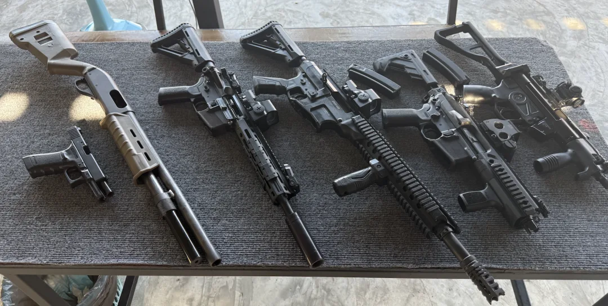

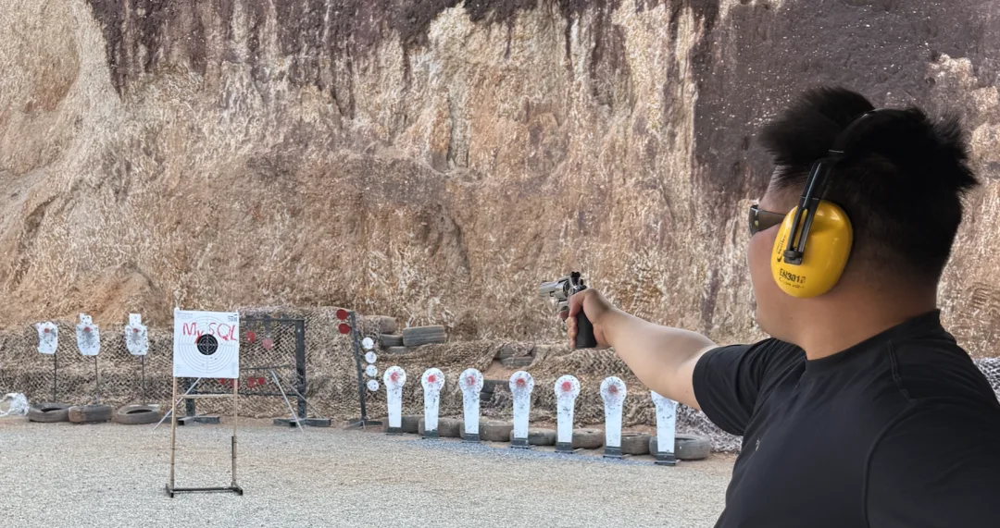

“打爆 MYSQL！”

## 泰国物价真便宜

在普吉和清迈吃了几家米其林，翻着花样吃撑人均也就两百块。泰国菜的味道非常赞！酒店 900 ¥ 的 SPA 很一般，路边 150 ¥ / 两小时的泰式按摩非常赞。

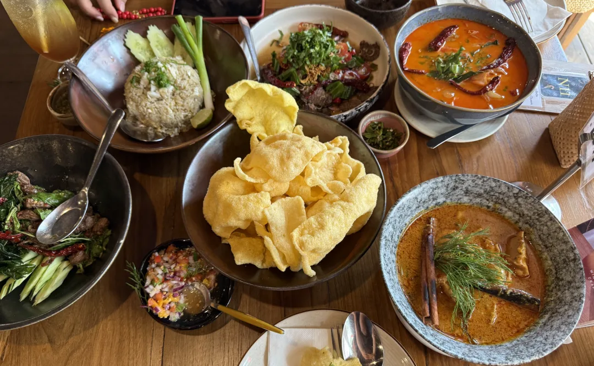

## 泰国素质蛮高

体现一个地方文明程度有一个很管用的指标：**厕所清洁程度**。老实说泰国绝大多数地方的厕所清洁程度都远远超过我的估计，比起很多地方那些旅游区饭店的厕所要好太多了 —— 不仅仅是大酒店，路边小饭馆的厕所也都非常卫生。当然，机场这种地方依然难逃一劫……

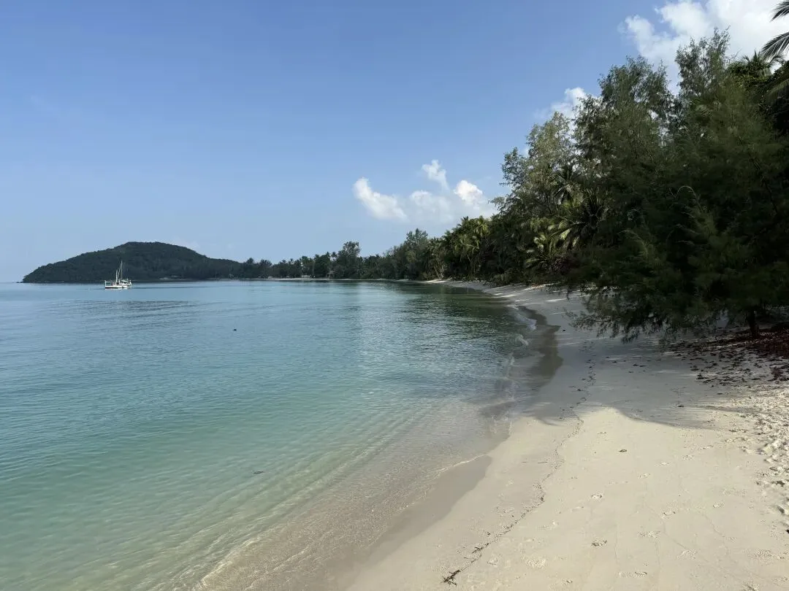

## 泰国开车快，但很礼貌

泰国车是右舵，和国内不一样。泰国的道路虽然写着限速，但反正没有拍照大家都开的飞快。限速 60 的路上开 160 的比比皆是。但出乎意料的是，泰国车虽然开的飞快，但驾驶风格相当文明，只要你打转向，别人都愿意给你让道。

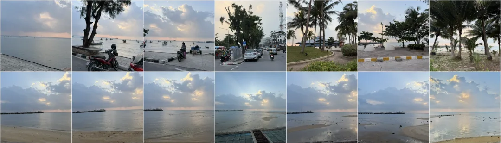

## 普吉岛：适合躺平 {#phuket}

普吉岛住攀牙湾的 COMO POINT YAMU <https://www.comohotels.com/zh/thailand/como-point-yamu> 住了三晚。很舒适

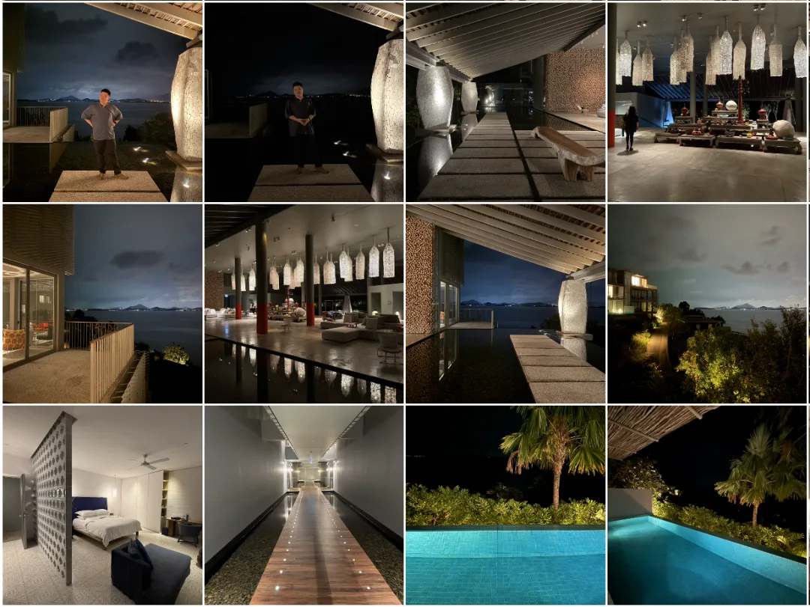

## 斯米兰很好，但人太多了 {#similan}

从普吉开车一个小时到码头，坐船跳岛斯米兰浮潜。坐船请做船头，坐船舱里躺平的朋友吐了一路，坐船头晃来晃去的俺们啥事没有。

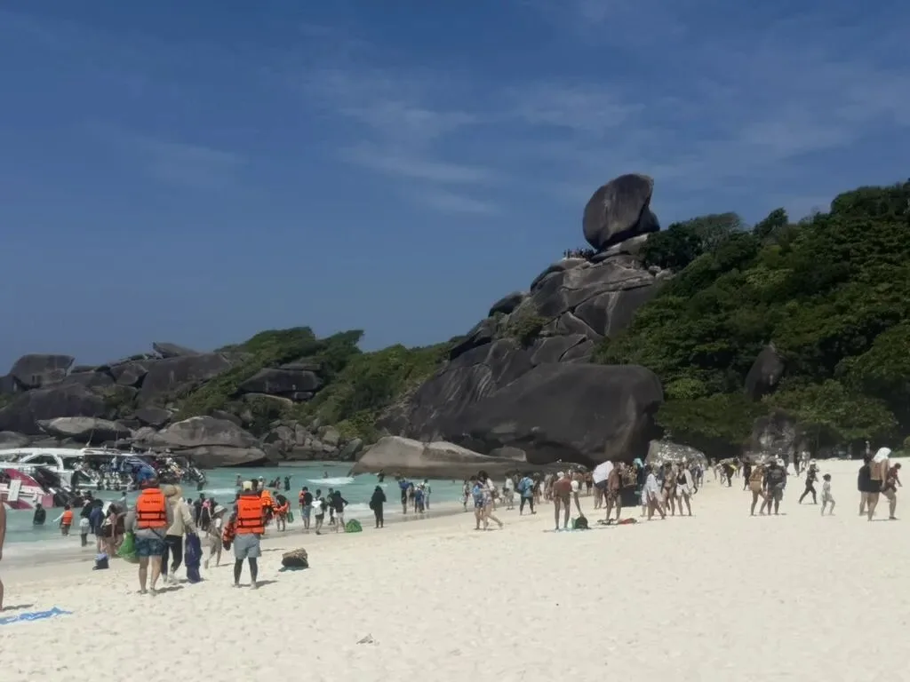

浮潜老实说比马尔代夫差不少意思，但运气不错，看到只大海龟。

[嵌入媒体](https://mp.weixin.qq.com/mp/readtemplate?t=pages/video_player_tmpl&action=mpvideo&auto=0&vid=wxv_3850435544328863745)

这岛不错，但人太多了，人一多就不好玩了。而且从岛上回来，整个人都黑了一圈。

## 苏梅岛：在此过年 {#samui}

普吉完事后去苏梅过年，在这儿弄了个山景海景大别墅，待了几天。每天在打王者，打 PS5，打台球，打扑克，打麻将，看电影，游泳泡水中循环度过。

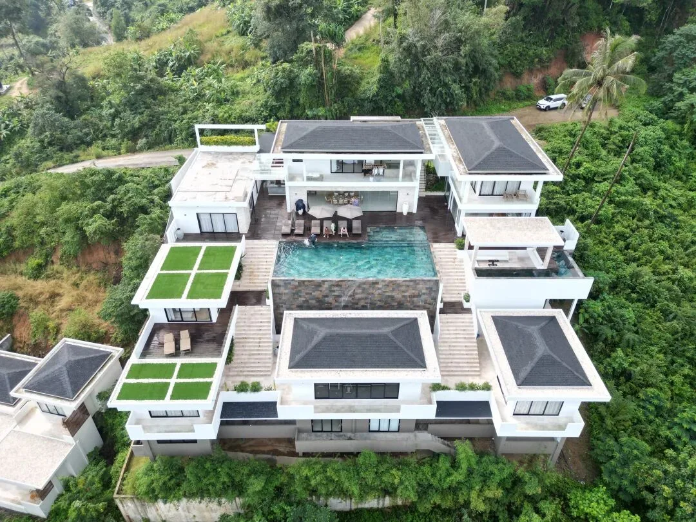

总共有五间卧室，塞进十个人不成问题，还有客厅，电影厅，娱乐厅，健身房，还配有司机，管家，大厨管三餐（还能兼职乐师），能俯瞰海景，景色一流。虽然每天 1 万¥不算便宜，但七个人一起住人均下来其实还好。

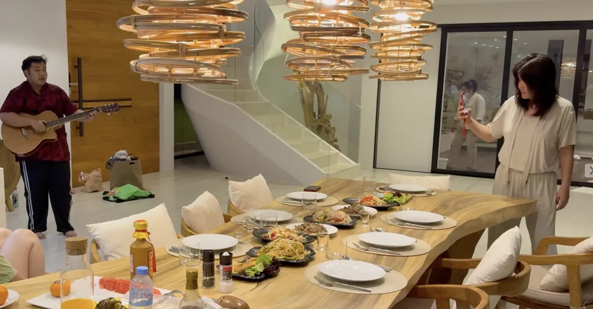

苏梅岛太棒了，等俺退休了，也想在这弄个这样的房子养老。

## 清迈的咖啡馆：很有格调 {#chiangmai}

在清迈继续躺平，和朋友打麻将打牌打枪，逛商场夜间动物园，剩下的也就是逛逛咖啡厅了。清迈咖啡厅很多，而且弄的都非常精致。

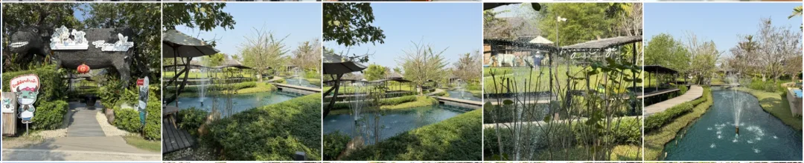

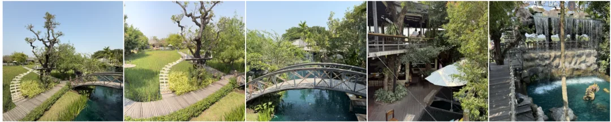

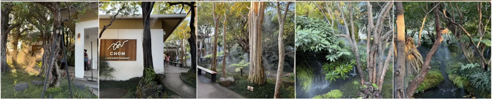

总的来说，是个有趣的地方。邓丽君《小城故事多》说的就是这里。总的来说，如果说苏梅普吉是“三亚”，那么清迈就算是海口，住着非常舒服。

## 翻车点 {#mishaps}

当然，在泰国旅游也踩过雷。首先是普吉飞 清迈的亚行托运行李给我摔开了，还好没丢东西，赔了 600 株。然后在曼谷定了个机场酒店踩雷了，跟图片差太远了，差评投诉了。曼谷整体观感一般，也堵车，感觉没清迈好。

别的嘛，我都想不到这两周还有啥其他不顺心的事了。

## 结语

总的来说，泰国是一个非常不错的旅游目的地，高品质的服务，低廉的价格，便捷的交通，自由的网络。到处都是世界各地的游客与数字游民。老实说我都心动了 —— 要不要来泰国当个数字游牧民或者来这里定居养老呢？

至于什么嘎腰子电诈拐卖的，我觉得那都是在吓唬自己，说到底，还是要眼见为实。而且就算真的有什么风险，应该做的也是认识风险并规避风险，而不是躲在家里哪也不敢去。起码这次来泰国，我觉得，嗯，真的是很不错的地方，以后度假要是纠结去什么地方，就来这里耍耍了。

---

发布版本：[微信公众号](https://mp.weixin.qq.com/s/AnEtJWPtN-IqoyjkG5tHlw)
