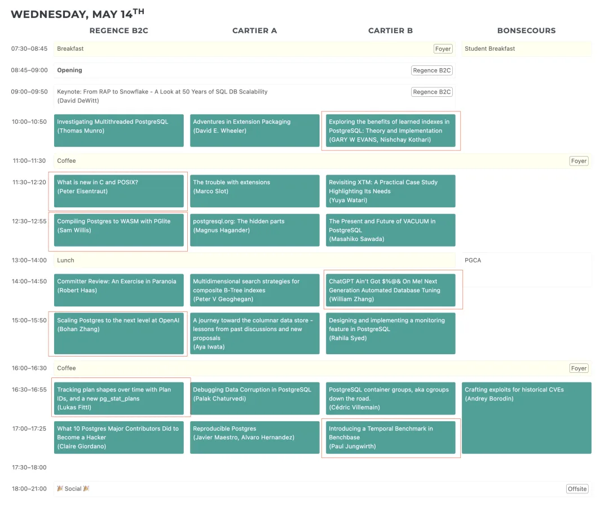
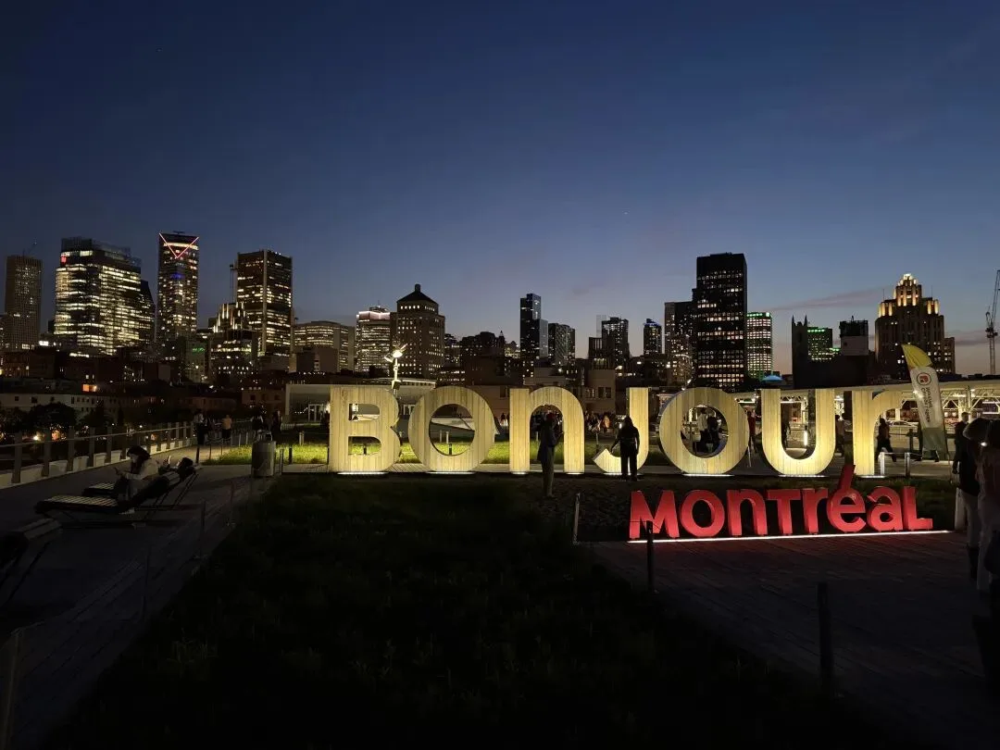
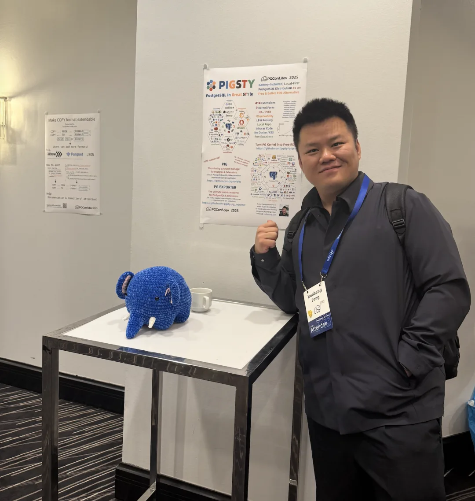
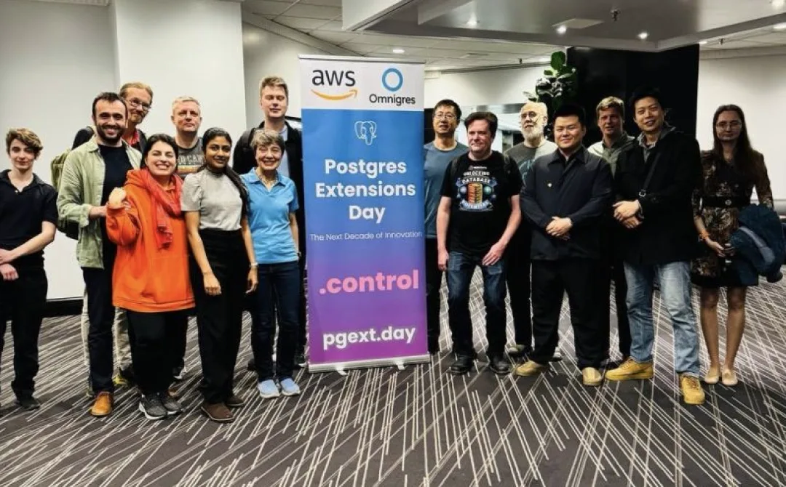

老冯这几天在蒙特利尔参加 PG 全球开发者大会，并在 PG 扩展日上进行了题为《PG 生态中缺失的扩展仓库与包管理器》的演讲。老实说，这两天每天忙的要死，回到酒店倒头就睡，实在是没啥功夫写文章了。

## 蒙特利尔照片地图 {#photo-map}

下面这张交互地图标出此次赴蒙特利尔参加 PGConf.dev 2025 与 PG 扩展日活动的 4 处市中心及老港地标与实拍留影（结合 Mac 照片库原始 EXIF GPS 与 OpenStreetMap 公开地标 WGS 84 坐标整理）；点击任意标记或下方图例可预览现场照片并跳转至对应随笔段落。

```map {caption="PGConf.dev 2025 蒙特利尔会场、官方社交夜与老城老港地标（Plaza Centre-Ville · Time Out Market · 蒙特利尔老城 · 老港大码头）" height="460px"}
- name: Plaza Centre-Ville · PG 扩展日与主会场
  lat: 45.5005
  lng: -73.5618
  text: 位于 777 Blvd Robert-Bourassa 的 PGConf.dev 2025 与 PG 扩展日会场（照片库 105 张市区实拍集中于此）；完成扩展仓库与包管理器主题演讲，Pigsty 海报与蓝色大象玩偶上墙亮相并留下扩展日合影。
  image: 07.webp
  link: "#montreal-photos"
- name: Time Out Market · 5/14 大会社交夜
  lat: 45.5028
  lng: -73.5715
  text: 位于市中心伊顿中心（705 Rue Sainte-Catherine O）的大会 5/14 晚间 Offsite Social 场地；主议程首日高强度听会之后，与全球 PG 开发者在此聚餐叙旧、交换社区一手动态。
  link: "#schedule"
- name: 蒙特利尔老城 · 圣母大教堂与法语区
  lat: 45.5044
  lng: -73.5561
  text: 会场与老港之间的法语区历史核心，兵器广场旁的圣母大教堂双塔与欧式石砌街区尽显浓郁欧洲范儿，亦映入老港夜拍天际线右侧。
  link: "#montreal-photos"
- name: 老港大码头 · Bonjour Montréal 夜景
  lat: 45.5022
  lng: -73.5529
  text: "圣劳伦斯河畔老港大码头屋顶平台（Grand Quai / Promenade d'Iberville），夜色中亮起的巨型「Bonjour MONTRÉAL」木质装置与蒙特利尔市中心天际线同框。"
  image: 05.webp
  link: "#montreal-photos"
```

## 参会随笔与 5/14 议程 {#schedule}

比如昨天那篇《[深度分析：迪奥数据泄露事件，云配置失当的锅？](/cloud/dior-leak/)》 其实是个不错的题材，但是老冯没什么时间加工，就偷懒儿直接把 GPT 输出丢上去了。评论区有读者朋友批评，AI 写的就不是那个味儿了。朋友们批评的对，老冯以后还是尽可能不偷懒了，哈哈，还是手写比较顺畅，看着也舒服。


关于扩展日的分享内容，我会在后面有空的时候以文章的时候发布出来，目前在 Youtub 上也有直播回放可以看：<https://www.youtube.com/live/cucQOOAahNY> （空降 4:50:20 即可），我在视频号也发了个自己手机录的版本，如下：

今天 5/14，PG 开发者大会的主议程第一天，今天的内容都很硬，Schedule 如下所示，不少内容我都比较期待，有几场精彩的内容重叠了，只能割爱一些有趣的演讲。要是等回放的话，那可就不知道要几个月后了。当然，参加大会最有趣的部分始终还是认识新朋友，以及交换小道消息，哈哈。



最近，《ITPUB》搞了个 IT 新媒体影响力年度评选，这都什么年代了竟然还是拉票，老冯确实也没啥功夫折腾这些。不过如果各位读者朋友有空，也欢迎帮老冯投一票哈（搜“冯”就是了）<https://zt.itpub.net/topic/peanit/> 你们的鼓舞是老冯持续创作的动力源泉，先在这里谢过各位了哈哈。


## 蒙特利尔夜色与会场留影 {#montreal-photos}

最后是一些在蒙特利尔拍的照片，不愧是法语区，欧洲范儿。



哈哈，好的各位朋友，老冯先走一步，参会去也～。



Pigsty 硬广上墙，哈哈，被贴到最显眼的位置去了。顺便一提，这个大象玩偶非常受欢迎，哈哈。



扩展日合影


---

发布版本：[微信公众号](https://mp.weixin.qq.com/s/NVQRbZsn_5C7tIdGEHw7jA)
