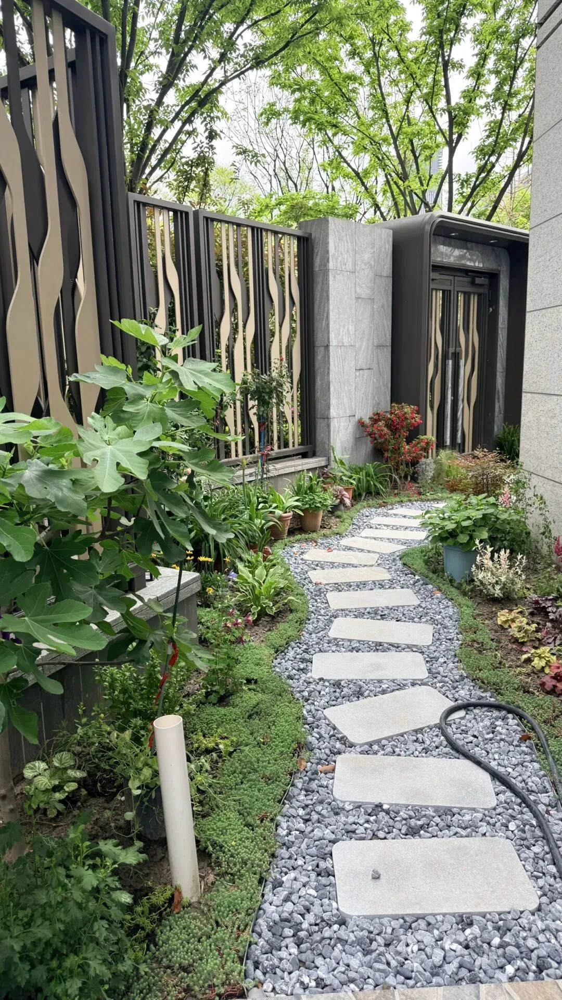
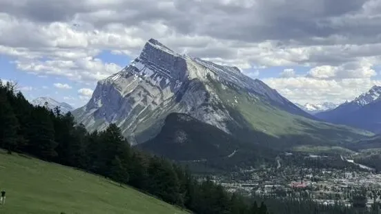

I haven't posted much on my WeChat blog lately because I was in Canada. My wife and I just spent a week in Banff and Jasper National Parks, and in the meantime I slacked off by running backlog pieces from *[Cyber Dharma](/en/ai/cyber-dharma/)*.

I finally flew home today. After a full day in the air—leaving Calgary in the morning and touching down in Shanghai at night—there really is no place like home. The downside is dealing with jet lag all over again: crashing as soon as I get back, only to wake up wide-eyed in the middle of the night.

My wife and I spent 23 days in Canada on this trip. We flew out on May 12 and split our time across a week in Montreal, a week in Vancouver, a week in Banff and Jasper, and two days in Calgary. We got a lot done there, though plenty of work piled up back home while we were away. The next stretch is going to be busy.

Plenty of interesting topics worth writing about came up during the trip, but inspiration is fleeting—if you don't write an idea down when it strikes, the spark is gone by the time you circle back to it. Once I clear the backlog on my desk, I'll get back to daily posts.

Here are a few photos and clips from the last couple of days.

## Bears in Banff

The biggest thrill was spotting wild bears along a mountain road just outside the town of Banff—specifically the most dangerous kind, a mother bear with three cubs. I saw three people pulled over taking photos by the roadside, got out to see what the fuss was about, and realized it was a family of bears. They were completely unbothered, grazing on grass, scratching an itch, and climbing trees.

Looking back, it was actually pretty dicey. The bears were only 30 to 40 meters away—one charge and she would have been right on top of us. Before long, though, more and more people pulled over until a dozen cars were parked along the shoulder. With a crowd that size, nobody felt too nervous anymore.

I left my car door open as a contingency plan so I could duck inside at a moment's notice if the bear charged. That plan did end up getting used, just not the way I expected: the bear never charged us, but the police showed up to clear the road and shoo everyone away. I darted back into the car and took off.

## Boating on Lake Minnewanka

Just outside the town of Banff sits the famous Lake Minnewanka. The day we visited, the wind and waves were a bit rough and it was raining, so canoes were off-limits and only motorboats were available. A motorboat was fine by me—I had never driven one before. Turns out it's dead simple; after a couple of passes, I had the hang of it.

## Canoeing on Emerald Lake in Yoho

Cruising around in a motorboat felt like it was missing something, so we went over to Emerald Lake in Yoho National Park to paddle a canoe properly. Doing a full lap around the lake took an hour, and it was a real workout.

## Calgary's Frame of Mind

We explored quite a few spots in Calgary—Chinatown, the Chinese Cultural Centre, Studio Bell, and the Central Library—but nothing left a stronger impression than the Pedal Pubs rolling down the street: giant bar-carts powered by passengers pedaling together.

I have no idea what state of mind it takes to invent something this ridiculous. It feels straight out of a Canadian "Handcraft Geng" workshop (China's viral inventor of gloriously useless contraptions). I couldn't stop laughing when I saw one go by.

## No Place Like Home

We had just leased a new apartment in early May and ended up living in it for only a few days the entire month, which felt like a bit of a waste. When we left, Shanghai was at its most pleasant, with cool spring breezes; by the time we got back, it had turned into muggy June weather. Time to take a few days and rest up properly.

Just a quick catch-up for now. Once I have some breathing room in a few days, I'll write more about PGConf, what I saw in Canada, and my thoughts on the trip.

---

Published on: [WeChat Official Account](https://mp.weixin.qq.com/s/tdRUPT8H0Ul_ZqbZLv85Bg)
