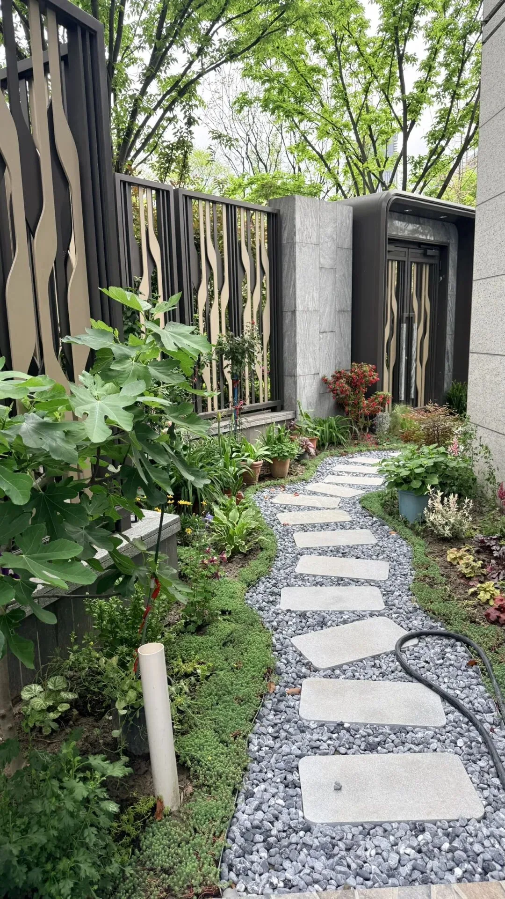
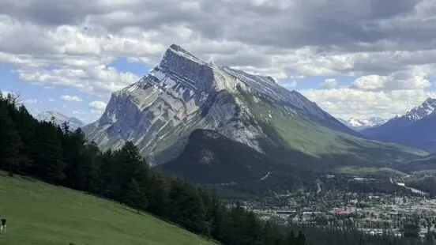

最近没怎么写公众号，因为人在加拿大，最近和老婆去班夫/贾斯帕国家公园玩了一周，间歇性偷懒发点之前《[赛博经藏](/ai/cyber-dharma/)》的存货。

今天终于回国了，飞了一整天，早上还在卡尔加里，晚上就落地上海了，真是哪儿都没有家舒服啊。悲催的是又要重新倒时差了，下回回来倒头就睡，然后大半夜又精神抖擞了。

这次和老婆去加拿大待了 23 天，5 月 12 号出发，蒙特利尔一周，温哥华一周，班夫贾斯帕一周，卡尔加里两天。办了很多事，也有很多事情堆积了下来。估计要开始忙一阵子了。

其实这段期间有不少有趣的主题都值得一写，但灵感就是这样，有时候出现的时候不写，错过再写就没感觉了。等手头积压的事情告一段落后，老冯会重新恢复日更。

放点这两天的照片视频吧。

## 加拿大之行照片地图 {#photo-map}

下面这两张交互地图基于 Mac 照片库原始 EXIF GPS（WGS 84）坐标整理，分别呈现班夫与优鹤国家公园的收官实拍路线，以及 23 天横跨加拿大的完整行程；点击任意编号标记或下方图例可预览照片并跳转至对应段落。

```map {tab="班夫与优鹤亮点" group="canada-return" value="parks" caption="班夫与优鹤国家公园实拍路线（佩托湖 → 露易丝湖 → 班夫诺奎山道 → 明尼旺卡湖 → 城堡山路口 → 优鹤翡翠湖）" route=true height="460px"}
- name: 佩托湖观景台（2121m）
  lat: 51.7175
  lng: -116.5070
  text: 5 月 28 日从贾斯帕沿冰原大道南下进入班夫的首座标志性冰川湖。
- name: 露易丝湖（1741m）
  lat: 51.4163
  lng: -116.2165
  text: 傍晚经停露易丝湖畔，随后南下前往班夫小镇落脚。
- name: 班夫诺奎山道（1508m）
  lat: 51.1928
  lng: -115.5843
  text: 俯瞰伦德尔峰与班夫小镇的山道观景点；在小镇旁山路偶遇带着三只幼崽的野熊一家。
  image: 02.webp
  link: "#banff-bears"
- name: 明尼旺卡湖（1510m）
  lat: 51.2360
  lng: -115.4883
  text: 班夫小镇东北侧大湖；当天风浪较大又下着雨，禁划独木舟，索性租了艘摩托艇游湖。
  link: "#lake-minnewanka"
- name: 城堡山路口（1438m）
  lat: 51.2693
  lng: -115.9191
  text: 5 月 30 日沿弓谷大道向西穿行班夫腹地，经城堡山脚下驶往优鹤国家公园。
- name: 优鹤翡翠湖（1302m）
  lat: 51.4408
  lng: -116.5363
  text: 补上人力划船的心愿，租独木舟用一小时绕着整座翡翠湖划完一圈，挺累但过瘾。
  link: "#emerald-lake"
```

```map {tab="加拿大 23 天行程" value="canada" caption="23 天加拿大行程总览：蒙特利尔（1 周）→ 温哥华（1 周）→ 贾斯帕与落基山（1 周）→ 卡尔加里（2 天，随后飞返上海）" route=true height="460px"}
- name: 蒙特利尔旧城（第一周）
  lat: 45.5064
  lng: -73.5531
  text: 5 月 12 日启程赴加，在蒙特利尔停留一周，拉开 23 天行程的序幕。
- name: 温哥华市中心（第二周）
  lat: 49.2846
  lng: -123.1112
  text: 飞赴西海岸在温哥华停留一周，参加 PGConf 并在市中心与海滨周边游览。
- name: 贾斯帕与落基山（第三周）
  lat: 52.8763
  lng: -118.0797
  text: 自贾斯帕沿冰原大道南下，花一周串联哥伦比亚冰原、佩托湖、班夫与优鹤国家公园。
  link: "#banff-bears"
- name: 卡尔加里市中心（收官两天）
  lat: 51.0465
  lng: -114.0571
  text: 逛唐人街、中华文化中心、Studio Bell 与中央图书馆，目击街头脚踏车酒吧，次晨直飞上海归家。
  link: "#calgary"
```

## 班夫的熊 {#banff-bears}

最刺激的是在 Banff 小镇边上的山路旁看到了野熊，还是那种最危险的带着三个幼崽的熊妈妈。我是在路边看到有三个人停车在拍照，下来凑热闹一看竟然是熊。相当悠闲，吃草挠痒爬树。

后来想想还是有点危险，这熊距离我们也就三四十米的样子，一个冲锋就倒眼前了。不过好在后面人越来越多，十几辆车停在那里，围观的人也越来越多，人多势众也就不怕了。

我把车门开着，确保熊万一冲过来，过来可以随时溜进车里，结果这个预案以一种我没想到的方式用上了：熊没冲过来，警察倒是冲过来开路赶人了。我一溜烟冲进车里溜走了。

## 明尼旺卡湖划船 {#lake-minnewanka}

Banff 镇边上有一个很有名的湖，不过当天风浪略大而且下雨，不让划独木舟，只有摩托艇。摩托艇就摩托艇吧，我还从来没开过呢。不过也很简单，弄两趟就会了。

## 优鹤翡翠湖泛舟 {#emerald-lake}

单纯摩托艇游湖感觉差点意思，所以我们又在优鹤的翡翠湖上划人力独木舟。一个小时绕着整个湖转了一圈，还是挺累的。

## 卡尔加里的精神状态 {#calgary}

在卡尔加里逛了不少地方，唐人街，中华文化中心，Studio Bell，图书馆，但给我留下最深刻印象的，莫过于街上形势的 Pedal Pub，脚踏车酒吧。

不知道是什么样的精神状态才能发明出这么离谱的东西，简直是加拿大手工耿。看见笑的不行不行的。

## 哪儿都没有家里舒服

五月初刚租了新房子，结果一个月就住了几天，怪可惜的。走的时候上海还是凉风习习最舒服的状态，回来的时候就变成湿热六月天了。这次要好好休息几天。



随便聊聊，过几天有空聊聊 PGConf 和加拿大的见闻，以及这次旅游的感想。



---

发布版本：[微信公众号](https://mp.weixin.qq.com/s/tdRUPT8H0Ul_ZqbZLv85Bg)
