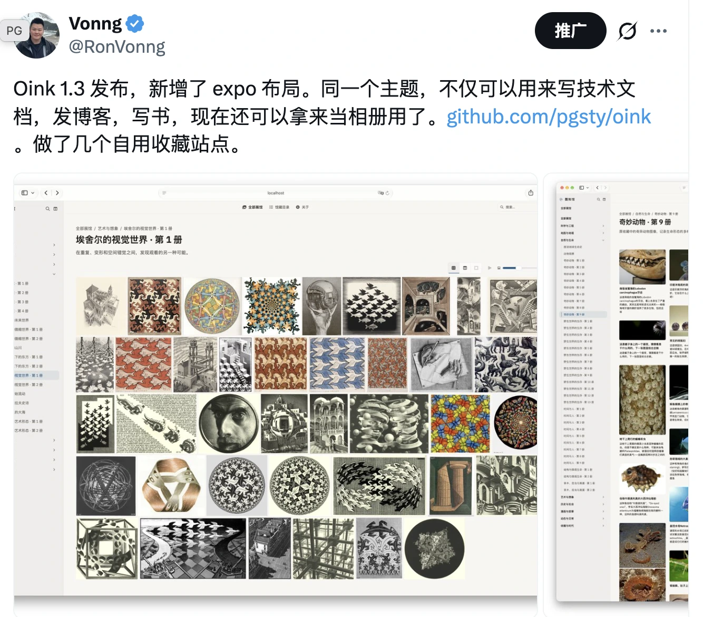
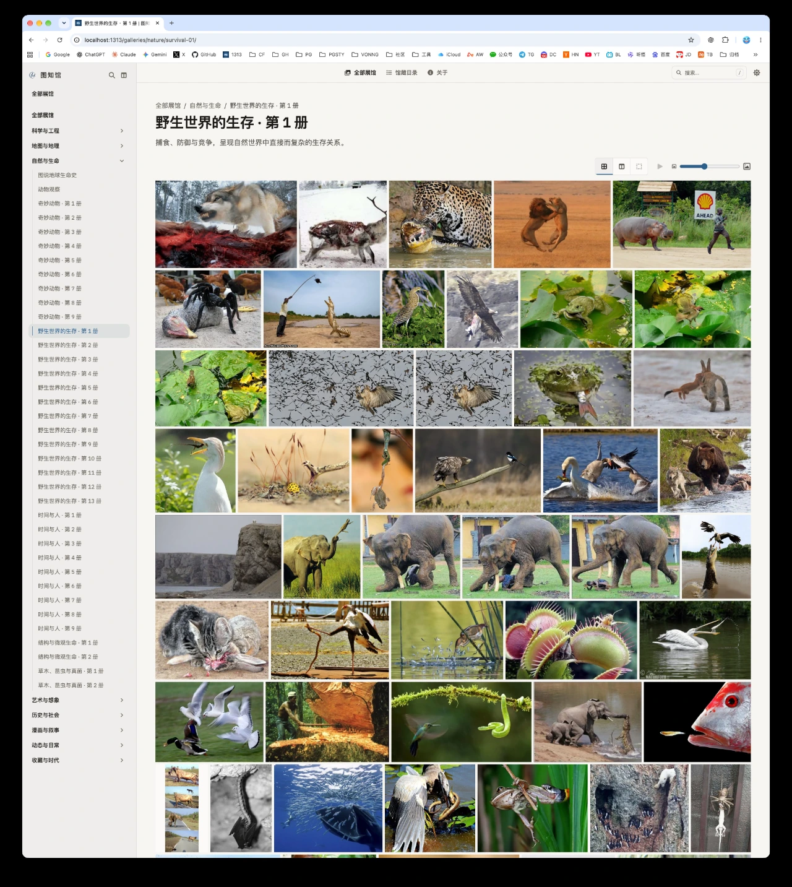
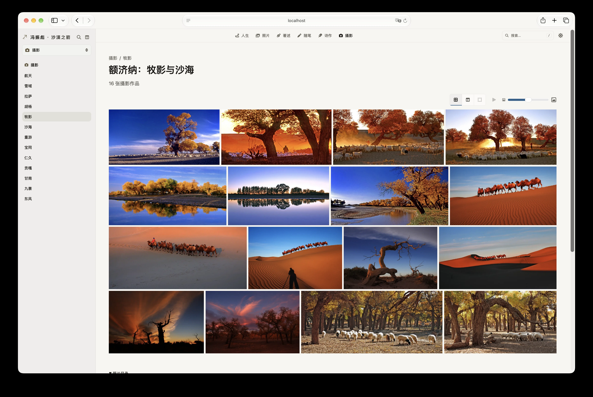
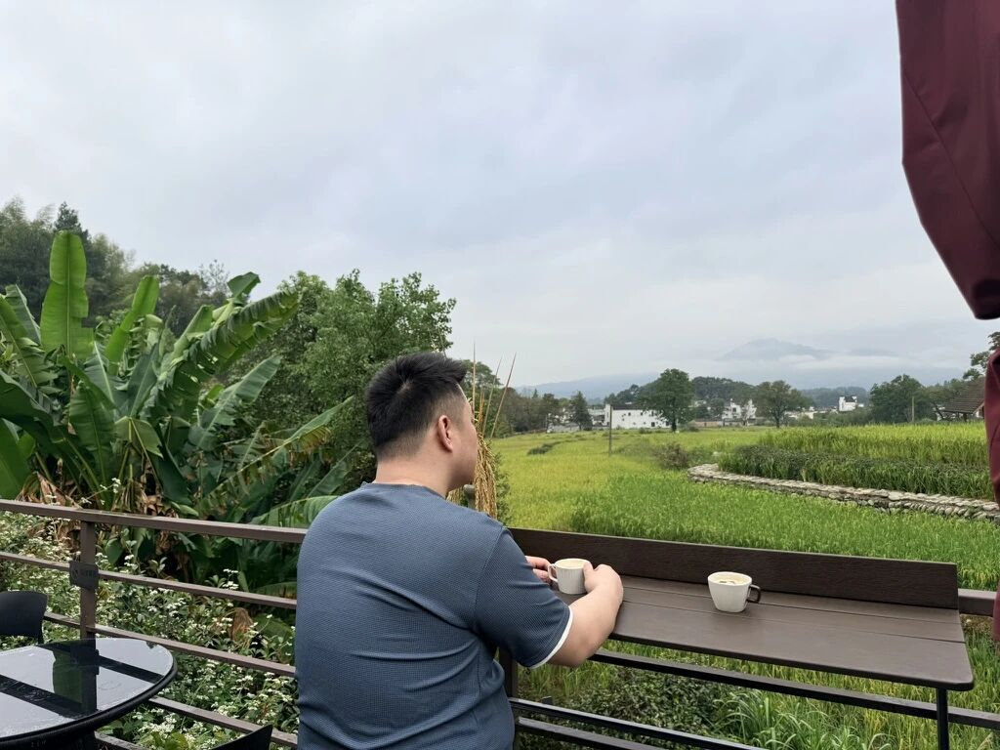
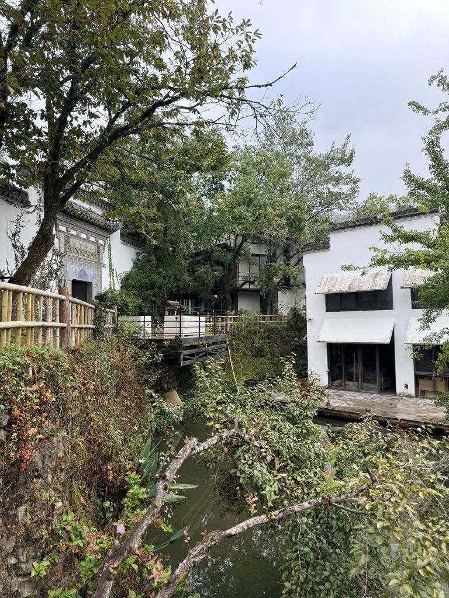
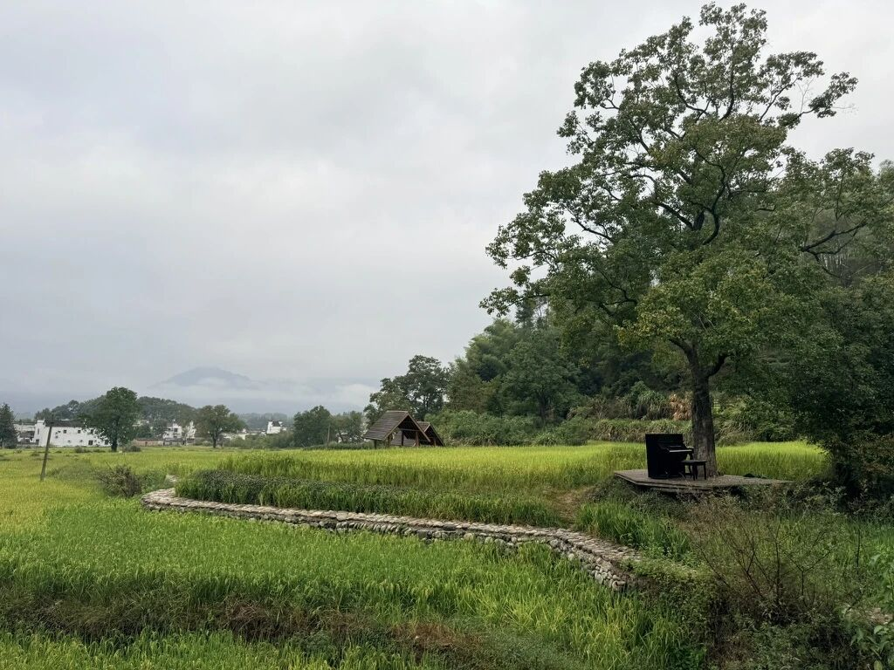
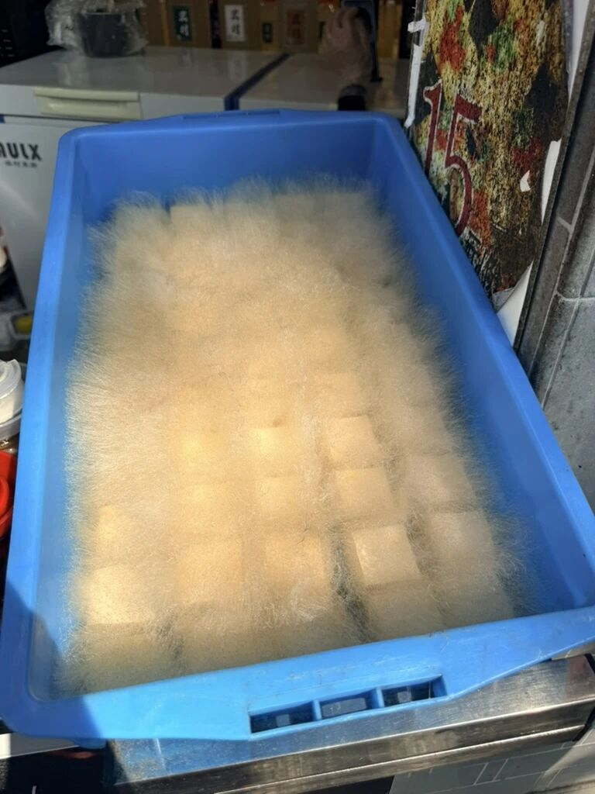
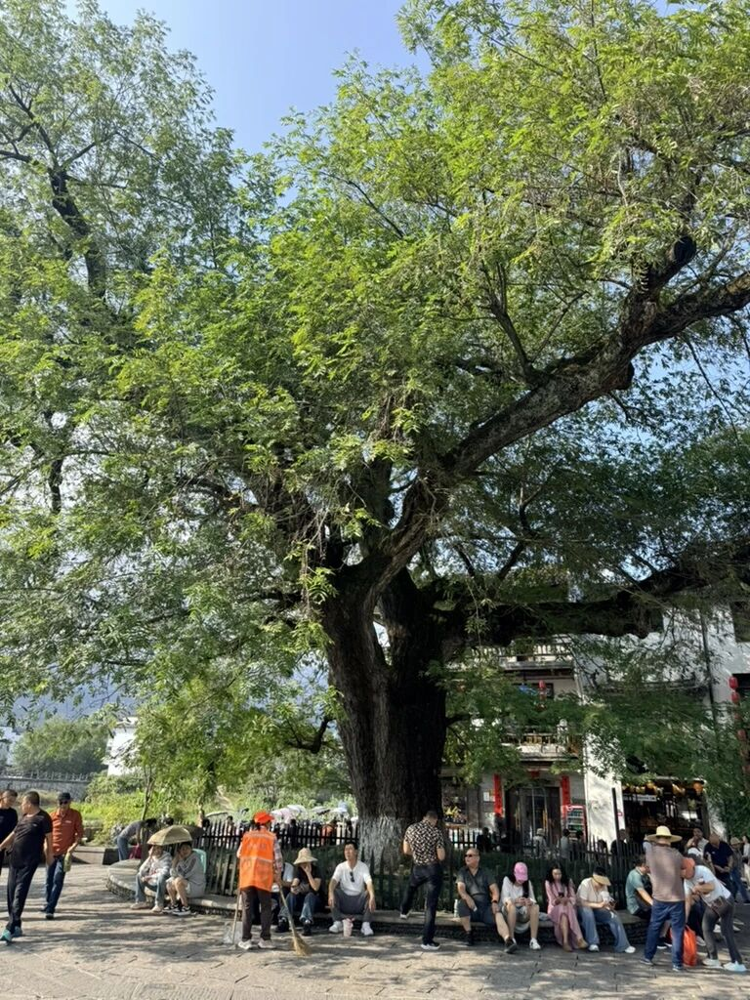
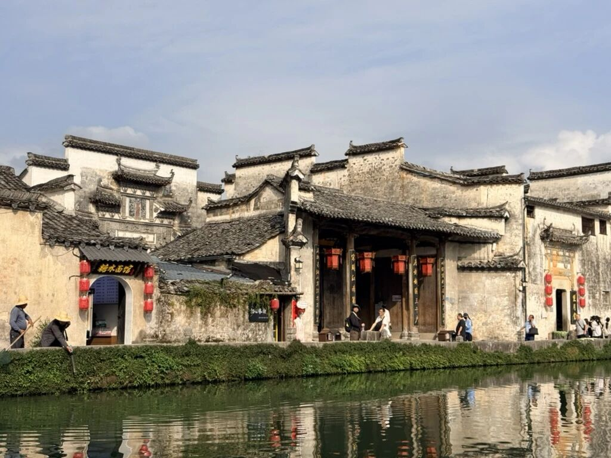
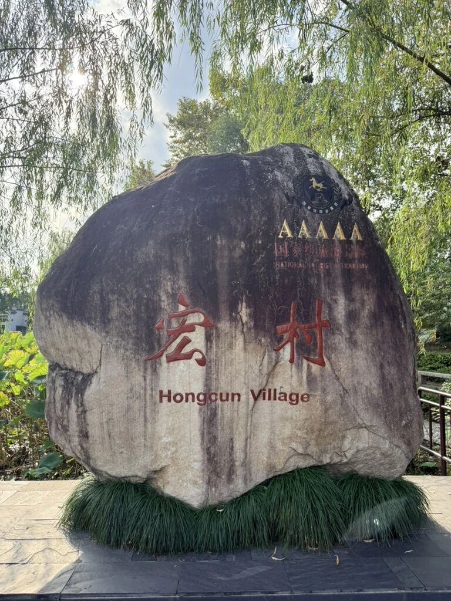

这两天老冯开车从上海一路干到了杭州、黄山，今天早上在宏村，晚上住在黄山山脚下，花两天时间和家人一起出来转转，忙里偷个闲。

要说忙，最近也确实挺忙的。手头有一些商业合同需要续签，十一月还有三场演讲得准备 PPT（一场在清华，一场中国企业 AI 大会，还有一个 PGConf.Asia）；再加上下个月 PostgreSQL 19 正式发布有不少适配工作要做，以及 AI Coding 新拉出来的许多条战线，确实得耗费不少精力。

不过好在现在有 AI 打配合，哪怕人在路上，电脑在手，蹬车也不能停。家里这几条开源产品线的发版节奏也没落下。这几天就顺手推了两个项目的更新：

## Silo `20261018` 月度安全版本

老冯接盘维护的开源对象存储 **[Silo](/db/long-live-silo/)**（MinIO 社区分支），昨天刚刚发布了 `20261018` 月度版本，重点做了一波安全加固与组件同步：

- **核心安全修复**：发布了十月安全更新，重点修复了 **Object Lock（对象锁定）**、**管理凭据（Admin Credentials）** 以及 **JWK 解析** 相关的安全问题。对于拿对象存储做数据库备份（比如防勒索、防误删的不可变备份）和合规归档的场景来说，把这些底层权限与锁机制的窟窿堵上是刚需。

- **全套制品同步**：配套的客户端工具 `mcli 20261018`、完整版 Web 管理控制台 `Console v2.4.2`、以及基础库 `silo-pkg 3.14.3` 也都已经同步构建就绪。另外，应用户的需求，这次 `KES` 密钥管理组件也正式加入了构建分发管道中。

- **开箱即用**：照旧提供全套预编译二进制、多架构容器镜像（含 Distroless 变体）以及 RPM / DEB / APK 原生软件包，保持与既有 `MINIO_*` 环境变量、S3 API 和底层数据卷的无缝兼容，直接替换镜像或包就能平滑升级。

项目主页与更新日志：[Silo](https://silo.pgsty.com/)

## Oink `v1.3`：新增 Expo 相册画廊

除了底层的存储组件，承载我们整个文档矩阵的本地优先 Hugo 主题框架 **[Oink](/ai/oink-intro/)**，这几天也迭代到了 `v1.3`（最新小版本已到 `v1.3.2`）。这次最核心的更新，是在原有的文档（Docs）、博客（Blog）和书籍（Book）三大件之外，新增了原生的 **Expo 相册画廊** 支持：

- **目录即相册，拒绝繁琐配置**：秉承工程优先的思路，一个 Hugo 叶子页面包（一个 `index.md` 加上同目录的一堆图片）就是一册相册。把图片往目录里一丢就能自动渲染，不需要给每张图单独建页面或者手写一堆繁琐的 YAML。

- **三种视图与原图查看器**：内置了 **展墙（Wall）**、**卡片（Cards）**、**无缝（Seamless）** 三种排版布局，并且会自动记住读者的视图偏好。配套的原图查看器支持无级缩放、拖拽查看细节、GIF 播放控制，以及全套键盘快捷键（`Q`/`E` 或方向键切图、`K`/`J` 缩放、`F` 展开等）和触屏手势。

- **细节与工程打磨**：同步将构建基线升级到了 `Hugo Extended 0.166.0` 与 `Go 1.27`，顺手修了一批侧边栏导航作用域、Draw.io 模态框焦点、Landing 页面代码块交互以及整书聚合打印（Print）的细节问题，并在我们自己维护的 36 个站点上都更新到最新版本。

正好这次出门在皖南拍了不少好看的照片，回头就能直接用 Oink 的新相册功能派上用场了。项目主页与示例演示：[Oink](https://oink.pgsty.com/)

## 宏村与塔川书院

早上住在宏村，塔川书院，非常好的一家民宿，有一片好看的稻田。

还有几只不怕人的猫，有一只长得特别像那个……

午饭吃了安徽特色臭鳜鱼和毛豆腐，经典名菜，好吃。

然后去宏村溜达了一下，老冯来了好几次黄山，这还是第一次去宏村，老实说这 5A 景区太水了……感觉非常一般吧，普通古镇，修得不错，但当个景点就纯纯多余了。还不如村子外面的自然景色和民宿呢。

晚上住在黄山脚下民宿，以前来黄山都住汤口镇，这次住在了东大门，这边新开了个东海索道和东海景区，才运营半年不到，正好来看看。

山里的空气确实不错，这两天睡得都嘎嘎香。多了也懒得写，忙里偷个闲随便聊聊。这两天先陪家人看风景去了，明天一天干上黄山再干回上海，到时候再说吧。
